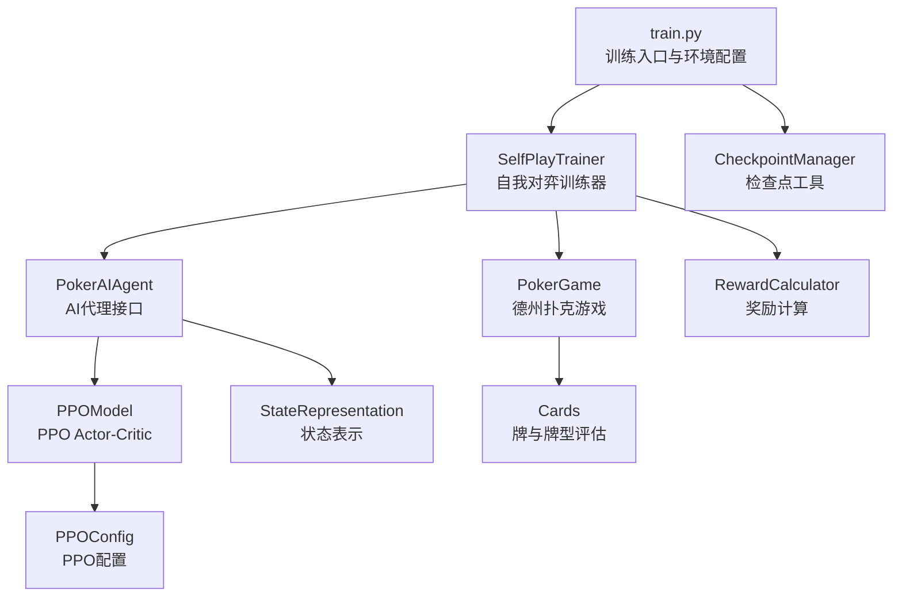
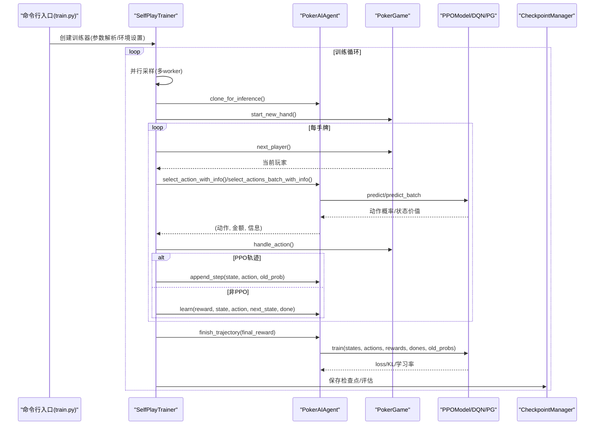
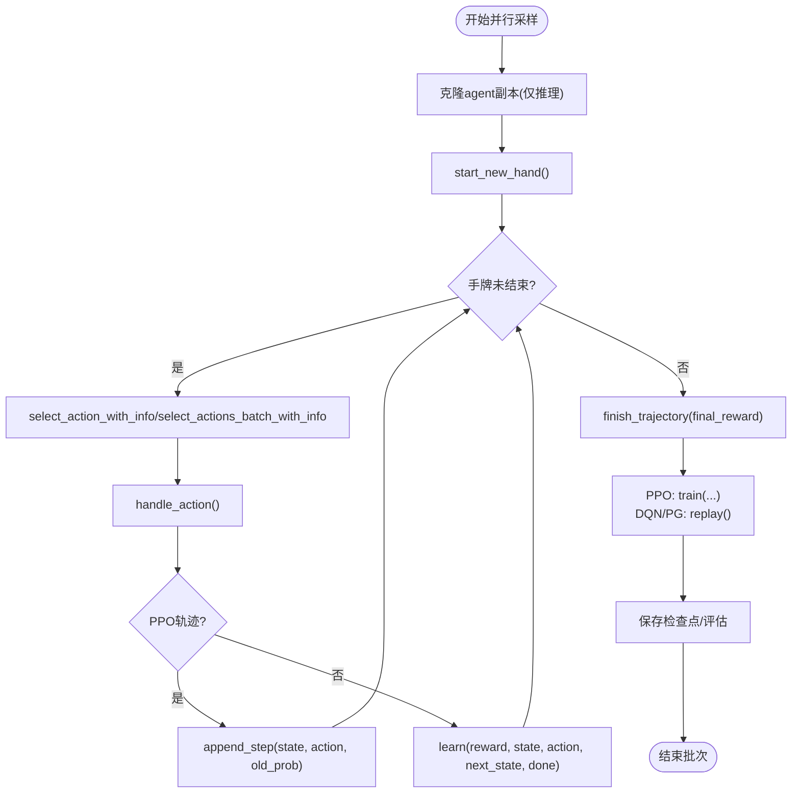
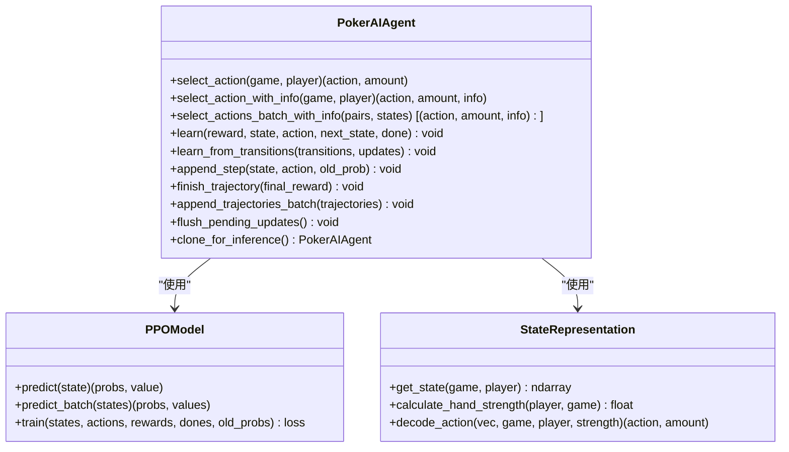
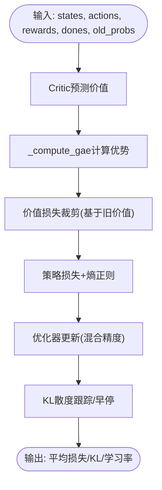
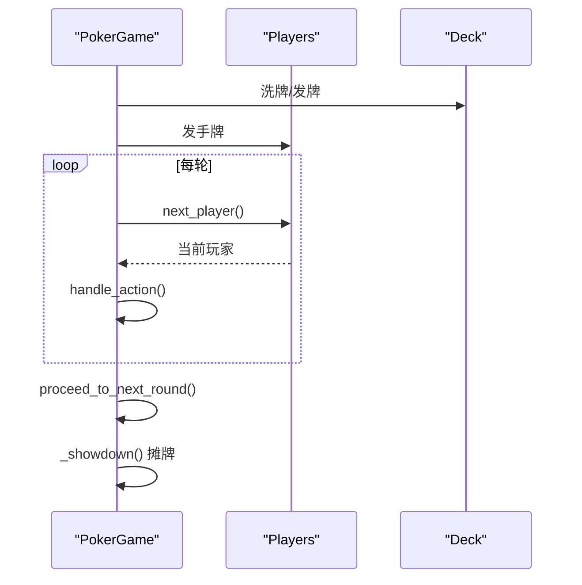
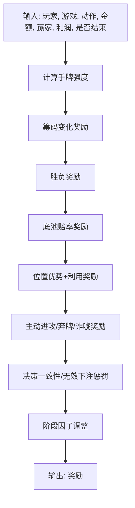
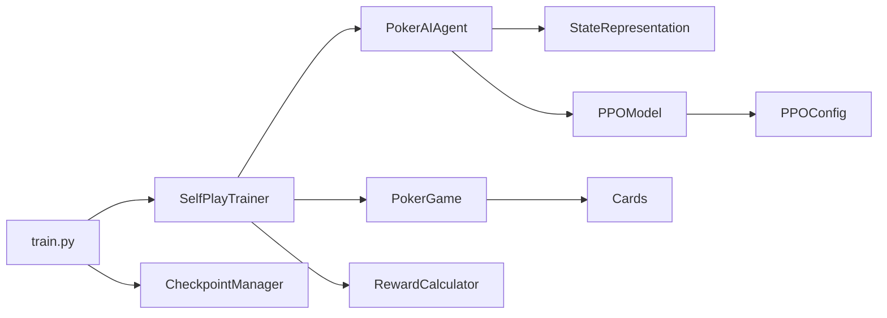

# 训练数据流

<cite>
**本文引用的文件**
- [train.py](file://train.py)
- [poker_ai/reward/self_play_trainer.py](file://poker_ai/reward/self_play_trainer.py)
- [poker_ai/model/ppo_model.py](file://poker_ai/model/ppo_model.py)
- [poker_ai/model/ai_agent.py](file://poker_ai/model/ai_agent.py)
- [poker_ai/game/poker_game.py](file://poker_ai/game/poker_game.py)
- [poker_ai/game/cards.py](file://poker_ai/game/cards.py)
- [poker_ai/reward/reward_calculator.py](file://poker_ai/reward/reward_calculator.py)
- [poker_ai/model/state_representation.py](file://poker_ai/model/state_representation.py)
- [poker_ai/utils/checkpoint.py](file://poker_ai/utils/checkpoint.py)
- [poker_ai/config/ppo_config.py](file://poker_ai/config/ppo_config.py)
- [README.md](file://README.md)
</cite>

## 目录
1. [简介](#简介)
2. [项目结构](#项目结构)
3. [核心组件](#核心组件)
4. [架构总览](#架构总览)
5. [详细组件分析](#详细组件分析)
6. [依赖关系分析](#依赖关系分析)
7. [性能考量](#性能考量)
8. [故障排查指南](#故障排查指南)
9. [结论](#结论)
10. [附录](#附录)

## 简介
本文件面向强化学习训练系统，聚焦“从并行采样到批量训练”的完整数据处理管道，涵盖自我对弈产生的训练样本、动作序列收集、奖励信号计算与传播、并行采样与数据同步策略、训练样本存储格式与批次处理策略、数据增强与质量控制、异常处理与数据完整性校验，并提供训练数据流图与处理流程图，辅以代码路径定位与性能优化建议。

## 项目结构
- 训练入口与环境配置：train.py
- 自我对弈训练器：poker_ai/reward/self_play_trainer.py
- 模型与代理：poker_ai/model/ppo_model.py、poker_ai/model/ai_agent.py
- 游戏与牌型：poker_ai/game/poker_game.py、poker_ai/game/cards.py
- 奖励计算：poker_ai/reward/reward_calculator.py
- 状态表示：poker_ai/model/state_representation.py
- 检查点工具：poker_ai/utils/checkpoint.py
- PPO配置：poker_ai/config/ppo_config.py
- 项目说明：README.md

**图表来源**
- [train.py:1-856](file://train.py#L1-L856)
- [poker_ai/reward/self_play_trainer.py:1-1604](file://poker_ai/reward/self_play_trainer.py#L1-L1604)
- [poker_ai/model/ai_agent.py:1-703](file://poker_ai/model/ai_agent.py#L1-L703)
- [poker_ai/model/ppo_model.py:1-670](file://poker_ai/model/ppo_model.py#L1-L670)
- [poker_ai/model/state_representation.py:1-247](file://poker_ai/model/state_representation.py#L1-L247)
- [poker_ai/game/poker_game.py:1-497](file://poker_ai/game/poker_game.py#L1-L497)
- [poker_ai/game/cards.py:1-202](file://poker_ai/game/cards.py#L1-L202)
- [poker_ai/reward/reward_calculator.py:1-587](file://poker_ai/reward/reward_calculator.py#L1-L587)
- [poker_ai/utils/checkpoint.py:1-139](file://poker_ai/utils/checkpoint.py#L1-L139)
- [poker_ai/config/ppo_config.py:1-97](file://poker_ai/config/ppo_config.py#L1-L97)

**章节来源**
- [README.md:1-227](file://README.md#L1-L227)

## 核心组件
- 训练入口与环境配置：负责解析参数、自动推断并行度、设置TensorFlow线程与设备、自动调参、创建训练器并驱动训练/评估/演示。
- 自我对弈训练器：封装并行采样、轨迹收集、奖励计算、对手更新、检查点与评估周期控制。
- AI代理接口：统一封装DQN/PPO/PG等模型，提供动作选择、轨迹记录、批量动作选择、学习接口。
- PPO模型：Actor-Critic网络、GAE优势估计、价值损失裁剪、KL早停、自适应熵系数、学习率调度、混合精度与XLA优化。
- 游戏与牌型：6人桌德州扑克规则、发牌、下注、摊牌、胜负判定、牌型评估。
- 奖励计算：综合筹码变化、手牌强度、底池赔率、位置优势、及时弃牌、成功诈唬、决策一致性、无效下注惩罚等。
- 状态表示：134维状态向量（手牌、公共牌、玩家信息、全局信息、位置、活跃人数）。
- 检查点工具：权重/模型/元数据保存与加载。
- PPO配置：集中管理PPO超参数与默认配置。

**章节来源**
- [train.py:136-531](file://train.py#L136-L531)
- [poker_ai/reward/self_play_trainer.py:48-800](file://poker_ai/reward/self_play_trainer.py#L48-L800)
- [poker_ai/model/ai_agent.py:55-703](file://poker_ai/model/ai_agent.py#L55-L703)
- [poker_ai/model/ppo_model.py:20-670](file://poker_ai/model/ppo_model.py#L20-L670)
- [poker_ai/game/poker_game.py:155-497](file://poker_ai/game/poker_game.py#L155-L497)
- [poker_ai/reward/reward_calculator.py:9-587](file://poker_ai/reward/reward_calculator.py#L9-L587)
- [poker_ai/model/state_representation.py:9-247](file://poker_ai/model/state_representation.py#L9-L247)
- [poker_ai/utils/checkpoint.py:17-139](file://poker_ai/utils/checkpoint.py#L17-L139)
- [poker_ai/config/ppo_config.py:18-97](file://poker_ai/config/ppo_config.py#L18-L97)

## 架构总览
训练数据流从“并行采样”开始，经“轨迹收集与奖励计算”，再到“批量训练”。PPO采用轨迹级学习，通过GAE计算优势，使用裁剪与早停机制稳定训练；DQN采用经验回放与目标网络；PG使用回合奖励。

**图表来源**
- [train.py:340-531](file://train.py#L340-L531)
- [poker_ai/reward/self_play_trainer.py:48-800](file://poker_ai/reward/self_play_trainer.py#L48-L800)
- [poker_ai/model/ai_agent.py:117-420](file://poker_ai/model/ai_agent.py#L117-L420)
- [poker_ai/model/ppo_model.py:497-638](file://poker_ai/model/ppo_model.py#L497-L638)
- [poker_ai/utils/checkpoint.py:17-139](file://poker_ai/utils/checkpoint.py#L17-L139)

## 详细组件分析

### 自我对弈训练器（SelfPlayTrainer）
- 并行采样与轨迹收集
  - 使用线程池执行多局并行采样，每worker持有独立的agent副本（clone_for_inference）以避免共享状态竞争。
  - PPO采用轨迹收集（append_step/finish_trajectory），非PPO采用learn接口。
  - _play_hands_collect_batched支持PPO批量动作选择，减少Python/TensorFlow往返开销。
- 奖励计算与传播
  - 使用RewardCalculator计算即时奖励与最终奖励，结合all-in不走运补偿与轻量反塌缩惩罚。
  - PPO轨迹中记录old_prob，用于重要性采样比率与裁剪。
- 对手更新与策略稳定性
  - 定期更新对手代理，避免策略退化。
  - all-in不走运补偿统计与阈值控制，防止过度惩罚。
- 检查点与评估
  - 按eval_interval与checkpoint_interval周期性评估与保存。

**图表来源**
- [poker_ai/reward/self_play_trainer.py:48-800](file://poker_ai/reward/self_play_trainer.py#L48-L800)
- [poker_ai/model/ai_agent.py:388-420](file://poker_ai/model/ai_agent.py#L388-L420)

**章节来源**
- [poker_ai/reward/self_play_trainer.py:48-800](file://poker_ai/reward/self_play_trainer.py#L48-L800)
- [poker_ai/model/ai_agent.py:117-420](file://poker_ai/model/ai_agent.py#L117-L420)

### AI代理接口（PokerAIAgent）
- 动作选择与合法性掩码
  - _get_legal_action_mask根据当前下注、最小加注、玩家筹码生成5维动作掩码（fold/call/raise小/raise中/all-in）。
  - PPO路径下，先预测动作概率，再应用合法掩码，确保记录的是“实际执行动作”的概率。
- 批量动作选择
  - select_actions_batch_with_info支持PPO单次前向推理多局状态，显著降低调度开销。
- 轨迹与批量训练
  - append_step/finish_trajectory用于PPO轨迹收集；append_trajectories_batch支持批量写入多条轨迹。
  - learn_from_transitions支持批量经验回放（DQN）。

**图表来源**
- [poker_ai/model/ai_agent.py:55-703](file://poker_ai/model/ai_agent.py#L55-L703)
- [poker_ai/model/ppo_model.py:20-670](file://poker_ai/model/ppo_model.py#L20-L670)
- [poker_ai/model/state_representation.py:137-247](file://poker_ai/model/state_representation.py#L137-L247)

**章节来源**
- [poker_ai/model/ai_agent.py:15-420](file://poker_ai/model/ai_agent.py#L15-L420)
- [poker_ai/model/state_representation.py:137-247](file://poker_ai/model/state_representation.py#L137-L247)

### PPO模型（PPOModel）
- 网络结构与优化
  - Actor/Critic双网络，256-256-128-64容量，LayerNorm+残差连接，PPO专用优化（价值裁剪、自适应熵、KL早停、学习率调度、混合精度、XLA）。
- GAE优势估计与价值裁剪
  - _compute_gae向量化实现，支持裁剪与标准化，提升稳定性。
  - 价值损失裁剪基于旧价值，避免过度更新。
- 训练流程
  - _ppo_update_step使用tf.function编译，混合精度LossScaleOptimizer，梯度裁剪，KL早停，自适应熵系数。
  - train按批次训练，支持padding与梯度累积。

**图表来源**
- [poker_ai/model/ppo_model.py:276-638](file://poker_ai/model/ppo_model.py#L276-L638)

**章节来源**
- [poker_ai/model/ppo_model.py:20-670](file://poker_ai/model/ppo_model.py#L20-L670)
- [poker_ai/config/ppo_config.py:18-97](file://poker_ai/config/ppo_config.py#L18-L97)

### 游戏与牌型（PokerGame/Cards）
- 游戏规则
  - 6人桌，大小盲注、翻牌前/翻牌/转牌/河牌、摊牌结算、底池分配。
  - handle_action严格校验下注合法性，支持fold/call/raise/all-in。
- 牌型评估
  - evaluate_hand与compare_hands用于牌型强度与胜负比较。
  - Cards提供卡牌编码与共享实例缓存，提升性能。

**图表来源**
- [poker_ai/game/poker_game.py:227-497](file://poker_ai/game/poker_game.py#L227-L497)
- [poker_ai/game/cards.py:53-202](file://poker_ai/game/cards.py#L53-L202)

**章节来源**
- [poker_ai/game/poker_game.py:155-497](file://poker_ai/game/poker_game.py#L155-L497)
- [poker_ai/game/cards.py:1-202](file://poker_ai/game/cards.py#L1-L202)

### 奖励计算（RewardCalculator）
- 奖励构成
  - 赢牌/输牌、筹码变化、手牌强度、底池赔率、位置优势、主动进攻、及时弃牌、成功诈唬、决策一致性、无效下注惩罚。
- 动态调整
  - AdaptiveRewardCalculator根据表现（利润/诈唬率/无效下注率）动态调整权重，保持策略平衡。

**图表来源**
- [poker_ai/reward/reward_calculator.py:303-391](file://poker_ai/reward/reward_calculator.py#L303-L391)

**章节来源**
- [poker_ai/reward/reward_calculator.py:9-587](file://poker_ai/reward/reward_calculator.py#L9-L587)

### 状态表示（StateRepresentation）
- 状态维度
  - 134维：自身手牌(52)+公共牌(52)+6人玩家信息(18)+全局信息(5)+Hero绝对位置(6)+活跃人数(1)。
- 性能优化
  - 整数编码卡牌one-hot、预计算索引映射、相对Hero位置编码，避免频繁对象构造与查找。

**章节来源**
- [poker_ai/model/state_representation.py:9-247](file://poker_ai/model/state_representation.py#L9-L247)

### 检查点工具（CheckpointManager）
- 保存：权重/模型/pickle，附带元数据（时间戳等）。
- 加载：优先权重文件，其次pickle，最后通用load方法。
- 查找最新：按元数据时间戳排序。

**章节来源**
- [poker_ai/utils/checkpoint.py:17-139](file://poker_ai/utils/checkpoint.py#L17-L139)

## 依赖关系分析
- train.py依赖SelfPlayTrainer、环境设置、自动调参、检查点工具。
- SelfPlayTrainer依赖PokerAIAgent、PokerGame、RewardCalculator、CheckpointManager。
- PokerAIAgent依赖StateRepresentation与具体模型（PPO/DQN/PG）。
- PPOModel依赖StateRepresentation、PPOConfig、TensorFlow。
- PokerGame依赖Cards。
- RewardCalculator依赖Cards与线程本地存储。

**图表来源**
- [train.py:340-531](file://train.py#L340-L531)
- [poker_ai/reward/self_play_trainer.py:48-800](file://poker_ai/reward/self_play_trainer.py#L48-L800)
- [poker_ai/model/ai_agent.py:55-703](file://poker_ai/model/ai_agent.py#L55-L703)
- [poker_ai/model/ppo_model.py:20-670](file://poker_ai/model/ppo_model.py#L20-L670)
- [poker_ai/model/state_representation.py:9-247](file://poker_ai/model/state_representation.py#L9-L247)
- [poker_ai/game/poker_game.py:155-497](file://poker_ai/game/poker_game.py#L155-L497)
- [poker_ai/game/cards.py:1-202](file://poker_ai/game/cards.py#L1-L202)
- [poker_ai/reward/reward_calculator.py:9-587](file://poker_ai/reward/reward_calculator.py#L9-L587)
- [poker_ai/utils/checkpoint.py:17-139](file://poker_ai/utils/checkpoint.py#L17-L139)
- [poker_ai/config/ppo_config.py:18-97](file://poker_ai/config/ppo_config.py#L18-L97)

**章节来源**
- [train.py:136-531](file://train.py#L136-L531)
- [poker_ai/reward/self_play_trainer.py:48-800](file://poker_ai/reward/self_play_trainer.py#L48-L800)
- [poker_ai/model/ai_agent.py:55-703](file://poker_ai/model/ai_agent.py#L55-L703)
- [poker_ai/model/ppo_model.py:20-670](file://poker_ai/model/ppo_model.py#L20-L670)
- [poker_ai/model/state_representation.py:9-247](file://poker_ai/model/state_representation.py#L9-L247)
- [poker_ai/game/poker_game.py:155-497](file://poker_ai/game/poker_game.py#L155-L497)
- [poker_ai/game/cards.py:1-202](file://poker_ai/game/cards.py#L1-L202)
- [poker_ai/reward/reward_calculator.py:9-587](file://poker_ai/reward/reward_calculator.py#L9-L587)
- [poker_ai/utils/checkpoint.py:17-139](file://poker_ai/utils/checkpoint.py#L17-L139)
- [poker_ai/config/ppo_config.py:18-97](file://poker_ai/config/ppo_config.py#L18-L97)

## 性能考量
- 并行采样与批处理
  - train_workers与eval_workers自动推断，train_workers默认使用约75%可用核心，eval_workers更激进。
  - PPO批量动作选择（select_actions_batch_with_info）与轨迹批量写入（append_trajectories_batch）显著降低Python调度开销。
- 硬件与混合精度
  - 自动设置TF线程并行度、启用XLA、混合精度，GPU显存按需增长，针对RTX4090D优化默认参数。
- 网络与训练优化
  - PPOModel使用LayerNorm+残差、价值裁剪、KL早停、自适应熵、学习率warmup+cosine衰减、梯度累积。
- 状态与动作空间
  - 134维状态向量与5维动作空间，合法动作掩码确保动作有效性，避免无效计算。

[本节为通用指导，无需具体文件引用]

## 故障排查指南
- 训练异常与错误处理
  - PPO更新时捕获DNN/Graph错误并给出提示，建议关闭XLA或禁用oneDNN重试。
  - 自动调参失败时记录hands/s并选择最优配置。
- 检查点加载
  - 支持权重文件、pickle模型、通用load三种方式；找不到文件时返回False并记录错误。
- 数据完整性
  - PPO轨迹缓冲区清空与强制刷新（flush_pending_updates）确保未训练样本不丢失。
  - all-in不走运补偿统计与阈值控制，避免过度惩罚。

**章节来源**
- [poker_ai/model/ai_agent.py:314-332](file://poker_ai/model/ai_agent.py#L314-L332)
- [train.py:408-482](file://train.py#L408-L482)
- [poker_ai/utils/checkpoint.py:58-104](file://poker_ai/utils/checkpoint.py#L58-L104)

## 结论
本系统通过SelfPlayTrainer实现高效的并行采样与轨迹收集，结合PPO的轨迹级学习与奖励计算，形成从自我对弈到批量训练的闭环。通过状态表示、动作掩码、奖励工程与PPO优化策略，系统在6人桌德州扑克场景下实现了稳定高效的训练数据流。建议在大规模训练中充分利用并行采样、批量动作选择与硬件优化，并通过检查点与评估周期持续监控训练质量。

[本节为总结，无需具体文件引用]

## 附录
- 关键参数与默认值
  - PPO：batch_size、update_epochs、clip_epsilon、entropy_coef、value_clip、kl_target、warmup_steps、use_cosine_decay等。
  - 训练：train_workers、eval_workers、train_rollouts_per_worker、train_sync_every_batches、ppo_update_min_steps等。
- 命令示例
  - 训练：python train.py --mode train --model-type ppo --num-hands 10000
  - 评估：python train.py --mode eval --model-type ppo --model-path ./checkpoints/agent_ppo_1000 --num-eval-games 500
  - 演示：python train.py --mode demo --model-type ppo --model-path ./checkpoints/agent_ppo_1000 --demo-hands 10

**章节来源**
- [poker_ai/config/ppo_config.py:18-97](file://poker_ai/config/ppo_config.py#L18-L97)
- [train.py:136-238](file://train.py#L136-L238)
- [README.md:79-122](file://README.md#L79-L122)