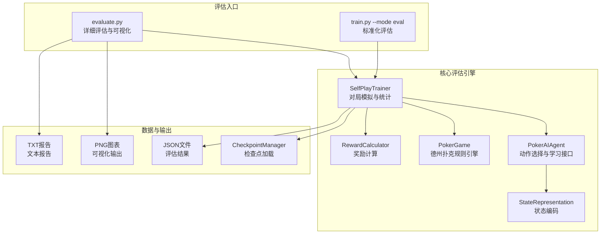
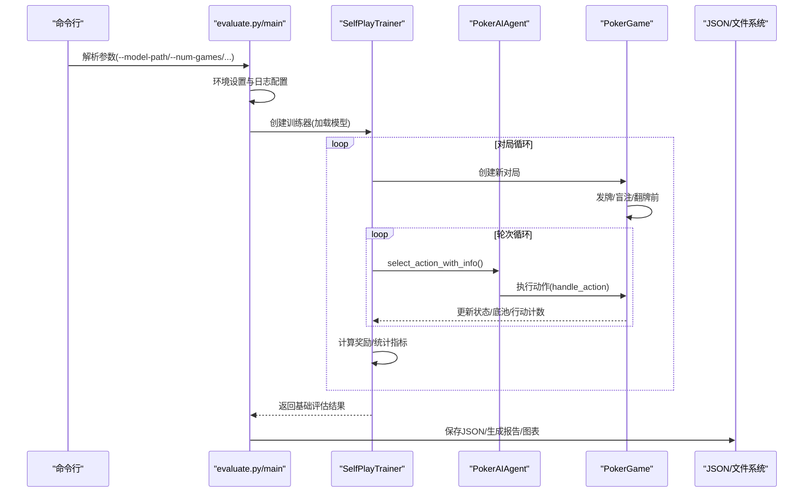
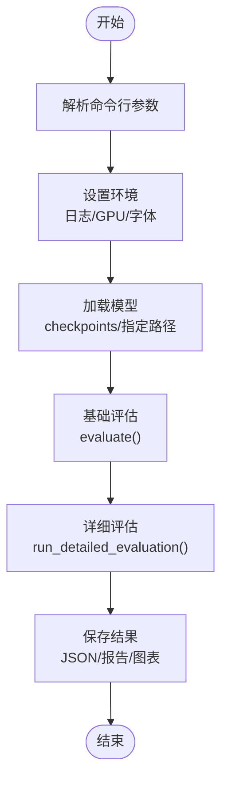
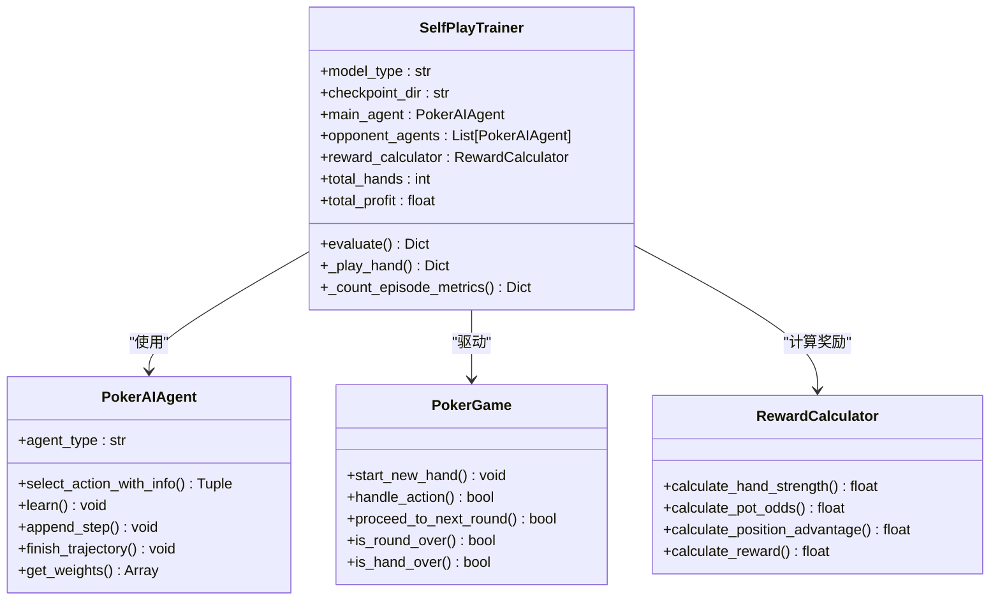
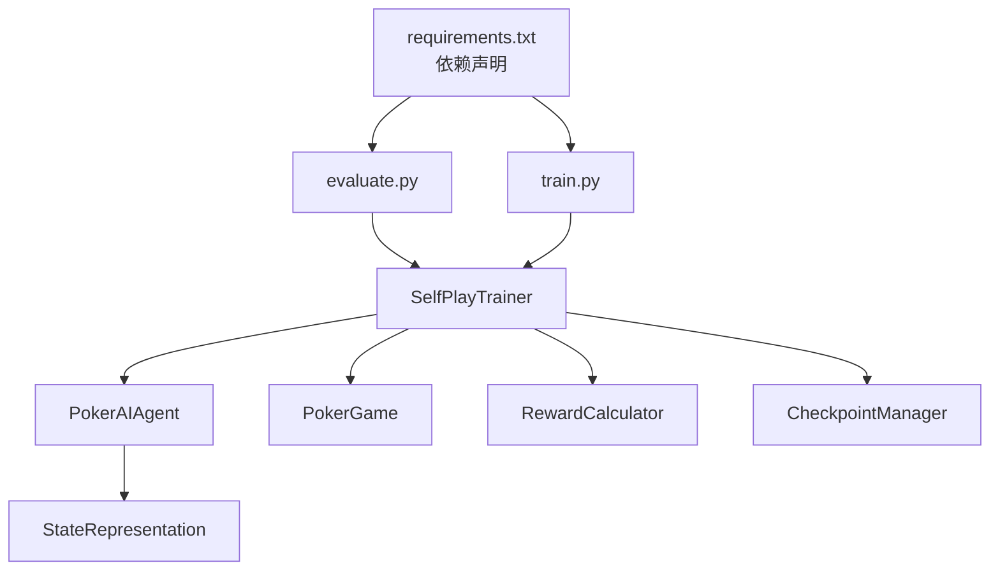
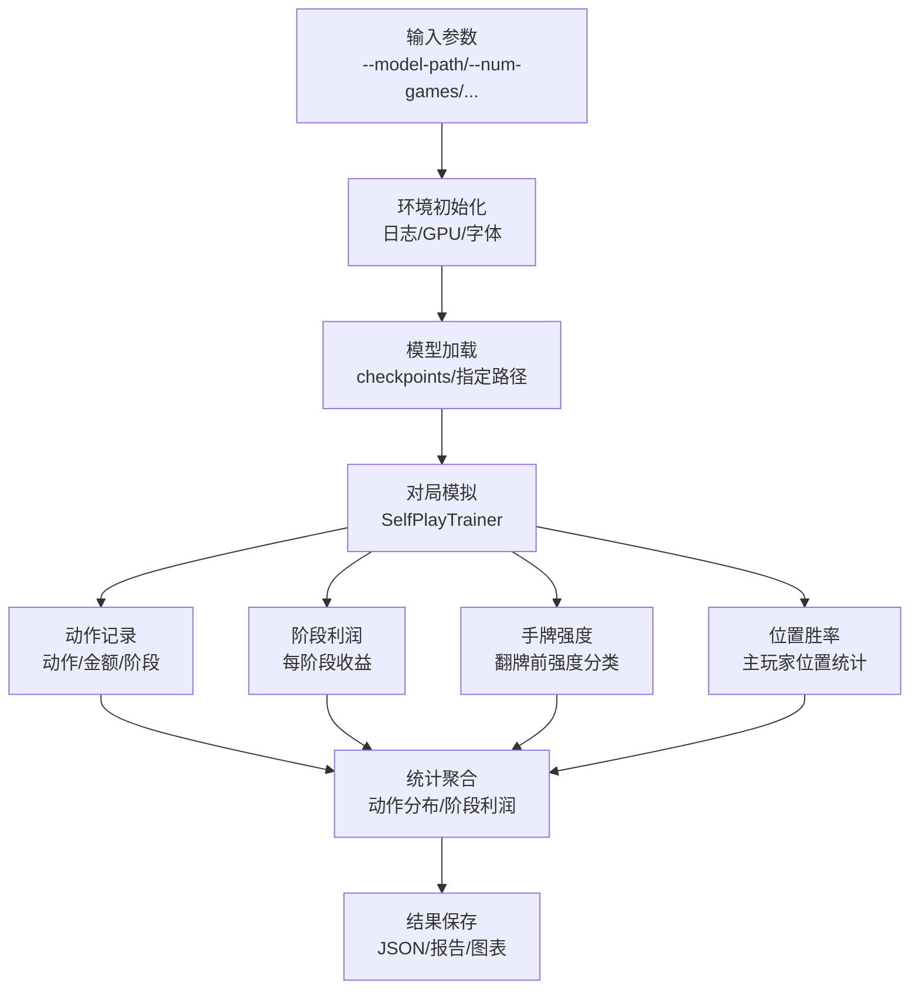

# 评估数据流

<cite>
**本文档引用的文件**
- [evaluate.py](file://evaluate.py)
- [train.py](file://train.py)
- [README.md](file://README.md)
- [poker_ai/reward/self_play_trainer.py](file://poker_ai/reward/self_play_trainer.py)
- [poker_ai/model/ai_agent.py](file://poker_ai/model/ai_agent.py)
- [poker_ai/game/poker_game.py](file://poker_ai/game/poker_game.py)
- [poker_ai/model/state_representation.py](file://poker_ai/model/state_representation.py)
- [poker_ai/reward/reward_calculator.py](file://poker_ai/reward/reward_calculator.py)
- [poker_ai/utils/checkpoint.py](file://poker_ai/utils/checkpoint.py)
- [requirements.txt](file://requirements.txt)
</cite>

## 目录
1. [简介](#简介)
2. [项目结构](#项目结构)
3. [核心组件](#核心组件)
4. [架构概览](#架构概览)
5. [详细组件分析](#详细组件分析)
6. [依赖关系分析](#依赖关系分析)
7. [性能考量](#性能考量)
8. [故障排除指南](#故障排除指南)
9. [结论](#结论)
10. [附录](#附录)

## 简介
本文件面向模型评估系统，系统性阐述从原始数据到最终报告的完整评估数据流。重点涵盖以下方面：
- 评估数据的来源：测试集数据（模拟对局）、模型检查点、历史训练记录
- 数据收集与处理：对局模拟、动作记录、阶段利润统计、手牌强度分类
- 统计分析与指标：胜率、平均利润、动作分布、按阶段利润、按手牌强度的胜率、位置胜率
- 可视化与报告：图表生成与文本报告输出
- 存储格式与查询优化：JSON序列化、文件命名与目录组织
- 使用示例与结果解读：命令行参数、典型用法与指标含义

## 项目结构
评估系统由两条主要路径构成：
- 交互式详细评估：evaluate.py 提供丰富的统计与可视化
- 标准化评估：train.py 的 --mode eval 提供简洁的评估结果

**图表来源**
- [evaluate.py:706-753](file://evaluate.py#L706-L753)
- [train.py:532-592](file://train.py#L532-L592)
- [poker_ai/reward/self_play_trainer.py:48-166](file://poker_ai/reward/self_play_trainer.py#L48-L166)
- [poker_ai/model/ai_agent.py:55-116](file://poker_ai/model/ai_agent.py#L55-L116)
- [poker_ai/game/poker_game.py:155-194](file://poker_ai/game/poker_game.py#L155-L194)
- [poker_ai/model/state_representation.py:9-46](file://poker_ai/model/state_representation.py#L9-L46)
- [poker_ai/reward/reward_calculator.py:9-42](file://poker_ai/reward/reward_calculator.py#L9-L42)
- [poker_ai/utils/checkpoint.py:17-56](file://poker_ai/utils/checkpoint.py#L17-L56)

**章节来源**
- [README.md:1-227](file://README.md#L1-L227)
- [evaluate.py:110-142](file://evaluate.py#L110-L142)
- [train.py:136-238](file://train.py#L136-L238)

## 核心组件
- 评估入口与参数解析
  - evaluate.py：命令行参数解析、环境设置、模型加载、详细评估、结果保存与报告生成、可视化图表生成
  - train.py：--mode eval 的评估流程，加载检查点、执行评估、保存结果与报告
- 评估引擎
  - SelfPlayTrainer：对局模拟、对手代理管理、奖励计算、统计聚合
  - PokerAIAgent：统一动作选择接口，兼容 DQN/PPO/Policy Gradient
  - PokerGame：6人德州扑克规则引擎，负责发牌、行动、轮次推进、摊牌结算
  - StateRepresentation：状态编码（手牌、公共牌、玩家信息、位置、活跃人数等）
  - RewardCalculator：奖励计算（手牌强度、底池赔率、位置优势、决策一致性、无效下注惩罚等）
- 数据与存储
  - CheckpointManager：检查点保存与加载（权重、元数据）
  - JSON：评估结果序列化
  - PNG/TXT：可视化图表与文本报告

**章节来源**
- [evaluate.py:110-142](file://evaluate.py#L110-L142)
- [train.py:136-238](file://train.py#L136-L238)
- [poker_ai/reward/self_play_trainer.py:48-166](file://poker_ai/reward/self_play_trainer.py#L48-L166)
- [poker_ai/model/ai_agent.py:55-116](file://poker_ai/model/ai_agent.py#L55-L116)
- [poker_ai/game/poker_game.py:155-194](file://poker_ai/game/poker_game.py#L155-L194)
- [poker_ai/model/state_representation.py:9-46](file://poker_ai/model/state_representation.py#L9-L46)
- [poker_ai/reward/reward_calculator.py:9-42](file://poker_ai/reward/reward_calculator.py#L9-L42)
- [poker_ai/utils/checkpoint.py:17-56](file://poker_ai/utils/checkpoint.py#L17-L56)

## 架构概览
评估数据流从命令行参数开始，经过模型加载与环境初始化，进入对局模拟阶段，收集动作与利润数据，进行统计分析，最终生成报告与可视化图表。

**图表来源**
- [evaluate.py:706-753](file://evaluate.py#L706-L753)
- [poker_ai/reward/self_play_trainer.py:214-417](file://poker_ai/reward/self_play_trainer.py#L214-L417)
- [poker_ai/model/ai_agent.py:125-155](file://poker_ai/model/ai_agent.py#L125-L155)
- [poker_ai/game/poker_game.py:299-402](file://poker_ai/game/poker_game.py#L299-L402)

**章节来源**
- [evaluate.py:181-267](file://evaluate.py#L181-L267)
- [train.py:532-592](file://train.py#L532-L592)

## 详细组件分析

### 评估入口与参数解析
- evaluate.py
  - 命令行参数：模型路径、模型类型、对局数、对手数量与类型、游戏参数（盲注、初始筹码）、输出目录、是否生成图表、详细日志
  - 环境设置：创建输出目录、日志级别、GPU内存增长配置、中文字体设置
  - 模型加载：支持 checkpoints 目录下的模型文件，兼容绝对/相对路径
  - 评估执行：基础评估 + 详细评估（动作分布、阶段利润、手牌强度分类、位置胜率）
  - 结果保存：JSON序列化（含numpy类型转换）、文本报告、可视化图表
- train.py --mode eval
  - 标准化评估流程，加载检查点或指定模型路径，执行评估并保存结果

**图表来源**
- [evaluate.py:110-142](file://evaluate.py#L110-L142)
- [evaluate.py:144-158](file://evaluate.py#L144-L158)
- [evaluate.py:181-267](file://evaluate.py#L181-L267)
- [evaluate.py:484-522](file://evaluate.py#L484-L522)
- [evaluate.py:523-584](file://evaluate.py#L523-L584)
- [evaluate.py:586-704](file://evaluate.py#L586-L704)

**章节来源**
- [evaluate.py:110-158](file://evaluate.py#L110-L158)
- [evaluate.py:181-267](file://evaluate.py#L181-L267)
- [evaluate.py:484-584](file://evaluate.py#L484-L584)
- [evaluate.py:586-704](file://evaluate.py#L586-L704)
- [train.py:532-592](file://train.py#L532-L592)

### 评估引擎：SelfPlayTrainer
- 对局模拟：创建6人德州扑克对局，处理翻牌前/翻牌/转牌/河牌各阶段
- 对手代理：主代理 + 多个对手代理（含随机鱼玩家），支持集成代理
- 奖励计算：使用 RewardCalculator 计算即时奖励（手牌强度、底池赔率、位置优势、决策一致性、无效下注惩罚）
- 统计聚合：累计利润、获胜次数、策略指标（诈唬、主动进攻、无效下注）

**图表来源**
- [poker_ai/reward/self_play_trainer.py:48-166](file://poker_ai/reward/self_play_trainer.py#L48-L166)
- [poker_ai/model/ai_agent.py:55-116](file://poker_ai/model/ai_agent.py#L55-L116)
- [poker_ai/game/poker_game.py:155-194](file://poker_ai/game/poker_game.py#L155-L194)
- [poker_ai/reward/reward_calculator.py:9-42](file://poker_ai/reward/reward_calculator.py#L9-L42)

**章节来源**
- [poker_ai/reward/self_play_trainer.py:48-166](file://poker_ai/reward/self_play_trainer.py#L48-L166)
- [poker_ai/reward/self_play_trainer.py:214-417](file://poker_ai/reward/self_play_trainer.py#L214-L417)
- [poker_ai/reward/self_play_trainer.py:419-800](file://poker_ai/reward/self_play_trainer.py#L419-L800)

### 状态表示与动作解码：StateRepresentation
- 状态编码：自身手牌、公共牌、所有玩家状态（筹码、下注、活跃）、全局信息（轮次、底池、当前下注、大小盲）、绝对位置 One-Hot、活跃人数
- 动作解码：将动作概率向量解码为具体动作（fold/call/raise）及金额

**章节来源**
- [poker_ai/model/state_representation.py:9-46](file://poker_ai/model/state_representation.py#L9-L46)
- [poker_ai/model/state_representation.py:137-158](file://poker_ai/model/state_representation.py#L137-L158)
- [poker_ai/model/state_representation.py:225-247](file://poker_ai/model/state_representation.py#L225-L247)

### 奖励计算：RewardCalculator
- 手牌强度：蒙特卡洛估算胜率（翻牌前使用预设强度映射）
- 底池赔率：根据底池与下注额计算奖励
- 位置优势：基于相对庄家位置的奖励与利用
- 决策一致性：前后动作与强度变化的矛盾惩罚
- 无效下注惩罚：弱牌高注惩罚
- 阶段因子：随游戏阶段与手牌强度动态调整

**章节来源**
- [poker_ai/reward/reward_calculator.py:9-42](file://poker_ai/reward/reward_calculator.py#L9-L42)
- [poker_ai/reward/reward_calculator.py:56-72](file://poker_ai/reward/reward_calculator.py#L56-L72)
- [poker_ai/reward/reward_calculator.py:303-370](file://poker_ai/reward/reward_calculator.py#L303-L370)

### 检查点管理：CheckpointManager
- 保存：权重文件、元数据 JSON
- 加载：权重、pickle 模型、模型对象
- 最新检查点查找：按元数据时间戳排序

**章节来源**
- [poker_ai/utils/checkpoint.py:17-56](file://poker_ai/utils/checkpoint.py#L17-L56)
- [poker_ai/utils/checkpoint.py:58-104](file://poker_ai/utils/checkpoint.py#L58-L104)
- [poker_ai/utils/checkpoint.py:106-139](file://poker_ai/utils/checkpoint.py#L106-L139)

## 依赖关系分析
- 外部依赖：TensorFlow、NumPy、Matplotlib、Seaborn、pickle-mixin、argparse、python-dateutil
- 内部模块耦合：
  - evaluate.py 依赖 SelfPlayTrainer、PokerAIAgent、PokerGame、StateRepresentation、RewardCalculator、CheckpointManager
  - train.py --mode eval 依赖 SelfPlayTrainer、CheckpointManager
  - SelfPlayTrainer 依赖 PokerAIAgent、PokerGame、RewardCalculator、CheckpointManager

**图表来源**
- [requirements.txt:1-7](file://requirements.txt#L1-L7)
- [evaluate.py:84-98](file://evaluate.py#L84-L98)
- [train.py:532-592](file://train.py#L532-L592)
- [poker_ai/reward/self_play_trainer.py:21-25](file://poker_ai/reward/self_play_trainer.py#L21-L25)

**章节来源**
- [requirements.txt:1-7](file://requirements.txt#L1-L7)

## 性能考量
- GPU 内存管理：TensorFlow GPU 内存增长配置，避免一次性占用
- 字体渲染：中文字体设置与兜底方案，确保图表输出稳定
- 并行与批处理：PPO 支持批量动作选择与轨迹累积，减少 Python 调度开销
- 状态编码优化：整数编码与预计算映射，降低高频路径开销
- 奖励计算缓存：LRU 缓存手牌强度估算结果

**章节来源**
- [evaluate.py:31-51](file://evaluate.py#L31-L51)
- [evaluate.py:54-82](file://evaluate.py#L54-L82)
- [poker_ai/model/ai_agent.py:157-214](file://poker_ai/model/ai_agent.py#L157-L214)
- [poker_ai/model/state_representation.py:47-64](file://poker_ai/model/state_representation.py#L47-L64)
- [poker_ai/reward/reward_calculator.py:80-84](file://poker_ai/reward/reward_calculator.py#L80-L84)

## 故障排除指南
- 模型加载失败
  - 检查模型路径是否存在，支持 checkpoints 目录下的相对路径
  - 确认模型文件权限可读
- GPU 相关问题
  - 确认 TensorFlow 可用，GPU 设备可见
  - 关闭 XLA/onednn 或调整混合精度设置以规避特定错误
- 图表生成异常
  - 确认 Matplotlib/Seaborn 安装
  - 检查输出目录权限
- 评估结果为空
  - 检查对局数参数是否合理
  - 确认对手代理配置正确

**章节来源**
- [evaluate.py:200-240](file://evaluate.py#L200-L240)
- [evaluate.py:586-704](file://evaluate.py#L586-L704)
- [train.py:532-592](file://train.py#L532-L592)

## 结论
评估数据流通过清晰的模块划分与稳健的实现，实现了从模型加载到对局模拟、统计分析与报告可视化的完整闭环。系统支持多种模型类型与评估模式，具备良好的扩展性与可维护性。建议在大规模评估时结合并行策略与缓存机制进一步提升性能。

## 附录

### 评估数据流图（从原始数据到最终报告）

**图表来源**
- [evaluate.py:110-158](file://evaluate.py#L110-L158)
- [evaluate.py:181-267](file://evaluate.py#L181-L267)
- [evaluate.py:269-482](file://evaluate.py#L269-L482)
- [evaluate.py:484-584](file://evaluate.py#L484-L584)
- [evaluate.py:586-704](file://evaluate.py#L586-L704)

### 评估脚本使用示例
- 详细评估（生成图表）
  - python evaluate.py --model-path ./checkpoints/agent_dqn_1000.weights.h5 --model-type dqn --num-games 200 --generate-plots
- 标准评估（train.py）
  - python train.py --mode eval --model-type ppo --model-path ./checkpoints/agent_ppo_1000 --num-eval-games 500 --eval-output eval_results.json

**章节来源**
- [README.md:113-121](file://README.md#L113-L121)
- [README.md:104-111](file://README.md#L104-L111)

### 评估指标与解读
- 基础指标
  - 平均利润：单位对局的平均收益
  - 胜率：获胜局数/总对局数
  - 总利润：累计收益
  - 获胜次数：累计胜利局数
- 详细统计
  - 动作分布：弃牌/跟注/加注次数
  - 各阶段平均利润：翻牌前/翻牌/转牌/河牌阶段的平均收益
  - 按手牌强度的胜率：弱牌/中等牌/强牌的胜率与样本数
  - 按位置的胜率：主玩家在不同位置的胜率

**章节来源**
- [evaluate.py:523-584](file://evaluate.py#L523-L584)
- [evaluate.py:269-482](file://evaluate.py#L269-L482)