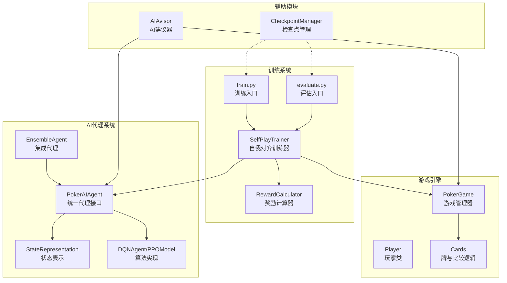
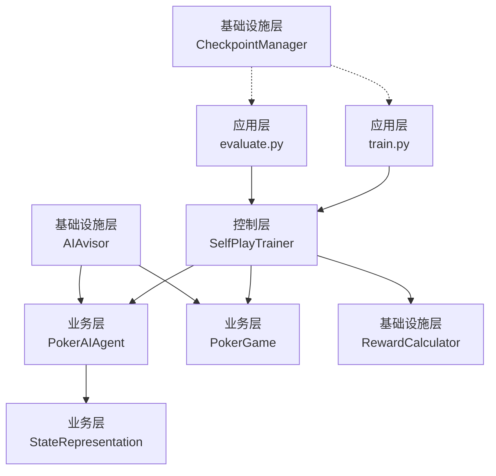
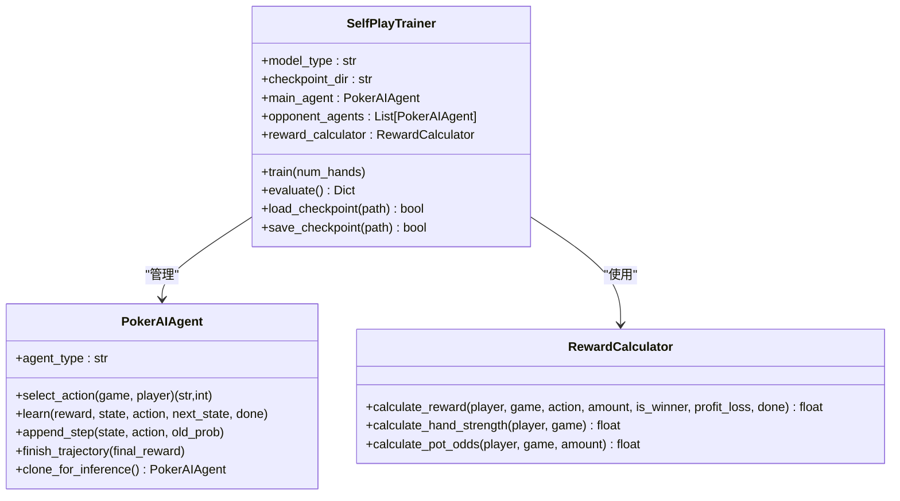
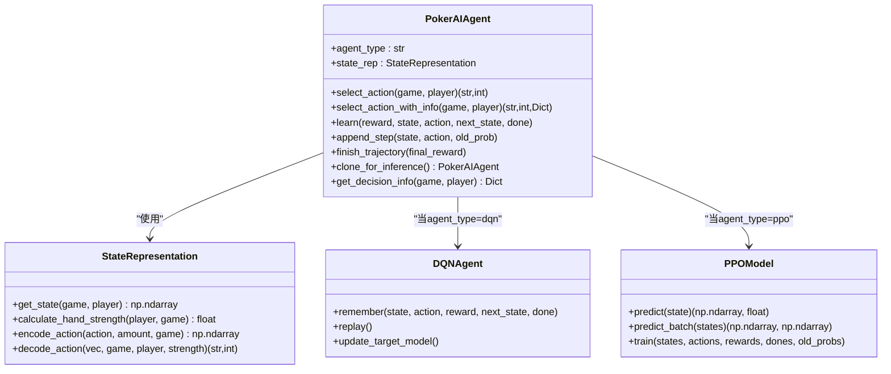
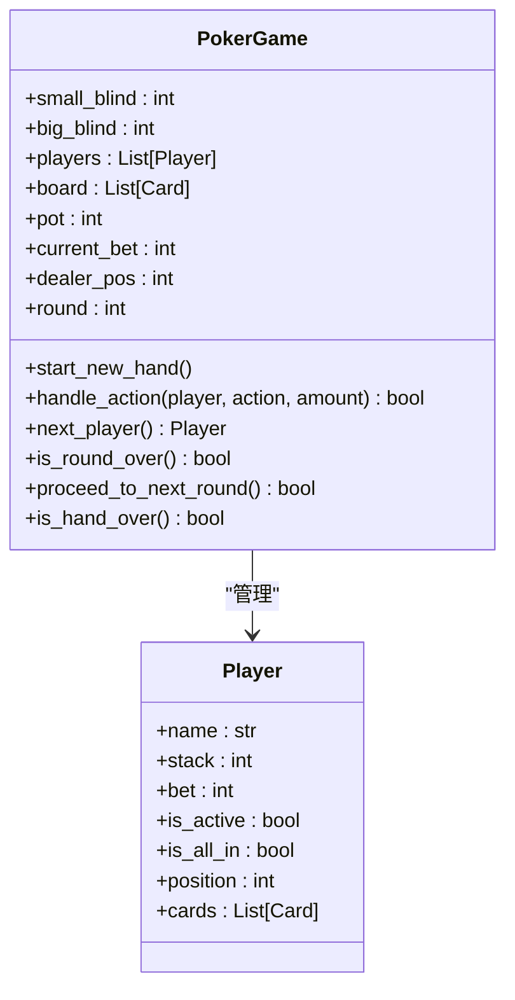
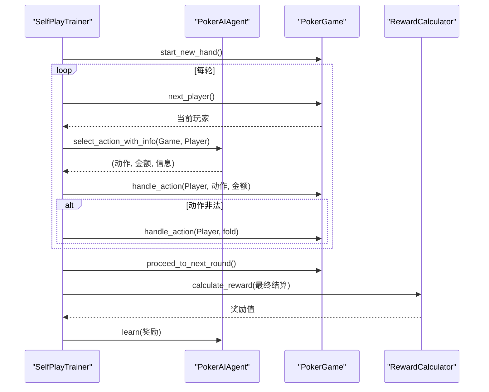
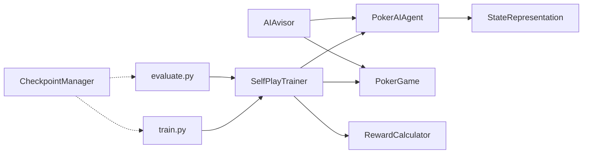

# 核心架构设计

<cite>
**本文档引用的文件**
- [train.py](file://train.py)
- [evaluate.py](file://evaluate.py)
- [poker_ai/reward/self_play_trainer.py](file://poker_ai/reward/self_play_trainer.py)
- [poker_ai/model/ai_agent.py](file://poker_ai/model/ai_agent.py)
- [poker_ai/game/poker_game.py](file://poker_ai/game/poker_game.py)
- [poker_ai/model/state_representation.py](file://poker_ai/model/state_representation.py)
- [poker_ai/advisor/ai_advisor.py](file://poker_ai/advisor/ai_advisor.py)
- [poker_ai/reward/reward_calculator.py](file://poker_ai/reward/reward_calculator.py)
- [poker_ai/utils/checkpoint.py](file://poker_ai/utils/checkpoint.py)
</cite>

## 目录
1. [简介](#简介)
2. [项目结构](#项目结构)
3. [核心组件](#核心组件)
4. [架构概览](#架构概览)
5. [详细组件分析](#详细组件分析)
6. [依赖关系分析](#依赖关系分析)
7. [性能考量](#性能考量)
8. [故障排查指南](#故障排查指南)
9. [结论](#结论)
10. [附录](#附录)

## 简介
本项目是一个基于深度强化学习的德州扑克AI系统，采用自我对弈训练（Self-Play）与多智能体博弈相结合的方式，构建了从训练到评估再到演示的完整流水线。系统围绕以下核心目标展开：
- 训练系统：支持DQN、策略梯度与PPO三种算法，结合SelfPlayTrainer实现高效的自我对弈训练。
- 评估系统：提供基础与详细评估，支持多维度统计与可视化输出。
- 游戏引擎：6人德州扑克完整规则引擎，支持状态表示、动作合法性与回合推进。
- AI代理系统：统一的PokerAIAgent接口，封装不同算法的决策与学习能力，并支持集成代理。

系统通过清晰的模块边界与职责划分，结合策略模式（算法选择）、工厂模式（代理创建）、观察者模式（奖励与性能监控）等设计模式，实现了高度可扩展与可维护的架构。

## 项目结构
项目采用按功能域划分的层次化组织方式，核心模块包括：
- poker_ai/reward：训练与奖励相关模块，包含SelfPlayTrainer、奖励计算器与简单奖励计算器。
- poker_ai/model：模型与状态表示，包含AI代理、DQN/PPO模型、状态表示与手牌评估器。
- poker_ai/game：游戏引擎，包含牌、玩家、完整德州扑克规则与回合推进逻辑。
- poker_ai/advisor：AI建议器，基于训练模型提供决策建议与可视化数据。
- poker_ai/utils：工具模块，包含检查点管理与通用工具。
- 根目录脚本：train.py与evaluate.py，提供命令行入口与训练/评估流程编排。

**图表来源**
- [train.py:1-856](file://train.py#L1-L856)
- [evaluate.py:1-753](file://evaluate.py#L1-L753)
- [poker_ai/reward/self_play_trainer.py:1-1604](file://poker_ai/reward/self_play_trainer.py#L1-L1604)
- [poker_ai/model/ai_agent.py:1-703](file://poker_ai/model/ai_agent.py#L1-L703)
- [poker_ai/game/poker_game.py:1-497](file://poker_ai/game/poker_game.py#L1-L497)
- [poker_ai/advisor/ai_advisor.py:1-629](file://poker_ai/advisor/ai_advisor.py#L1-L629)
- [poker_ai/reward/reward_calculator.py:1-587](file://poker_ai/reward/reward_calculator.py#L1-L587)
- [poker_ai/utils/checkpoint.py:1-139](file://poker_ai/utils/checkpoint.py#L1-L139)

**章节来源**
- [train.py:1-856](file://train.py#L1-L856)
- [evaluate.py:1-753](file://evaluate.py#L1-L753)

## 核心组件
本节深入分析系统的关键组件及其职责与交互关系。

- SelfPlayTrainer（自我对弈训练器）
  - 职责：负责组织并执行自我对弈训练，管理主代理与多个对手代理，协调奖励计算与检查点保存，支持并行采样与批量轨迹训练。
  - 关键特性：6-Max专用、对手轮换、all-in不走运补偿、轨迹级学习（PPO）与单步学习（DQN/PG）兼容。
  - 并行策略：通过worker池与批量轨迹收集，减少Python与TensorFlow往返开销，提升吞吐。

- PokerAIAgent（统一代理接口）
  - 职责：封装不同算法（DQN、策略梯度、PPO）的选择与调用，提供动作选择、学习接口与推理克隆。
  - 设计模式：工厂模式（根据agent_type创建具体代理）、策略模式（不同算法的learn/select_action实现）。
  - 扩展性：支持批量动作选择、轨迹缓冲与集成代理。

- PokerGame（游戏引擎）
  - 职责：实现德州扑克完整规则，包括发牌、下注、回合推进、摊牌与底池分配。
  - 关键特性：6人桌、状态向量化、动作合法性检查、回合状态管理。

- StateRepresentation（状态表示）
  - 职责：将游戏状态转换为神经网络可接受的向量，包含玩家手牌、公共牌、玩家信息、游戏全局信息、位置与活跃人数等特征。
  - 性能优化：one-hot编码、预计算索引映射、快速翻牌前强度估算。

- RewardCalculator（奖励计算器）
  - 职责：计算精细化奖励，包含手牌强度、底池赔率、位置优势、及时弃牌、成功诈唬、决策一致性与无效下注惩罚等。
  - 自适应调整：AdaptiveRewardCalculator可根据策略表现动态调整权重，维持策略平衡。

- AIAvisor（AI建议器）
  - 职责：基于训练模型提供决策建议，包含手牌强度评估、预期价值计算、对手动作预测与风险评估。
  - 输出：基础建议与详细分析，支持可视化数据生成与建议持久化。

- CheckpointManager（检查点管理）
  - 职责：统一模型权重与元数据的保存与加载，支持TensorFlow权重、pickle模型与自定义save/load接口。

**章节来源**
- [poker_ai/reward/self_play_trainer.py:1-1604](file://poker_ai/reward/self_play_trainer.py#L1-L1604)
- [poker_ai/model/ai_agent.py:1-703](file://poker_ai/model/ai_agent.py#L1-L703)
- [poker_ai/game/poker_game.py:1-497](file://poker_ai/game/poker_game.py#L1-L497)
- [poker_ai/model/state_representation.py:1-247](file://poker_ai/model/state_representation.py#L1-L247)
- [poker_ai/reward/reward_calculator.py:1-587](file://poker_ai/reward/reward_calculator.py#L1-L587)
- [poker_ai/advisor/ai_advisor.py:1-629](file://poker_ai/advisor/ai_advisor.py#L1-L629)
- [poker_ai/utils/checkpoint.py:1-139](file://poker_ai/utils/checkpoint.py#L1-L139)

## 架构概览
系统采用分层架构，自上而下分别为：
- 应用层：train.py与evaluate.py作为训练与评估入口，解析参数、设置环境并驱动训练/评估流程。
- 控制层：SelfPlayTrainer协调训练与评估，管理代理、游戏与奖励。
- 业务层：PokerAIAgent封装算法细节，PokerGame提供规则引擎，StateRepresentation提供状态向量化。
- 基础设施层：RewardCalculator与AIAvisor提供奖励与建议，CheckpointManager提供模型持久化。

**图表来源**
- [train.py:1-856](file://train.py#L1-L856)
- [evaluate.py:1-753](file://evaluate.py#L1-L753)
- [poker_ai/reward/self_play_trainer.py:1-1604](file://poker_ai/reward/self_play_trainer.py#L1-L1604)
- [poker_ai/model/ai_agent.py:1-703](file://poker_ai/model/ai_agent.py#L1-L703)
- [poker_ai/game/poker_game.py:1-497](file://poker_ai/game/poker_game.py#L1-L497)
- [poker_ai/advisor/ai_advisor.py:1-629](file://poker_ai/advisor/ai_advisor.py#L1-L629)
- [poker_ai/utils/checkpoint.py:1-139](file://poker_ai/utils/checkpoint.py#L1-L139)

## 详细组件分析

### SelfPlayTrainer 自我对弈训练器
SelfPlayTrainer是训练系统的核心控制器，负责：
- 代理创建：根据配置创建主代理与多个对手代理，其中最后一个对手为“鱼”（Random/DQN）以打破策略同质化。
- 游戏执行：并行推进多局手牌，收集结果与轨迹，支持PPO批量轨迹与DQN/PG单步学习。
- 奖励与学习：使用RewardCalculator计算即时奖励与最终奖励，驱动代理学习。
- 检查点与评估：周期性保存检查点与评估，支持自动调参与硬件档位优化。

**图表来源**
- [poker_ai/reward/self_play_trainer.py:1-1604](file://poker_ai/reward/self_play_trainer.py#L1-L1604)
- [poker_ai/model/ai_agent.py:1-703](file://poker_ai/model/ai_agent.py#L1-L703)
- [poker_ai/reward/reward_calculator.py:1-587](file://poker_ai/reward/reward_calculator.py#L1-L587)

**章节来源**
- [poker_ai/reward/self_play_trainer.py:1-1604](file://poker_ai/reward/self_play_trainer.py#L1-L1604)

### PokerAIAgent 统一代理接口
PokerAIAgent提供统一的代理接口，内部通过工厂模式根据agent_type创建具体算法实现：
- DQN：基于经验回放与目标网络更新。
- 策略梯度：基于回合奖励的策略优化。
- PPO：基于轨迹的近端策略优化，支持批量训练与轨迹缓冲。

**图表来源**
- [poker_ai/model/ai_agent.py:1-703](file://poker_ai/model/ai_agent.py#L1-L703)
- [poker_ai/model/state_representation.py:1-247](file://poker_ai/model/state_representation.py#L1-L247)

**章节来源**
- [poker_ai/model/ai_agent.py:1-703](file://poker_ai/model/ai_agent.py#L1-L703)

### 游戏引擎 PokerGame
PokerGame实现德州扑克完整规则，包括：
- 发牌与盲注：处理大小盲注与起手牌发放。
- 下注与回合推进：支持fold/call/raise，检查回合结束条件与阶段推进。
- 摊牌与底池分配：比较手牌强度，按规则分配底池。

**图表来源**
- [poker_ai/game/poker_game.py:1-497](file://poker_ai/game/poker_game.py#L1-L497)

**章节来源**
- [poker_ai/game/poker_game.py:1-497](file://poker_ai/game/poker_game.py#L1-L497)

### 奖励与建议系统
- RewardCalculator：提供精细化奖励计算，包含手牌强度、底池赔率、位置优势、及时弃牌、成功诈唬、决策一致性与无效下注惩罚等。
- AdaptiveRewardCalculator：根据策略表现动态调整奖励权重，维持策略平衡。
- AIAvisor：基于训练模型提供决策建议，包含手牌强度评估、预期价值计算、对手动作预测与风险评估。

**图表来源**
- [poker_ai/reward/self_play_trainer.py:1-1604](file://poker_ai/reward/self_play_trainer.py#L1-L1604)
- [poker_ai/model/ai_agent.py:1-703](file://poker_ai/model/ai_agent.py#L1-L703)
- [poker_ai/game/poker_game.py:1-497](file://poker_ai/game/poker_game.py#L1-L497)
- [poker_ai/reward/reward_calculator.py:1-587](file://poker_ai/reward/reward_calculator.py#L1-L587)

**章节来源**
- [poker_ai/reward/reward_calculator.py:1-587](file://poker_ai/reward/reward_calculator.py#L1-L587)
- [poker_ai/advisor/ai_advisor.py:1-629](file://poker_ai/advisor/ai_advisor.py#L1-L629)

## 依赖关系分析
模块间依赖关系如下：
- train.py与evaluate.py分别依赖SelfPlayTrainer与相关模块，形成训练与评估的入口。
- SelfPlayTrainer依赖PokerAIAgent、PokerGame与RewardCalculator。
- PokerAIAgent依赖StateRepresentation与具体算法实现（DQN/PPO）。
- AIAvisor依赖PokerAIAgent与PokerGame，提供决策建议。
- CheckpointManager被训练与评估入口调用，实现模型持久化。

**图表来源**
- [train.py:1-856](file://train.py#L1-L856)
- [evaluate.py:1-753](file://evaluate.py#L1-L753)
- [poker_ai/reward/self_play_trainer.py:1-1604](file://poker_ai/reward/self_play_trainer.py#L1-L1604)
- [poker_ai/model/ai_agent.py:1-703](file://poker_ai/model/ai_agent.py#L1-L703)
- [poker_ai/game/poker_game.py:1-497](file://poker_ai/game/poker_game.py#L1-L497)
- [poker_ai/advisor/ai_advisor.py:1-629](file://poker_ai/advisor/ai_advisor.py#L1-L629)
- [poker_ai/utils/checkpoint.py:1-139](file://poker_ai/utils/checkpoint.py#L1-L139)

**章节来源**
- [train.py:1-856](file://train.py#L1-L856)
- [evaluate.py:1-753](file://evaluate.py#L1-L753)

## 性能考量
- 并行与吞吐：SelfPlayTrainer通过train_workers与eval_workers实现并行采样，PPO场景下支持批量轨迹收集，减少Python与TensorFlow交互开销。
- 硬件优化：train.py内置RTX4090D与RTX3090_112cpu硬件档位，自动调整线程数、XLA与混合精度等参数，最大化GPU利用率。
- 状态表示优化：StateRepresentation采用one-hot编码与预计算索引映射，降低高频路径的计算成本。
- 奖励计算缓存：RewardCalculator使用LRU缓存与线程本地存储，避免重复计算与线程冲突。
- 检查点管理：CheckpointManager支持多种保存格式与元数据记录，便于恢复与追踪。

[本节为通用性能讨论，无需具体文件分析]

## 故障排查指南
- 训练异常：检查日志输出与异常堆栈，确认模型路径、检查点文件是否存在，以及硬件配置（GPU/CPU）是否正确。
- 评估失败：确认模型路径与文件权限，检查评估参数（对手类型、游戏数量等），并查看详细日志。
- 模型加载失败：检查权重文件格式（.weights/.pkl/.metadata.json），确保与模型类型匹配。
- 性能问题：调整train_workers/eval_workers、batch_size与ppo_update_min_steps，启用XLA与混合精度，检查GPU内存增长设置。

**章节来源**
- [train.py:1-856](file://train.py#L1-L856)
- [evaluate.py:1-753](file://evaluate.py#L1-L753)
- [poker_ai/utils/checkpoint.py:1-139](file://poker_ai/utils/checkpoint.py#L1-L139)

## 结论
本项目通过清晰的模块划分与设计模式的应用，构建了一个可扩展、可维护且高性能的德州扑克AI系统。SelfPlayTrainer作为训练核心，结合PokerAIAgent的统一接口与PokerGame的完整规则引擎，实现了从自我对弈到策略学习的闭环。RewardCalculator与AIAvisor进一步增强了奖励设计与决策建议能力。未来可在以下方面演进：
- 引入更丰富的对手建模与动态对手选择策略。
- 扩展状态表示维度与特征工程，提升模型泛化能力。
- 增强自适应奖励机制，实现更精细的策略平衡与收敛控制。
- 优化并行采样与轨迹训练，进一步提升吞吐与稳定性。

[本节为总结性内容，无需具体文件分析]

## 附录
- 命令行参数：train.py与evaluate.py提供丰富的训练与评估参数，支持多算法、多硬件档位与自动调参。
- 硬件配置：根据RTX4090D或RTX3090_112cpu自动调整线程数、XLA与混合精度，提升训练效率。
- 检查点格式：支持TensorFlow权重、pickle模型与自定义save/load接口，便于迁移与调试。

**章节来源**
- [train.py:1-856](file://train.py#L1-L856)
- [evaluate.py:1-753](file://evaluate.py#L1-L753)
- [poker_ai/utils/checkpoint.py:1-139](file://poker_ai/utils/checkpoint.py#L1-L139)