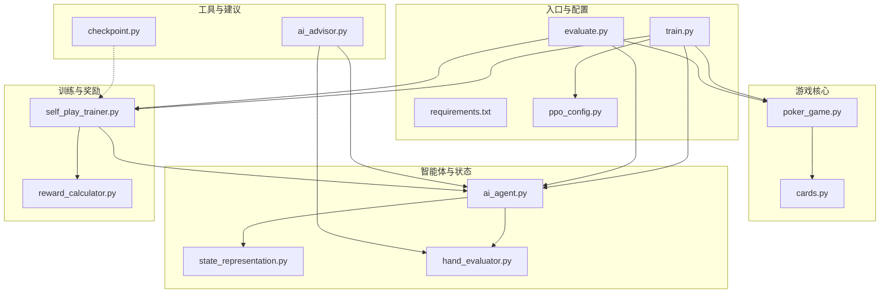
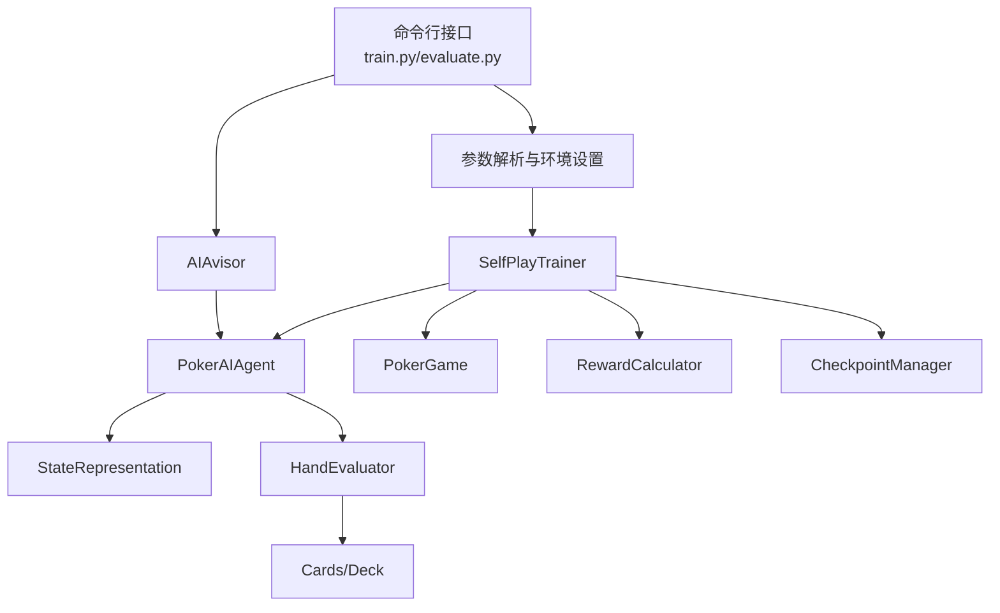
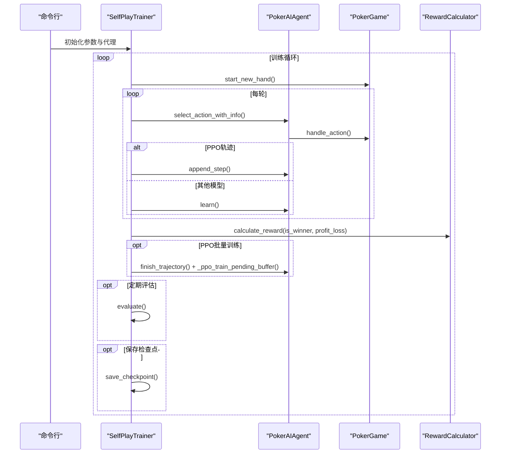
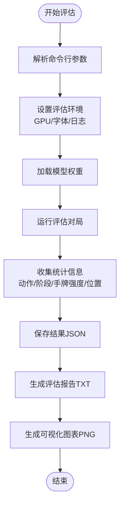
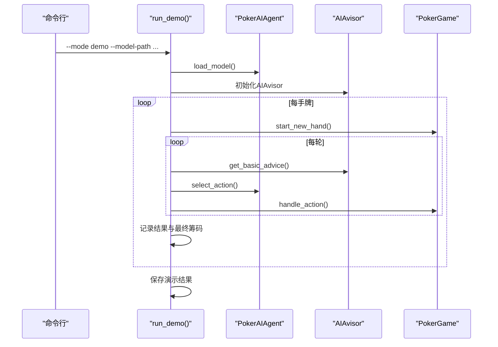
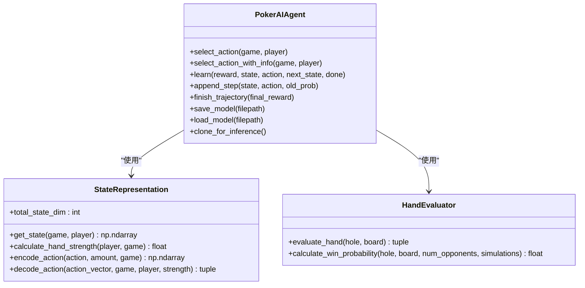
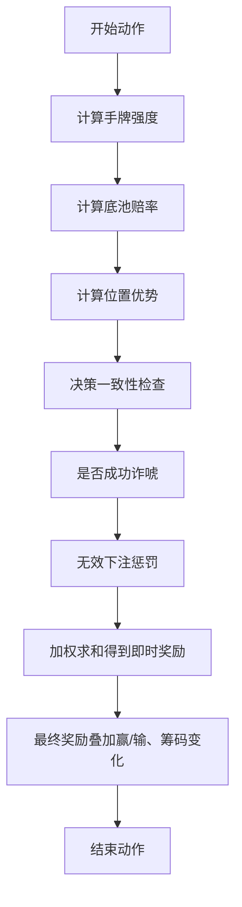
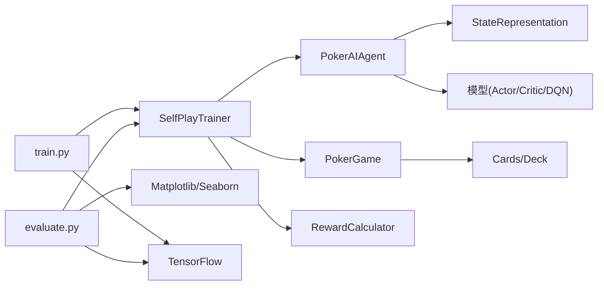

# 系统总体架构

<cite>
**本文档引用的文件**
- [README.md](file://README.md)
- [train.py](file://train.py)
- [evaluate.py](file://evaluate.py)
- [requirements.txt](file://requirements.txt)
- [poker_ai/config/ppo_config.py](file://poker_ai/config/ppo_config.py)
- [poker_ai/reward/self_play_trainer.py](file://poker_ai/reward/self_play_trainer.py)
- [poker_ai/model/ai_agent.py](file://poker_ai/model/ai_agent.py)
- [poker_ai/game/poker_game.py](file://poker_ai/game/poker_game.py)
- [poker_ai/advisor/ai_advisor.py](file://poker_ai/advisor/ai_advisor.py)
- [poker_ai/utils/checkpoint.py](file://poker_ai/utils/checkpoint.py)
- [poker_ai/model/state_representation.py](file://poker_ai/model/state_representation.py)
- [poker_ai/model/hand_evaluator.py](file://poker_ai/model/hand_evaluator.py)
- [poker_ai/reward/reward_calculator.py](file://poker_ai/reward/reward_calculator.py)
- [poker_ai/game/cards.py](file://poker_ai/game/cards.py)
</cite>

## 目录
1. [简介](#简介)
2. [项目结构](#项目结构)
3. [核心组件](#核心组件)
4. [架构概览](#架构概览)
5. [详细组件分析](#详细组件分析)
6. [依赖关系分析](#依赖关系分析)
7. [性能考量](#性能考量)
8. [故障排查指南](#故障排查指南)
9. [结论](#结论)
10. [附录](#附录)

## 简介
本项目是一个基于强化学习的6人桌德州扑克AI系统，包含训练系统、评估系统与演示系统三大核心模块。系统采用模块化设计，支持PPO、DQN与策略梯度三种模型类型，提供命令行接口、参数解析与硬件优化配置，结合高性能状态表示、奖励计算与并行采样机制，实现高效的自我对弈训练与评估。

## 项目结构
项目采用按功能域分层的模块化组织方式，核心目录与文件如下：
- 入口脚本：train.py（训练/评估/演示）、evaluate.py（详细评估）
- 核心模块：poker_ai/game（游戏逻辑）、poker_ai/model（智能体与状态表示）、poker_ai/reward（奖励与训练器）、poker_ai/advisor（AI建议器）、poker_ai/utils（检查点工具）、poker_ai/config（PPO配置）
- 依赖声明：requirements.txt
- 文档：README.md、TRAINING_GUIDE.md、PPO快速指南.md等

**图表来源**
- [train.py:1-856](file://train.py#L1-L856)
- [evaluate.py:1-753](file://evaluate.py#L1-L753)
- [poker_ai/config/ppo_config.py:1-97](file://poker_ai/config/ppo_config.py#L1-L97)
- [poker_ai/reward/self_play_trainer.py:1-800](file://poker_ai/reward/self_play_trainer.py#L1-L800)
- [poker_ai/model/ai_agent.py:1-703](file://poker_ai/model/ai_agent.py#L1-L703)
- [poker_ai/game/poker_game.py:1-497](file://poker_ai/game/poker_game.py#L1-L497)
- [poker_ai/advisor/ai_advisor.py:1-629](file://poker_ai/advisor/ai_advisor.py#L1-L629)
- [poker_ai/utils/checkpoint.py:1-139](file://poker_ai/utils/checkpoint.py#L1-L139)
- [poker_ai/model/state_representation.py:1-247](file://poker_ai/model/state_representation.py#L1-L247)
- [poker_ai/model/hand_evaluator.py:1-187](file://poker_ai/model/hand_evaluator.py#L1-L187)
- [poker_ai/reward/reward_calculator.py:1-587](file://poker_ai/reward/reward_calculator.py#L1-L587)
- [poker_ai/game/cards.py:1-202](file://poker_ai/game/cards.py#L1-L202)

**章节来源**
- [README.md:1-227](file://README.md#L1-L227)
- [requirements.txt:1-7](file://requirements.txt#L1-L7)

## 核心组件
- 命令行接口与参数解析：train.py提供统一入口，解析训练/评估/演示模式、模型类型、硬件配置、并行参数、奖励与探索策略等参数。
- 自我对弈训练器：SelfPlayTrainer负责构建主代理与对手代理、并行采样、轨迹收集、批量训练与检查点管理。
- 智能体接口：PokerAIAgent封装DQN、策略梯度与PPO三种模型，提供动作选择、批量推理、轨迹记录与权重保存。
- 游戏引擎：PokerGame实现6人桌规则、发牌、下注、轮次推进与摊牌结算。
- 状态表示：StateRepresentation将手牌、公共牌、玩家状态、游戏全局信息与位置特征编码为134维向量。
- 奖励与评估：RewardCalculator提供精细化奖励信号（手牌强度、位置优势、底池赔率、及时弃牌、成功诈唬、无效下注等），AdaptiveRewardCalculator支持自适应权重调整。
- 检查点工具：checkpoint.py提供通用权重/模型保存与加载，兼容TensorFlow权重、pickle与自定义格式。
- AI建议器：AIAvisor基于训练模型提供实时建议，包含手牌强度评估、期望价值与置信度分析。

**章节来源**
- [train.py:136-238](file://train.py#L136-L238)
- [poker_ai/reward/self_play_trainer.py:48-166](file://poker_ai/reward/self_play_trainer.py#L48-L166)
- [poker_ai/model/ai_agent.py:55-116](file://poker_ai/model/ai_agent.py#L55-L116)
- [poker_ai/game/poker_game.py:155-497](file://poker_ai/game/poker_game.py#L155-L497)
- [poker_ai/model/state_representation.py:9-46](file://poker_ai/model/state_representation.py#L9-L46)
- [poker_ai/reward/reward_calculator.py:9-37](file://poker_ai/reward/reward_calculator.py#L9-L37)
- [poker_ai/utils/checkpoint.py:17-104](file://poker_ai/utils/checkpoint.py#L17-L104)
- [poker_ai/advisor/ai_advisor.py:21-48](file://poker_ai/advisor/ai_advisor.py#L21-L48)

## 架构概览
系统采用“命令行入口 + 模块化组件 + 并行采样 + 强化学习训练”的整体架构。训练系统通过SelfPlayTrainer驱动主代理与多个对手代理进行自我对弈，收集轨迹并进行批量训练；评估系统通过evaluate.py生成详细统计与可视化；演示系统通过train.py --mode demo与AIAvisor提供交互式建议。

**图表来源**
- [train.py:240-339](file://train.py#L240-L339)
- [poker_ai/reward/self_play_trainer.py:167-213](file://poker_ai/reward/self_play_trainer.py#L167-L213)
- [poker_ai/model/ai_agent.py:131-155](file://poker_ai/model/ai_agent.py#L131-L155)
- [poker_ai/game/poker_game.py:155-194](file://poker_ai/game/poker_game.py#L155-L194)
- [poker_ai/reward/reward_calculator.py:303-370](file://poker_ai/reward/reward_calculator.py#L303-L370)
- [poker_ai/advisor/ai_advisor.py:49-58](file://poker_ai/advisor/ai_advisor.py#L49-L58)
- [poker_ai/utils/checkpoint.py:17-56](file://poker_ai/utils/checkpoint.py#L17-L56)
- [poker_ai/model/hand_evaluator.py:15-98](file://poker_ai/model/hand_evaluator.py#L15-L98)
- [poker_ai/game/cards.py:53-77](file://poker_ai/game/cards.py#L53-L77)

## 详细组件分析

### 训练系统（SelfPlayTrainer）
- 职责：创建主代理与对手代理、并行采样、轨迹收集、批量训练、定期评估与检查点保存。
- 关键机制：
  - 并行采样：通过train_workers与eval_workers控制采样并行度，减少Python调度开销。
  - PPO轨迹管理：支持批量轨迹写入与阈值触发训练，避免频繁函数调用。
  - 奖励信号：使用RewardCalculator提供即时奖励与最终奖励叠加。
  - 探索策略：DQN代理支持ε-贪婪策略参数设置。
- 性能优化：自动推断worker数量、批大小与同步批次，针对RTX 4090D优化配置。

**图表来源**
- [poker_ai/reward/self_play_trainer.py:260-417](file://poker_ai/reward/self_play_trainer.py#L260-L417)
- [poker_ai/model/ai_agent.py:248-420](file://poker_ai/model/ai_agent.py#L248-L420)
- [poker_ai/reward/reward_calculator.py:303-370](file://poker_ai/reward/reward_calculator.py#L303-L370)

**章节来源**
- [poker_ai/reward/self_play_trainer.py:48-166](file://poker_ai/reward/self_play_trainer.py#L48-L166)
- [poker_ai/reward/self_play_trainer.py:587-800](file://poker_ai/reward/self_play_trainer.py#L587-L800)

### 评估系统（evaluate.py）
- 职责：加载模型、运行大规模对局、统计动作分布、阶段利润、手牌强度胜率、位置胜率等，生成详细报告与可视化图表。
- 关键机制：
  - 环境设置：GPU内存增长、中文字体配置、日志级别控制。
  - 详细统计：手牌强度分布、动作分布、各阶段利润、按手牌强度的胜率、累计利润曲线。
  - 可视化：手牌强度分布、动作分布饼图、各阶段利润箱线图、按手牌强度胜率柱状图、累计利润曲线。
- 输出：JSON结果文件、TXT报告文件、PNG图表目录。

**图表来源**
- [evaluate.py:110-142](file://evaluate.py#L110-L142)
- [evaluate.py:144-157](file://evaluate.py#L144-L157)
- [evaluate.py:181-267](file://evaluate.py#L181-L267)
- [evaluate.py:484-521](file://evaluate.py#L484-L521)
- [evaluate.py:523-584](file://evaluate.py#L523-L584)
- [evaluate.py:586-704](file://evaluate.py#L586-L704)

**章节来源**
- [evaluate.py:1-753](file://evaluate.py#L1-L753)

### 演示系统（train.py --mode demo）
- 职责：加载模型与建议器，在交互式演示中展示AI建议与动作选择过程。
- 关键机制：
  - 加载PokerAIAgent与AIAvisor。
  - 创建6人桌PokerGame，逐手牌推进，打印公共牌与最终筹码。
  - AI建议器提供手牌强度、推荐动作、期望价值、置信度与理由。
- 输出：演示结果JSON与控制台交互。

**图表来源**
- [train.py:593-707](file://train.py#L593-L707)
- [poker_ai/advisor/ai_advisor.py:191-234](file://poker_ai/advisor/ai_advisor.py#L191-L234)
- [poker_ai/model/ai_agent.py:117-124](file://poker_ai/model/ai_agent.py#L117-L124)

**章节来源**
- [train.py:593-707](file://train.py#L593-L707)

### 智能体与状态表示（PokerAIAgent + StateRepresentation）
- PokerAIAgent：
  - 统一接口封装DQN、策略梯度与PPO。
  - 提供动作选择（含批量推理）、轨迹记录（PPO）、权重保存/加载。
  - 支持克隆用于并行采样（clone_for_inference）。
- StateRepresentation：
  - 134维状态向量：自身手牌、公共牌、6名玩家状态、游戏全局信息、Hero绝对位置One-Hot、活跃人数。
  - 高性能编码：one-hot与整数编码映射，避免频繁对象创建。
  - 手牌强度快速估算（翻牌前/翻牌后）。

**图表来源**
- [poker_ai/model/ai_agent.py:55-116](file://poker_ai/model/ai_agent.py#L55-L116)
- [poker_ai/model/state_representation.py:137-158](file://poker_ai/model/state_representation.py#L137-L158)
- [poker_ai/model/hand_evaluator.py:15-98](file://poker_ai/model/hand_evaluator.py#L15-L98)

**章节来源**
- [poker_ai/model/ai_agent.py:1-703](file://poker_ai/model/ai_agent.py#L1-L703)
- [poker_ai/model/state_representation.py:1-247](file://poker_ai/model/state_representation.py#L1-L247)
- [poker_ai/model/hand_evaluator.py:1-187](file://poker_ai/model/hand_evaluator.py#L1-L187)

### 游戏引擎与奖励计算
- PokerGame：
  - 6人桌规则：大小盲注、发牌、下注（fold/call/raise）、轮次推进、摊牌结算。
  - 高性能状态：使用整数编码与共享Card实例，减少对象开销。
- RewardCalculator：
  - 综合奖励：赢牌/输牌、手牌强度、底池赔率、位置优势、及时弃牌、成功诈唬、决策一致性、无效下注惩罚。
  - 自适应调整：根据策略指标（诈唬率、无效下注率、利润）动态平衡权重。

**图表来源**
- [poker_ai/reward/reward_calculator.py:303-370](file://poker_ai/reward/reward_calculator.py#L303-L370)
- [poker_ai/reward/reward_calculator.py:394-536](file://poker_ai/reward/reward_calculator.py#L394-L536)

**章节来源**
- [poker_ai/game/poker_game.py:155-497](file://poker_ai/game/poker_game.py#L155-L497)
- [poker_ai/reward/reward_calculator.py:1-587](file://poker_ai/reward/reward_calculator.py#L1-L587)

## 依赖关系分析
- 技术栈选择：
  - TensorFlow 2.x：神经网络训练与推理（PPO/DQN/Policy Gradient）。
  - NumPy：高性能数值计算与状态向量。
  - Matplotlib/Seaborn：评估报告与可视化。
  - argparse：命令行参数解析。
- 模块耦合：
  - SelfPlayTrainer高度依赖PokerAIAgent与PokerGame，通过接口解耦。
  - PokerAIAgent依赖StateRepresentation与HandEvaluator，形成清晰的数据流。
  - evaluate.py与train.py分别通过SelfPlayTrainer与PokerAIAgent间接耦合至游戏与模型模块。
- 外部依赖：
  - requirements.txt声明了tensorflow、numpy、matplotlib、seaborn、pickle-mixin、argparse、python-dateutil。

**图表来源**
- [requirements.txt:1-7](file://requirements.txt#L1-L7)
- [train.py:258-334](file://train.py#L258-L334)
- [evaluate.py:32-52](file://evaluate.py#L32-L52)

**章节来源**
- [requirements.txt:1-7](file://requirements.txt#L1-L7)

## 性能考量
- 并行与批处理：
  - 自动worker推断与线程并行配置，减少调度开销。
  - PPO轨迹批量写入与阈值触发训练，降低函数调用成本。
- 硬件优化：
  - RTX 4090D档位自动配置：更大batch、更多并行、XLA/JIT、混合精度、GPU按需增长。
- 状态与计算优化：
  - 整数编码与共享Card实例，避免频繁对象创建。
  - StateRepresentation预计算索引映射与one-hot编码，加速状态构造。
  - HandEvaluator蒙特卡洛胜率估算与LRU缓存，平衡精度与速度。
- 日志与可观测性：
  - 训练/评估日志包含运行状态、效率（平均每手耗时）与效果（平均利润/胜率/诈唬率/加注率）。

**章节来源**
- [train.py:39-135](file://train.py#L39-L135)
- [train.py:240-339](file://train.py#L240-L339)
- [poker_ai/model/state_representation.py:47-64](file://poker_ai/model/state_representation.py#L47-L64)
- [poker_ai/model/hand_evaluator.py:123-187](file://poker_ai/model/hand_evaluator.py#L123-L187)
- [README.md:194-203](file://README.md#L194-L203)

## 故障排查指南
- 硬件与依赖：
  - 未安装TensorFlow：导入时报错，需安装tensorflow>=2.5.0。
  - GPU不可用：切换到CPU模式或检查驱动与CUDA版本。
- 模型加载：
  - PPO检查点需三件套（actor/critic/state），确保路径正确。
  - DQN/PPO可传权重或pickle路径，检查文件存在与权限。
- 训练异常：
  - DNN/Graph错误：尝试关闭XLA或禁用oneDNN。
  - 手牌强度/动作非法：系统自动折算为fold并记录轨迹。
- 评估失败：
  - 检查模型路径、输出目录权限与GPU内存限制。
  - 中文字体问题：自动兜底恢复默认字体。

**章节来源**
- [evaluate.py:32-52](file://evaluate.py#L32-L52)
- [poker_ai/utils/checkpoint.py:58-104](file://poker_ai/utils/checkpoint.py#L58-L104)
- [train.py:331-334](file://train.py#L331-L334)
- [evaluate.py:77-82](file://evaluate.py#L77-L82)

## 结论
本系统通过模块化设计与高性能实现，构建了从命令行入口到强化学习训练、评估与演示的完整闭环。PPO为主力算法，配合精细化奖励信号与自适应权重调整，结合并行采样与硬件优化，实现了高效稳定的训练流程。建议在未来引入分布式训练、异构设备适配与在线评估流水线，进一步提升可扩展性与工程化水平。

## 附录
- 命令行参数速览（train.py）：模式选择、模型类型、训练轮数、学习率、批大小、PPO专用参数、评估间隔、检查点间隔、并行worker、设备偏好、混合精度、XLA、GPU内存增长、游戏配置、探索参数等。
- 模型与检查点：支持DQN、策略梯度、PPO；PPO检查点为三件套（actor/critic/state）。
- 常用参数参考：README.md“常用参数”章节。

**章节来源**
- [train.py:136-238](file://train.py#L136-L238)
- [README.md:149-191](file://README.md#L149-L191)