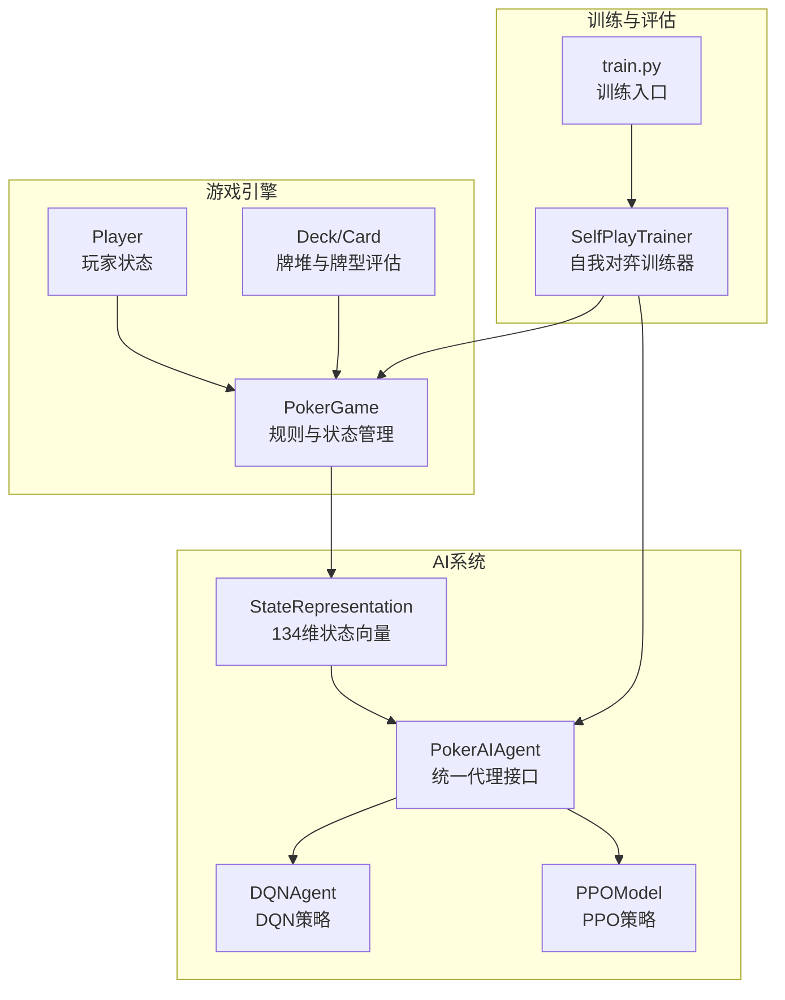
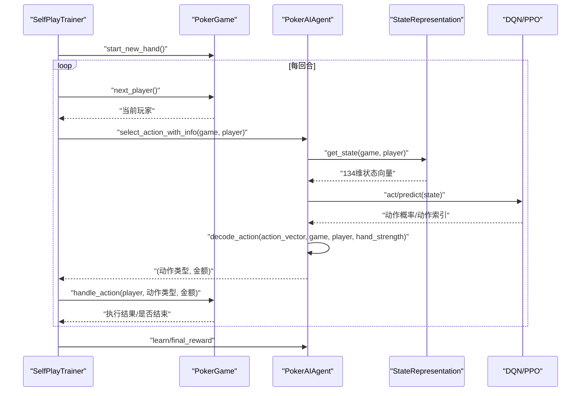
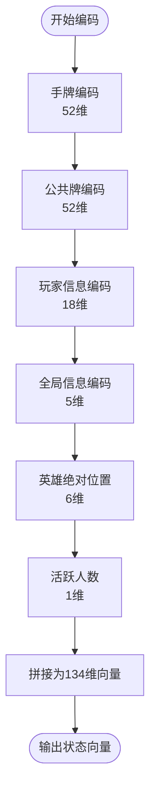
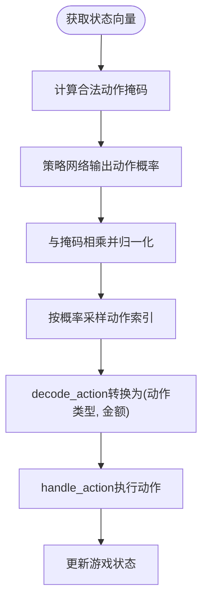
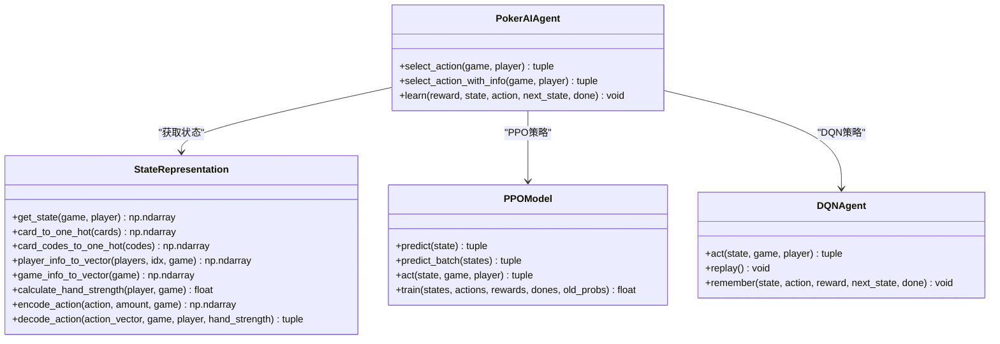
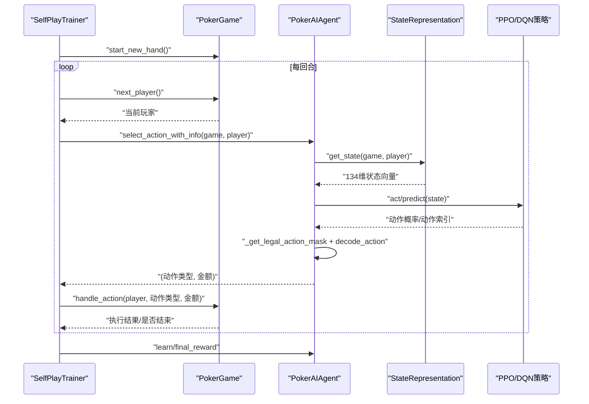
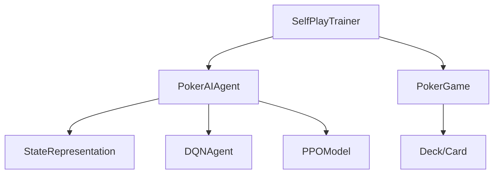

# AI代理与游戏引擎交互

<cite>
**本文引用的文件**
- [ai_agent.py](file://poker_ai/model/ai_agent.py)
- [poker_game.py](file://poker_ai/game/poker_game.py)
- [state_representation.py](file://poker_ai/model/state_representation.py)
- [ppo_model.py](file://poker_ai/model/ppo_model.py)
- [dqn_agent.py](file://poker_ai/model/dqn_agent.py)
- [cards.py](file://poker_ai/game/cards.py)
- [self_play_trainer.py](file://poker_ai/reward/self_play_trainer.py)
- [train.py](file://train.py)
- [README.md](file://README.md)
</cite>

## 目录
1. [简介](#简介)
2. [项目结构](#项目结构)
3. [核心组件](#核心组件)
4. [架构概览](#架构概览)
5. [详细组件分析](#详细组件分析)
6. [依赖分析](#依赖分析)
7. [性能考量](#性能考量)
8. [故障排查指南](#故障排查指南)
9. [结论](#结论)
10. [附录](#附录)

## 简介
本文件聚焦于德州扑克AI代理与游戏引擎的交互机制，围绕PokerAIAgent与PokerGame之间的关键交互环节展开，包括状态获取、动作选择、合法动作过滤、游戏状态更新与奖励反馈等。文档详细说明134维状态向量的构成与解析方式，解释AI代理如何将神经网络输出转化为游戏动作，以及在PPO与DQN两种训练范式下的交互差异。同时提供交互时序图与关键调用链路，帮助读者快速理解从状态观测到动作执行的完整流程。

## 项目结构
该项目采用模块化设计，核心交互涉及以下模块：
- 游戏引擎：PokerGame负责规则执行、状态维护与回合推进
- 状态表示：StateRepresentation将游戏状态编码为134维向量
- AI代理：PokerAIAgent统一封装DQN/PPO/PG三种策略，并提供动作选择与学习接口
- 训练器：SelfPlayTrainer驱动自我对弈，协调多代理与奖励计算
- 辅助工具：AIAvisor提供建议与分析（不在核心交互链路）

**图表来源**
- [poker_game.py:155-473](file://poker_ai/game/poker_game.py#L155-L473)
- [state_representation.py:9-158](file://poker_ai/model/state_representation.py#L9-L158)
- [ai_agent.py:55-116](file://poker_ai/model/ai_agent.py#L55-L116)
- [dqn_agent.py:21-62](file://poker_ai/model/dqn_agent.py#L21-L62)
- [ppo_model.py:20-93](file://poker_ai/model/ppo_model.py#L20-L93)
- [self_play_trainer.py:48-224](file://poker_ai/reward/self_play_trainer.py#L48-L224)
- [train.py:340-527](file://train.py#L340-L527)

**章节来源**
- [README.md:46-75](file://README.md#L46-L75)
- [poker_game.py:155-473](file://poker_ai/game/poker_game.py#L155-L473)
- [state_representation.py:9-158](file://poker_ai/model/state_representation.py#L9-L158)
- [ai_agent.py:55-116](file://poker_ai/model/ai_agent.py#L55-L116)
- [dqn_agent.py:21-62](file://poker_ai/model/dqn_agent.py#L21-L62)
- [ppo_model.py:20-93](file://poker_ai/model/ppo_model.py#L20-L93)
- [self_play_trainer.py:48-224](file://poker_ai/reward/self_play_trainer.py#L48-L224)
- [train.py:340-527](file://train.py#L340-L527)

## 核心组件
- PokerGame：维护6人桌德州扑克的完整状态，包括玩家筹码、下注、公共牌、底池、轮次等，并提供动作处理与回合推进逻辑。
- StateRepresentation：将游戏状态编码为134维向量，包含玩家手牌、公共牌、玩家信息、全局信息、英雄绝对位置与活跃人数等特征。
- PokerAIAgent：统一代理接口，封装DQN、策略梯度与PPO三种策略，提供动作选择、批量动作选择、学习与轨迹管理等能力。
- DQNAgent：基于深度Q网络的策略，使用经验回放与目标网络更新。
- PPOModel：基于Actor-Critic的策略优化，支持轨迹级学习与批量推理优化。
- SelfPlayTrainer：自我对弈训练器，协调多代理、奖励计算与检查点管理。

**章节来源**
- [poker_game.py:155-473](file://poker_ai/game/poker_game.py#L155-L473)
- [state_representation.py:9-158](file://poker_ai/model/state_representation.py#L9-L158)
- [ai_agent.py:55-116](file://poker_ai/model/ai_agent.py#L55-L116)
- [dqn_agent.py:21-62](file://poker_ai/model/dqn_agent.py#L21-L62)
- [ppo_model.py:20-93](file://poker_ai/model/ppo_model.py#L20-L93)
- [self_play_trainer.py:48-224](file://poker_ai/reward/self_play_trainer.py#L48-L224)

## 架构概览
AI代理与游戏引擎的交互遵循“状态观测 → 动作选择 → 合法性校验 → 执行动作 → 状态更新 → 奖励反馈”的闭环。PokerAIAgent通过StateRepresentation获取当前134维状态向量，结合游戏规则计算合法动作掩码，再由具体策略模型输出动作概率或Q值，最终将动作转换为游戏可执行的字符串与金额。

**图表来源**
- [self_play_trainer.py:260-417](file://poker_ai/reward/self_play_trainer.py#L260-L417)
- [ai_agent.py:117-155](file://poker_ai/model/ai_agent.py#L117-L155)
- [state_representation.py:137-158](file://poker_ai/model/state_representation.py#L137-L158)
- [dqn_agent.py:127-142](file://poker_ai/model/dqn_agent.py#L127-L142)
- [ppo_model.py:347-372](file://poker_ai/model/ppo_model.py#L347-L372)
- [poker_game.py:299-349](file://poker_ai/game/poker_game.py#L299-L349)

## 详细组件分析

### 状态表示系统（134维向量）
StateRepresentation将游戏状态分解为多个子向量并拼接成134维特征：
- 玩家手牌：52维（每张牌one-hot）
- 公共牌：52维（每张牌one-hot）
- 玩家信息：18维（6人 × 3特征：筹码、下注、是否活跃）
- 全局信息：5维（轮次、底池、当前下注、大盲、小盲）
- 英雄绝对位置：6维（相对于庄家的绝对位置one-hot）
- 活跃人数：1维（归一化）

上述维度累加得到134维状态向量，供AI代理直接输入神经网络。

**图表来源**
- [state_representation.py:137-158](file://poker_ai/model/state_representation.py#L137-L158)
- [state_representation.py:12-39](file://poker_ai/model/state_representation.py#L12-L39)

**章节来源**
- [state_representation.py:9-158](file://poker_ai/model/state_representation.py#L9-L158)

### 动作选择与合法性过滤
PokerAIAgent在选择动作时，首先通过StateRepresentation获取状态向量，然后：
- 对PPO：调用PPOModel.predict获取动作概率分布，结合合法动作掩码进行归一化，采样得到动作索引，再通过StateRepresentation.decode_action转换为动作类型与金额。
- 对DQN/PG：直接调用各自策略网络输出动作索引，再通过decode_action转换。

合法动作掩码由_get_legal_action_mask根据当前下注、玩家筹码与游戏规则计算，确保动作在技术与规则上均可执行。

**图表来源**
- [ai_agent.py:15-53](file://poker_ai/model/ai_agent.py#L15-L53)
- [ai_agent.py:117-155](file://poker_ai/model/ai_agent.py#L117-L155)
- [state_representation.py:225-247](file://poker_ai/model/state_representation.py#L225-L247)
- [poker_game.py:299-349](file://poker_ai/game/poker_game.py#L299-L349)

**章节来源**
- [ai_agent.py:15-53](file://poker_ai/model/ai_agent.py#L15-L53)
- [ai_agent.py:117-155](file://poker_ai/model/ai_agent.py#L117-L155)
- [state_representation.py:225-247](file://poker_ai/model/state_representation.py#L225-L247)
- [poker_game.py:299-349](file://poker_ai/game/poker_game.py#L299-L349)

### 数据转换：从游戏状态到神经网络输入
- 游戏状态字段（玩家、公共牌、底池、轮次等）经StateRepresentation编码为134维向量。
- 向量作为神经网络输入，PPO输出动作概率分布，DQN输出Q值，策略梯度输出动作概率。
- 动作概率经掩码过滤后采样得到动作索引，再由decode_action映射为具体动作类型与金额。

**图表来源**
- [state_representation.py:137-247](file://poker_ai/model/state_representation.py#L137-L247)
- [ai_agent.py:55-116](file://poker_ai/model/ai_agent.py#L55-L116)
- [ppo_model.py:322-372](file://poker_ai/model/ppo_model.py#L322-L372)
- [dqn_agent.py:127-176](file://poker_ai/model/dqn_agent.py#L127-L176)

**章节来源**
- [state_representation.py:137-247](file://poker_ai/model/state_representation.py#L137-L247)
- [ai_agent.py:55-116](file://poker_ai/model/ai_agent.py#L55-L116)
- [ppo_model.py:322-372](file://poker_ai/model/ppo_model.py#L322-L372)
- [dqn_agent.py:127-176](file://poker_ai/model/dqn_agent.py#L127-L176)

### 交互时序图（完整链路）
以下时序图展示了从状态观测到动作执行的完整链路，涵盖状态获取、动作选择、合法性过滤与执行更新。

**图表来源**
- [self_play_trainer.py:260-417](file://poker_ai/reward/self_play_trainer.py#L260-L417)
- [ai_agent.py:117-155](file://poker_ai/model/ai_agent.py#L117-L155)
- [state_representation.py:137-158](file://poker_ai/model/state_representation.py#L137-L158)
- [poker_game.py:299-349](file://poker_ai/game/poker_game.py#L299-L349)

**章节来源**
- [self_play_trainer.py:260-417](file://poker_ai/reward/self_play_trainer.py#L260-L417)
- [ai_agent.py:117-155](file://poker_ai/model/ai_agent.py#L117-L155)
- [state_representation.py:137-158](file://poker_ai/model/state_representation.py#L137-L158)
- [poker_game.py:299-349](file://poker_ai/game/poker_game.py#L299-L349)

### 关键交互方法与数据传递
- 状态获取：PokerAIAgent.select_action_with_info → StateRepresentation.get_state
- 合法动作掩码：PokerAIAgent内部_get_legal_action_mask
- 动作解码：StateRepresentation.decode_action
- 动作执行：PokerGame.handle_action
- 学习更新：PokerAIAgent.learn（DQN/PG）或轨迹收集（PPO）

**章节来源**
- [ai_agent.py:117-155](file://poker_ai/model/ai_agent.py#L117-L155)
- [ai_agent.py:248-301](file://poker_ai/model/ai_agent.py#L248-L301)
- [state_representation.py:225-247](file://poker_ai/model/state_representation.py#L225-L247)
- [poker_game.py:299-349](file://poker_ai/game/poker_game.py#L299-L349)

## 依赖分析
- PokerAIAgent依赖StateRepresentation进行状态编码，并根据代理类型委托DQN或PPO策略。
- PPOModel与DQNAgent分别实现不同的策略输出与学习方式，但对外暴露统一的act接口。
- SelfPlayTrainer协调训练流程，调用PokerAIAgent进行动作选择，并通过PokerGame执行动作与结算。

**图表来源**
- [ai_agent.py:55-116](file://poker_ai/model/ai_agent.py#L55-L116)
- [dqn_agent.py:21-62](file://poker_ai/model/dqn_agent.py#L21-L62)
- [ppo_model.py:20-93](file://poker_ai/model/ppo_model.py#L20-L93)
- [self_play_trainer.py:48-224](file://poker_ai/reward/self_play_trainer.py#L48-L224)
- [poker_game.py:155-188](file://poker_ai/game/poker_game.py#L155-L188)

**章节来源**
- [ai_agent.py:55-116](file://poker_ai/model/ai_agent.py#L55-L116)
- [dqn_agent.py:21-62](file://poker_ai/model/dqn_agent.py#L21-L62)
- [ppo_model.py:20-93](file://poker_ai/model/ppo_model.py#L20-L93)
- [self_play_trainer.py:48-224](file://poker_ai/reward/self_play_trainer.py#L48-L224)
- [poker_game.py:155-188](file://poker_ai/game/poker_game.py#L155-L188)

## 性能考量
- 向量化与批处理：PPOModel支持predict_batch与轨迹级训练，显著降低Python调度开销。
- 预编译与混合精度：PPOModel与DQNAgent使用tf.function与LossScaleOptimizer，提升推理与训练效率。
- 并行采样：SelfPlayTrainer支持多worker并行采样，结合批量动作选择减少通信成本。
- 状态编码优化：使用整数编码与one-hot映射，避免频繁对象构造，提升高频路径性能。

**章节来源**
- [ppo_model.py:106-198](file://poker_ai/model/ppo_model.py#L106-L198)
- [dqn_agent.py:64-77](file://poker_ai/model/dqn_agent.py#L64-L77)
- [self_play_trainer.py:587-799](file://poker_ai/reward/self_play_trainer.py#L587-L799)

## 故障排查指南
- PPO更新失败：日志中出现DNN/Graph相关错误时，可尝试禁用XLA与oneDNN后重试。
- 探索参数异常：DQN代理的epsilon、epsilon_min、epsilon_decay需正确设置，避免策略过早收敛或不稳定。
- 合法动作问题：若动作非法，PokerGame会强制执行fold，需检查_get_legal_action_mask与decode_action逻辑。
- 模型加载失败：确认权重文件路径与格式（PPO为actor/critic双文件，DQN/PG为权重文件）。

**章节来源**
- [ai_agent.py:322-331](file://poker_ai/model/ai_agent.py#L322-L331)
- [ai_agent.py:523-552](file://poker_ai/model/ai_agent.py#L523-L552)
- [poker_game.py:299-349](file://poker_ai/game/poker_game.py#L299-L349)

## 结论
本文系统梳理了德州扑克AI代理与游戏引擎的交互机制，明确了134维状态向量的构成与解析流程，阐述了PPO与DQN在动作选择与学习上的差异，并通过时序图与依赖图直观展示了从状态观测到动作执行的完整链路。结合性能优化与故障排查建议，可帮助开发者高效调试与扩展该系统。

## 附录
- 训练与评估命令参考：详见项目根目录README中的“常用参数”与“训练与评估命令”。

**章节来源**
- [README.md:79-227](file://README.md#L79-L227)