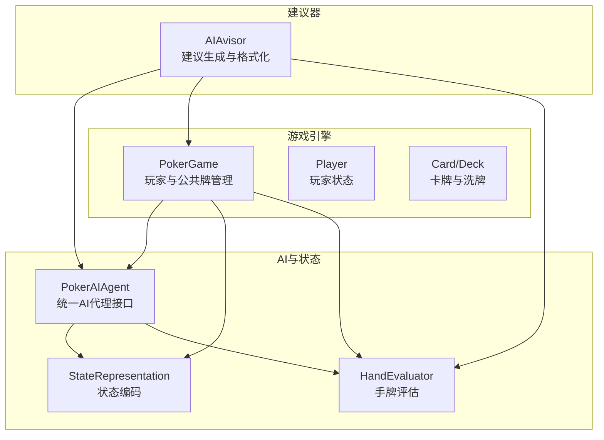
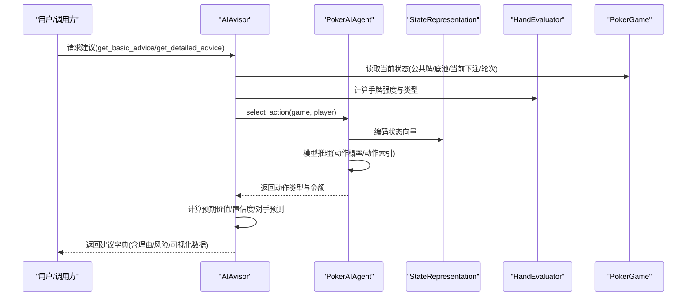
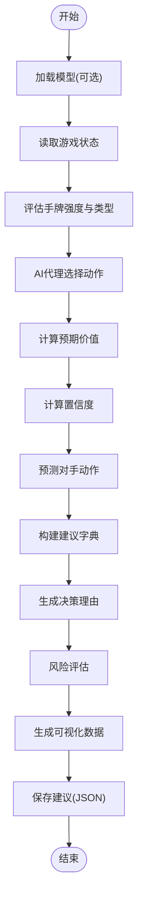
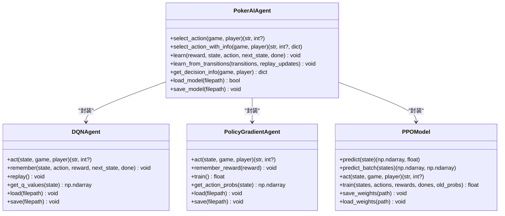
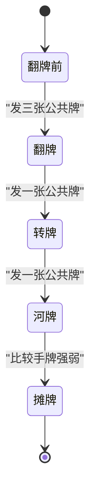
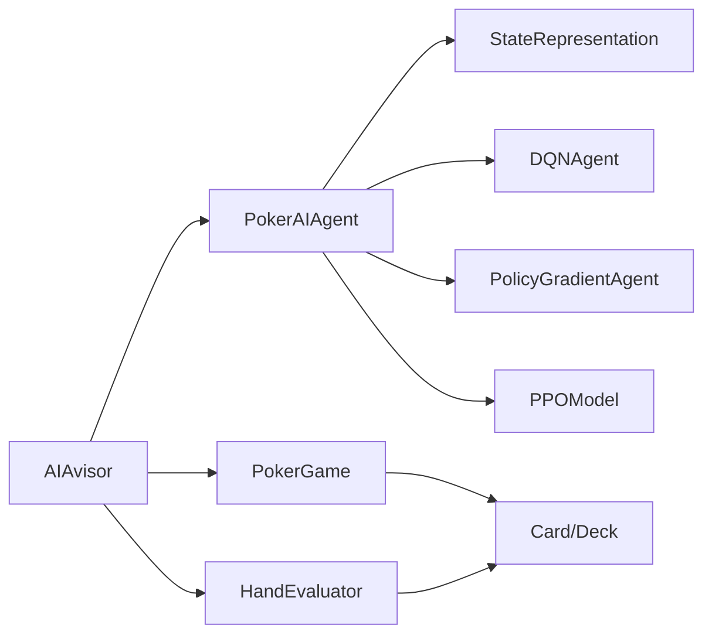
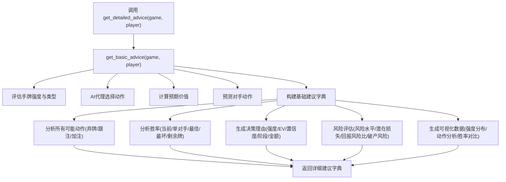

# AI建议器系统交互

<cite>
**本文引用的文件**
- [ai_advisor.py](file://poker_ai/advisor/ai_advisor.py)
- [ai_agent.py](file://poker_ai/model/ai_agent.py)
- [poker_game.py](file://poker_ai/game/poker_game.py)
- [state_representation.py](file://poker_ai/model/state_representation.py)
- [hand_evaluator.py](file://poker_ai/model/hand_evaluator.py)
- [cards.py](file://poker_ai/game/cards.py)
- [dqn_agent.py](file://poker_ai/model/dqn_agent.py)
- [ppo_model.py](file://poker_ai/model/ppo_model.py)
</cite>

## 目录
1. [简介](#简介)
2. [项目结构](#项目结构)
3. [核心组件](#核心组件)
4. [架构概览](#架构概览)
5. [详细组件分析](#详细组件分析)
6. [依赖关系分析](#依赖关系分析)
7. [性能考量](#性能考量)
8. [故障排查指南](#故障排查指南)
9. [结论](#结论)
10. [附录](#附录)

## 简介
本文件面向AI建议器系统（AIAvisor）与PokerAIAgent、PokerGame之间的交互，提供从状态分析到建议输出的完整文档。重点涵盖以下方面：
- 建议生成的触发条件与调用链路
- 建议内容的格式化与呈现机制
- 建议结果的展示与持久化
- 建议器如何分析游戏状态并提供决策建议
- 建议器与AI代理在模型加载与推理过程中的配合
- 建议器如何处理用户查询：手牌强度评估、推荐动作生成、预期价值计算
- 建议器与游戏引擎的交互：如何从游戏状态提取相关信息并生成人类可理解的建议
- 建议生成流程图与具体代码示例路径

## 项目结构
该项目采用模块化设计，围绕德州扑克游戏核心，分别提供：
- 游戏引擎：PokerGame、Player、Card、Deck
- AI代理：PokerAIAgent（封装DQN、Policy Gradient、PPO三种模型）
- 状态表示：StateRepresentation（将游戏状态编码为神经网络输入）
- 手牌评估：HandEvaluator（评估手牌强度与胜率）
- 建议器：AIAvisor（综合模型与游戏状态生成建议）

**图表来源**
- [poker_game.py](file://poker_ai/game/poker_game.py)
- [ai_agent.py](file://poker_ai/model/ai_agent.py)
- [state_representation.py](file://poker_ai/model/state_representation.py)
- [hand_evaluator.py](file://poker_ai/model/hand_evaluator.py)
- [ai_advisor.py](file://poker_ai/advisor/ai_advisor.py)

**章节来源**
- [poker_game.py](file://poker_ai/game/poker_game.py)
- [ai_agent.py](file://poker_ai/model/ai_agent.py)
- [state_representation.py](file://poker_ai/model/state_representation.py)
- [hand_evaluator.py](file://poker_ai/model/hand_evaluator.py)
- [ai_advisor.py](file://poker_ai/advisor/ai_advisor.py)

## 核心组件
- AIAvisor：负责综合游戏状态、AI代理输出与手牌评估，生成人类可读的建议与置信度，并提供详细分析与可视化数据。
- PokerAIAgent：统一AI代理接口，支持DQN、Policy Gradient、PPO三种模型，负责动作选择与决策信息提取。
- PokerGame：德州扑克游戏引擎，维护玩家状态、公共牌、底池、当前下注、轮次等。
- StateRepresentation：将游戏状态编码为固定维度向量，供AI模型推理使用。
- HandEvaluator：评估手牌强度与胜率，支持翻牌前与翻牌后的不同策略。
- Card/Deck：卡牌与牌堆管理，支持高效编码与比较。

**章节来源**
- [ai_advisor.py](file://poker_ai/advisor/ai_advisor.py)
- [ai_agent.py](file://poker_ai/model/ai_agent.py)
- [poker_game.py](file://poker_ai/game/poker_game.py)
- [state_representation.py](file://poker_ai/model/state_representation.py)
- [hand_evaluator.py](file://poker_ai/model/hand_evaluator.py)
- [cards.py](file://poker_ai/game/cards.py)

## 架构概览
AIAvisor作为高层协调者，结合PokerAIAgent的推理能力与HandEvaluator的评估能力，从PokerGame提供的实时状态中抽取关键信息，生成建议并进行格式化输出。其核心交互如下：

**图表来源**
- [ai_advisor.py](file://poker_ai/advisor/ai_advisor.py)
- [ai_agent.py](file://poker_ai/model/ai_agent.py)
- [state_representation.py](file://poker_ai/model/state_representation.py)
- [hand_evaluator.py](file://poker_ai/model/hand_evaluator.py)
- [poker_game.py](file://poker_ai/game/poker_game.py)

## 详细组件分析

### AIAvisor：建议生成与格式化
- 初始化与模型加载：支持指定模型类型（DQN/Policy Gradient/PPO），可加载已有权重。
- 建议生成入口：
  - get_basic_advice：返回基础建议（手牌强度、推荐动作、预期价值、置信度、对手预测、阶段名称、底池赔率）。
  - get_detailed_advice：在基础建议基础上，追加动作分析、胜率分析、决策理由、风险评估与可视化数据。
- 关键算法：
  - 手牌强度计算：结合翻牌前/翻牌后策略，必要时进行模拟评估。
  - 预期价值计算：基于动作类型（弃牌/跟注/加注）与对手弃牌率估算。
  - 置信度计算：综合手牌强度、预期价值与信息完整性。
  - 对手动作预测：基于轮次与筹码状况的简化解析。
  - 底池赔率：当前下注与底池的比例。
  - 决策理由生成：将强度、EV、置信度、阶段与动作金额转化为自然语言。
  - 风险评估：计算风险水平、潜在损失、回报风险比与破产风险。
  - 可视化数据：生成手牌强度分布、动作分析、胜率对比等数据。
  - 建议持久化：将建议保存为JSON文件，自动转换numpy类型。

**图表来源**
- [ai_advisor.py](file://poker_ai/advisor/ai_advisor.py)

**章节来源**
- [ai_advisor.py](file://poker_ai/advisor/ai_advisor.py)

### PokerAIAgent：模型加载与推理
- 统一接口：支持DQN、Policy Gradient、PPO三种模型类型。
- 动作选择：
  - select_action：返回动作类型与金额。
  - select_action_with_info：返回动作与训练所需信息（如PPO的动作概率、状态价值等）。
  - 批量动作选择：支持多局状态的批量推理，PPO尤为高效。
- 模型学习：
  - learn：根据奖励与经验进行学习（DQN经验回放、PG回合后训练、PPO轨迹级训练）。
  - learn_from_transitions：批量应用转移样本，降低Python调度开销。
  - PPO专用：append_step/finish_trajectory/append_trajectories_batch，支持轨迹级训练与早停。
- 决策信息：get_decision_info，返回Q值/动作概率/状态价值等，便于建议器进行置信度与理由生成。
- 模型持久化：load/save与兼容CheckpointManager的别名方法。

**图表来源**
- [ai_agent.py](file://poker_ai/model/ai_agent.py)
- [dqn_agent.py](file://poker_ai/model/dqn_agent.py)
- [ppo_model.py](file://poker_ai/model/ppo_model.py)

**章节来源**
- [ai_agent.py](file://poker_ai/model/ai_agent.py)
- [dqn_agent.py](file://poker_ai/model/dqn_agent.py)
- [ppo_model.py](file://poker_ai/model/ppo_model.py)

### PokerGame：游戏状态与规则
- 玩家状态：筹码、下注、是否活跃、是否全下、位置等。
- 游戏阶段：翻牌前、翻牌、转牌、河牌。
- 行动处理：弃牌、跟注、加注（含最小加注与全下限制）。
- 轮次推进：自动进入下一阶段或摊牌结算。
- 状态导出：get_game_state，便于AI与建议器读取。

**图表来源**
- [poker_game.py](file://poker_ai/game/poker_game.py)

**章节来源**
- [poker_game.py](file://poker_ai/game/poker_game.py)

### StateRepresentation：状态编码
- 将手牌、公共牌、所有玩家状态、游戏全局信息、Hero绝对位置、活跃人数等特征拼接为固定维度向量。
- 提供动作编码/解码：将独热动作向量还原为动作类型与金额。
- 高性能：使用整数编码与预计算映射，避免频繁对象构造。

**章节来源**
- [state_representation.py](file://poker_ai/model/state_representation.py)

### HandEvaluator：手牌强度与胜率
- 评估手牌强度与类型（高牌、一对、两对、三条、顺子、同花、葫芦、四条、同花顺、皇家同花顺）。
- 胜率估算：在给定对手数量与模拟次数下，估算获胜概率。
- 翻牌前强度：基于手牌点数、花色与连牌关系的快速评估。

**章节来源**
- [hand_evaluator.py](file://poker_ai/model/hand_evaluator.py)
- [cards.py](file://poker_ai/game/cards.py)

## 依赖关系分析
- AIAvisor依赖：
  - PokerAIAgent：用于动作选择与决策信息提取
  - HandEvaluator：用于手牌强度与胜率评估
  - PokerGame：用于读取当前轮次、底池、公共牌、玩家状态
- PokerAIAgent依赖：
  - StateRepresentation：状态编码与动作解码
  - DQNAgent/PolicyGradientAgent/PPOModel：具体模型实现
- PokerGame依赖：
  - Card/Deck：卡牌与牌堆管理
- HandEvaluator依赖：
  - Card/Deck：用于评估与胜率模拟

**图表来源**
- [ai_advisor.py](file://poker_ai/advisor/ai_advisor.py)
- [ai_agent.py](file://poker_ai/model/ai_agent.py)
- [state_representation.py](file://poker_ai/model/state_representation.py)
- [hand_evaluator.py](file://poker_ai/model/hand_evaluator.py)
- [poker_game.py](file://poker_ai/game/poker_game.py)
- [cards.py](file://poker_ai/game/cards.py)

**章节来源**
- [ai_advisor.py](file://poker_ai/advisor/ai_advisor.py)
- [ai_agent.py](file://poker_ai/model/ai_agent.py)
- [state_representation.py](file://poker_ai/model/state_representation.py)
- [hand_evaluator.py](file://poker_ai/model/hand_evaluator.py)
- [poker_game.py](file://poker_ai/game/poker_game.py)
- [cards.py](file://poker_ai/game/cards.py)

## 性能考量
- 状态编码优化：使用整数编码与预计算映射，减少对象构造与查找开销。
- 推理加速：PPO与DQN均采用tf.function预编译，降低Python调度开销。
- 批量推理：PokerAIAgent支持批量动作选择，PPO提供predict_batch，显著提升吞吐。
- 学习效率：PPO采用GAE向量化计算、价值损失裁剪、自适应熵系数与KL早停，提升稳定性与收敛速度。
- 数据持久化：建议器保存JSON时自动转换numpy类型，避免序列化异常。

[本节为通用性能讨论，无需代码来源]

## 故障排查指南
- 模型加载失败：检查模型路径与文件是否存在，确认模型类型与权重文件匹配。
- 动作选择异常：确认游戏状态合法（当前下注、玩家筹码、轮次），检查动作掩码与最小加注规则。
- 建议置信度过低：检查手牌强度与公共牌数量，适当提高模拟次数或调整阈值。
- JSON保存失败：确认输出目录存在与权限充足，检查数据中是否存在不可序列化对象。

**章节来源**
- [ai_agent.py](file://poker_ai/model/ai_agent.py)
- [ai_advisor.py](file://poker_ai/advisor/ai_advisor.py)

## 结论
AIAvisor通过整合PokerAIAgent的推理能力与HandEvaluator的评估能力，实现了从游戏状态到人类可理解建议的闭环。其设计强调：
- 可扩展性：支持多种模型类型与批量推理
- 可解释性：提供动作分析、胜率估计、风险评估与自然语言理由
- 可靠性：完善的错误处理与数据持久化
- 性能：状态编码与推理的多项优化

## 附录

### 建议生成流程图（代码级映射）

**图表来源**
- [ai_advisor.py](file://poker_ai/advisor/ai_advisor.py)

### 代码示例路径（建议生成方法与格式化）
- 基础建议生成：[get_basic_advice](file://poker_ai/advisor/ai_advisor.py)
- 详细建议生成：[get_detailed_advice](file://poker_ai/advisor/ai_advisor.py)
- 手牌强度评估：[evaluate_hand/_calculate_hand_strength](file://poker_ai/advisor/ai_advisor.py)
- 预期价值计算：[get_expected_value](file://poker_ai/advisor/ai_advisor.py)
- 置信度计算：[get_confidence](file://poker_ai/advisor/ai_advisor.py)
- 对手动作预测：[predict_opponent_actions](file://poker_ai/advisor/ai_advisor.py)
- 决策理由生成：[generate_reasoning](file://poker_ai/advisor/ai_advisor.py)
- 风险评估：[assess_risk](file://poker_ai/advisor/ai_advisor.py)
- 可视化数据生成：[generate_visualization_data](file://poker_ai/advisor/ai_advisor.py)
- 建议持久化：[save_advice_to_file](file://poker_ai/advisor/ai_advisor.py)

**章节来源**
- [ai_advisor.py](file://poker_ai/advisor/ai_advisor.py)