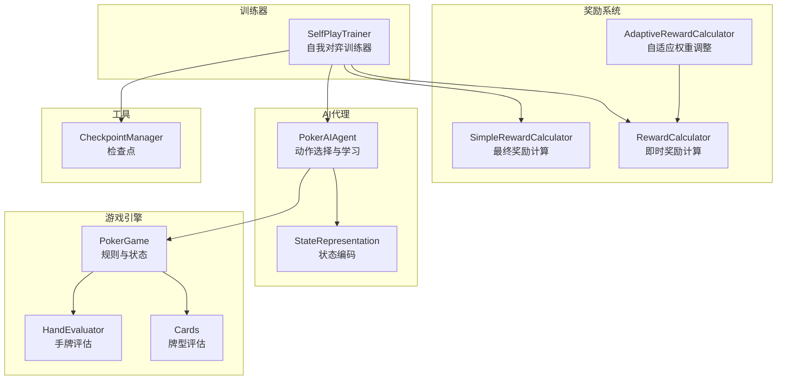
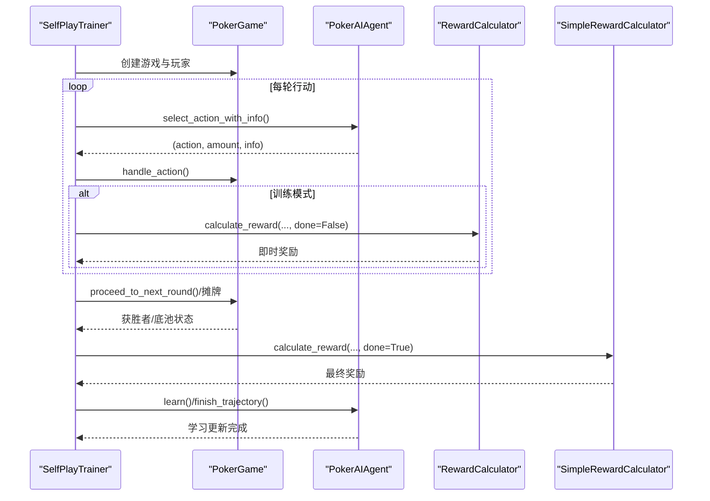
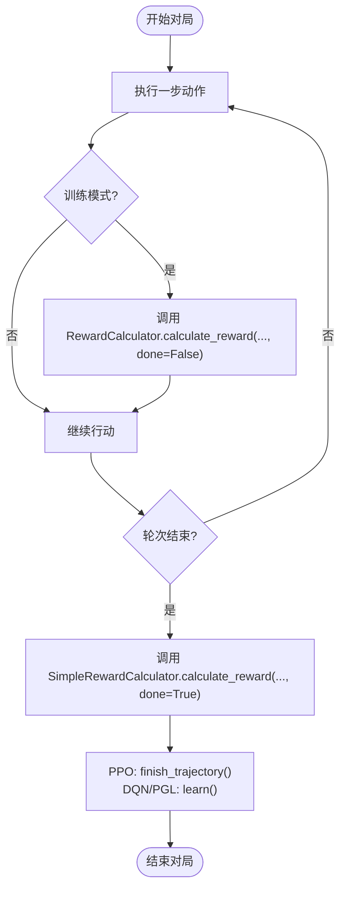
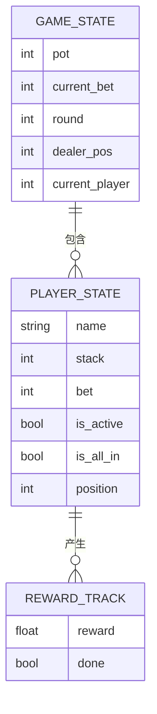
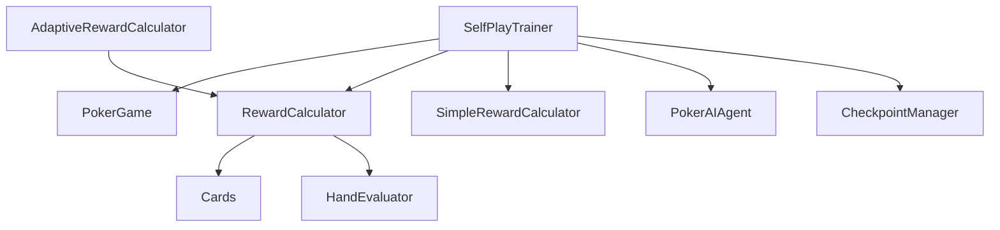

# 奖励系统与训练器交互

<cite>
**本文档引用的文件**
- [self_play_trainer.py](file://poker_ai/reward/self_play_trainer.py)
- [reward_calculator.py](file://poker_ai/reward/reward_calculator.py)
- [simple_reward_calculator.py](file://poker_ai/reward/simple_reward_calculator.py)
- [ai_agent.py](file://poker_ai/model/ai_agent.py)
- [poker_game.py](file://poker_ai/game/poker_game.py)
- [state_representation.py](file://poker_ai/model/state_representation.py)
- [checkpoint.py](file://poker_ai/utils/checkpoint.py)
- [cards.py](file://poker_ai/game/cards.py)
- [hand_evaluator.py](file://poker_ai/model/hand_evaluator.py)
- [train.py](file://train.py)
</cite>

## 目录
1. [简介](#简介)
2. [项目结构](#项目结构)
3. [核心组件](#核心组件)
4. [架构概览](#架构概览)
5. [详细组件分析](#详细组件分析)
6. [依赖关系分析](#依赖关系分析)
7. [性能考量](#性能考量)
8. [故障排查指南](#故障排查指南)
9. [结论](#结论)

## 简介
本文件面向奖励系统与训练器交互，深入解析 SelfPlayTrainer 与奖励计算系统的协作关系，涵盖奖励计算的触发时机、奖励值传递机制、训练反馈收集过程。文档详细说明奖励系统如何评估游戏结果并计算即时奖励与最终奖励，以及这些奖励如何影响 AI 代理的学习过程；解释奖励系统与训练器的数据交换：从游戏结果到奖励轨迹的转换过程；分析奖励系统的动态调整机制（对手更新、奖励缩放、探索奖励等策略）；提供奖励计算流程图，展示从游戏结束到奖励应用的完整过程；并给出具体代码示例路径，展示奖励计算方法的调用与奖励值的格式化过程。

## 项目结构
该项目围绕德州扑克自我对弈训练展开，核心模块包括：
- 奖励系统：包含基础奖励计算器与自适应奖励计算器，负责即时奖励与最终奖励的计算与动态调整
- 训练器：SelfPlayTrainer 负责组织对局、收集轨迹、驱动 AI 代理学习
- AI 代理：PokerAIAgent 提供动作选择与学习接口，支持 DQN、策略梯度与 PPO
- 游戏引擎：PokerGame 提供规则与状态管理
- 状态表示：StateRepresentation 将游戏状态编码为神经网络输入
- 工具：CheckpointManager 提供检查点保存与加载

图表来源
- [self_play_trainer.py:48-166](file://poker_ai/reward/self_play_trainer.py#L48-L166)
- [reward_calculator.py:9-587](file://poker_ai/reward/reward_calculator.py#L9-L587)
- [simple_reward_calculator.py:5-72](file://poker_ai/reward/simple_reward_calculator.py#L5-L72)
- [ai_agent.py:55-516](file://poker_ai/model/ai_agent.py#L55-L516)
- [poker_game.py:155-497](file://poker_ai/game/poker_game.py#L155-L497)
- [state_representation.py:9-247](file://poker_ai/model/state_representation.py#L9-L247)
- [checkpoint.py:17-139](file://poker_ai/utils/checkpoint.py#L17-L139)

章节来源
- [self_play_trainer.py:48-166](file://poker_ai/reward/self_play_trainer.py#L48-L166)
- [reward_calculator.py:9-587](file://poker_ai/reward/reward_calculator.py#L9-L587)
- [simple_reward_calculator.py:5-72](file://poker_ai/reward/simple_reward_calculator.py#L5-L72)
- [ai_agent.py:55-516](file://poker_ai/model/ai_agent.py#L55-L516)
- [poker_game.py:155-497](file://poker_ai/game/poker_game.py#L155-L497)
- [state_representation.py:9-247](file://poker_ai/model/state_representation.py#L9-L247)
- [checkpoint.py:17-139](file://poker_ai/utils/checkpoint.py#L17-L139)

## 核心组件
- SelfPlayTrainer：负责创建 AI 代理、对手、组织对局、收集轨迹、调用奖励计算、驱动学习更新。其核心职责包括：
  - 创建主代理与多个对手代理（含“鱼”玩家）
  - 在训练与评估场景中分别调用奖励计算
  - 收集动作历史与策略指标，统计训练性能
  - 管理检查点与对手更新周期
- RewardCalculator：精细化奖励计算，包含即时奖励（手牌强度、位置优势、底池赔率、决策一致性、无效下注惩罚等）与最终奖励叠加
- AdaptiveRewardCalculator：根据策略表现动态调整奖励权重，维持策略平衡与多样性
- SimpleRewardCalculator：极简奖励计算器，仅在游戏结束时基于盈亏计算最终奖励
- PokerAIAgent：统一的 AI 代理接口，支持 DQN、策略梯度与 PPO，提供动作选择与学习能力
- PokerGame：德州扑克游戏引擎，提供状态、动作处理、摊牌与底池分配
- StateRepresentation：将游戏状态编码为神经网络输入，支持快速预翻牌强度估算
- CheckpointManager：检查点保存与加载工具

章节来源
- [self_play_trainer.py:167-213](file://poker_ai/reward/self_play_trainer.py#L167-L213)
- [reward_calculator.py:9-587](file://poker_ai/reward/reward_calculator.py#L9-L587)
- [simple_reward_calculator.py:5-72](file://poker_ai/reward/simple_reward_calculator.py#L5-L72)
- [ai_agent.py:55-516](file://poker_ai/model/ai_agent.py#L55-L516)
- [poker_game.py:155-497](file://poker_ai/game/poker_game.py#L155-L497)
- [state_representation.py:9-247](file://poker_ai/model/state_representation.py#L9-L247)
- [checkpoint.py:17-139](file://poker_ai/utils/checkpoint.py#L17-L139)

## 架构概览
SelfPlayTrainer 与奖励系统的交互遵循“对局执行—奖励计算—轨迹收集—学习更新”的闭环流程。训练器在每手牌结束时调用奖励计算，将即时奖励与最终奖励叠加，形成完整的奖励轨迹，然后驱动 AI 代理进行学习更新。

图表来源
- [self_play_trainer.py:260-417](file://poker_ai/reward/self_play_trainer.py#L260-L417)
- [self_play_trainer.py:419-585](file://poker_ai/reward/self_play_trainer.py#L419-L585)
- [self_play_trainer.py:587-800](file://poker_ai/reward/self_play_trainer.py#L587-L800)
- [reward_calculator.py:303-391](file://poker_ai/reward/reward_calculator.py#L303-L391)
- [simple_reward_calculator.py:13-30](file://poker_ai/reward/simple_reward_calculator.py#L13-L30)
- [ai_agent.py:248-420](file://poker_ai/model/ai_agent.py#L248-L420)
- [poker_game.py:398-447](file://poker_ai/game/poker_game.py#L398-L447)

## 详细组件分析

### SelfPlayTrainer 与奖励系统的协作
- 触发时机
  - 即时奖励：在每一步合法动作后，训练模式下调用 RewardCalculator.calculate_reward，其中 done=False，仅计算即时奖励
  - 最终奖励：在手牌结束时，调用 SimpleRewardCalculator.calculate_reward，其中 done=True，仅在最终结算时计算基于盈亏的奖励
- 奖励值传递机制
  - 即时奖励通过 RewardCalculator.calculate_reward 返回，训练器将其累积到轨迹中（PPO）或直接用于 DQN/PGL 的单步学习
  - 最终奖励通过 SimpleRewardCalculator.calculate_reward 返回，训练器将其叠加到轨迹的最后一个步（PPO）或作为单步奖励（DQN/PGL）
- 训练反馈收集
  - 训练器收集动作历史、策略指标（诈唬率、主动行动、无效下注等），用于统计与评估
  - 训练器维护性能历史，用于对手更新与奖励动态调整

图表来源
- [self_play_trainer.py:260-417](file://poker_ai/reward/self_play_trainer.py#L260-L417)
- [self_play_trainer.py:419-585](file://poker_ai/reward/self_play_trainer.py#L419-L585)
- [simple_reward_calculator.py:13-30](file://poker_ai/reward/simple_reward_calculator.py#L13-L30)
- [ai_agent.py:388-420](file://poker_ai/model/ai_agent.py#L388-L420)

章节来源
- [self_play_trainer.py:260-417](file://poker_ai/reward/self_play_trainer.py#L260-L417)
- [self_play_trainer.py:419-585](file://poker_ai/reward/self_play_trainer.py#L419-L585)
- [simple_reward_calculator.py:13-30](file://poker_ai/reward/simple_reward_calculator.py#L13-L30)
- [ai_agent.py:388-420](file://poker_ai/model/ai_agent.py#L388-L420)

### 奖励计算方法调用与奖励值格式化
- 即时奖励调用路径
  - 调用入口：[self_play_trainer.py:370-378](file://poker_ai/reward/self_play_trainer.py#L370-L378)
  - 方法签名：[reward_calculator.py:303-391](file://poker_ai/reward/reward_calculator.py#L303-L391)
  - 奖励值格式化：返回浮点数，范围受裁剪约束
- 最终奖励调用路径
  - 调用入口：[self_play_trainer.py:537-545](file://poker_ai/reward/self_play_trainer.py#L537-L545)
  - 方法签名：[simple_reward_calculator.py:13-30](file://poker_ai/reward/simple_reward_calculator.py#L13-L30)
  - 奖励值格式化：按大盲注归一化，范围裁剪至 [-5, 5]
- 奖励轨迹格式
  - PPO：finish_trajectory(final_reward) 将最终奖励写入轨迹末尾，其余步奖励为 0
  - DQN/PGL：learn(reward, ...) 直接使用即时奖励或最终奖励

章节来源
- [self_play_trainer.py:370-378](file://poker_ai/reward/self_play_trainer.py#L370-L378)
- [self_play_trainer.py:537-545](file://poker_ai/reward/self_play_trainer.py#L537-L545)
- [reward_calculator.py:303-391](file://poker_ai/reward/reward_calculator.py#L303-L391)
- [simple_reward_calculator.py:13-30](file://poker_ai/reward/simple_reward_calculator.py#L13-L30)
- [ai_agent.py:388-420](file://poker_ai/model/ai_agent.py#L388-L420)

### 奖励系统如何评估游戏结果并计算即时奖励与最终奖励
- 即时奖励（RewardCalculator）
  - 手牌强度奖励：基于手牌强度估算，鼓励基于真实强度的决策
  - 位置优势与利用：根据相对庄家位置与动作类型给予奖励/惩罚
  - 底池赔率：根据加注金额与底池大小计算赔率奖励
  - 决策一致性：检查前后动作一致性，避免策略摇摆
  - 无效下注惩罚：在弱牌、不利赔率与大额加注时施加惩罚
  - 阶段因子：随游戏阶段与手牌强度动态调整奖励权重
- 最终奖励（SimpleRewardCalculator）
  - 仅在 done=True 时计算，基于最终盈亏与大盲注归一化，裁剪范围防止梯度爆炸

章节来源
- [reward_calculator.py:303-391](file://poker_ai/reward/reward_calculator.py#L303-L391)
- [simple_reward_calculator.py:13-30](file://poker_ai/reward/simple_reward_calculator.py#L13-L30)

### 奖励系统与训练器的数据交换：从游戏结果到奖励轨迹的转换
- 数据交换流程
  - 游戏结果：PokerGame 提供赢家、底池、筹码变化等状态
  - 奖励计算：SelfPlayTrainer 调用 SimpleRewardCalculator 计算最终奖励
  - 轨迹转换：PPO 使用 finish_trajectory(final_reward) 将最终奖励写入轨迹；DQN/PGL 使用 learn(reward, ...)
  - 学习更新：AI 代理根据轨迹或单步奖励进行策略更新

图表来源
- [poker_game.py:155-497](file://poker_ai/game/poker_game.py#L155-L497)
- [self_play_trainer.py:360-417](file://poker_ai/reward/self_play_trainer.py#L360-L417)
- [ai_agent.py:388-420](file://poker_ai/model/ai_agent.py#L388-L420)

章节来源
- [poker_game.py:155-497](file://poker_ai/game/poker_game.py#L155-L497)
- [self_play_trainer.py:360-417](file://poker_ai/reward/self_play_trainer.py#L360-L417)
- [ai_agent.py:388-420](file://poker_ai/model/ai_agent.py#L388-L420)

### 奖励系统的动态调整机制
- 自适应权重调整（AdaptiveRewardCalculator）
  - 记录近期表现（平均利润、诈唬率、无效下注率）
  - 根据收益趋势与策略多样性调整奖励权重，保持进攻性与防守性的平衡
  - 确保分析性权重不低于阈值，避免过度保守
- 对手更新
  - 训练器按配置周期更新对手代理，避免策略停滞
- 探索奖励
  - 通过探索参数（ε-贪婪）与熵正则（PPO）鼓励探索，避免过早收敛

章节来源
- [reward_calculator.py:394-536](file://poker_ai/reward/reward_calculator.py#L394-L536)
- [self_play_trainer.py:167-213](file://poker_ai/reward/self_play_trainer.py#L167-L213)
- [train.py:385-406](file://train.py#L385-L406)

### 具体代码示例路径
- 即时奖励计算调用
  - [self_play_trainer.py:370-378](file://poker_ai/reward/self_play_trainer.py#L370-L378)
  - [reward_calculator.py:303-391](file://poker_ai/reward/reward_calculator.py#L303-L391)
- 最终奖励计算调用
  - [self_play_trainer.py:537-545](file://poker_ai/reward/self_play_trainer.py#L537-L545)
  - [simple_reward_calculator.py:13-30](file://poker_ai/reward/simple_reward_calculator.py#L13-L30)
- 轨迹写入与学习更新
  - [ai_agent.py:388-420](file://poker_ai/model/ai_agent.py#L388-L420)
  - [ai_agent.py:248-302](file://poker_ai/model/ai_agent.py#L248-L302)

## 依赖关系分析
- SelfPlayTrainer 依赖
  - 游戏引擎：PokerGame 提供状态与动作处理
  - 奖励系统：RewardCalculator/SimpleRewardCalculator 提供奖励计算
  - AI 代理：PokerAIAgent 提供动作选择与学习
  - 工具：CheckpointManager 提供检查点管理
- 奖励系统内部依赖
  - RewardCalculator 依赖 Cards 与 HandEvaluator 进行手牌强度估算
  - AdaptiveRewardCalculator 代理基础计算器接口

图表来源
- [self_play_trainer.py:21-25](file://poker_ai/reward/self_play_trainer.py#L21-L25)
- [reward_calculator.py:6-7](file://poker_ai/reward/reward_calculator.py#L6-L7)
- [cards.py:1-202](file://poker_ai/game/cards.py#L1-L202)
- [hand_evaluator.py:1-187](file://poker_ai/model/hand_evaluator.py#L1-L187)
- [checkpoint.py:17-139](file://poker_ai/utils/checkpoint.py#L17-L139)

章节来源
- [self_play_trainer.py:21-25](file://poker_ai/reward/self_play_trainer.py#L21-L25)
- [reward_calculator.py:6-7](file://poker_ai/reward/reward_calculator.py#L6-L7)
- [cards.py:1-202](file://poker_ai/game/cards.py#L1-L202)
- [hand_evaluator.py:1-187](file://poker_ai/model/hand_evaluator.py#L1-L187)
- [checkpoint.py:17-139](file://poker_ai/utils/checkpoint.py#L17-L139)

## 性能考量
- 奖励计算性能
  - 手牌强度估算使用 LRU 缓存与预翻牌快速估算，减少重复计算
  - 蒙特卡洛模拟次数可调，平衡准确性与性能
- 训练效率
  - PPO 支持批量轨迹写入与阈值触发训练，减少函数调用开销
  - 并行采样与批量动作选择降低 Python/TensorFlow 往返开销
- 状态表示
  - 整数编码与向量化操作提升状态编码效率
  - 预计算索引映射避免高频路径中的重复计算

## 故障排查指南
- 奖励异常
  - 检查 SimpleRewardCalculator 的 done 参数是否正确传递
  - 确认 RewardCalculator 的裁剪范围与阶段因子设置
- 训练停滞
  - 检查 AdaptiveRewardCalculator 的权重调整是否生效
  - 调整探索参数（ε-贪婪或 PPO 熵正则）
- 轨迹错误
  - 确认 PPO finish_trajectory 与 learn 的调用时机
  - 检查非法动作的轨迹记录（fold 补偿）

章节来源
- [simple_reward_calculator.py:13-30](file://poker_ai/reward/simple_reward_calculator.py#L13-L30)
- [reward_calculator.py:368-370](file://poker_ai/reward/reward_calculator.py#L368-L370)
- [reward_calculator.py:419-471](file://poker_ai/reward/reward_calculator.py#L419-L471)
- [ai_agent.py:388-420](file://poker_ai/model/ai_agent.py#L388-L420)

## 结论
奖励系统与训练器的交互通过 SelfPlayTrainer 实现闭环：在训练过程中，即时奖励引导策略细化，最终奖励确保长期收益导向；通过自适应权重调整与对手更新，系统维持策略平衡与持续进步。奖励系统与 AI 代理的紧密耦合使得奖励值能够高效转化为学习信号，推动 AI 在德州扑克环境中不断优化决策质量。