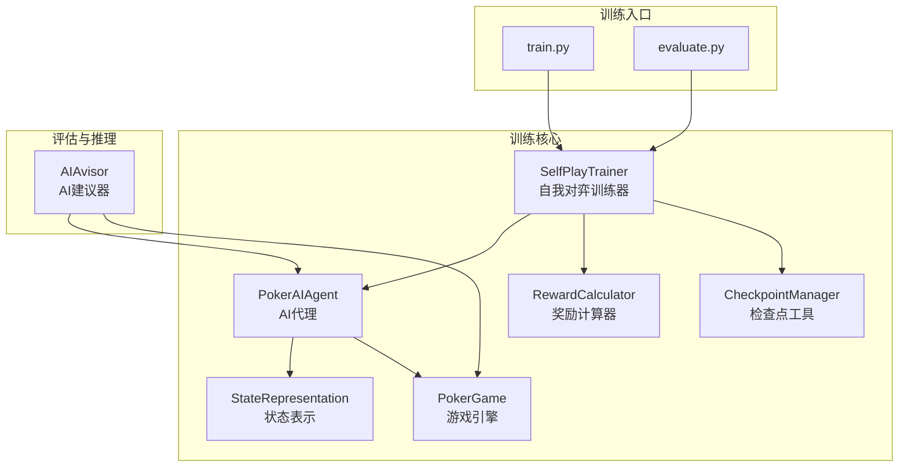
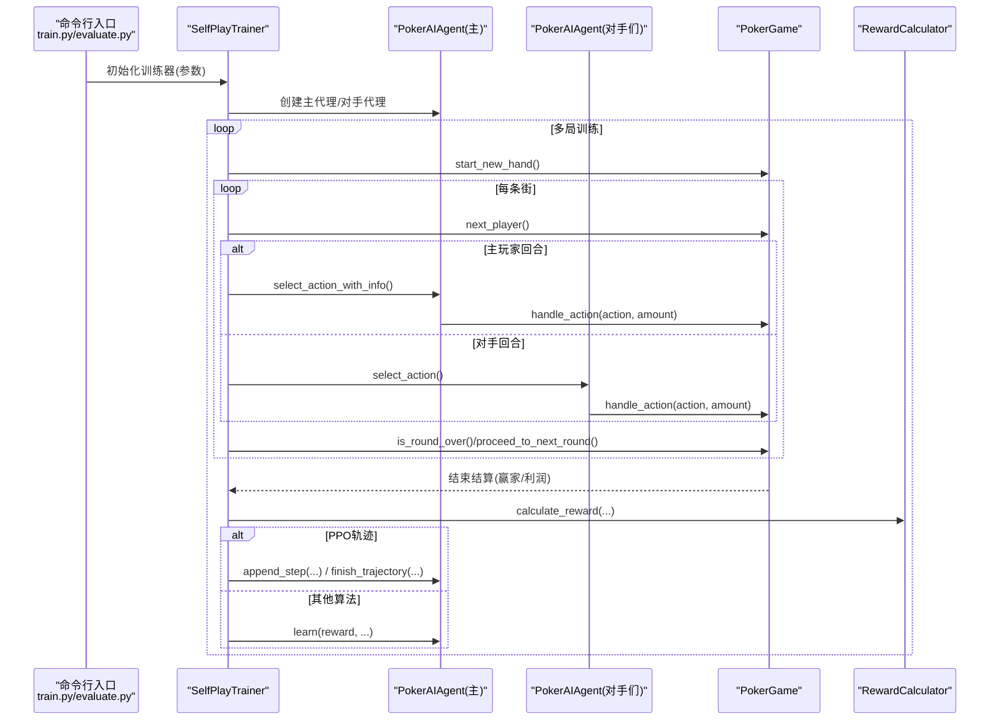
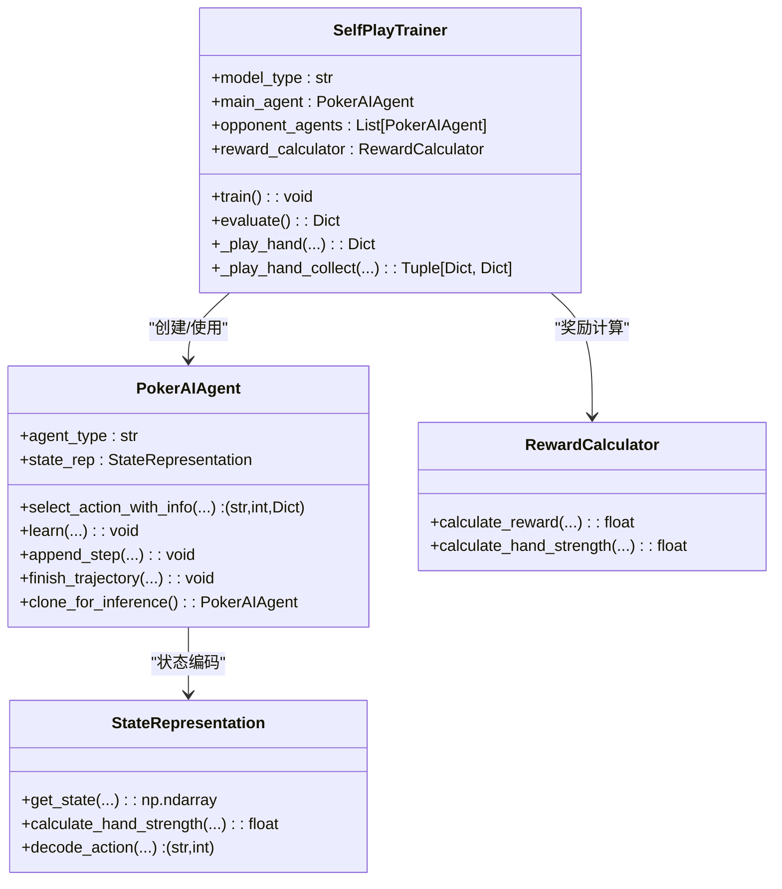
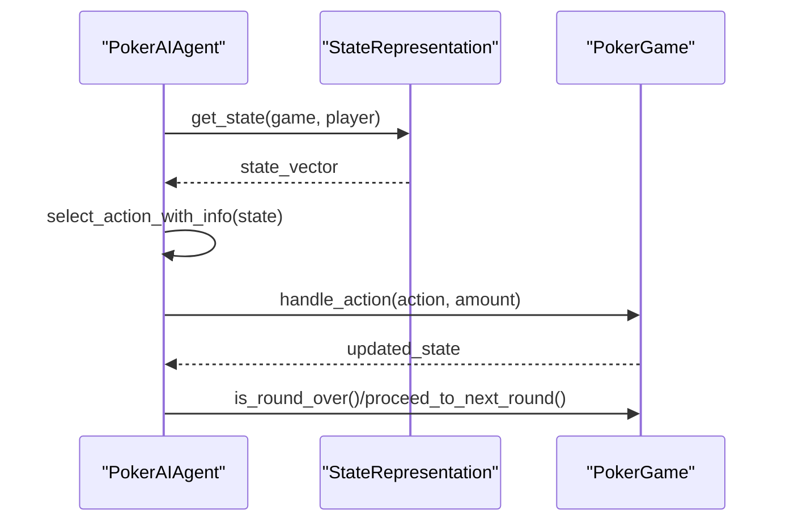
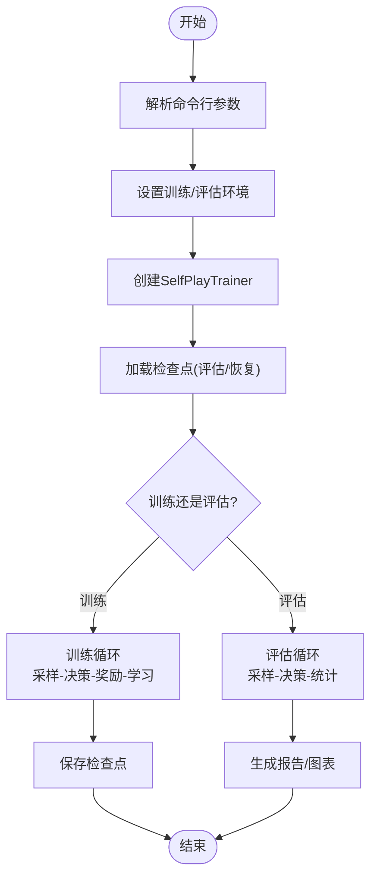
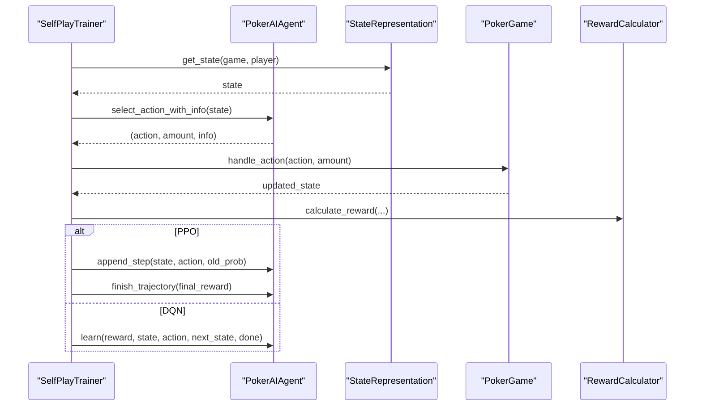
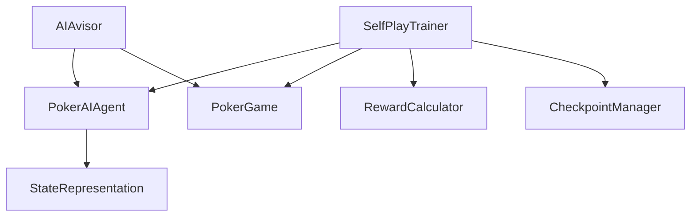

# 组件交互关系

<cite>
**本文档引用的文件**
- [train.py](file://train.py)
- [evaluate.py](file://evaluate.py)
- [poker_ai/reward/self_play_trainer.py](file://poker_ai/reward/self_play_trainer.py)
- [poker_ai/model/ai_agent.py](file://poker_ai/model/ai_agent.py)
- [poker_ai/game/poker_game.py](file://poker_ai/game/poker_game.py)
- [poker_ai/reward/reward_calculator.py](file://poker_ai/reward/reward_calculator.py)
- [poker_ai/model/state_representation.py](file://poker_ai/model/state_representation.py)
- [poker_ai/utils/checkpoint.py](file://poker_ai/utils/checkpoint.py)
- [poker_ai/advisor/ai_advisor.py](file://poker_ai/advisor/ai_advisor.py)
</cite>

## 目录
1. [简介](#简介)
2. [项目结构](#项目结构)
3. [核心组件](#核心组件)
4. [架构概览](#架构概览)
5. [详细组件分析](#详细组件分析)
6. [依赖关系分析](#依赖关系分析)
7. [性能考量](#性能考量)
8. [故障排查指南](#故障排查指南)
9. [结论](#结论)

## 简介
本文件聚焦德州扑克AI项目的组件交互关系，系统梳理SelfPlayTrainer与PokerAIAgent的协作、AI代理与游戏引擎的交互模式、训练系统与评估系统的数据流转，解释组件间的依赖关系、调用顺序与数据传递方式。重点阐述训练过程中的完整链路：从状态获取、动作选择、奖励计算到轨迹记录与模型更新。同时分析组件解耦设计与接口抽象，讨论如何通过良好设计提升系统的可测试性与可维护性。

## 项目结构
项目采用模块化组织，围绕“训练-评估-推理”三条主线划分核心模块：
- 训练入口与环境配置：train.py
- 自我对弈训练器：poker_ai/reward/self_play_trainer.py
- AI代理与模型：poker_ai/model/ai_agent.py、poker_ai/model/state_representation.py
- 游戏引擎：poker_ai/game/poker_game.py
- 奖励与评估：poker_ai/reward/reward_calculator.py、evaluate.py
- 检查点工具：poker_ai/utils/checkpoint.py
- AI建议器：poker_ai/advisor/ai_advisor.py

**图表来源**
- [train.py:340-531](file://train.py#L340-L531)
- [evaluate.py:181-267](file://evaluate.py#L181-L267)
- [poker_ai/reward/self_play_trainer.py:48-166](file://poker_ai/reward/self_play_trainer.py#L48-L166)
- [poker_ai/model/ai_agent.py:55-116](file://poker_ai/model/ai_agent.py#L55-L116)
- [poker_ai/model/state_representation.py:9-46](file://poker_ai/model/state_representation.py#L9-L46)
- [poker_ai/game/poker_game.py:155-194](file://poker_ai/game/poker_game.py#L155-L194)
- [poker_ai/reward/reward_calculator.py:9-42](file://poker_ai/reward/reward_calculator.py#L9-L42)
- [poker_ai/utils/checkpoint.py:17-56](file://poker_ai/utils/checkpoint.py#L17-L56)
- [poker_ai/advisor/ai_advisor.py:21-48](file://poker_ai/advisor/ai_advisor.py#L21-L48)

**章节来源**
- [train.py:136-238](file://train.py#L136-L238)
- [evaluate.py:110-142](file://evaluate.py#L110-L142)

## 核心组件
- SelfPlayTrainer：负责训练调度、并行采样、轨迹收集、奖励计算与模型更新，协调主代理与多个对手代理。
- PokerAIAgent：封装DQN/PPO等智能体，提供动作选择、轨迹记录、批量推理与权重管理。
- StateRepresentation：将6-Max德州扑克状态编码为高维向量，支持快速one-hot与相对位置编码。
- PokerGame：实现6人德州扑克规则，处理发牌、下注、轮次推进与摊牌结算。
- RewardCalculator：提供精细化奖励计算，包含手牌强度、底池赔率、位置优势、决策一致性等因子。
- CheckpointManager：统一模型权重与元数据的保存与加载。
- AIAvisor：面向人类玩家的建议器，基于训练模型给出动作建议与置信度分析。

**章节来源**
- [poker_ai/reward/self_play_trainer.py:48-166](file://poker_ai/reward/self_play_trainer.py#L48-L166)
- [poker_ai/model/ai_agent.py:55-116](file://poker_ai/model/ai_agent.py#L55-L116)
- [poker_ai/model/state_representation.py:9-46](file://poker_ai/model/state_representation.py#L9-L46)
- [poker_ai/game/poker_game.py:155-194](file://poker_ai/game/poker_game.py#L155-L194)
- [poker_ai/reward/reward_calculator.py:9-42](file://poker_ai/reward/reward_calculator.py#L9-L42)
- [poker_ai/utils/checkpoint.py:17-56](file://poker_ai/utils/checkpoint.py#L17-L56)
- [poker_ai/advisor/ai_advisor.py:21-48](file://poker_ai/advisor/ai_advisor.py#L21-L48)

## 架构概览
训练系统采用“训练器驱动代理，代理驱动游戏引擎”的分层架构。训练器负责宏观调度与并行采样，代理负责感知状态与决策，游戏引擎提供规则约束与状态演进，奖励计算器提供强化学习信号，检查点工具贯穿训练与评估生命周期。

**图表来源**
- [train.py:340-531](file://train.py#L340-L531)
- [evaluate.py:181-267](file://evaluate.py#L181-L267)
- [poker_ai/reward/self_play_trainer.py:260-417](file://poker_ai/reward/self_play_trainer.py#L260-L417)
- [poker_ai/model/ai_agent.py:125-155](file://poker_ai/model/ai_agent.py#L125-L155)
- [poker_ai/game/poker_game.py:299-402](file://poker_ai/game/poker_game.py#L299-L402)
- [poker_ai/reward/reward_calculator.py:303-391](file://poker_ai/reward/reward_calculator.py#L303-L391)

## 详细组件分析

### SelfPlayTrainer 与 PokerAIAgent 的协作关系
- 训练器在每手牌开始时创建游戏实例与玩家集合，主代理与多个对手代理参与。
- 主代理在训练阶段通过select_action_with_info获取动作与额外信息（状态、动作索引、旧概率、状态价值等），用于PPO轨迹记录与DQN单步学习。
- 对手代理通过select_action进行动作选择，动作合法性由handle_action统一校验。
- 训练器在手牌结束时调用奖励计算器计算最终奖励，并根据模型类型选择轨迹记录或单步学习。

**图表来源**
- [poker_ai/reward/self_play_trainer.py:48-166](file://poker_ai/reward/self_play_trainer.py#L48-L166)
- [poker_ai/model/ai_agent.py:55-116](file://poker_ai/model/ai_agent.py#L55-L116)
- [poker_ai/model/state_representation.py:137-158](file://poker_ai/model/state_representation.py#L137-L158)
- [poker_ai/reward/reward_calculator.py:9-42](file://poker_ai/reward/reward_calculator.py#L9-L42)

**章节来源**
- [poker_ai/reward/self_play_trainer.py:167-213](file://poker_ai/reward/self_play_trainer.py#L167-L213)
- [poker_ai/reward/self_play_trainer.py:260-417](file://poker_ai/reward/self_play_trainer.py#L260-L417)
- [poker_ai/model/ai_agent.py:125-246](file://poker_ai/model/ai_agent.py#L125-L246)

### AI代理与游戏引擎的交互模式
- 状态获取：代理通过StateRepresentation.get_state将手牌、公共牌、玩家状态、全局信息、位置与活跃人数等特征拼接为统一状态向量。
- 动作选择：代理根据当前状态与合法掩码选择动作，PPO路径支持批量动作与轨迹记录，DQN路径支持单步学习。
- 动作执行：代理将动作与金额传递给游戏引擎的handle_action，引擎校验合法性并更新状态。
- 轮次推进：引擎在每条街结束时推进到下一条街或进入摊牌阶段。

**图表来源**
- [poker_ai/model/ai_agent.py:125-155](file://poker_ai/model/ai_agent.py#L125-L155)
- [poker_ai/model/state_representation.py:137-158](file://poker_ai/model/state_representation.py#L137-L158)
- [poker_ai/game/poker_game.py:299-402](file://poker_ai/game/poker_game.py#L299-L402)

**章节来源**
- [poker_ai/model/ai_agent.py:157-214](file://poker_ai/model/ai_agent.py#L157-L214)
- [poker_ai/game/poker_game.py:299-402](file://poker_ai/game/poker_game.py#L299-L402)

### 训练系统与评估系统的数据流转
- 训练系统：命令行入口解析参数，创建SelfPlayTrainer，配置环境与并行参数，调用train()进行训练，期间通过检查点工具保存权重与元数据。
- 评估系统：命令行入口解析参数，创建SelfPlayTrainer并加载检查点，执行evaluate()生成基本与详细评估结果，保存报告与可视化图表。

**图表来源**
- [train.py:240-339](file://train.py#L240-L339)
- [train.py:340-531](file://train.py#L340-L531)
- [evaluate.py:144-157](file://evaluate.py#L144-L157)
- [evaluate.py:181-267](file://evaluate.py#L181-L267)

**章节来源**
- [train.py:240-339](file://train.py#L240-L339)
- [evaluate.py:144-157](file://evaluate.py#L144-L157)

### 训练过程中的组件协作流程（从状态到动作再到奖励）
- 状态获取：代理通过StateRepresentation.get_state获取当前局面的统一状态向量。
- 动作选择：代理根据状态与合法掩码选择动作，PPO路径记录轨迹，DQN路径准备单步学习。
- 动作执行：代理调用handle_action，引擎更新玩家状态与底池，随后推进轮次。
- 奖励计算：训练器调用RewardCalculator.calculate_reward计算即时奖励与最终奖励，结合all-in不走运补偿等策略性修正。
- 模型更新：PPO通过append_step/finish_trajectory批量更新，DQN通过learn与replay更新经验回放。

**图表来源**
- [poker_ai/reward/self_play_trainer.py:260-417](file://poker_ai/reward/self_play_trainer.py#L260-L417)
- [poker_ai/model/ai_agent.py:125-155](file://poker_ai/model/ai_agent.py#L125-L155)
- [poker_ai/reward/reward_calculator.py:303-391](file://poker_ai/reward/reward_calculator.py#L303-L391)

**章节来源**
- [poker_ai/reward/self_play_trainer.py:360-404](file://poker_ai/reward/self_play_trainer.py#L360-L404)
- [poker_ai/model/ai_agent.py:248-301](file://poker_ai/model/ai_agent.py#L248-L301)

### 组件解耦设计与接口抽象
- SelfPlayTrainer与PokerAIAgent通过统一接口解耦：训练器仅依赖代理的select_action/learn/append_step等方法，不关心具体算法细节。
- PokerAIAgent与StateRepresentation通过状态表示接口解耦：代理仅依赖get_state/decode_action等方法，便于替换不同状态编码方案。
- PokerGame提供清晰的规则边界：动作合法性与轮次推进由引擎统一处理，代理无需关注规则细节。
- RewardCalculator提供可插拔的奖励策略：支持静态权重与自适应调整，便于实验不同奖励机制。
- CheckpointManager提供统一的模型持久化接口，支持多种保存/加载策略。

**章节来源**
- [poker_ai/model/ai_agent.py:55-116](file://poker_ai/model/ai_agent.py#L55-L116)
- [poker_ai/model/state_representation.py:137-158](file://poker_ai/model/state_representation.py#L137-L158)
- [poker_ai/game/poker_game.py:299-402](file://poker_ai/game/poker_game.py#L299-L402)
- [poker_ai/reward/reward_calculator.py:394-552](file://poker_ai/reward/reward_calculator.py#L394-L552)
- [poker_ai/utils/checkpoint.py:17-56](file://poker_ai/utils/checkpoint.py#L17-L56)

## 依赖关系分析
- SelfPlayTrainer依赖PokerAIAgent、PokerGame、RewardCalculator与CheckpointManager。
- PokerAIAgent依赖StateRepresentation与具体算法实现（DQN/PPO）。
- PokerGame独立提供规则与状态演进。
- RewardCalculator依赖游戏状态与手牌评估能力。
- AIAvisor依赖PokerAIAgent与HandEvaluator，提供人类友好的建议。

**图表来源**
- [poker_ai/reward/self_play_trainer.py:21-25](file://poker_ai/reward/self_play_trainer.py#L21-L25)
- [poker_ai/model/ai_agent.py:6-9](file://poker_ai/model/ai_agent.py#L6-L9)
- [poker_ai/advisor/ai_advisor.py:17-19](file://poker_ai/advisor/ai_advisor.py#L17-L19)

**章节来源**
- [poker_ai/reward/self_play_trainer.py:21-25](file://poker_ai/reward/self_play_trainer.py#L21-L25)
- [poker_ai/model/ai_agent.py:6-9](file://poker_ai/model/ai_agent.py#L6-L9)
- [poker_ai/advisor/ai_advisor.py:17-19](file://poker_ai/advisor/ai_advisor.py#L17-L19)

## 性能考量
- 并行采样与批量推理：SelfPlayTrainer支持训练与评估的多worker并行，PPO路径支持批量动作与轨迹累积，减少Python与深度学习框架往返开销。
- 状态表示优化：StateRepresentation采用one-hot编码与预计算索引映射，避免频繁对象解包与列表查找。
- 奖励计算缓存：RewardCalculator使用LRU缓存与线程本地存储，降低蒙特卡洛模拟与状态记录的重复成本。
- 探索参数与对手更新：训练器支持动态探索率与对手更新间隔，平衡训练效率与策略稳定性。

**章节来源**
- [poker_ai/reward/self_play_trainer.py:587-799](file://poker_ai/reward/self_play_trainer.py#L587-L799)
- [poker_ai/model/state_representation.py:47-64](file://poker_ai/model/state_representation.py#L47-L64)
- [poker_ai/reward/reward_calculator.py:80-83](file://poker_ai/reward/reward_calculator.py#L80-L83)
- [train.py:385-403](file://train.py#L385-L403)

## 故障排查指南
- 模型加载失败：检查检查点路径与文件是否存在，确认权重格式与模型类型匹配。
- 训练无进展：检查探索参数设置、对手更新间隔与奖励权重，观察策略指标统计与all-in不走运补偿触发情况。
- GPU相关错误：根据日志提示调整XLA与oneDNN配置，或切换到CPU模式验证问题定位。
- 评估异常：确认评估参数与对手类型设置，检查模型路径与文件权限。

**章节来源**
- [poker_ai/utils/checkpoint.py:58-104](file://poker_ai/utils/checkpoint.py#L58-L104)
- [train.py:240-339](file://train.py#L240-L339)
- [evaluate.py:200-240](file://evaluate.py#L200-L240)

## 结论
本项目通过清晰的模块划分与接口抽象，实现了训练器、AI代理、游戏引擎与奖励系统的高效协作。SelfPlayTrainer作为中枢，协调多代理并行采样与奖励反馈；PokerAIAgent与StateRepresentation提供稳定的决策与状态表示；PokerGame确保规则一致性；RewardCalculator与CheckpointManager保障奖励信号与模型持久化。整体设计提升了系统的可扩展性、可测试性与可维护性，为后续算法迭代与评估体系完善奠定了坚实基础。