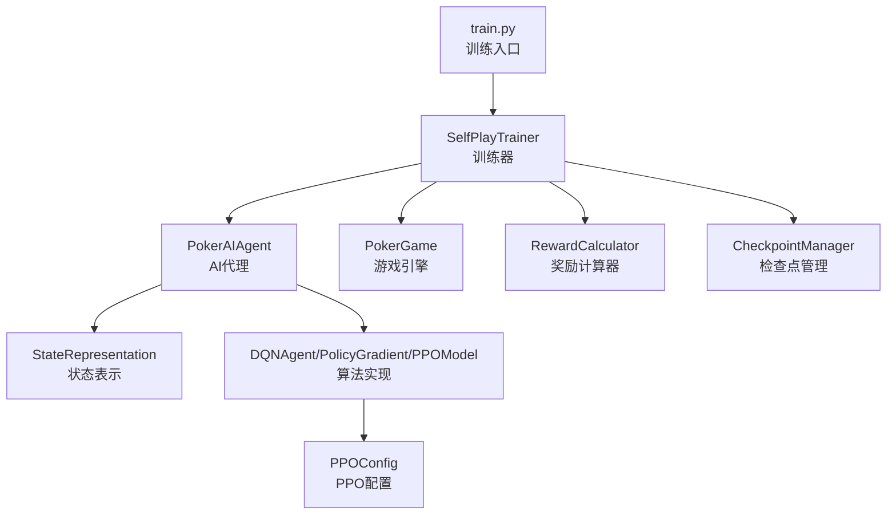
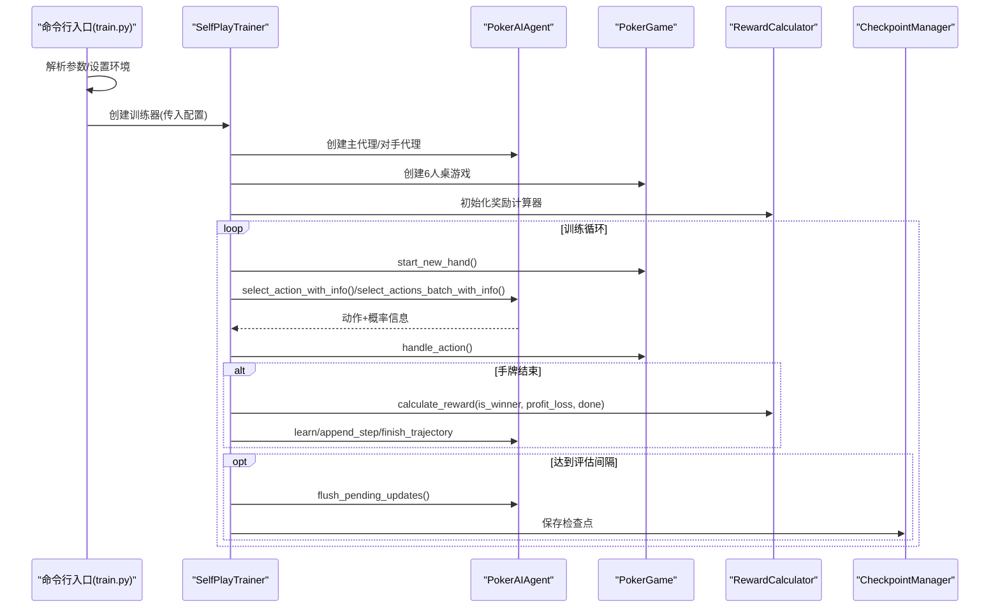
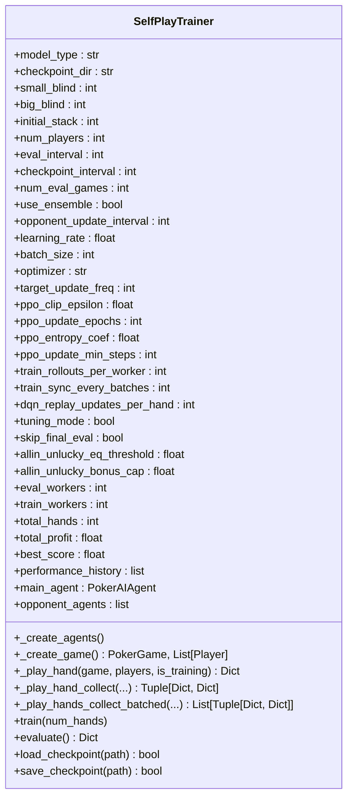
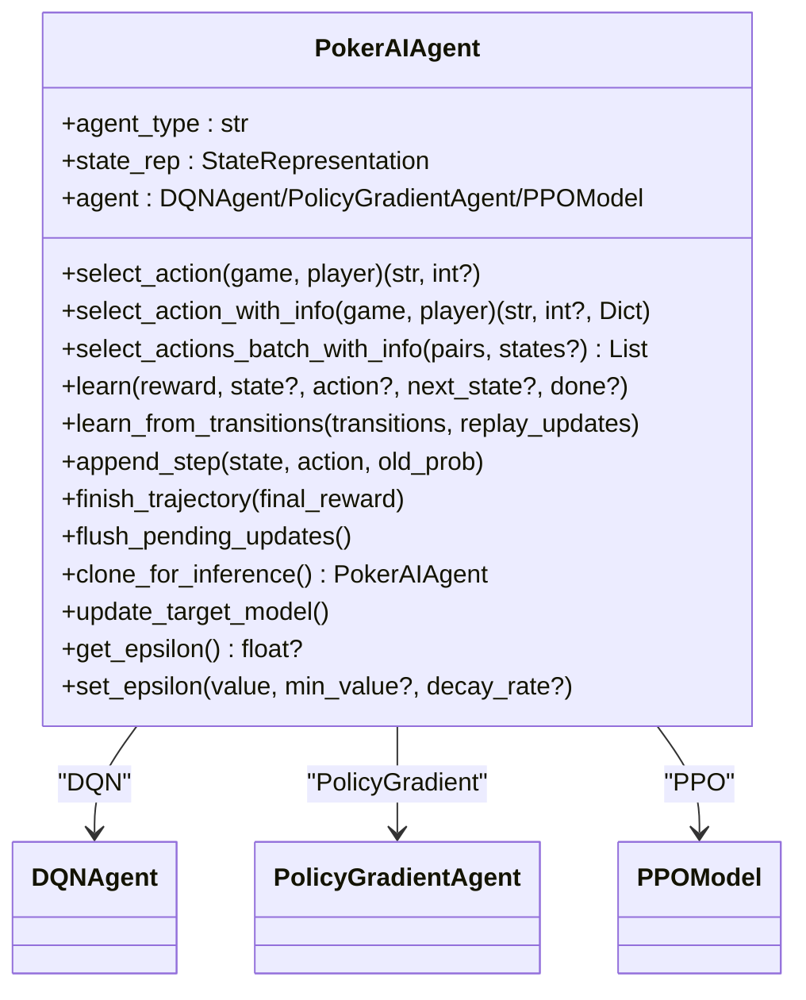
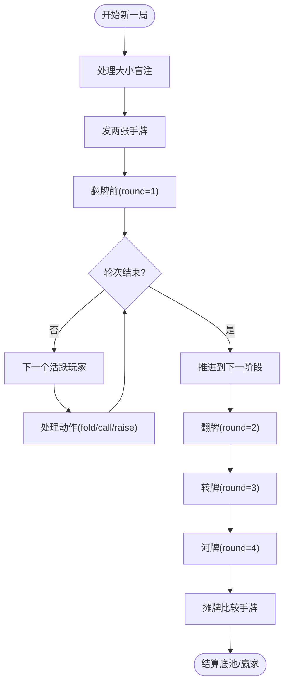
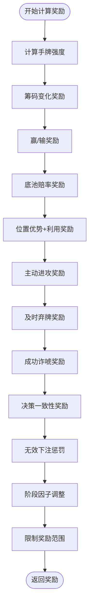
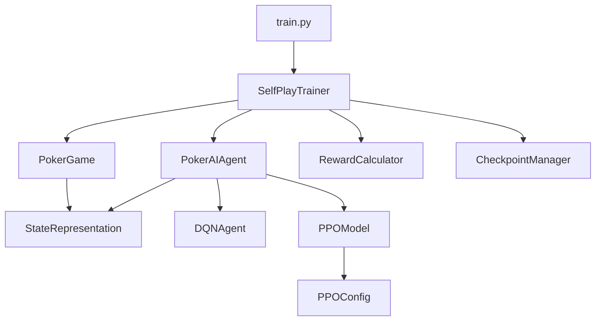
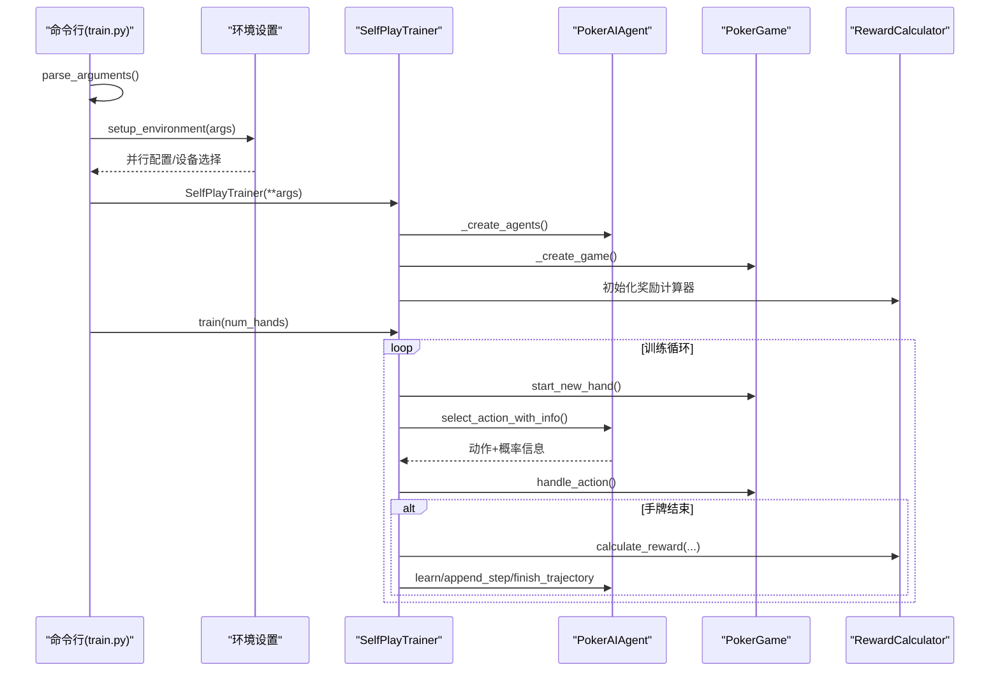
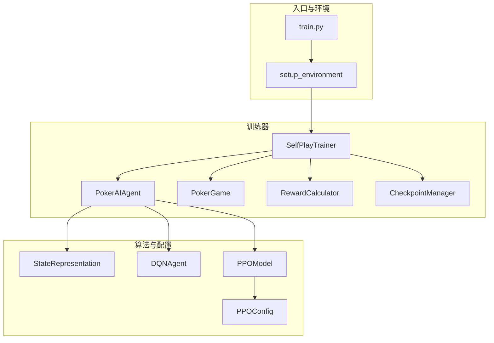

# 训练系统组件交互

<cite>
**本文引用的文件**
- [train.py](file://train.py)
- [self_play_trainer.py](file://poker_ai/reward/self_play_trainer.py)
- [ai_agent.py](file://poker_ai/model/ai_agent.py)
- [poker_game.py](file://poker_ai/game/poker_game.py)
- [reward_calculator.py](file://poker_ai/reward/reward_calculator.py)
- [checkpoint.py](file://poker_ai/utils/checkpoint.py)
- [state_representation.py](file://poker_ai/model/state_representation.py)
- [ppo_model.py](file://poker_ai/model/ppo_model.py)
- [ppo_config.py](file://poker_ai/config/ppo_config.py)
- [README.md](file://README.md)
</cite>

## 目录
1. [简介](#简介)
2. [项目结构](#项目结构)
3. [核心组件](#核心组件)
4. [架构总览](#架构总览)
5. [详细组件分析](#详细组件分析)
6. [依赖关系分析](#依赖关系分析)
7. [性能考量](#性能考量)
8. [故障排查指南](#故障排查指南)
9. [结论](#结论)
10. [附录](#附录)

## 简介
本文件面向德州扑克AI训练系统，聚焦SelfPlayTrainer与训练流程各阶段的交互关系，涵盖训练器初始化、参数配置传递、训练循环控制、组件调用顺序、AI代理、游戏引擎、奖励计算器的协作机制，以及并发处理（并行采样、批量训练、检查点管理）等。文档提供时序图与组件交互图，帮助读者理解从参数解析到环境设置、从训练器创建到实际训练执行的完整链路，并给出具体代码示例路径与配置参数传递过程。

## 项目结构
项目采用模块化设计，围绕训练入口、训练器、AI代理、游戏引擎、奖励计算、状态表示、检查点管理与PPO配置展开。训练入口负责参数解析与环境初始化，训练器负责组织并行采样、批量训练与评估，AI代理封装不同算法（DQN、PG、PPO），游戏引擎提供6人桌规则与状态，奖励计算器提供即时与最终奖励，状态表示将游戏状态编码为高维向量，检查点管理负责模型持久化，PPO配置集中管理超参数。

**图表来源**
- [train.py:340-531](file://train.py#L340-L531)
- [self_play_trainer.py:48-166](file://poker_ai/reward/self_play_trainer.py#L48-L166)
- [ai_agent.py:55-116](file://poker_ai/model/ai_agent.py#L55-L116)
- [state_representation.py:9-46](file://poker_ai/model/state_representation.py#L9-L46)
- [poker_game.py:155-194](file://poker_ai/game/poker_game.py#L155-L194)
- [reward_calculator.py:9-42](file://poker_ai/reward/reward_calculator.py#L9-L42)
- [checkpoint.py:17-56](file://poker_ai/utils/checkpoint.py#L17-L56)
- [ppo_model.py:20-93](file://poker_ai/model/ppo_model.py#L20-L93)
- [ppo_config.py:18-97](file://poker_ai/config/ppo_config.py#L18-L97)

**章节来源**
- [README.md:46-75](file://README.md#L46-L75)

## 核心组件
- 训练入口（train.py）：解析命令行参数、设置环境、创建训练器、执行训练/评估/演示。
- SelfPlayTrainer：训练器主体，负责并行采样、轨迹收集、批量训练、评估与检查点管理。
- PokerAIAgent：统一AI代理接口，封装DQN、PG、PPO三种算法，提供动作选择与学习接口。
- StateRepresentation：将游戏状态编码为134维向量，支持Hero相对位置与活跃人数等特征。
- PokerGame：6人桌德州扑克引擎，负责发牌、下注、轮次推进、摊牌结算。
- RewardCalculator：综合奖励计算，包含手牌强度、底池赔率、位置优势、决策一致性、无效下注惩罚等。
- CheckpointManager：检查点保存与加载，支持权重、pickle与元数据。
- PPOModel/PPOConfig：PPO Actor-Critic模型与超参数配置，支持学习率调度、KL早停、价值损失裁剪等。

**章节来源**
- [train.py:136-238](file://train.py#L136-L238)
- [self_play_trainer.py:48-166](file://poker_ai/reward/self_play_trainer.py#L48-L166)
- [ai_agent.py:55-116](file://poker_ai/model/ai_agent.py#L55-L116)
- [state_representation.py:9-46](file://poker_ai/model/state_representation.py#L9-L46)
- [poker_game.py:155-194](file://poker_ai/game/poker_game.py#L155-L194)
- [reward_calculator.py:9-42](file://poker_ai/reward/reward_calculator.py#L9-L42)
- [checkpoint.py:17-56](file://poker_ai/utils/checkpoint.py#L17-L56)
- [ppo_model.py:20-93](file://poker_ai/model/ppo_model.py#L20-L93)
- [ppo_config.py:18-97](file://poker_ai/config/ppo_config.py#L18-L97)

## 架构总览
训练系统采用“入口-训练器-代理-引擎-奖励-状态-检查点-PPO配置”的分层架构。入口负责参数解析与环境初始化；训练器协调并行采样与批量训练；代理封装算法细节；引擎提供规则与状态；奖励提供即时与最终反馈；状态表示将规则状态映射为神经网络输入；检查点管理贯穿训练生命周期；PPO配置集中管理超参数。

**图表来源**
- [train.py:340-531](file://train.py#L340-L531)
- [self_play_trainer.py:260-417](file://poker_ai/reward/self_play_trainer.py#L260-L417)
- [ai_agent.py:125-214](file://poker_ai/model/ai_agent.py#L125-L214)
- [poker_game.py:299-402](file://poker_ai/game/poker_game.py#L299-L402)
- [reward_calculator.py:303-370](file://poker_ai/reward/reward_calculator.py#L303-L370)
- [checkpoint.py:17-56](file://poker_ai/utils/checkpoint.py#L17-L56)

## 详细组件分析

### SelfPlayTrainer：训练器核心
- 职责：创建AI代理与对手、并行采样、轨迹收集、批量训练、评估与检查点管理。
- 关键参数：模型类型、检查点目录、盲注、初始筹码、玩家数、评估间隔、检查点间隔、使用集成、对手更新间隔、学习率、批大小、优化器、目标网络更新频率、PPO裁剪、更新轮次、熵系数、PPO最小更新步数、训练每worker轨迹数、训练同步批次、DQN回放更新次数、调参模式、跳过最终评估、all-in不走运补偿阈值与上限、评估/训练worker数。
- 并行策略：训练worker与评估worker分别按CPU核数自动推断；PPO场景下增大每worker轨迹数与同步批次，降低调度开销。
- PPO轨迹管理：支持append_step/finish_trajectory与pending buffer批量训练，满足PPO最小更新步数阈值。

**图表来源**
- [self_play_trainer.py:48-166](file://poker_ai/reward/self_play_trainer.py#L48-L166)
- [self_play_trainer.py:167-213](file://poker_ai/reward/self_play_trainer.py#L167-L213)
- [self_play_trainer.py:214-258](file://poker_ai/reward/self_play_trainer.py#L214-L258)
- [self_play_trainer.py:260-417](file://poker_ai/reward/self_play_trainer.py#L260-L417)
- [self_play_trainer.py:420-800](file://poker_ai/reward/self_play_trainer.py#L420-L800)

**章节来源**
- [self_play_trainer.py:48-166](file://poker_ai/reward/self_play_trainer.py#L48-L166)
- [self_play_trainer.py:167-213](file://poker_ai/reward/self_play_trainer.py#L167-L213)
- [self_play_trainer.py:214-258](file://poker_ai/reward/self_play_trainer.py#L214-L258)
- [self_play_trainer.py:260-417](file://poker_ai/reward/self_play_trainer.py#L260-L417)
- [self_play_trainer.py:420-800](file://poker_ai/reward/self_play_trainer.py#L420-L800)

### PokerAIAgent：统一AI代理接口
- 职责：封装DQN、PG、PPO三种算法，提供动作选择（含概率信息）、批量动作选择、学习接口、轨迹追加与批量训练、权重克隆（推理副本）。
- PPO特殊性：维护pending buffer，支持append_step/finish_trajectory与批量轨迹追加；提供learn_from_transitions以降低Python调度开销。
- 探索参数：DQN支持epsilon、epsilon_min、epsilon_decay设置。

**图表来源**
- [ai_agent.py:55-116](file://poker_ai/model/ai_agent.py#L55-L116)
- [ai_agent.py:117-214](file://poker_ai/model/ai_agent.py#L117-L214)
- [ai_agent.py:248-420](file://poker_ai/model/ai_agent.py#L248-L420)
- [ai_agent.py:421-517](file://poker_ai/model/ai_agent.py#L421-L517)
- [dqn_agent.py:21-62](file://poker_ai/model/dqn_agent.py#L21-L62)
- [ppo_model.py:20-93](file://poker_ai/model/ppo_model.py#L20-L93)

**章节来源**
- [ai_agent.py:55-116](file://poker_ai/model/ai_agent.py#L55-L116)
- [ai_agent.py:117-214](file://poker_ai/model/ai_agent.py#L117-L214)
- [ai_agent.py:248-420](file://poker_ai/model/ai_agent.py#L248-L420)
- [ai_agent.py:421-517](file://poker_ai/model/ai_agent.py#L421-L517)
- [dqn_agent.py:21-62](file://poker_ai/model/dqn_agent.py#L21-L62)
- [ppo_model.py:20-93](file://poker_ai/model/ppo_model.py#L20-L93)

### PokerGame：6人桌游戏引擎
- 职责：发牌、处理玩家动作（fold/call/raise）、轮次推进、摊牌结算、记录赢家。
- 关键约束：6人桌专用，庄家位置顺时针移动，大小盲注处理，公共牌三张翻牌、一张转牌、一张河牌。

**图表来源**
- [poker_game.py:227-257](file://poker_ai/game/poker_game.py#L227-L257)
- [poker_game.py:299-402](file://poker_ai/game/poker_game.py#L299-L402)
- [poker_game.py:404-457](file://poker_ai/game/poker_game.py#L404-L457)

**章节来源**
- [poker_game.py:155-194](file://poker_ai/game/poker_game.py#L155-L194)
- [poker_game.py:227-257](file://poker_ai/game/poker_game.py#L227-L257)
- [poker_game.py:299-402](file://poker_ai/game/poker_game.py#L299-L402)
- [poker_game.py:404-457](file://poker_ai/game/poker_game.py#L404-L457)

### RewardCalculator：奖励计算
- 职责：综合即时与最终奖励，包含手牌强度、底池赔率、位置优势、决策一致性、无效下注惩罚、阶段因子等。
- 并发安全：使用线程本地存储避免多worker间状态冲突。
- 自适应调整：根据策略指标（诈唬率、无效下注率、利润）动态调整权重。

**图表来源**
- [reward_calculator.py:303-370](file://poker_ai/reward/reward_calculator.py#L303-L370)
- [reward_calculator.py:394-536](file://poker_ai/reward/reward_calculator.py#L394-L536)

**章节来源**
- [reward_calculator.py:9-42](file://poker_ai/reward/reward_calculator.py#L9-L42)
- [reward_calculator.py:303-370](file://poker_ai/reward/reward_calculator.py#L303-L370)
- [reward_calculator.py:394-536](file://poker_ai/reward/reward_calculator.py#L394-L536)

### CheckpointManager：检查点管理
- 职责：保存与加载模型权重、pickle模型、元数据；查找最新检查点。
- 保存格式：PPO三件套（actor/critic/state），DQN/PG权重或pickle文件，元数据JSON。

**章节来源**
- [checkpoint.py:17-56](file://poker_ai/utils/checkpoint.py#L17-L56)
- [checkpoint.py:58-104](file://poker_ai/utils/checkpoint.py#L58-L104)
- [checkpoint.py:106-139](file://poker_ai/utils/checkpoint.py#L106-L139)

### PPOModel与PPOConfig：PPO训练配置
- PPOModel：Actor-Critic网络，支持学习率调度（warmup+cosine）、KL散度早停、价值损失裁剪、自适应熵系数、梯度累积与混合精度适配。
- PPOConfig：集中管理超参数（输入维度、输出维度、学习率、clip、gamma、lambda、熵系数、更新轮次、batch size、学习率调度、KL早停、价值裁剪、梯度裁剪等）。

**章节来源**
- [ppo_model.py:20-93](file://poker_ai/model/ppo_model.py#L20-L93)
- [ppo_model.py:106-199](file://poker_ai/model/ppo_model.py#L106-L199)
- [ppo_config.py:18-97](file://poker_ai/config/ppo_config.py#L18-L97)

## 依赖关系分析
- train.py依赖SelfPlayTrainer创建训练器，传入解析后的参数；训练器依赖AI代理、游戏引擎、奖励计算器、检查点管理。
- SelfPlayTrainer依赖PokerAIAgent（主代理与对手代理）、PokerGame、RewardCalculator、CheckpointManager。
- PokerAIAgent依赖StateRepresentation与具体算法实现（DQN/PG/PPO）。
- PPOModel依赖PPOConfig与StateRepresentation。
- PokerGame与StateRepresentation相互配合，前者提供规则状态，后者提供向量表示。

**图表来源**
- [train.py:340-531](file://train.py#L340-L531)
- [self_play_trainer.py:48-166](file://poker_ai/reward/self_play_trainer.py#L48-L166)
- [ai_agent.py:55-116](file://poker_ai/model/ai_agent.py#L55-L116)
- [state_representation.py:9-46](file://poker_ai/model/state_representation.py#L9-L46)
- [ppo_model.py:20-93](file://poker_ai/model/ppo_model.py#L20-L93)
- [ppo_config.py:18-97](file://poker_ai/config/ppo_config.py#L18-L97)
- [poker_game.py:155-194](file://poker_ai/game/poker_game.py#L155-L194)

**章节来源**
- [train.py:340-531](file://train.py#L340-L531)
- [self_play_trainer.py:48-166](file://poker_ai/reward/self_play_trainer.py#L48-L166)
- [ai_agent.py:55-116](file://poker_ai/model/ai_agent.py#L55-L116)
- [state_representation.py:9-46](file://poker_ai/model/state_representation.py#L9-L46)
- [ppo_model.py:20-93](file://poker_ai/model/ppo_model.py#L20-L93)
- [ppo_config.py:18-97](file://poker_ai/config/ppo_config.py#L18-L97)
- [poker_game.py:155-194](file://poker_ai/game/poker_game.py#L155-L194)

## 性能考量
- 并行采样与批量训练：训练器根据模型类型自动调整每worker轨迹数与同步批次，PPO场景下增大batch与减少更新轮次以提升GPU利用率。
- 线程并行配置：入口设置TensorFlow线程并行度（intra/inter op），并根据硬件档位（如RTX4090D）自动优化参数。
- 混合精度与XLA：在GPU环境下启用混合精度与XLA以提升吞吐，同时提供开关以便兼容不同环境。
- PPO优化：价值损失裁剪、KL散度早停、自适应熵系数、梯度累积与混合精度适配，减少策略退化与数值不稳定。
- 探索参数：DQN支持epsilon衰减，可通过入口参数设置，影响早期探索与后期收敛。

[本节为通用性能讨论，无需特定文件引用]

## 故障排查指南
- 检查点加载失败：确认检查点路径与格式（PPO三件套、DQN/PG权重或pickle），查看日志错误信息。
- GPU相关错误：若出现DNN/Graph错误，尝试禁用XLA或onednn，或调整batch size与学习率。
- 硬件档位：使用RTX4090D档位时，入口会自动设置更高train_workers、eval_workers与batch size，确保CPU/GPU资源充足。
- 评估输出：评估完成后生成JSON结果与文本报告，便于对比不同版本模型。

**章节来源**
- [checkpoint.py:58-104](file://poker_ai/utils/checkpoint.py#L58-L104)
- [train.py:240-337](file://train.py#L240-L337)
- [ai_agent.py:322-331](file://poker_ai/model/ai_agent.py#L322-L331)

## 结论
SelfPlayTrainer通过清晰的职责划分与参数传递，将训练入口、AI代理、游戏引擎、奖励计算、状态表示、检查点管理与PPO配置有机整合，形成高效的自我对弈训练流水线。其并发策略与PPO优化技术在保证稳定性的同时提升了吞吐与收敛速度。通过模块化设计与集中式配置，系统具备良好的可扩展性与可维护性。

[本节为总结性内容，无需特定文件引用]

## 附录

### 训练流程时序图（参数解析到训练执行）

**图表来源**
- [train.py:136-238](file://train.py#L136-L238)
- [train.py:240-337](file://train.py#L240-L337)
- [train.py:340-531](file://train.py#L340-L531)
- [self_play_trainer.py:48-166](file://poker_ai/reward/self_play_trainer.py#L48-L166)
- [self_play_trainer.py:260-417](file://poker_ai/reward/self_play_trainer.py#L260-L417)
- [ai_agent.py:125-214](file://poker_ai/model/ai_agent.py#L125-L214)
- [poker_game.py:299-402](file://poker_ai/game/poker_game.py#L299-L402)
- [reward_calculator.py:303-370](file://poker_ai/reward/reward_calculator.py#L303-L370)

### 训练系统组件交互图（关键业务流程）

**图表来源**
- [train.py:240-337](file://train.py#L240-L337)
- [self_play_trainer.py:48-166](file://poker_ai/reward/self_play_trainer.py#L48-L166)
- [ai_agent.py:55-116](file://poker_ai/model/ai_agent.py#L55-L116)
- [state_representation.py:9-46](file://poker_ai/model/state_representation.py#L9-L46)
- [ppo_model.py:20-93](file://poker_ai/model/ppo_model.py#L20-L93)
- [ppo_config.py:18-97](file://poker_ai/config/ppo_config.py#L18-L97)

### 配置参数传递过程示例
- 入口参数解析：命令行参数通过解析函数传入训练器构造函数。
- 环境设置：根据硬件档位自动调整并行worker数、batch size、线程并行度、XLA与混合精度。
- 训练器初始化：训练器接收模型类型、检查点目录、盲注、初始筹码、玩家数、评估/检查点间隔、使用集成、对手更新间隔、学习率、批大小、优化器、目标网络更新频率、PPO裁剪、更新轮次、熵系数、PPO最小更新步数、训练每worker轨迹数、训练同步批次、DQN回放更新次数、调参模式、跳过最终评估、all-in不走运补偿阈值与上限、评估/训练worker数。
- AI代理创建：根据模型类型与超参数创建DQN/PG/PPO代理，并设置PPO的pending buffer与最小更新步数。
- 训练循环：并行采样、轨迹收集、批量训练、评估与检查点保存。

**章节来源**
- [train.py:136-238](file://train.py#L136-L238)
- [train.py:240-337](file://train.py#L240-L337)
- [train.py:340-531](file://train.py#L340-L531)
- [self_play_trainer.py:48-166](file://poker_ai/reward/self_play_trainer.py#L48-L166)
- [ai_agent.py:55-116](file://poker_ai/model/ai_agent.py#L55-L116)
- [ppo_model.py:20-93](file://poker_ai/model/ppo_model.py#L20-L93)