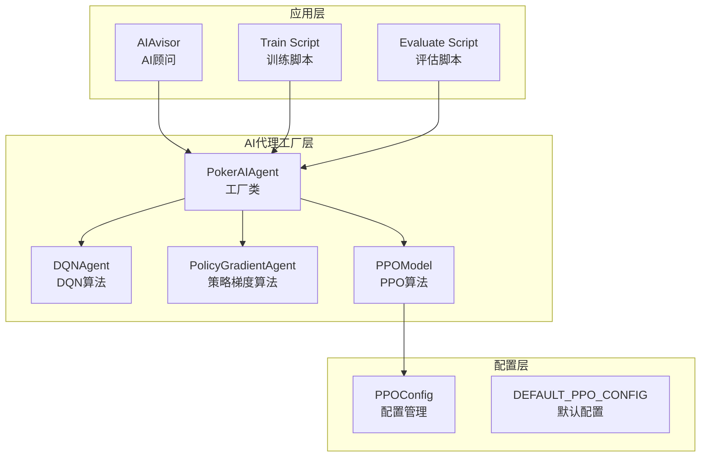
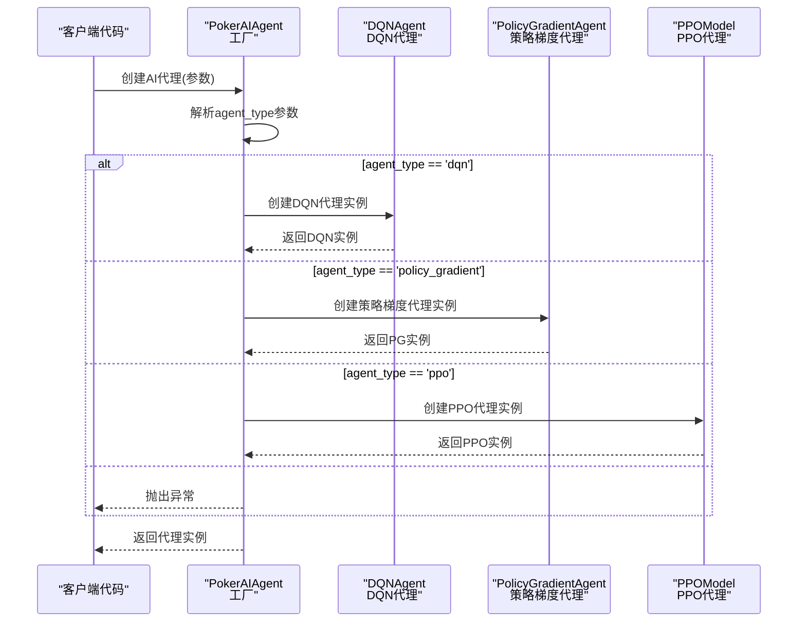
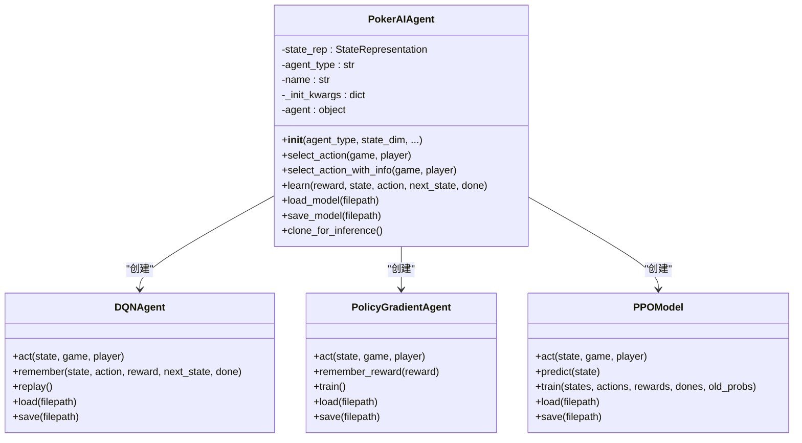
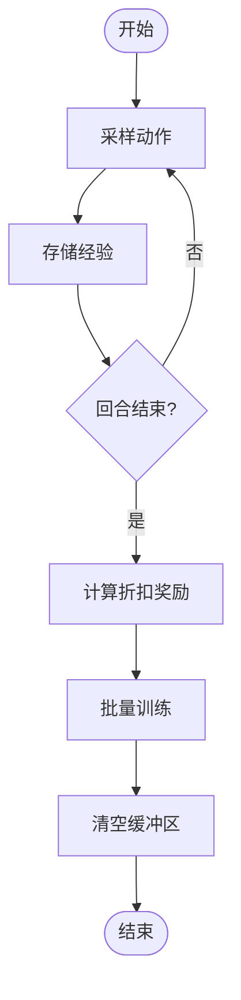
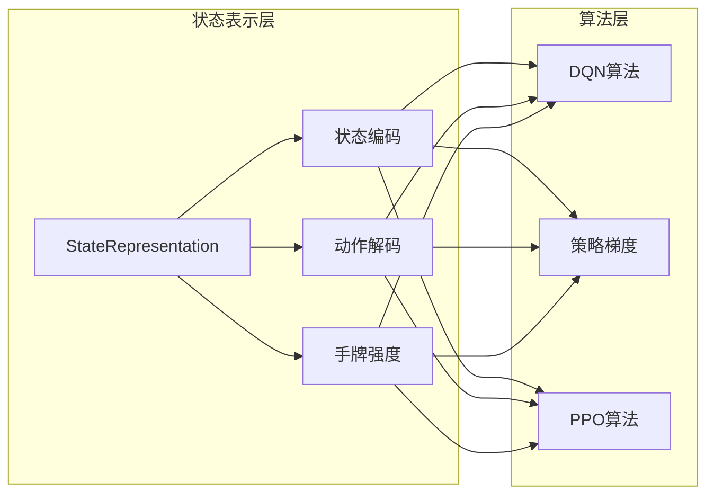
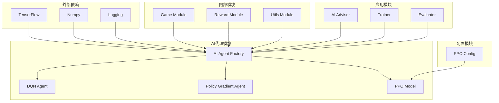

# 工厂模式应用

<cite>
**本文引用的文件**
- [ai_agent.py](file://poker_ai/model/ai_agent.py)
- [dqn_agent.py](file://poker_ai/model/dqn_agent.py)
- [ppo_model.py](file://poker_ai/model/ppo_model.py)
- [ppo_config.py](file://poker_ai/config/ppo_config.py)
- [ai_advisor.py](file://poker_ai/advisor/ai_advisor.py)
- [train.py](file://train.py)
- [evaluate.py](file://evaluate.py)
- [test_ppo.py](file://test_ppo.py)
- [test_fix.py](file://test_fix.py)
</cite>

## 目录
1. [简介](#简介)
2. [项目结构](#项目结构)
3. [核心组件](#核心组件)
4. [架构概览](#架构概览)
5. [详细组件分析](#详细组件分析)
6. [依赖分析](#依赖分析)
7. [性能考量](#性能考量)
8. [故障排除指南](#故障排除指南)
9. [结论](#结论)

## 简介
本文档深入分析德州扑克AI项目中工厂模式的应用，重点阐述PokerAIAgent类如何作为工厂类创建不同类型的AI代理实例。工厂模式在该项目中的实现体现了以下特点：
- 对象创建的集中化管理
- 算法实例的标准化创建
- 配置参数的一致性
- 动态创建和算法配置的灵活性

通过工厂模式，项目实现了统一的接口来创建DQN、策略梯度和PPO三种不同算法的AI代理，同时保持了算法间的差异性和各自的特化能力。

## 项目结构
项目采用模块化设计，工厂模式主要集中在AI代理模块中：



**图表来源**
- [ai_agent.py:55-116](file://poker_ai/model/ai_agent.py#L55-L116)
- [ppo_model.py:20-57](file://poker_ai/model/ppo_model.py#L20-L57)
- [ppo_config.py:18-96](file://poker_ai/config/ppo_config.py#L18-L96)

**章节来源**
- [ai_agent.py:1-703](file://poker_ai/model/ai_agent.py#L1-L703)
- [ppo_model.py:1-670](file://poker_ai/model/ppo_model.py#L1-L670)

## 核心组件
工厂模式的核心在于PokerAIAgent类，它充当统一的工厂接口，负责根据agent_type参数创建不同类型的AI代理实例。

### 工厂类设计原理
PokerAIAgent类实现了以下工厂模式的关键要素：

1. **统一接口**：提供统一的构造函数接口，接受agent_type参数
2. **条件创建**：根据agent_type参数选择不同的算法实现
3. **参数传递**：将配置参数传递给相应的算法类
4. **实例化过程**：创建并返回特定类型的AI代理实例

### 参数处理机制
工厂类支持多种参数配置：

- **基础参数**：agent_type、state_dim、learning_rate、optimizer
- **DQN特化参数**：target_update_freq
- **PPO特化参数**：ppo_clip_epsilon、ppo_update_epochs、ppo_entropy_coef、ppo_batch_size、ppo_update_min_steps

**章节来源**
- [ai_agent.py:58-116](file://poker_ai/model/ai_agent.py#L58-L116)

## 架构概览
工厂模式在德州扑克AI项目中的整体架构如下：



**图表来源**
- [ai_agent.py:90-112](file://poker_ai/model/ai_agent.py#L90-L112)

**章节来源**
- [ai_agent.py:55-116](file://poker_ai/model/ai_agent.py#L55-L116)

## 详细组件分析

### PokerAIAgent工厂类分析
PokerAIAgent作为核心工厂类，实现了完整的工厂模式：

#### 类结构设计


**图表来源**
- [ai_agent.py:55-116](file://poker_ai/model/ai_agent.py#L55-L116)
- [dqn_agent.py:21-125](file://poker_ai/model/dqn_agent.py#L21-L125)
- [dqn_agent.py:216-326](file://poker_ai/model/dqn_agent.py#L216-L326)
- [ppo_model.py:20-105](file://poker_ai/model/ppo_model.py#L20-L105)

#### 工厂方法实现细节
工厂类的创建逻辑体现了以下设计原则：

1. **参数一致性**：所有代理类型共享相同的参数接口
2. **算法特化**：针对不同算法提供专门的参数配置
3. **状态共享机制**：通过StateRepresentation实现状态表示的统一管理

**章节来源**
- [ai_agent.py:73-116](file://poker_ai/model/ai_agent.py#L73-L116)

### DQNAgent创建过程
DQN算法的工厂创建过程展示了传统强化学习算法的实现方式：

#### 关键特性
- **经验回放**：使用deque存储经验样本
- **目标网络**：分离训练网络和目标网络
- **ε-贪婪策略**：控制探索与利用的平衡
- **优化器配置**：支持多种优化器类型

#### 参数配置
```python
# DQN特化参数
DQNAgent(
    state_dim=state_dim,
    action_dim=5,
    learning_rate=learning_rate,
    gamma=0.95,
    epsilon=1.0,
    epsilon_min=0.1,
    epsilon_decay=0.995,
    memory_size=10000,
    batch_size=64,
    target_update_freq=target_update_freq,
    optimizer=optimizer
)
```

**章节来源**
- [dqn_agent.py:24-62](file://poker_ai/model/dqn_agent.py#L24-L62)

### PolicyGradientAgent创建过程
策略梯度算法展现了基于策略的方法实现：

#### 核心特点
- **策略网络**：直接输出动作概率分布
- **折扣奖励**：使用GAE计算优势函数
- **批量训练**：回合结束时进行批量训练
- **数值稳定性**：使用tf.function优化性能

#### 算法流程


**图表来源**
- [dqn_agent.py:262-308](file://poker_ai/model/dqn_agent.py#L262-L308)

**章节来源**
- [dqn_agent.py:216-326](file://poker_ai/model/dqn_agent.py#L216-L326)

### PPOModel创建过程
PPO算法代表了现代深度强化学习的先进实现：

#### 高级特性
- **多层网络架构**：256-256-128-64的增强网络
- **自适应学习率**：Warmup + Cosine衰减
- **价值损失裁剪**：基于旧价值的裁剪机制
- **KL散度早停**：防止策略退化

#### PPO配置管理
```python
# PPO配置参数
PPOConfig(
    input_dim=134,
    output_dim=5,
    lr=3e-4,
    clip_epsilon=0.2,
    gamma=0.99,
    lambda_=0.95,
    entropy_coef=0.02,
    update_epochs=4,
    batch_size=256,
    use_lr_warmup=True,
    warmup_steps=2000,
    use_cosine_decay=True,
    kl_target=0.015,
    kl_early_stop=True
)
```

**章节来源**
- [ppo_model.py:33-89](file://poker_ai/model/ppo_model.py#L33-L89)
- [ppo_config.py:18-96](file://poker_ai/config/ppo_config.py#L18-L96)

### 状态表示共享机制
工厂模式的一个重要优势是状态表示的共享机制：

#### StateRepresentation的作用
- **统一状态编码**：为所有算法提供一致的状态表示
- **动作解码**：将离散动作转换为具体的扑克动作
- **手牌强度计算**：提供手牌强度评估功能

#### 共享机制实现


**图表来源**
- [ai_agent.py:73](file://poker_ai/model/ai_agent.py#L73)
- [dqn_agent.py:61](file://poker_ai/model/dqn_agent.py#L61)
- [ppo_model.py:57](file://poker_ai/model/ppo_model.py#L57)

**章节来源**
- [ai_agent.py:73-76](file://poker_ai/model/ai_agent.py#L73-L76)

## 依赖分析
工厂模式的依赖关系体现了清晰的层次结构：



**图表来源**
- [ai_agent.py:1-12](file://poker_ai/model/ai_agent.py#L1-L12)
- [ppo_model.py:1-10](file://poker_ai/model/ppo_model.py#L1-L10)

**章节来源**
- [ai_agent.py:1-12](file://poker_ai/model/ai_agent.py#L1-L12)
- [ppo_model.py:1-10](file://poker_ai/model/ppo_model.py#L1-L10)

## 性能考量
工厂模式在性能方面的优势体现在多个层面：

### 训练效率优化
1. **预编译函数**：使用tf.function优化关键路径
2. **批量处理**：支持批量训练和推理
3. **内存管理**：合理的内存分配和回收策略

### 算法特化优化
- **DQN**：经验回放和目标网络更新
- **策略梯度**：折扣奖励计算和批量训练
- **PPO**：KL散度早停和自适应学习率

## 故障排除指南
工厂模式相关的常见问题及解决方案：

### 常见问题1：代理类型错误
**问题描述**：传入不支持的agent_type参数
**解决方案**：检查agent_type参数的有效性

### 常见问题2：配置参数冲突
**问题描述**：不同算法的参数配置不兼容
**解决方案**：使用工厂类的参数验证机制

### 常见问题3：内存泄漏
**问题描述**：代理实例未正确释放
**解决方案**：使用工厂类的克隆和清理机制

**章节来源**
- [ai_agent.py:111](file://poker_ai/model/ai_agent.py#L111)
- [ai_agent.py:489-516](file://poker_ai/model/ai_agent.py#L489-L516)

## 结论
德州扑克AI项目中的工厂模式应用体现了现代软件工程的最佳实践：

### 主要优势
1. **统一接口**：提供一致的API接口
2. **算法隔离**：保持算法间的独立性
3. **配置管理**：集中化的参数配置
4. **扩展性**：易于添加新的算法类型

### 设计亮点
- **参数传递机制**：灵活的参数传递和验证
- **状态共享**：统一的状态表示和动作解码
- **性能优化**：针对不同算法的特化优化
- **错误处理**：完善的异常处理和日志记录

### 应用价值
工厂模式使得项目能够：
- 简化AI代理的创建和管理
- 提高代码的可维护性和可扩展性
- 支持多种算法的灵活切换
- 保持算法实现的独立性和专长性

通过工厂模式的应用，德州扑克AI项目实现了算法抽象与具体实现的有效分离，为复杂AI系统的开发提供了良好的架构基础。