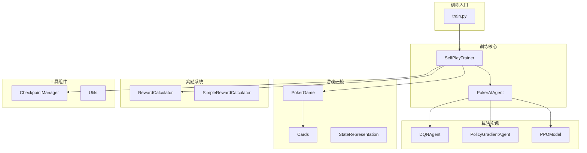
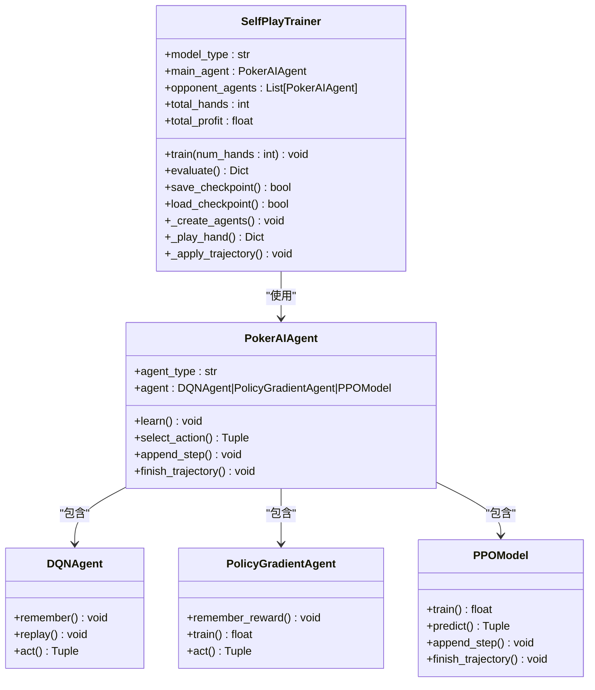
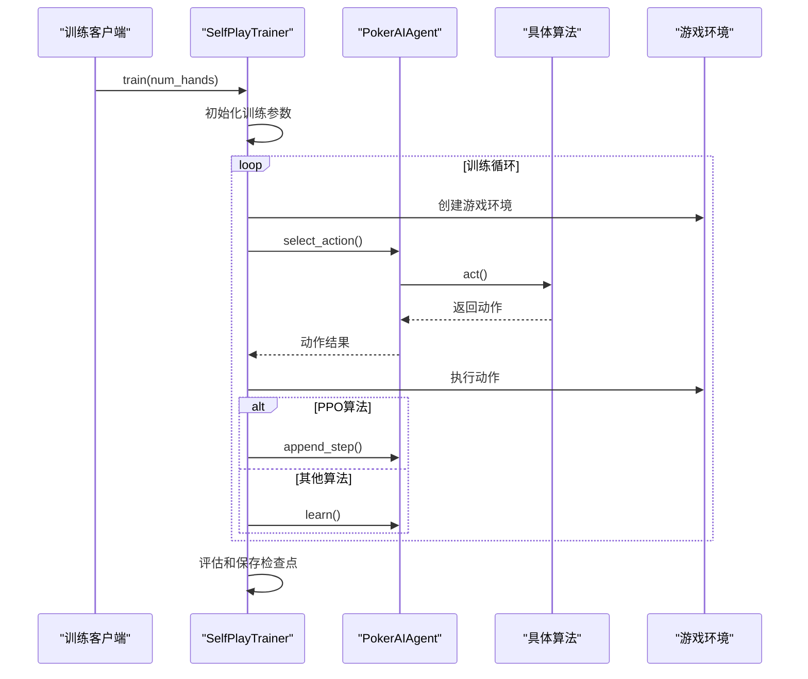
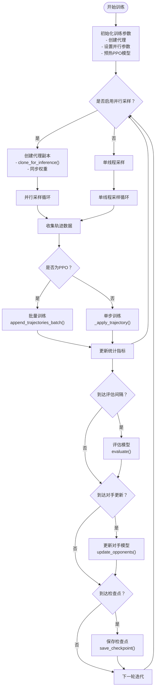
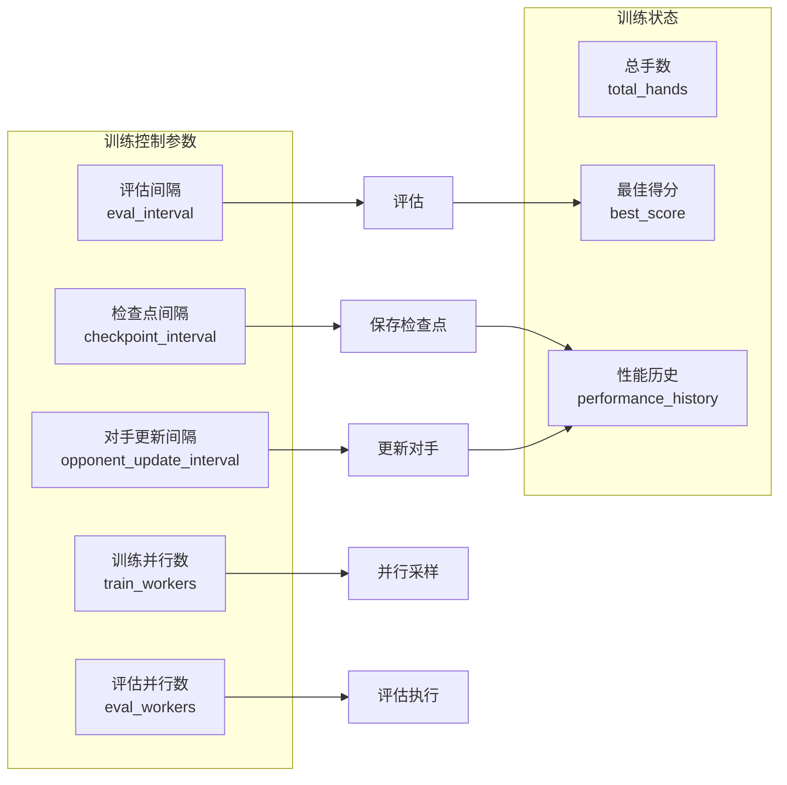
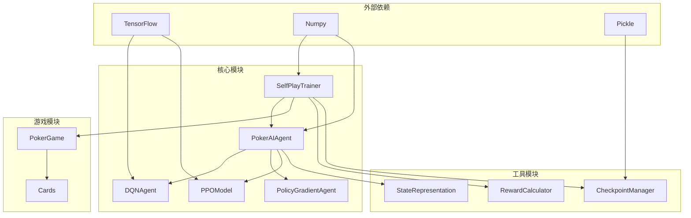

# 模板方法模式应用

<cite>
**本文档引用的文件**
- [self_play_trainer.py](file://poker_ai/reward/self_play_trainer.py)
- [train.py](file://train.py)
- [ai_agent.py](file://poker_ai/model/ai_agent.py)
- [dqn_agent.py](file://poker_ai/model/dqn_agent.py)
- [ppo_model.py](file://poker_ai/model/ppo_model.py)
- [reward_calculator.py](file://poker_ai/reward/reward_calculator.py)
- [checkpoint.py](file://poker_ai/utils/checkpoint.py)
</cite>

## 目录
1. [简介](#简介)
2. [项目结构](#项目结构)
3. [核心组件](#核心组件)
4. [架构概览](#架构概览)
5. [详细组件分析](#详细组件分析)
6. [依赖分析](#依赖分析)
7. [性能考虑](#性能考虑)
8. [故障排除指南](#故障排除指南)
9. [结论](#结论)

## 简介

本文档深入分析德州扑克AI项目中模板方法模式的应用。模板方法模式是一种行为设计模式，它定义了一个算法的骨架，将一些步骤延迟到子类中实现。在本项目中，SelfPlayTrainer类实现了训练流程的模板方法，标准化了训练的核心步骤，同时允许不同的算法实现（DQN、策略梯度、PPO）通过钩子函数来定制特定的训练行为。

该项目通过模板方法模式实现了训练框架的稳定性和算法实现的灵活性，使得开发者可以在不改变训练整体流程的情况下，轻松切换和扩展不同的强化学习算法。

## 项目结构

项目采用模块化的架构设计，主要包含以下核心模块：



**图表来源**
- [self_play_trainer.py:48-166](file://poker_ai/reward/self_play_trainer.py#L48-L166)
- [train.py:350-510](file://train.py#L350-L510)
- [ai_agent.py:55-116](file://poker_ai/model/ai_agent.py#L55-L116)

**章节来源**
- [self_play_trainer.py:1-800](file://poker_ai/reward/self_play_trainer.py#L1-L800)
- [train.py:1-800](file://train.py#L1-L800)

## 核心组件

### SelfPlayTrainer - 模板方法的核心实现

SelfPlayTrainer类是模板方法模式的主要实现者，它定义了训练流程的完整骨架：



**图表来源**
- [self_play_trainer.py:48-166](file://poker_ai/reward/self_play_trainer.py#L48-L166)
- [ai_agent.py:55-116](file://poker_ai/model/ai_agent.py#L55-L116)
- [dqn_agent.py:21-62](file://poker_ai/model/dqn_agent.py#L21-L62)

### 模板方法的核心要素

模板方法模式在SelfPlayTrainer中的具体体现：

1. **固定不变的训练步骤**：`train()`方法定义了完整的训练流程骨架
2. **可变的算法实现**：通过PokerAIAgent接口实现不同算法的差异化
3. **钩子函数**：算法特定的方法如`learn()`、`select_action()`等

**章节来源**
- [self_play_trainer.py:1393-1592](file://poker_ai/reward/self_play_trainer.py#L1393-L1592)
- [ai_agent.py:248-420](file://poker_ai/model/ai_agent.py#L248-L420)

## 架构概览

项目采用分层架构设计，通过模板方法模式实现了训练流程的标准化：



**图表来源**
- [self_play_trainer.py:1393-1592](file://poker_ai/reward/self_play_trainer.py#L1393-L1592)
- [ai_agent.py:117-155](file://poker_ai/model/ai_agent.py#L117-L155)

## 详细组件分析

### 训练流程模板方法

SelfPlayTrainer的`train()`方法实现了完整的模板方法：



**图表来源**
- [self_play_trainer.py:1393-1592](file://poker_ai/reward/self_play_trainer.py#L1393-L1592)

### 算法特定实现钩子

不同算法通过PokerAIAgent接口实现特定的训练行为：

#### DQN算法实现
```python
# DQN的learn方法实现
def learn(self, reward: float, state: np.ndarray, 
          action: int, next_state: np.ndarray, done: bool) -> None:
    if self.agent_type == 'dqn':
        # DQN需要完整的经验元组
        self.agent.remember(state, action, reward, next_state, done)
        self.agent.replay()
```

#### PPO算法实现
```python
# PPO的轨迹管理
def append_step(self, state: np.ndarray, action: int, old_prob: float) -> None:
    if self.agent_type == 'ppo':
        # PPO使用轨迹级学习
        self._ppo_ensure_buffer()
        self.ppo_buffer['states'].append(state)
        self.ppo_buffer['actions'].append(action)
        self.ppo_buffer['old_probs'].append(float(np.clip(old_prob, 1e-8, 1.0)))

def finish_trajectory(self, final_reward: float) -> None:
    if self.agent_type == 'ppo':
        # 一手牌结束时批量训练
        self._ppo_ensure_buffer()
        n = len(self.ppo_buffer['states'])
        self.ppo_buffer['rewards'] = [0.0] * (n - 1) + [final_reward]
        # 批量加入待训练缓冲区
        pending = self.ppo_pending_buffer
        pending['states'].extend(self.ppo_buffer['states'])
        pending['actions'].extend(self.ppo_buffer['actions'])
        pending['rewards'].extend(self.ppo_buffer['rewards'])
        pending['dones'].extend(self.ppo_buffer['dones'])
        pending['old_probs'].extend(self.ppo_buffer['old_probs'])
        self._ppo_clear_buffer()
        self._ppo_train_pending_buffer(force=False)
```

**章节来源**
- [ai_agent.py:248-420](file://poker_ai/model/ai_agent.py#L248-L420)
- [dqn_agent.py:144-177](file://poker_ai/model/dqn_agent.py#L144-L177)
- [ppo_model.py:497-638](file://poker_ai/model/ppo_model.py#L497-L638)

### 训练循环控制逻辑

训练循环通过多个控制参数实现灵活的训练管理：



**图表来源**
- [self_play_trainer.py:85-166](file://poker_ai/reward/self_play_trainer.py#L85-L166)
- [self_play_trainer.py:1503-1542](file://poker_ai/reward/self_play_trainer.py#L1503-L1542)

**章节来源**
- [self_play_trainer.py:1393-1592](file://poker_ai/reward/self_play_trainer.py#L1393-L1592)

## 依赖分析

项目中的依赖关系展现了清晰的层次结构：



**图表来源**
- [self_play_trainer.py:21-26](file://poker_ai/reward/self_play_trainer.py#L21-L26)
- [ai_agent.py:3-9](file://poker_ai/model/ai_agent.py#L3-L9)

**章节来源**
- [self_play_trainer.py:1-800](file://poker_ai/reward/self_play_trainer.py#L1-L800)
- [ai_agent.py:1-703](file://poker_ai/model/ai_agent.py#L1-L703)

## 性能考虑

模板方法模式在性能方面的优势体现在：

### 并行化优化
- **并行采样**：通过`train_workers`参数实现多线程并行采样
- **批量处理**：PPO算法使用批量轨迹处理减少函数调用开销
- **预编译优化**：使用`tf.function`预编译关键函数

### 内存管理
- **经验回放**：DQN使用deque实现高效的回放缓冲
- **轨迹缓冲**：PPO使用待训练缓冲区避免频繁的小批量更新
- **权重同步**：定期同步主模型权重到工作副本

### 训练稳定性
- **目标网络**：DQN使用目标网络提升训练稳定性
- **价值裁剪**：PPO使用价值损失裁剪防止过大的价值更新
- **梯度裁剪**：限制梯度范数防止梯度爆炸

## 故障排除指南

### 常见问题及解决方案

#### 训练不稳定
**问题**：训练过程中出现震荡或发散
**解决方案**：
- 调整学习率参数
- 检查奖励函数设置
- 增加训练步数或调整批大小

#### 内存不足
**问题**：GPU/CPU内存不足导致训练中断
**解决方案**：
- 减少并行工作进程数
- 降低批处理大小
- 启用GPU内存增长

#### 模型不收敛
**问题**：模型性能停滞不前
**解决方案**：
- 检查对手模型更新频率
- 调整探索参数
- 验证奖励函数的有效性

**章节来源**
- [self_play_trainer.py:1554-1592](file://poker_ai/reward/self_play_trainer.py#L1554-L1592)
- [ppo_model.py:544-625](file://poker_ai/model/ppo_model.py#L544-L625)

## 结论

德州扑克AI项目通过模板方法模式成功实现了训练框架的标准化和算法实现的模块化。SelfPlayTrainer类作为模板方法的核心，定义了稳定的训练流程骨架，同时通过PokerAIAgent接口为不同的强化学习算法提供了扩展点。

这种设计模式的优势体现在：

1. **训练流程标准化**：模板方法确保了训练流程的一致性和可靠性
2. **算法实现模块化**：不同的算法通过钩子函数实现特定行为
3. **训练过程可控性**：通过参数化控制训练的各种方面
4. **框架稳定性**：模板方法提供了稳定的训练框架基础
5. **算法灵活性**：新的算法实现只需遵循接口约定即可集成

通过这种架构设计，项目不仅实现了高效的训练性能，还为未来的算法扩展和优化提供了良好的基础。模板方法模式的应用使得代码更加清晰、可维护，并且便于团队协作开发。