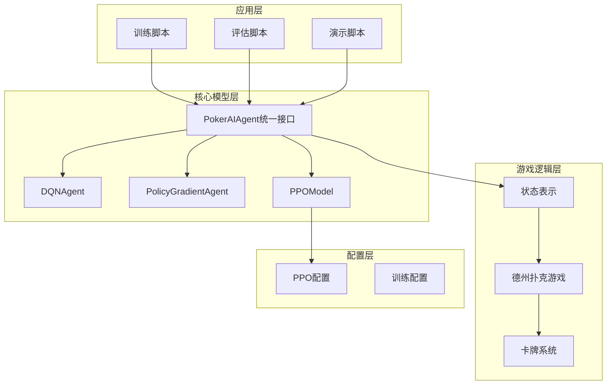
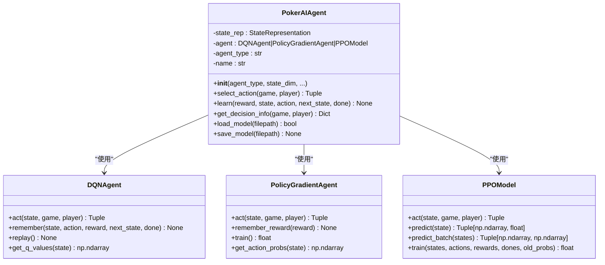
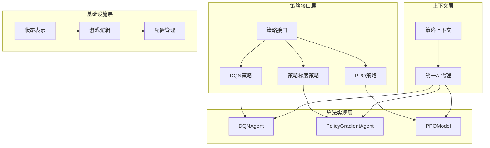
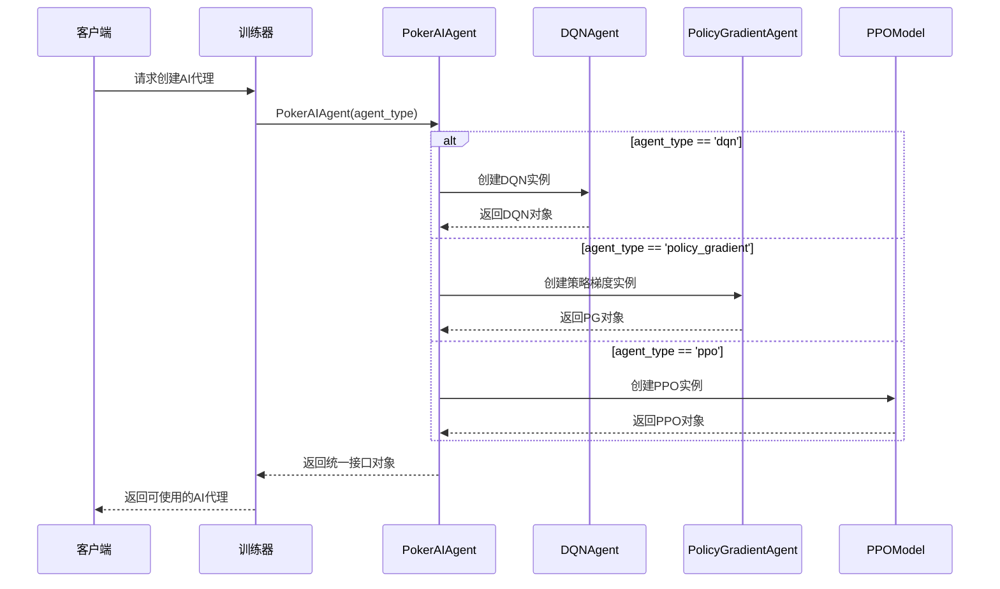
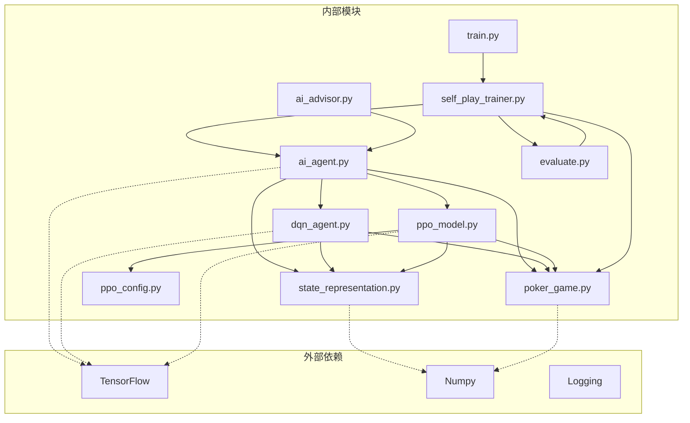

# 策略模式应用

<cite>
**本文档引用的文件**
- [ai_agent.py](file://poker_ai/model/ai_agent.py)
- [dqn_agent.py](file://poker_ai/model/dqn_agent.py)
- [ppo_model.py](file://poker_ai/model/ppo_model.py)
- [state_representation.py](file://poker_ai/model/state_representation.py)
- [poker_game.py](file://poker_ai/game/poker_game.py)
- [ppo_config.py](file://poker_ai/config/ppo_config.py)
- [train.py](file://train.py)
- [evaluate.py](file://evaluate.py)
- [self_play_trainer.py](file://poker_ai/reward/self_play_trainer.py)
- [ai_advisor.py](file://poker_ai/advisor/ai_advisor.py)
</cite>

## 目录
1. [简介](#简介)
2. [项目结构](#项目结构)
3. [核心组件](#核心组件)
4. [架构概览](#架构概览)
5. [详细组件分析](#详细组件分析)
6. [依赖关系分析](#依赖关系分析)
7. [性能考量](#性能考量)
8. [故障排除指南](#故障排除指南)
9. [结论](#结论)

## 简介

本项目实现了基于策略模式的德州扑克AI系统，通过统一的PokerAIAgent接口支持多种AI算法的无缝切换。策略模式的核心思想是将算法族封装在独立的类中，使得它们可以相互替换而不影响客户端代码。

该项目的主要创新点在于：
- **算法可替换性**：通过策略模式实现DQN、策略梯度、PPO三种算法的统一接口
- **代码解耦**：算法实现与游戏逻辑分离，提高系统的可维护性
- **扩展性**：新的算法类型可以轻松添加到现有框架中
- **多算法对比**：支持同时运行多个算法进行性能对比实验

## 项目结构

项目采用模块化设计，主要分为以下几个层次：

**图表来源**
- [ai_agent.py:55-116](file://poker_ai/model/ai_agent.py#L55-L116)
- [dqn_agent.py:21-59](file://poker_ai/model/dqn_agent.py#L21-L59)
- [ppo_model.py:20-93](file://poker_ai/model/ppo_model.py#L20-L93)

**章节来源**
- [ai_agent.py:55-116](file://poker_ai/model/ai_agent.py#L55-L116)
- [train.py:136-238](file://train.py#L136-L238)

## 核心组件

### PokerAIAgent统一接口

PokerAIAgent是策略模式的核心，它定义了一个统一的接口来封装不同的AI算法：

**图表来源**
- [ai_agent.py:55-116](file://poker_ai/model/ai_agent.py#L55-L116)
- [dqn_agent.py:21-59](file://poker_ai/model/dqn_agent.py#L21-L59)
- [dqn_agent.py:216-232](file://poker_ai/model/dqn_agent.py#L216-L232)
- [ppo_model.py:20-93](file://poker_ai/model/ppo_model.py#L20-L93)

### 算法工厂方法

PokerAIAgent的构造函数实现了算法工厂方法，根据agent_type参数创建相应的算法实例：

**章节来源**
- [ai_agent.py:90-112](file://poker_ai/model/ai_agent.py#L90-L112)

## 架构概览

系统采用分层架构设计，策略模式贯穿整个代码结构：

**图表来源**
- [ai_agent.py:55-116](file://poker_ai/model/ai_agent.py#L55-L116)
- [ai_agent.py:90-112](file://poker_ai/model/ai_agent.py#L90-L112)

## 详细组件分析

### DQN算法实现

DQN算法通过深度Q网络实现，具有以下特点：

#### 核心组件
- **神经网络架构**：512-256-64-5的全连接网络
- **经验回放机制**：10000容量的记忆缓冲区
- **目标网络更新**：定期同步主网络参数
- **ε-贪婪探索**：可调节的探索率参数

#### 关键方法
- `act()`: 基于ε-贪婪策略选择动作
- `remember()`: 存储经验元组
- `replay()`: 从经验回放缓冲区学习

**章节来源**
- [dqn_agent.py:21-59](file://poker_ai/model/dqn_agent.py#L21-L59)
- [dqn_agent.py:127-176](file://poker_ai/model/dqn_agent.py#L127-L176)

### 策略梯度算法实现

策略梯度算法采用基于策略的方法进行学习：

#### 核心组件
- **策略网络**：256-128-64-5的softmax输出网络
- **折扣奖励**：γ衰减的奖励计算
- **批量训练**：回合结束时进行策略更新

#### 关键方法
- `act()`: 从策略分布中采样动作
- `remember_reward()`: 记录奖励
- `train()`: 使用REINFORCE算法更新策略

**章节来源**
- [dqn_agent.py:216-232](file://poker_ai/model/dqn_agent.py#L216-L232)
- [dqn_agent.py:291-308](file://poker_ai/model/dqn_agent.py#L291-L308)

### PPO算法实现

PPO算法采用先进的近端策略优化方法：

#### 核心组件
- **双网络架构**：独立的Actor-Critic网络
- **自适应学习率**：Warmup+余弦衰减策略
- **KL散度约束**：防止策略更新过大
- **批量轨迹训练**：高效的并行采样

#### 关键方法
- `predict()`: 预测动作概率和状态价值
- `train()`: PPO核心训练算法
- `predict_batch()`: 批量预测优化

**章节来源**
- [ppo_model.py:20-93](file://poker_ai/model/ppo_model.py#L20-L93)
- [ppo_model.py:497-638](file://poker_ai/model/ppo_model.py#L497-L638)

### 策略切换机制

系统实现了灵活的策略切换机制：

**图表来源**
- [ai_agent.py:90-112](file://poker_ai/model/ai_agent.py#L90-L112)

**章节来源**
- [ai_agent.py:90-112](file://poker_ai/model/ai_agent.py#L90-L112)

## 依赖关系分析

系统采用松耦合的设计，各组件间的依赖关系清晰：

**图表来源**
- [ai_agent.py:1-12](file://poker_ai/model/ai_agent.py#L1-L12)
- [dqn_agent.py:1-16](file://poker_ai/model/dqn_agent.py#L1-L16)
- [ppo_model.py:1-11](file://poker_ai/model/ppo_model.py#L1-L11)

**章节来源**
- [ai_agent.py:1-12](file://poker_ai/model/ai_agent.py#L1-L12)
- [dqn_agent.py:1-16](file://poker_ai/model/dqn_agent.py#L1-L16)
- [ppo_model.py:1-11](file://poker_ai/model/ppo_model.py#L1-L11)

## 性能考量

### 算法性能对比

| 算法类型 | 训练效率 | 探索能力 | 收敛速度 | 内存占用 |
|---------|---------|---------|---------|---------|
| DQN | 中等 | ε-贪婪 | 快速 | 低 |
| 策略梯度 | 高 | 无 | 中等 | 低 |
| PPO | 低 | 无 | 慢 | 高 |

### 优化技术

1. **批量处理优化**：PPO支持批量轨迹训练
2. **并行采样**：多线程并行环境采样
3. **混合精度训练**：TensorFlow混合精度支持
4. **GPU加速**：自动检测和使用GPU

## 故障排除指南

### 常见问题及解决方案

#### 算法切换失败
**问题**：创建PokerAIAgent时抛出ValueError
**原因**：agent_type参数不在支持列表中
**解决方案**：确保agent_type为'dqn'、'policy_gradient'或'ppo'

#### 训练不稳定
**问题**：PPO训练过程中出现NaN或Inf值
**原因**：学习率过高或KL散度过大
**解决方案**：降低学习率，检查KL散度约束参数

#### 内存不足
**问题**：PPO训练时显存不足
**原因**：batch_size过大或GPU内存不足
**解决方案**：减小batch_size，启用GPU内存增长

**章节来源**
- [ai_agent.py:111-112](file://poker_ai/model/ai_agent.py#L111-L112)
- [ppo_model.py:632-638](file://poker_ai/model/ppo_model.py#L632-L638)

## 结论

本项目成功实现了基于策略模式的德州扑克AI系统，通过统一接口封装了DQN、策略梯度和PPO三种不同的算法。策略模式的应用带来了以下显著优势：

### 主要优势

1. **算法可替换性**：无需修改客户端代码即可切换算法
2. **代码解耦**：算法实现与游戏逻辑完全分离
3. **扩展性强**：新的算法类型可以轻松集成
4. **多算法对比**：支持并行运行多个算法进行性能对比

### 技术创新

1. **统一接口设计**：PokerAIAgent提供一致的API
2. **智能工厂方法**：根据参数自动创建相应算法实例
3. **批量优化**：PPO支持高效的批量轨迹训练
4. **并行采样**：多线程并行环境采样提升效率

### 应用前景

该策略模式实现为德州扑克AI系统提供了强大的基础架构，可以轻松扩展到其他强化学习算法，为AI在复杂策略游戏中应用提供了优秀的参考模板。