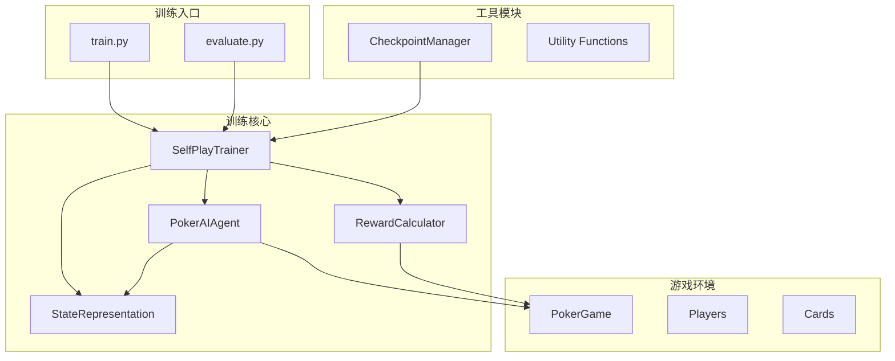
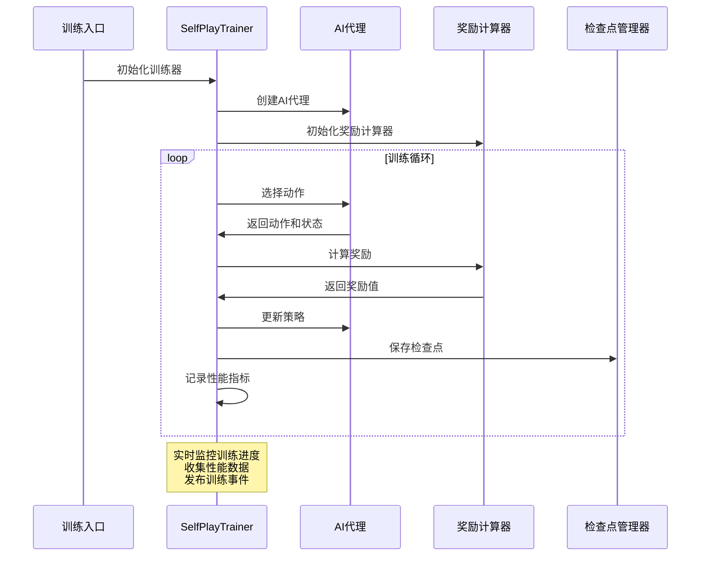
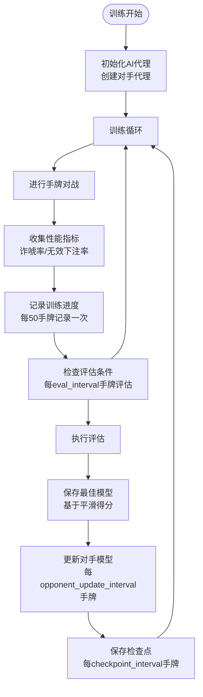
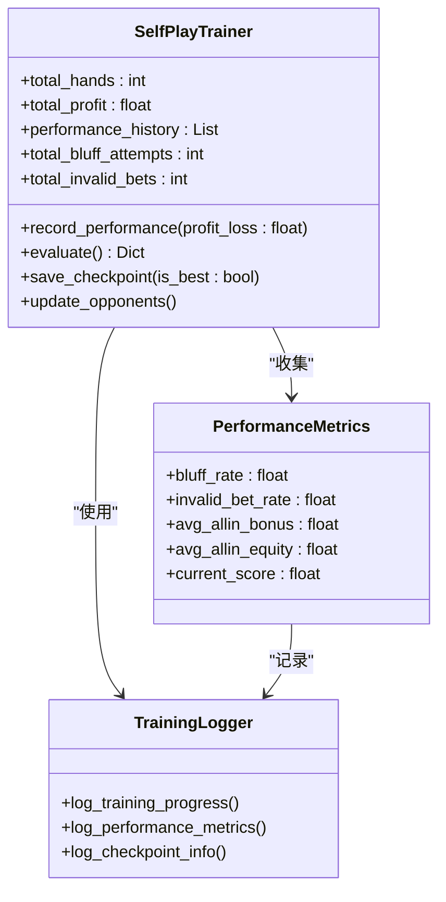
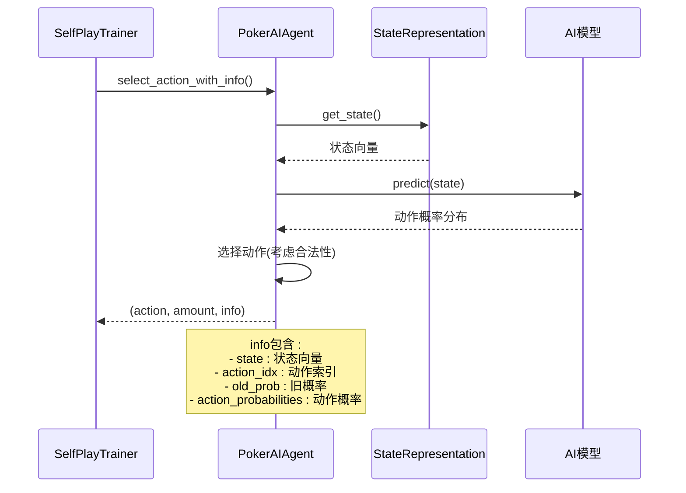
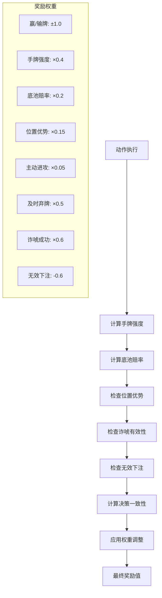
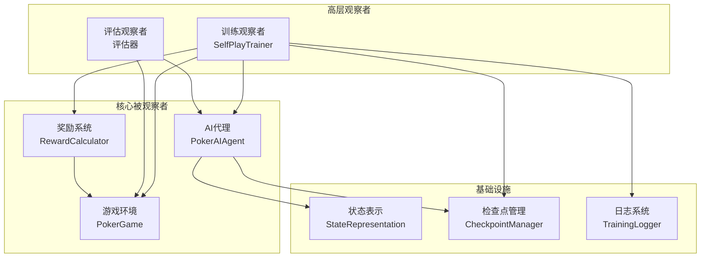

# 观察者模式应用

<cite>
**本文档引用的文件**
- [train.py](file://train.py)
- [self_play_trainer.py](file://poker_ai/reward/self_play_trainer.py)
- [ai_agent.py](file://poker_ai/model/ai_agent.py)
- [reward_calculator.py](file://poker_ai/reward/reward_calculator.py)
- [state_representation.py](file://poker_ai/model/state_representation.py)
- [checkpoint.py](file://poker_ai/utils/checkpoint.py)
- [evaluate.py](file://evaluate.py)
</cite>

## 目录
1. [简介](#简介)
2. [项目结构](#项目结构)
3. [核心组件](#核心组件)
4. [架构概览](#架构概览)
5. [详细组件分析](#详细组件分析)
6. [依赖分析](#依赖分析)
7. [性能考虑](#性能考虑)
8. [故障排除指南](#故障排除指南)
9. [结论](#结论)

## 简介

本文档深入分析德州扑克AI项目中观察者模式的应用。该项目实现了完整的强化学习训练系统，其中SelfPlayTrainer作为观察者，监控AI代理的学习过程，收集训练进度和性能指标。观察者模式在此项目中体现为训练事件的发布订阅机制，实现了训练状态的实时监控和性能指标的收集分析。

项目采用自我对弈训练方式，通过SelfPlayTrainer协调多个AI代理进行对战，实时收集和分析训练数据。观察者模式确保了训练过程的透明化监控、异常情况的及时发现和训练效果的持续评估。

## 项目结构

项目采用模块化设计，主要包含以下核心模块：

**图表来源**
- [train.py:1-856](file://train.py#L1-L856)
- [self_play_trainer.py:48-1604](file://poker_ai/reward/self_play_trainer.py#L48-L1604)

**章节来源**
- [train.py:1-856](file://train.py#L1-L856)
- [self_play_trainer.py:1-1604](file://poker_ai/reward/self_play_trainer.py#L1-L1604)

## 核心组件

### SelfPlayTrainer - 训练观察者

SelfPlayTrainer是观察者模式的核心实现，负责监控整个训练过程：

- **训练监控**: 实时跟踪训练进度、性能指标和策略分析
- **事件发布**: 在关键训练节点发布事件通知
- **性能收集**: 收集并分析训练过程中的各种指标
- **状态管理**: 维护训练状态和历史数据

### PokerAIAgent - 被观察者

AI代理作为被观察者，向观察者提供训练数据：

- **动作选择**: 基于当前状态选择最优动作
- **学习反馈**: 提供学习过程中的决策信息
- **状态报告**: 报告当前游戏状态和决策依据

### RewardCalculator - 奖励观察者

奖励计算器作为专门的观察者，专注于奖励计算和策略分析：

- **奖励计算**: 实时计算每个动作的奖励值
- **策略分析**: 分析AI的诈唬率、无效下注等策略指标
- **自适应调整**: 根据训练表现动态调整奖励权重

**章节来源**
- [self_play_trainer.py:48-1604](file://poker_ai/reward/self_play_trainer.py#L48-L1604)
- [ai_agent.py:55-703](file://poker_ai/model/ai_agent.py#L55-L703)
- [reward_calculator.py:9-587](file://poker_ai/reward/reward_calculator.py#L9-L587)

## 架构概览

项目采用分层架构，观察者模式贯穿整个训练系统：

**图表来源**
- [train.py:340-530](file://train.py#L340-L530)
- [self_play_trainer.py:1400-1604](file://poker_ai/reward/self_play_trainer.py#L1400-L1604)

## 详细组件分析

### SelfPlayTrainer 观察者实现

SelfPlayTrainer实现了完整的观察者模式，具有以下特性：

#### 训练事件监控

**图表来源**
- [self_play_trainer.py:1400-1604](file://poker_ai/reward/self_play_trainer.py#L1400-L1604)

#### 性能指标收集

SelfPlayTrainer实时收集以下关键性能指标：

- **总手牌数**: 记录已完成的训练手牌总数
- **累计利润**: 累计AI的总利润
- **诈唬率**: AI成功诈唬的比例
- **无效下注率**: AI进行无效下注的比例
- **all-in补偿统计**: 记录高胜率all-in失败的补偿情况

#### 训练进度可视化

**图表来源**
- [self_play_trainer.py:1329-1355](file://poker_ai/reward/self_play_trainer.py#L1329-L1355)
- [self_play_trainer.py:1503-1531](file://poker_ai/reward/self_play_trainer.py#L1503-L1531)

**章节来源**
- [self_play_trainer.py:1329-1355](file://poker_ai/reward/self_play_trainer.py#L1329-L1355)
- [self_play_trainer.py:1503-1531](file://poker_ai/reward/self_play_trainer.py#L1503-L1531)

### PokerAIAgent 观察者注册

AI代理实现了观察者接口，能够接收训练器的观察请求：

#### 动作选择观察

AI代理在选择动作时提供决策信息：

**图表来源**
- [ai_agent.py:125-155](file://poker_ai/model/ai_agent.py#L125-L155)
- [ai_agent.py:157-214](file://poker_ai/model/ai_agent.py#L157-L214)

#### 学习反馈观察

AI代理提供学习过程中的反馈信息：

- **决策依据**: Q值、动作概率、状态价值等
- **策略信息**: 当前探索参数、模型权重状态
- **性能指标**: 决策质量评估、策略稳定性

**章节来源**
- [ai_agent.py:125-155](file://poker_ai/model/ai_agent.py#L125-L155)
- [ai_agent.py:421-452](file://poker_ai/model/ai_agent.py#L421-L452)

### RewardCalculator 专业观察者

奖励计算器作为专业的观察者，专注于奖励计算和策略分析：

#### 奖励计算观察

**图表来源**
- [reward_calculator.py:303-370](file://poker_ai/reward/reward_calculator.py#L303-L370)

#### 自适应观察

奖励计算器能够根据训练表现自适应调整奖励权重：

- **收益分析**: 监控AI的平均利润和收益趋势
- **策略评估**: 分析诈唬率、无效下注率等策略指标
- **权重调整**: 动态平衡不同类型的奖励权重

**章节来源**
- [reward_calculator.py:303-370](file://poker_ai/reward/reward_calculator.py#L303-L370)
- [reward_calculator.py:394-536](file://poker_ai/reward/reward_calculator.py#L394-L536)

## 依赖分析

项目中的观察者关系形成了清晰的依赖层次：

**图表来源**
- [train.py:340-530](file://train.py#L340-L530)
- [evaluate.py:181-267](file://evaluate.py#L181-L267)

**章节来源**
- [train.py:340-530](file://train.py#L340-L530)
- [evaluate.py:181-267](file://evaluate.py#L181-L267)

## 性能考虑

观察者模式在项目中的性能影响：

### 内存管理

- **线程本地存储**: 使用`threading.local()`避免多线程间的状态冲突
- **缓存机制**: LRU缓存手牌强度计算结果，减少重复计算
- **状态复用**: AI代理克隆机制避免重复创建昂贵的模型对象

### 计算效率

- **批量处理**: PPO模型支持批量轨迹处理，减少函数调用开销
- **并行采样**: 多线程并行进行游戏对战，提高训练效率
- **延迟更新**: PPO模型使用延迟更新机制，平衡训练质量和性能

### 监控开销

- **采样频率**: 训练进度记录每50手牌进行一次，评估每eval_interval手牌进行一次
- **日志优化**: 区分详细日志和普通日志，避免过度日志输出影响性能
- **资源监控**: GPU内存使用和训练进度监控，确保系统稳定运行

## 故障排除指南

### 观察者模式常见问题

#### 训练监控异常

**问题**: 训练进度日志缺失或异常

**解决方案**:
1. 检查日志配置是否正确设置
2. 验证训练循环中的日志记录语句
3. 确认观察者注册是否正常

#### 性能指标异常

**问题**: 性能指标统计不准确

**解决方案**:
1. 检查指标收集逻辑的边界条件
2. 验证指标计算的数学公式
3. 确认数据类型转换的正确性

#### 模型保存失败

**问题**: 检查点保存异常

**解决方案**:
1. 检查文件权限和磁盘空间
2. 验证模型权重的序列化过程
3. 确认元数据文件的完整性

**章节来源**
- [checkpoint.py:17-56](file://poker_ai/utils/checkpoint.py#L17-L56)
- [self_play_trainer.py:1554-1571](file://poker_ai/reward/self_play_trainer.py#L1554-L1571)

## 结论

德州扑克AI项目中的观察者模式实现了训练过程的全面监控和数据分析。通过SelfPlayTrainer作为观察者，项目能够：

1. **实时监控**: 实时跟踪训练进度和性能指标
2. **事件驱动**: 基于训练事件的发布订阅机制
3. **数据收集**: 系统性地收集和分析训练数据
4. **性能评估**: 持续评估训练效果并进行优化

观察者模式的应用使得训练系统具备了良好的可观测性和可调试性，为强化学习训练提供了强大的监控和分析能力。通过这种设计，开发者可以深入了解AI的学习过程，及时发现和解决问题，从而提高训练效率和模型质量。

项目中的观察者模式不仅实现了技术层面的功能，更重要的是为AI训练提供了一个透明、可控的监控框架，这对于复杂强化学习系统的开发和维护具有重要意义。