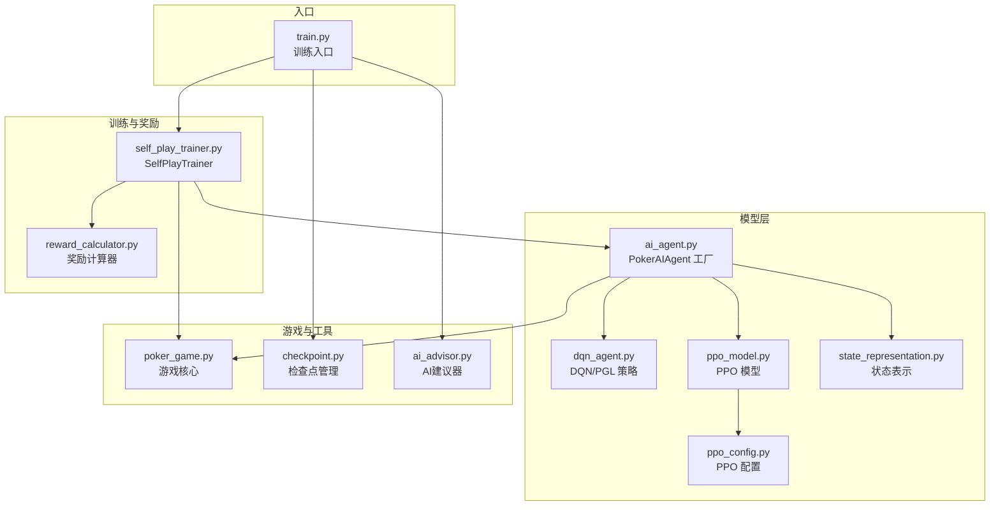
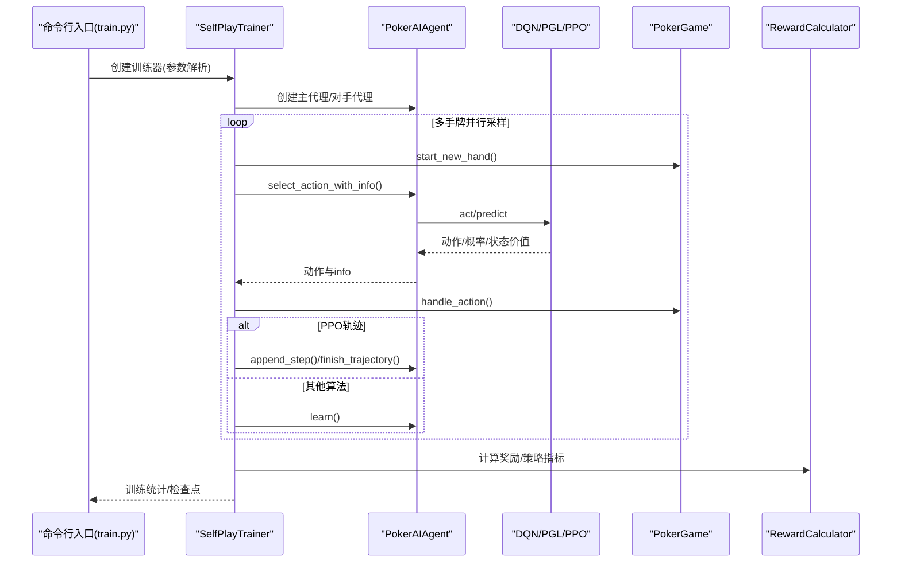
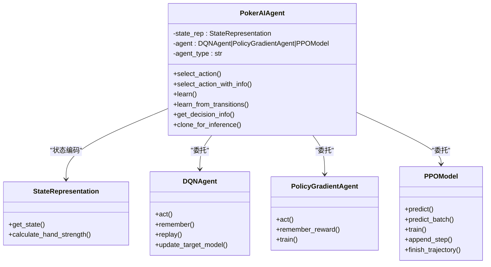
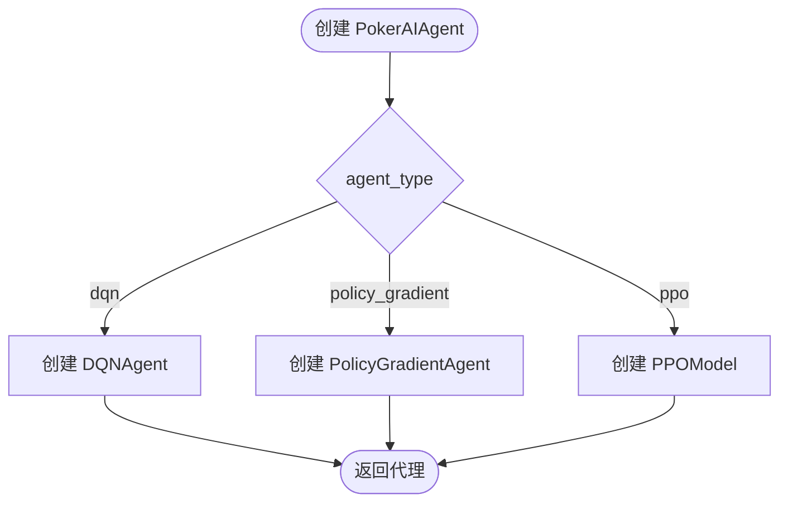
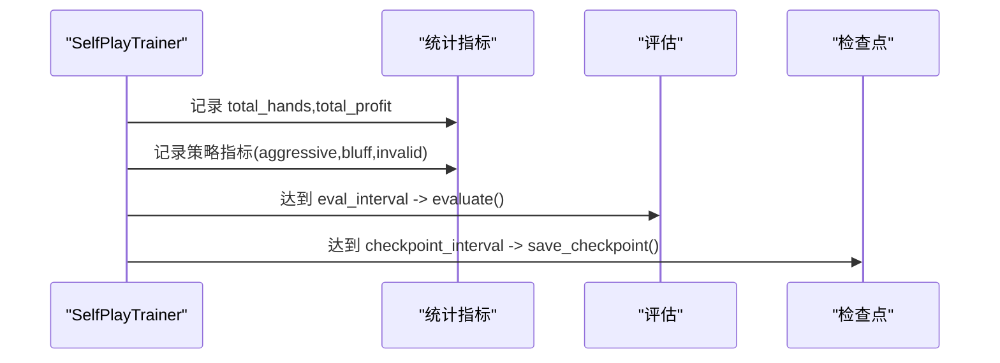
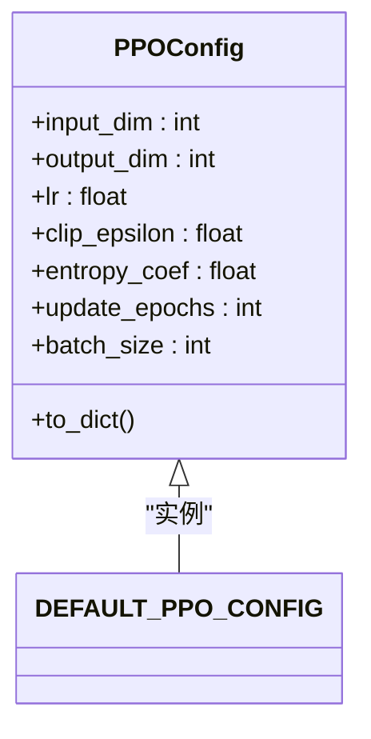
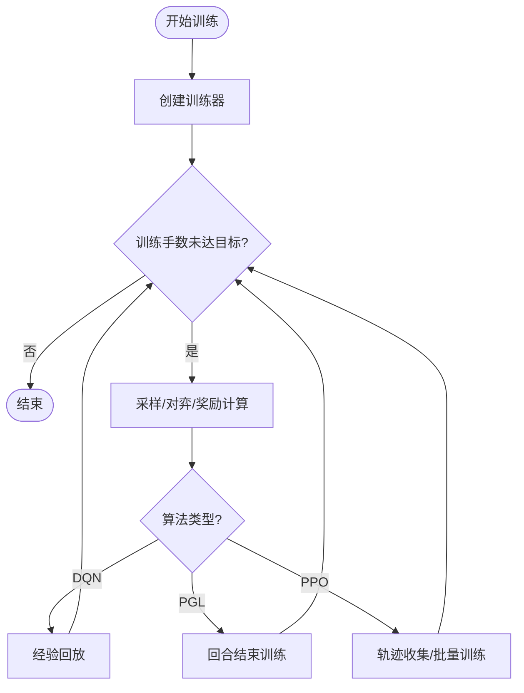
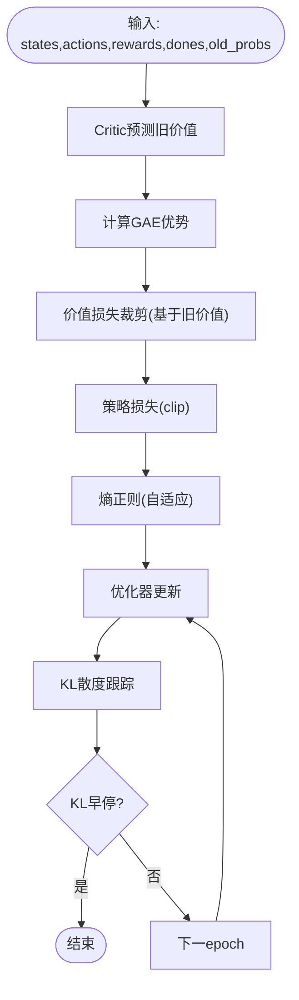
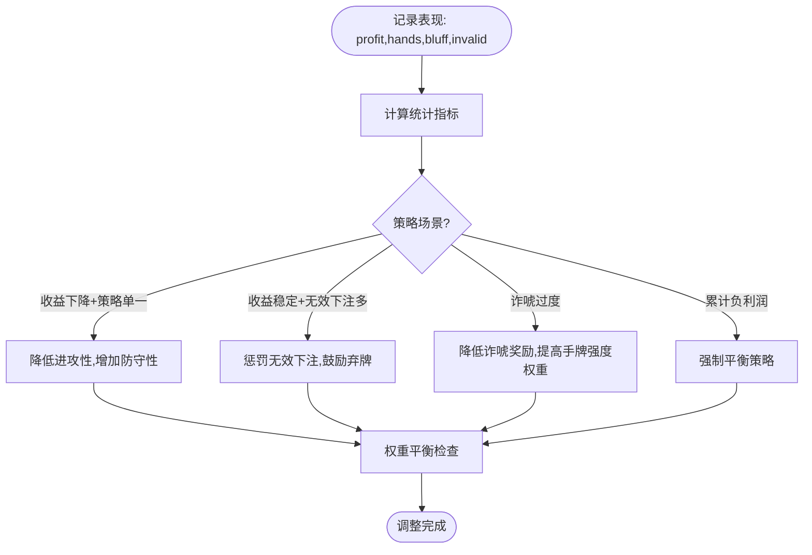
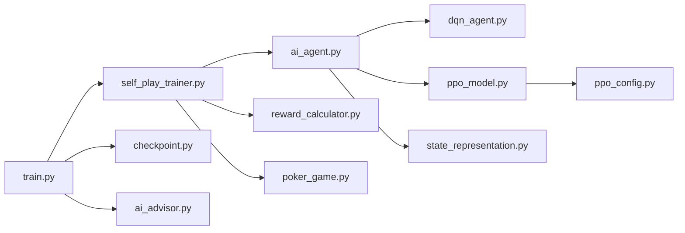

# 设计模式应用

<cite>
**本文档引用的文件**
- [poker_ai/model/ai_agent.py](file://poker_ai/model/ai_agent.py)
- [poker_ai/reward/self_play_trainer.py](file://poker_ai/reward/self_play_trainer.py)
- [poker_ai/model/ppo_model.py](file://poker_ai/model/ppo_model.py)
- [poker_ai/model/dqn_agent.py](file://poker_ai/model/dqn_agent.py)
- [poker_ai/model/state_representation.py](file://poker_ai/model/state_representation.py)
- [poker_ai/reward/reward_calculator.py](file://poker_ai/reward/reward_calculator.py)
- [poker_ai/utils/checkpoint.py](file://poker_ai/utils/checkpoint.py)
- [poker_ai/config/ppo_config.py](file://poker_ai/config/ppo_config.py)
- [poker_ai/game/poker_game.py](file://poker_ai/game/poker_game.py)
- [poker_ai/advisor/ai_advisor.py](file://poker_ai/advisor/ai_advisor.py)
- [train.py](file://train.py)
</cite>

## 目录
1. [简介](#简介)
2. [项目结构](#项目结构)
3. [核心组件](#核心组件)
4. [架构概览](#架构概览)
5. [详细组件分析](#详细组件分析)
6. [依赖分析](#依赖分析)
7. [性能考量](#性能考量)
8. [故障排查指南](#故障排查指南)
9. [结论](#结论)

## 简介
本设计模式应用文档聚焦于德州扑克AI项目的架构与实现，系统梳理并深入分析项目中采用的设计模式及其实现细节，重点涵盖：
- 策略模式：支持多种AI算法（DQN、策略梯度、PPO）的统一接口与动态切换
- 工厂模式：PokerAIAgent作为代理工厂，按类型创建不同算法实例
- 观察者模式：SelfPlayTrainer对训练过程的监控与统计（事件驱动的指标收集）
- 配置模式：PPOConfig集中管理超参数，便于调参与复现
- 模板方法模式：训练流程的统一模板（训练/评估/演示）

文档旨在帮助读者理解设计模式在项目中的落地方式、带来的好处与权衡，并提供可操作的优化建议。

## 项目结构
项目采用按职责分层的组织方式：
- model：AI模型与状态表示层（策略/工厂/配置）
- reward：训练与奖励计算层（训练器/奖励计算器）
- game：游戏规则与状态管理
- advisor：AI建议与演示
- utils：工具模块（检查点管理）
- config：配置管理
- train.py：训练入口与参数解析

**图表来源**
- [poker_ai/model/ai_agent.py:55-116](file://poker_ai/model/ai_agent.py#L55-L116)
- [poker_ai/reward/self_play_trainer.py:48-136](file://poker_ai/reward/self_play_trainer.py#L48-L136)
- [poker_ai/model/ppo_model.py:20-93](file://poker_ai/model/ppo_model.py#L20-L93)
- [poker_ai/model/dqn_agent.py:21-62](file://poker_ai/model/dqn_agent.py#L21-L62)
- [poker_ai/model/state_representation.py:9-46](file://poker_ai/model/state_representation.py#L9-L46)
- [poker_ai/reward/reward_calculator.py:9-42](file://poker_ai/reward/reward_calculator.py#L9-L42)
- [poker_ai/utils/checkpoint.py:17-56](file://poker_ai/utils/checkpoint.py#L17-L56)
- [poker_ai/config/ppo_config.py:18-96](file://poker_ai/config/ppo_config.py#L18-L96)
- [poker_ai/game/poker_game.py:155-194](file://poker_ai/game/poker_game.py#L155-L194)
- [train.py:350-383](file://train.py#L350-L383)

**章节来源**
- [train.py:136-238](file://train.py#L136-L238)
- [poker_ai/reward/self_play_trainer.py:48-136](file://poker_ai/reward/self_play_trainer.py#L48-L136)

## 核心组件
- PokerAIAgent：统一的AI代理接口，内部持有具体算法实例（DQN、策略梯度、PPO），提供统一的 select_action/learn 接口，实现策略模式与工厂模式的结合
- SelfPlayTrainer：自我对弈训练器，负责并行采样、轨迹收集、奖励计算与模型更新，体现模板方法与观察者模式
- PPOModel：PPO算法实现，包含策略网络与价值网络、GAE优势估计、KL早停、自适应熵等高级特性
- DQNAgent/PolicyGradientAgent：DQN与策略梯度算法实现，提供统一的 act/remember/replay 接口
- StateRepresentation：状态表示器，将游戏状态编码为统一的特征向量
- RewardCalculator/AdaptiveRewardCalculator：奖励计算与自适应调整，提供精细化奖励信号
- CheckpointManager：检查点保存与加载工具
- PPOConfig：集中管理PPO超参数

**章节来源**
- [poker_ai/model/ai_agent.py:55-116](file://poker_ai/model/ai_agent.py#L55-L116)
- [poker_ai/reward/self_play_trainer.py:48-136](file://poker_ai/reward/self_play_trainer.py#L48-L136)
- [poker_ai/model/ppo_model.py:20-93](file://poker_ai/model/ppo_model.py#L20-L93)
- [poker_ai/model/dqn_agent.py:21-62](file://poker_ai/model/dqn_agent.py#L21-L62)
- [poker_ai/model/state_representation.py:9-46](file://poker_ai/model/state_representation.py#L9-L46)
- [poker_ai/reward/reward_calculator.py:9-42](file://poker_ai/reward/reward_calculator.py#L9-L42)
- [poker_ai/utils/checkpoint.py:17-56](file://poker_ai/utils/checkpoint.py#L17-L56)
- [poker_ai/config/ppo_config.py:18-96](file://poker_ai/config/ppo_config.py#L18-L96)

## 架构概览
训练与推理的整体流程如下：

**图表来源**
- [train.py:350-531](file://train.py#L350-L531)
- [poker_ai/reward/self_play_trainer.py:260-417](file://poker_ai/reward/self_play_trainer.py#L260-L417)
- [poker_ai/model/ai_agent.py:117-155](file://poker_ai/model/ai_agent.py#L117-L155)
- [poker_ai/reward/reward_calculator.py:303-369](file://poker_ai/reward/reward_calculator.py#L303-L369)

## 详细组件分析

### 策略模式：PokerAIAgent统一接口与算法切换
- 统一接口：select_action/select_action_with_info/learn/learn_from_transitions 等，屏蔽不同算法差异
- 算法选择：构造函数根据 agent_type 决定使用 DQN、策略梯度或 PPO 实例
- PPO特化：支持轨迹级学习（append_step/finish_trajectory）、批量轨迹写入（append_trajectories_batch）、延迟批量训练（flush_pending_updates）
- 决策信息：get_decision_info 返回各算法的决策依据（Q值/动作概率/状态价值）

**图表来源**
- [poker_ai/model/ai_agent.py:55-116](file://poker_ai/model/ai_agent.py#L55-L116)
- [poker_ai/model/dqn_agent.py:21-62](file://poker_ai/model/dqn_agent.py#L21-L62)
- [poker_ai/model/dqn_agent.py:216-326](file://poker_ai/model/dqn_agent.py#L216-L326)
- [poker_ai/model/ppo_model.py:20-93](file://poker_ai/model/ppo_model.py#L20-L93)
- [poker_ai/model/state_representation.py:137-158](file://poker_ai/model/state_representation.py#L137-L158)

**章节来源**
- [poker_ai/model/ai_agent.py:55-116](file://poker_ai/model/ai_agent.py#L55-L116)
- [poker_ai/model/ai_agent.py:248-420](file://poker_ai/model/ai_agent.py#L248-L420)

### 工厂模式：PokerAIAgent作为代理工厂
- 工厂职责：根据 agent_type 创建不同算法实例，封装初始化参数与超参数
- 可扩展性：新增算法只需在工厂中注册，无需修改上层调用代码
- 克隆工厂：clone_for_inference 提供仅推理副本，避免训练状态污染

**图表来源**
- [poker_ai/model/ai_agent.py:90-112](file://poker_ai/model/ai_agent.py#L90-L112)

**章节来源**
- [poker_ai/model/ai_agent.py:90-112](file://poker_ai/model/ai_agent.py#L90-L112)
- [poker_ai/model/ai_agent.py:489-516](file://poker_ai/model/ai_agent.py#L489-L516)

### 观察者模式：SelfPlayTrainer训练监控
- 训练器作为“主题”，记录总手数、总利润、性能历史等指标
- 评估与检查点作为“观察者”，定期触发并输出统计
- 策略指标统计：激进行动、诈唬、无效下注等，用于策略健康度监控

**图表来源**
- [poker_ai/reward/self_play_trainer.py:142-166](file://poker_ai/reward/self_play_trainer.py#L142-L166)
- [poker_ai/reward/self_play_trainer.py:532-591](file://poker_ai/reward/self_play_trainer.py#L532-L591)
- [poker_ai/utils/checkpoint.py:17-56](file://poker_ai/utils/checkpoint.py#L17-L56)

**章节来源**
- [poker_ai/reward/self_play_trainer.py:142-166](file://poker_ai/reward/self_play_trainer.py#L142-L166)
- [poker_ai/reward/self_play_trainer.py:532-591](file://poker_ai/reward/self_play_trainer.py#L532-L591)

### 配置模式：PPOConfig集中管理超参数
- 集中式配置：PPOConfig 定义网络结构、学习率、clip、熵正则、KL早停、批大小等
- 默认配置：DEFAULT_PPO_CONFIG 提供开箱即用的优化参数
- 训练器覆盖：SelfPlayTrainer/训练入口可按硬件档位覆盖配置

**图表来源**
- [poker_ai/config/ppo_config.py:18-96](file://poker_ai/config/ppo_config.py#L18-L96)

**章节来源**
- [poker_ai/config/ppo_config.py:18-96](file://poker_ai/config/ppo_config.py#L18-L96)
- [poker_ai/reward/self_play_trainer.py:80-131](file://poker_ai/reward/self_play_trainer.py#L80-L131)

### 模板方法模式：训练流程模板
- SelfPlayTrainer.train/evaluate/run_demo 提供统一的训练/评估/演示模板
- 具体实现由子流程（如 PPO 的轨迹收集、DQN 的经验回放）填充
- AutoTune 自动调参：在模板内注入不同超参数组合，比较吞吐选择最优

**图表来源**
- [poker_ai/reward/self_play_trainer.py:260-417](file://poker_ai/reward/self_play_trainer.py#L260-L417)
- [poker_ai/model/ai_agent.py:279-301](file://poker_ai/model/ai_agent.py#L279-L301)
- [train.py:407-482](file://train.py#L407-L482)

**章节来源**
- [poker_ai/reward/self_play_trainer.py:260-417](file://poker_ai/reward/self_play_trainer.py#L260-L417)
- [train.py:407-482](file://train.py#L407-L482)

### PPO模型实现细节
- 网络结构：256-256-128-64 增强网络，LayerNorm+残差连接，提升稳定性
- GAE向量化：向量化实现TD残差与优势计算，显著加速
- KL早停：平均KL超过阈值提前终止epoch，避免策略退化
- 自适应熵：根据当前熵动态调整熵系数，平衡探索与利用
- 混合精度：LossScaleOptimizer适配float16，提升吞吐

**图表来源**
- [poker_ai/model/ppo_model.py:276-320](file://poker_ai/model/ppo_model.py#L276-L320)
- [poker_ai/model/ppo_model.py:497-638](file://poker_ai/model/ppo_model.py#L497-L638)

**章节来源**
- [poker_ai/model/ppo_model.py:200-274](file://poker_ai/model/ppo_model.py#L200-L274)
- [poker_ai/model/ppo_model.py:276-320](file://poker_ai/model/ppo_model.py#L276-L320)
- [poker_ai/model/ppo_model.py:497-638](file://poker_ai/model/ppo_model.py#L497-L638)

### 奖励计算与自适应调整
- 奖励权重：手牌强度、底池赔率、位置优势、及时弃牌、成功诈唬、无效下注等
- 自适应调整：根据近期利润、诈唬率、无效下注率动态平衡权重，维持策略多样性与稳健性

**图表来源**
- [poker_ai/reward/reward_calculator.py:394-536](file://poker_ai/reward/reward_calculator.py#L394-L536)

**章节来源**
- [poker_ai/reward/reward_calculator.py:9-42](file://poker_ai/reward/reward_calculator.py#L9-L42)
- [poker_ai/reward/reward_calculator.py:303-369](file://poker_ai/reward/reward_calculator.py#L303-L369)
- [poker_ai/reward/reward_calculator.py:394-536](file://poker_ai/reward/reward_calculator.py#L394-L536)

### 检查点管理
- 通用保存：权重/模型/元数据三合一，支持TensorFlow权重、pickle模型与自定义save/load
- 恢复加载：按后缀自动识别加载路径，支持元数据时间戳排序查找最新检查点

**章节来源**
- [poker_ai/utils/checkpoint.py:17-56](file://poker_ai/utils/checkpoint.py#L17-L56)
- [poker_ai/utils/checkpoint.py:106-139](file://poker_ai/utils/checkpoint.py#L106-L139)

### AI建议器与演示
- AIAvisor：基于训练好的模型提供基础/详细建议，包含手牌强度、预期价值、置信度、风险评估等
- 演示流程：加载模型→创建游戏→循环决策→记录结果→生成报告

**章节来源**
- [poker_ai/advisor/ai_advisor.py:21-48](file://poker_ai/advisor/ai_advisor.py#L21-L48)
- [poker_ai/advisor/ai_advisor.py:191-234](file://poker_ai/advisor/ai_advisor.py#L191-L234)
- [train.py:593-707](file://train.py#L593-L707)

## 依赖分析
- PokerAIAgent 依赖 StateRepresentation、DQNAgent/PolicyGradientAgent/PPOModel
- SelfPlayTrainer 依赖 PokerAIAgent、RewardCalculator、CheckPointManager、PokerGame
- PPOModel 依赖 StateRepresentation、PPOConfig
- 训练入口 train.py 依赖 SelfPlayTrainer、CheckpointManager、AIAdvisor

**图表来源**
- [poker_ai/model/ai_agent.py:1-12](file://poker_ai/model/ai_agent.py#L1-L12)
- [poker_ai/reward/self_play_trainer.py:21-25](file://poker_ai/reward/self_play_trainer.py#L21-L25)
- [poker_ai/model/ppo_model.py:8-10](file://poker_ai/model/ppo_model.py#L8-L10)
- [train.py:350-383](file://train.py#L350-L383)

**章节来源**
- [poker_ai/model/ai_agent.py:1-12](file://poker_ai/model/ai_agent.py#L1-L12)
- [poker_ai/reward/self_play_trainer.py:21-25](file://poker_ai/reward/self_play_trainer.py#L21-L25)
- [poker_ai/model/ppo_model.py:8-10](file://poker_ai/model/ppo_model.py#L8-L10)
- [train.py:350-383](file://train.py#L350-L383)

## 性能考量
- 并行采样与批量推理：SelfPlayTrainer 支持多手牌并行推进，PPO 支持批量预测与轨迹收集，显著降低Python调度开销
- 预编译与固定形状：PPOModel 使用 tf.function/warmup 与固定batch形状，减少图重编译与内存碎片
- 混合精度与XLA：train.py 支持混合精度与XLA JIT，提升GPU吞吐
- 策略指标与早停：KL早停与自适应熵避免策略退化，提升训练稳定性

[本节为通用指导，无需列出具体文件来源]

## 故障排查指南
- PPO更新跳过：当遇到DNN/Graph错误时，日志会提示跳过本次更新，可通过关闭XLA/oneDNN或调整batch大小缓解
- 检查点加载失败：确认权重文件后缀与模型save/load接口匹配，或使用pickle回退方案
- 探索参数异常：DQN探索率应在合理范围内，可通过 set_epsilon 设置并记录日志

**章节来源**
- [poker_ai/model/ai_agent.py:322-331](file://poker_ai/model/ai_agent.py#L322-L331)
- [poker_ai/utils/checkpoint.py:58-104](file://poker_ai/utils/checkpoint.py#L58-L104)
- [poker_ai/model/ai_agent.py:529-552](file://poker_ai/model/ai_agent.py#L529-L552)

## 结论
本项目通过策略模式实现算法统一接口，工厂模式实现算法动态切换，观察者模式实现训练监控，配置模式集中管理超参数，模板方法模式抽象训练流程，形成了高内聚、低耦合、易扩展的架构。设计模式的应用提升了代码的可维护性与可扩展性，配合并行采样、批量推理、混合精度等性能优化，使得PPO等先进算法在德州扑克场景中得以高效落地。