# 适配器模式应用

<cite>
**本文档引用的文件**
- [state_representation.py](file://poker_ai/model/state_representation.py)
- [ai_agent.py](file://poker_ai/model/ai_agent.py)
- [dqn_agent.py](file://poker_ai/model/dqn_agent.py)
- [ppo_model.py](file://poker_ai/model/ppo_model.py)
- [poker_game.py](file://poker_ai/game/poker_game.py)
- [ai_advisor.py](file://poker_ai/advisor/ai_advisor.py)
- [hand_evaluator.py](file://poker_ai/model/hand_evaluator.py)
</cite>

## 目录
1. [简介](#简介)
2. [项目结构概述](#项目结构概述)
3. [适配器模式核心概念](#适配器模式核心概念)
4. [PokerAIAgent作为适配器](#pokeraiaagent作为适配器)
5. [StateRepresentation适配过程](#staterepresentation适配过程)
6. [算法特定数据格式处理](#算法特定数据格式处理)
7. [状态向量转换机制](#状态向量转换机制)
8. [动作空间适配机制](#动作空间适配机制)
9. [统一接口实现](#统一接口实现)
10. [适配器模式的价值分析](#适配器模式的价值分析)
11. [性能优化与复杂度分析](#性能优化与复杂度分析)
12. [故障排除与调试](#故障排除与调试)
13. [结论](#结论)

## 简介

德州扑克AI项目采用适配器模式实现了算法与游戏引擎的解耦，通过PokerAIAgent作为核心适配器，将不同AI算法（DQN、策略梯度、PPO）与德州扑克游戏状态进行统一适配。该模式的核心价值在于提供算法无关的统一接口，使得同一套AI决策逻辑可以无缝适配不同的强化学习算法，同时保持游戏状态表示的一致性和算法输入输出的标准化。

## 项目结构概述

项目采用模块化设计，主要组件包括：

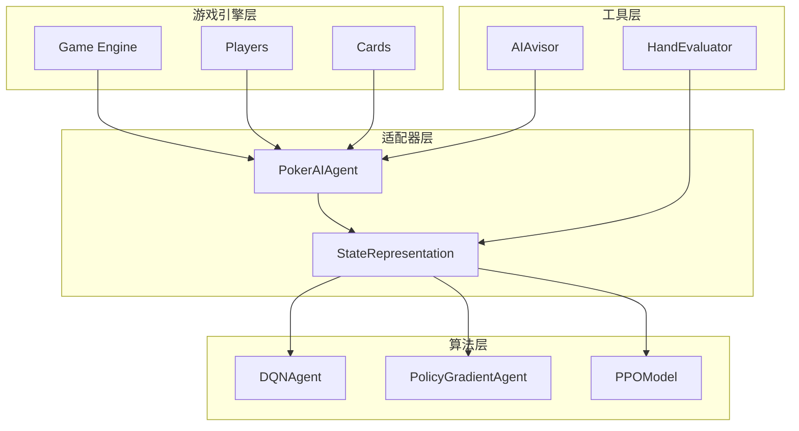

**图表来源**
- [ai_agent.py:55-116](file://poker_ai/model/ai_agent.py#L55-L116)
- [state_representation.py:9-42](file://poker_ai/model/state_representation.py#L9-L42)

## 适配器模式核心概念

适配器模式在本项目中的实现遵循以下核心原则：

### 设计目标
- **算法解耦**：不同AI算法无需了解游戏细节
- **状态统一**：提供标准化的游戏状态表示
- **接口兼容**：统一的动作选择接口
- **扩展性**：支持新算法的无缝接入

### 关键组件关系

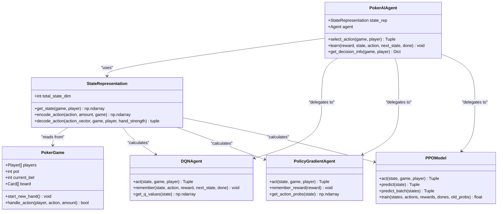

**图表来源**
- [ai_agent.py:55-116](file://poker_ai/model/ai_agent.py#L55-L116)
- [state_representation.py:9-42](file://poker_ai/model/state_representation.py#L9-L42)
- [dqn_agent.py:21-62](file://poker_ai/model/dqn_agent.py#L21-L62)
- [ppo_model.py:20-93](file://poker_ai/model/ppo_model.py#L20-L93)

## PokerAIAgent作为适配器

PokerAIAgent是整个系统的核心适配器，负责协调游戏状态与AI算法之间的交互。

### 核心职责

1. **算法工厂**：根据agent_type创建对应的AI代理实例
2. **状态适配**：将游戏状态转换为算法期望的输入格式
3. **动作解码**：将算法输出转换为游戏可执行的动作
4. **学习协调**：管理不同算法的学习过程

### 适配器初始化流程

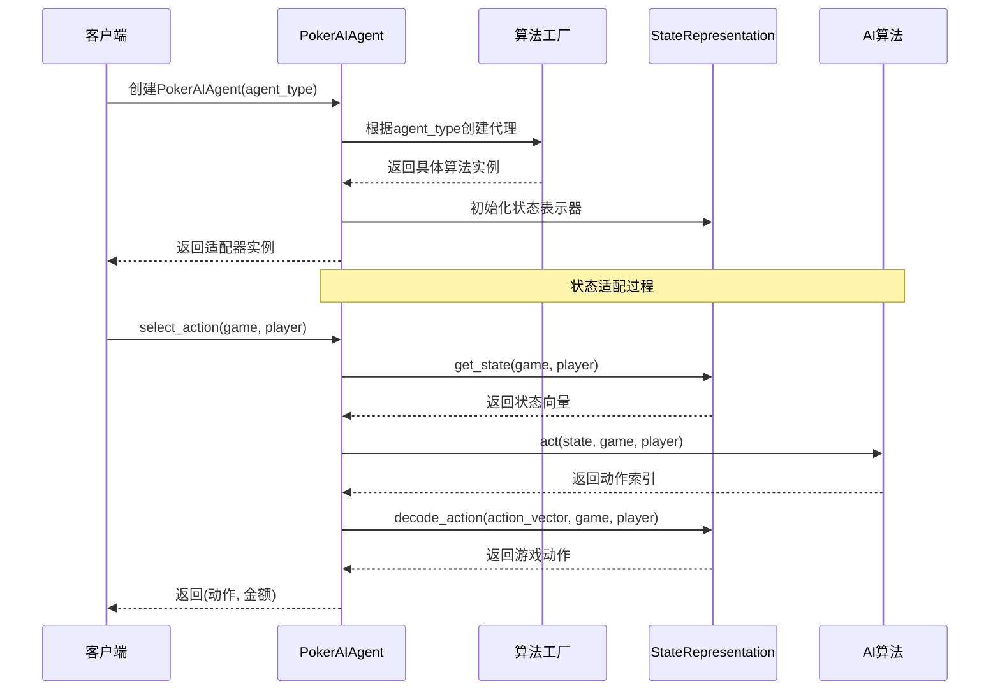

**图表来源**
- [ai_agent.py:58-116](file://poker_ai/model/ai_agent.py#L58-L116)
- [ai_agent.py:117-156](file://poker_ai/model/ai_agent.py#L117-L156)

**章节来源**
- [ai_agent.py:55-116](file://poker_ai/model/ai_agent.py#L55-L116)
- [ai_agent.py:117-156](file://poker_ai/model/ai_agent.py#L117-L156)

## StateRepresentation适配过程

StateRepresentation负责将复杂的德州扑克游戏状态转换为机器学习算法可处理的统一向量格式。

### 状态维度设计

系统采用134维状态向量，包含以下特征：

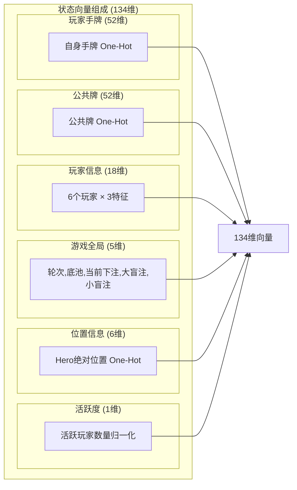

**图表来源**
- [state_representation.py:12-39](file://poker_ai/model/state_representation.py#L12-L39)

### 状态编码流程

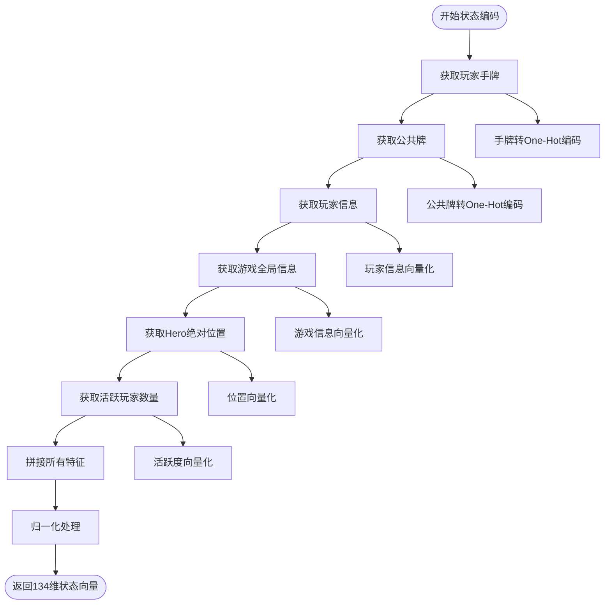

**图表来源**
- [state_representation.py:137-158](file://poker_ai/model/state_representation.py#L137-L158)

**章节来源**
- [state_representation.py:9-42](file://poker_ai/model/state_representation.py#L9-L42)
- [state_representation.py:47-64](file://poker_ai/model/state_representation.py#L47-L64)
- [state_representation.py:137-158](file://poker_ai/model/state_representation.py#L137-L158)

## 算法特定数据格式处理

不同AI算法对输入输出格式有不同要求，StateRepresentation提供了统一的适配机制。

### 动作空间适配

系统采用5维动作向量表示：
- 0: 弃牌 (Fold)
- 1: 跟注 (Call)  
- 2: 加注 (Raise) - 2倍底池
- 3: 加注 (Raise) - 4倍底池
- 4: 全下 (All-In)

### 动作解码机制

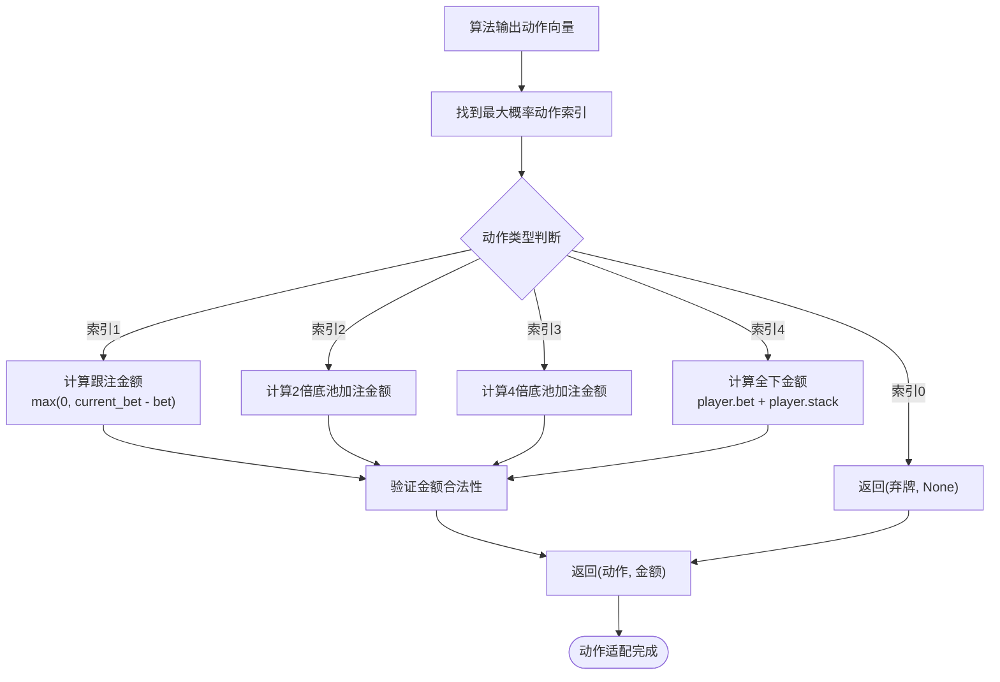

**图表来源**
- [state_representation.py:225-247](file://poker_ai/model/state_representation.py#L225-L247)

**章节来源**
- [state_representation.py:212-247](file://poker_ai/model/state_representation.py#L212-L247)

## 状态向量转换机制

StateRepresentation实现了高效的状态向量转换，采用了多项性能优化技术。

### One-Hot编码优化

```mermaid
classDiagram
class StateRepresentation {
+Dict~str,int~ _suit_to_idx
+Dict~str,int~ _rank_to_idx
+Dict~str,float~ _preflop_cache
+card_to_one_hot(cards) np.ndarray
+card_codes_to_one_hot(card_codes) np.ndarray
}
class Card {
+str suit
+str rank
+int value
}
StateRepresentation --> Card : "处理"
note for StateRepresentation : "预计算索引映射<br/>避免重复查找<br/>提高编码效率"
```

**图表来源**
- [state_representation.py:47-64](file://poker_ai/model/state_representation.py#L47-L64)
- [state_representation.py:42-45](file://poker_ai/model/state_representation.py#L42-L45)

### 玩家信息向量化

玩家信息向量化采用相对位置排序，确保AI总是在第一个位置看到自己：

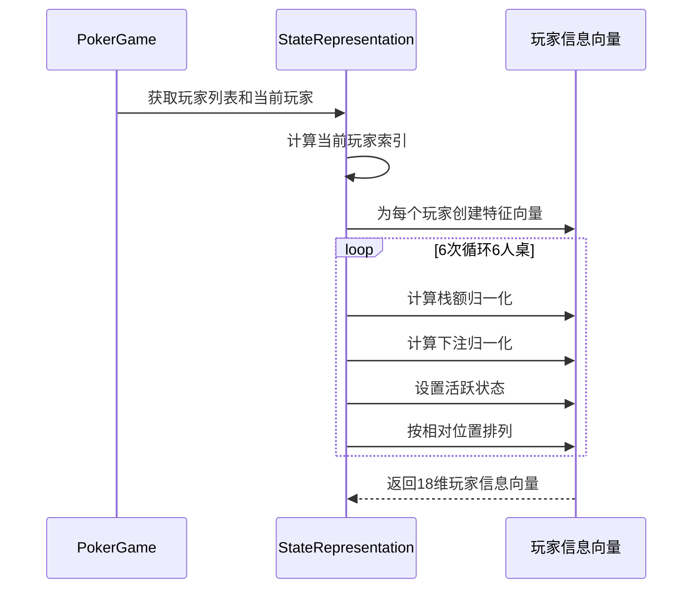

**图表来源**
- [state_representation.py:66-97](file://poker_ai/model/state_representation.py#L66-L97)

**章节来源**
- [state_representation.py:47-64](file://poker_ai/model/state_representation.py#L47-L64)
- [state_representation.py:66-97](file://poker_ai/model/state_representation.py#L66-L97)

## 动作空间适配机制

动作空间适配是适配器模式的关键功能，确保不同算法输出的动作能够被游戏引擎正确执行。

### 合法性掩码生成

系统为每个状态生成5维动作合法性掩码，确保AI只能选择合法动作：

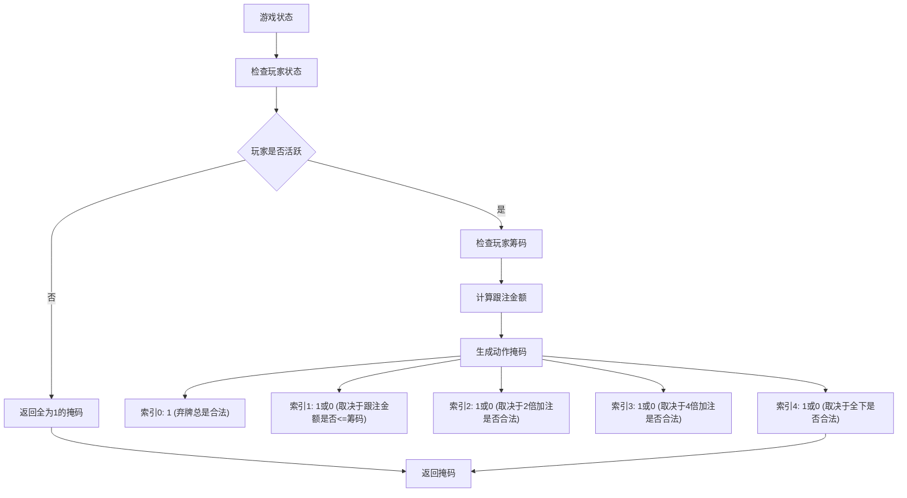

**图表来源**
- [ai_agent.py:15-53](file://poker_ai/model/ai_agent.py#L15-L53)

### PPO动作采样流程

PPO算法采用概率分布采样的方式，结合合法性掩码：

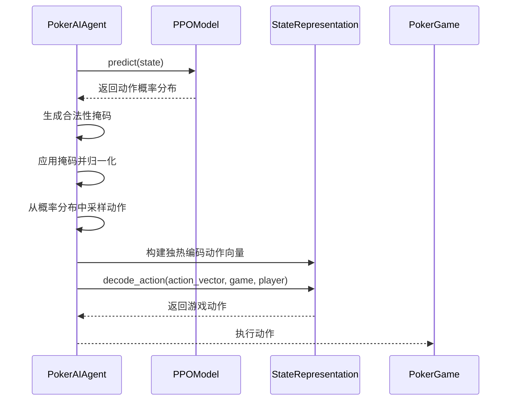

**图表来源**
- [ai_agent.py:125-156](file://poker_ai/model/ai_agent.py#L125-L156)
- [ai_agent.py:189-214](file://poker_ai/model/ai_agent.py#L189-L214)

**章节来源**
- [ai_agent.py:15-53](file://poker_ai/model/ai_agent.py#L15-L53)
- [ai_agent.py:125-156](file://poker_ai/model/ai_agent.py#L125-L156)

## 统一接口实现

PokerAIAgent实现了统一的接口，使得不同算法可以以相同的方式被调用。

### 核心接口方法

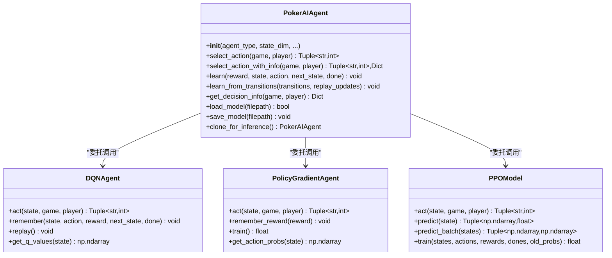

**图表来源**
- [ai_agent.py:55-116](file://poker_ai/model/ai_agent.py#L55-L116)
- [ai_agent.py:248-302](file://poker_ai/model/ai_agent.py#L248-L302)

### 批量处理优化

系统支持批量动作选择，提高并行处理效率：

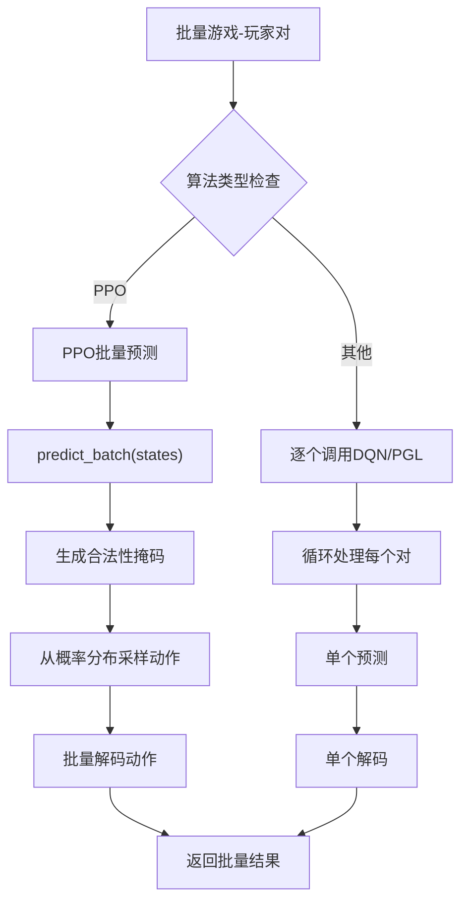

**图表来源**
- [ai_agent.py:157-214](file://poker_ai/model/ai_agent.py#L157-L214)

**章节来源**
- [ai_agent.py:55-116](file://poker_ai/model/ai_agent.py#L55-L116)
- [ai_agent.py:157-214](file://poker_ai/model/ai_agent.py#L157-L214)

## 适配器模式的价值分析

适配器模式在德州扑克AI项目中体现了多重价值：

### 算法解耦价值

1. **算法独立性**：AI算法无需了解游戏细节
2. **易于替换**：可轻松切换不同的AI算法
3. **并行开发**：不同算法可独立开发和测试

### 状态表示统一价值

1. **格式标准化**：所有算法接收相同的134维向量
2. **性能优化**：共享状态表示逻辑，避免重复实现
3. **一致性保证**：确保不同算法处理相同的游戏状态

### 扩展性价值

1. **新算法接入**：只需实现统一接口即可接入
2. **功能增强**：可在适配器层添加新的功能
3. **维护便利**：集中管理状态转换逻辑

## 性能优化与复杂度分析

系统在适配器模式的基础上实现了多项性能优化：

### 时间复杂度分析

- **状态编码**：O(n)，其中n为牌的数量（最多12张）
- **动作解码**：O(1)，常数时间操作
- **批量处理**：O(m×n)，m为批量大小，n为状态维度

### 空间复杂度分析

- **状态向量**：O(134) = O(1)，固定大小
- **批量处理**：O(m×n)，m为批量大小，n为状态维度
- **缓存机制**：O(k)，k为缓存大小

### 性能优化技术

1. **预计算索引映射**：避免重复查找操作
2. **向量化操作**：利用NumPy进行批量计算
3. **缓存机制**：缓存频繁计算的结果
4. **内存池**：复用中间计算结果

**章节来源**
- [state_representation.py:42-45](file://poker_ai/model/state_representation.py#L42-L45)
- [state_representation.py:174-210](file://poker_ai/model/state_representation.py#L174-L210)

## 故障排除与调试

### 常见问题诊断

1. **状态维度不匹配**：检查StateRepresentation的维度计算
2. **动作非法**：验证合法性掩码生成逻辑
3. **性能问题**：监控状态编码和动作解码的时间消耗

### 调试工具

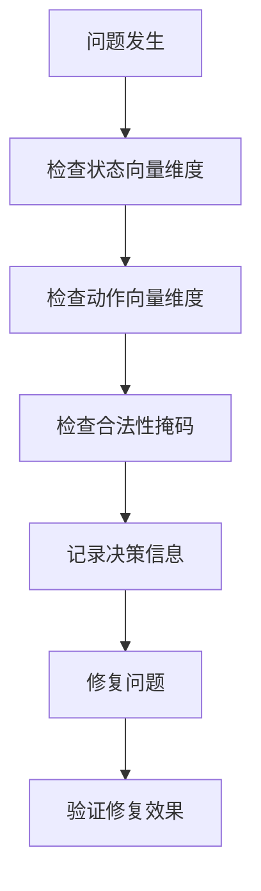

**图表来源**
- [ai_agent.py:421-452](file://poker_ai/model/ai_agent.py#L421-L452)

### 性能监控

系统提供了详细的决策信息获取功能，可用于性能分析：

**章节来源**
- [ai_agent.py:421-452](file://poker_ai/model/ai_agent.py#L421-L452)

## 结论

德州扑克AI项目通过适配器模式成功实现了算法与游戏引擎的解耦，PokerAIAgent作为核心适配器，将不同AI算法与德州扑克游戏状态进行了有效的统一适配。该模式的价值体现在：

1. **算法无关性**：统一接口支持多种AI算法
2. **状态标准化**：提供一致的状态表示格式
3. **扩展便利性**：支持新算法的无缝接入
4. **性能优化**：通过共享逻辑和缓存机制提升效率

适配器模式的应用不仅提高了代码的可维护性和可扩展性，还为后续的功能增强和算法改进奠定了坚实的基础。通过StateRepresentation的精心设计，系统实现了算法与游戏规则的抽象化分离，为德州扑克AI的发展提供了灵活的技术架构。