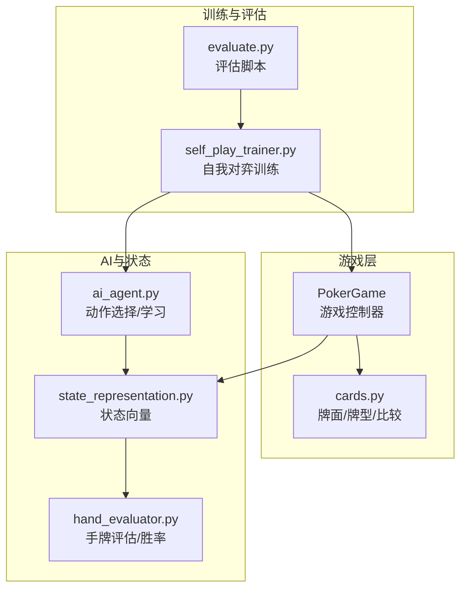
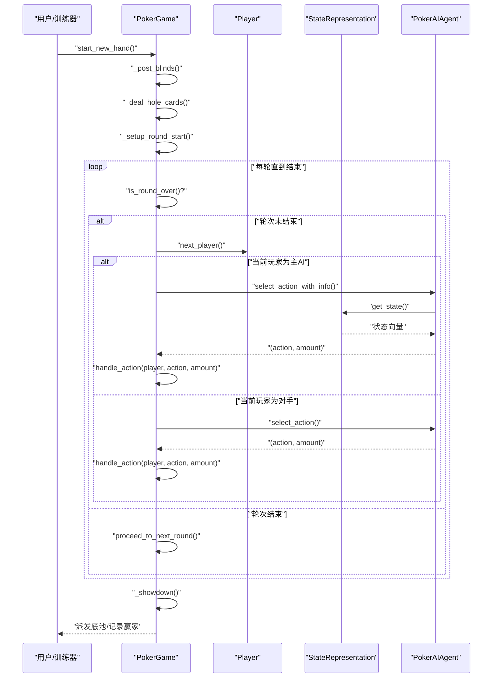
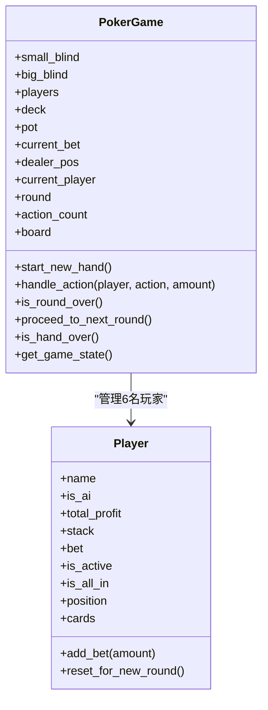
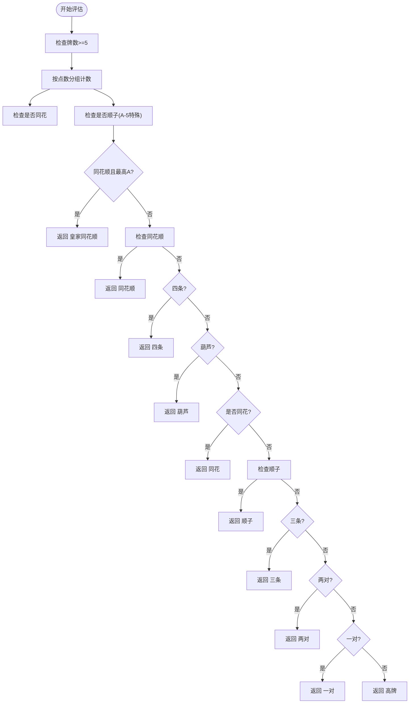
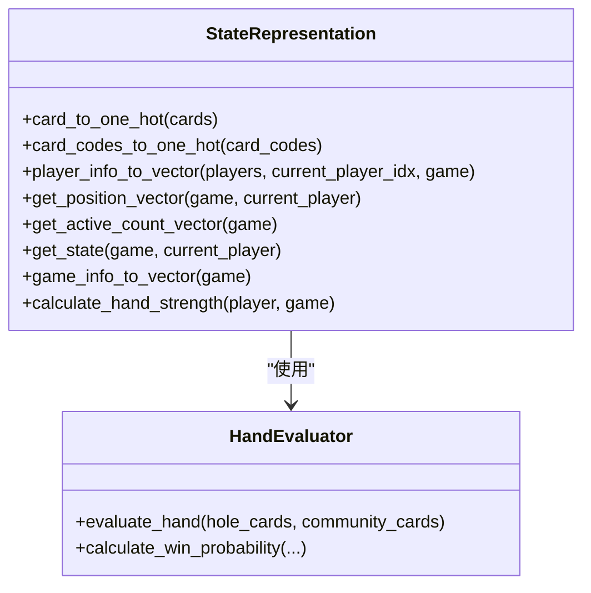
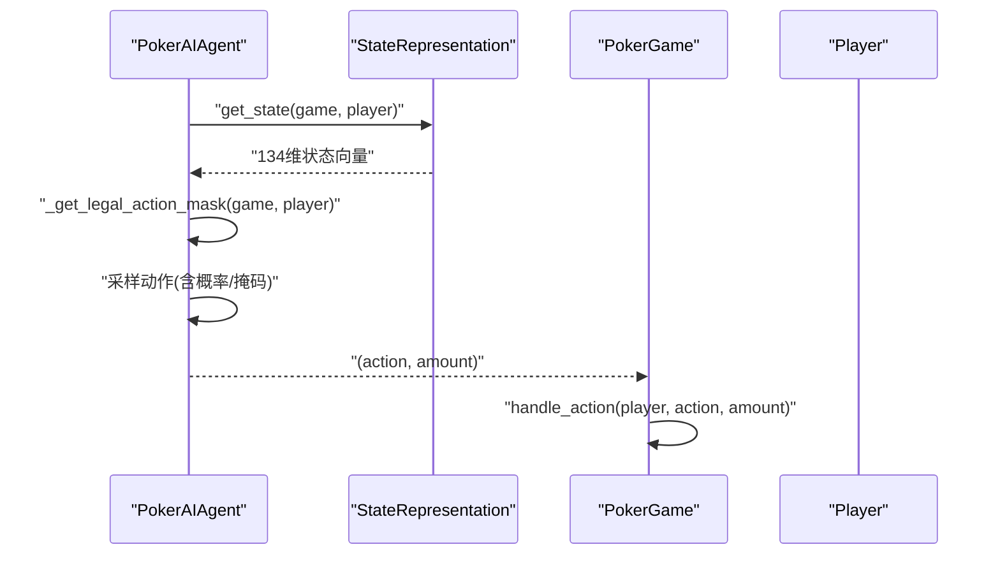
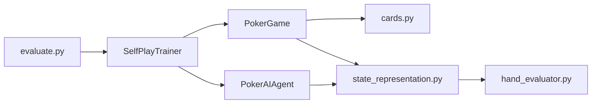

# 游戏引擎模块

<cite>
**本文引用的文件**
- [poker_ai/game/poker_game.py](file://poker_ai/game/poker_game.py)
- [poker_ai/game/cards.py](file://poker_ai/game/cards.py)
- [poker_ai/model/state_representation.py](file://poker_ai/model/state_representation.py)
- [poker_ai/model/hand_evaluator.py](file://poker_ai/model/hand_evaluator.py)
- [poker_ai/model/ai_agent.py](file://poker_ai/model/ai_agent.py)
- [poker_ai/reward/self_play_trainer.py](file://poker_ai/reward/self_play_trainer.py)
- [README.md](file://README.md)
- [test_fix.py](file://test_fix.py)
- [evaluate.py](file://evaluate.py)
</cite>

## 目录
1. [简介](#简介)
2. [项目结构](#项目结构)
3. [核心组件](#核心组件)
4. [架构总览](#架构总览)
5. [详细组件分析](#详细组件分析)
6. [依赖关系分析](#依赖关系分析)
7. [性能考量](#性能考量)
8. [故障排查指南](#故障排查指南)
9. [结论](#结论)
10. [附录](#附录)

## 简介
本技术文档围绕6人桌德州扑克游戏引擎模块展开，系统性解析以下内容：
- 6人桌德州扑克完整规则实现：发牌、下注轮次、摊牌结算等
- PokerGame类的设计与实现：游戏状态管理、玩家位置系统、动作验证机制
- cards.py中的牌面表示、牌型评估与手牌比较算法
- 状态管理的数据结构设计：公共牌、底池、玩家筹码等状态信息维护
- 使用示例：如何创建游戏实例、执行游戏动作、获取游戏状态
- 性能优化策略与内存管理考虑
- 常见问题的解决方案与调试技巧

## 项目结构
该项目采用“功能域+层次化”组织方式，核心模块如下：
- game：游戏核心逻辑（PokerGame、cards）
- model：AI状态表示、手牌评估、AI代理
- reward：自我对弈训练器与奖励计算
- 其他：训练、评估、GPU内存配置、示例测试脚本

图示来源
- [poker_ai/game/poker_game.py:155-474](file://poker_ai/game/poker_game.py#L155-L474)
- [poker_ai/game/cards.py:1-202](file://poker_ai/game/cards.py#L1-L202)
- [poker_ai/model/state_representation.py:9-247](file://poker_ai/model/state_representation.py#L9-L247)
- [poker_ai/model/hand_evaluator.py:8-187](file://poker_ai/model/hand_evaluator.py#L8-L187)
- [poker_ai/model/ai_agent.py:55-703](file://poker_ai/model/ai_agent.py#L55-L703)
- [poker_ai/reward/self_play_trainer.py:48-800](file://poker_ai/reward/self_play_trainer.py#L48-L800)
- [evaluate.py:181-200](file://evaluate.py#L181-L200)

章节来源
- [README.md:46-75](file://README.md#L46-L75)

## 核心组件
- Player：玩家实体，封装筹码、下注、位置、手牌等状态，并提供add_bet、reset_for_new_round等方法
- PokerGame：6人桌德州扑克主控制器，负责发牌、盲注、轮次推进、摊牌结算、状态导出
- Card/Deck/compare_hands：牌面表示、整数编码映射、发牌、牌型评估与手牌比较
- StateRepresentation：将游戏状态编码为134维向量，包含玩家手牌、公共牌、玩家信息、全局信息、位置与活跃人数等
- HandEvaluator：高性能手牌评估与胜率估算
- PokerAIAgent：统一AI代理接口，支持DQN、Policy Gradient、PPO三种策略
- SelfPlayTrainer：6人桌自我对弈训练器，驱动多线程并行训练

章节来源
- [poker_ai/game/poker_game.py:9-154](file://poker_ai/game/poker_game.py#L9-L154)
- [poker_ai/game/poker_game.py:155-474](file://poker_ai/game/poker_game.py#L155-L474)
- [poker_ai/game/cards.py:11-77](file://poker_ai/game/cards.py#L11-L77)
- [poker_ai/model/state_representation.py:9-158](file://poker_ai/model/state_representation.py#L9-L158)
- [poker_ai/model/hand_evaluator.py:8-187](file://poker_ai/model/hand_evaluator.py#L8-L187)
- [poker_ai/model/ai_agent.py:55-156](file://poker_ai/model/ai_agent.py#L55-L156)
- [poker_ai/reward/self_play_trainer.py:48-166](file://poker_ai/reward/self_play_trainer.py#L48-L166)

## 架构总览
下面的序列图展示了从创建游戏到执行动作、推进轮次、摊牌结算的整体流程。

图示来源
- [poker_ai/game/poker_game.py:227-402](file://poker_ai/game/poker_game.py#L227-L402)
- [poker_ai/model/ai_agent.py:117-156](file://poker_ai/model/ai_agent.py#L117-L156)
- [poker_ai/model/state_representation.py:137-158](file://poker_ai/model/state_representation.py#L137-L158)

## 详细组件分析

### PokerGame 类设计与实现
- 角色定位：6人桌德州扑克的唯一权威控制器，负责规则执行、状态推进与结算
- 关键数据结构
  - 玩家数组与共享状态表：player_stacks/bets/active/all_in/positions
  - 公共牌：_board_codes（整数编码）+ _board_cache（缓存）
  - 游戏全局状态：pot、current_bet、dealer_pos、current_player、round、action_count
- 核心流程
  - start_new_hand：洗牌、清场、发盲注、发手牌、设置轮次与起始玩家
  - _post_blinds：计算SB/BB位置并下注
  - _deal_hole_cards：每人两张
  - _setup_round_start：翻牌前从BB+1开始，翻牌后从庄家下一位开始
  - handle_action：fold/call/raise的合法性校验与状态变更
  - is_round_over：基于行动计数与跟注一致性判断轮次结束
  - proceed_to_next_round：翻牌/转牌/河牌/摊牌推进
  - _showdown：从7张牌中选最佳5张比较，分配底池，支持并列赢家
  - is_hand_over：手牌结束条件（只剩一人或轮次>4）
  - get_game_state：导出当前状态供AI决策
- 设计要点
  - 玩家位置系统：通过共享表维护相对位置，便于状态向量构造
  - 整数编码：公共牌与手牌均使用整数编码，减少对象创建与提升性能
  - 缓存策略：手牌与公共牌的缓存与脏标记，避免重复解码

图示来源
- [poker_ai/game/poker_game.py:9-154](file://poker_ai/game/poker_game.py#L9-L154)
- [poker_ai/game/poker_game.py:155-474](file://poker_ai/game/poker_game.py#L155-L474)

章节来源
- [poker_ai/game/poker_game.py:155-474](file://poker_ai/game/poker_game.py#L155-L474)

### cards.py：牌面表示、牌型评估与手牌比较
- Card/Deck
  - Card：点数、花色、点数值，支持相等与哈希
  - Deck：整数编码的牌堆，提供shuffle/deal/deal_code
- 牌面编码
  - card_to_code/code_to_card：将Card映射到稳定整数编码，利用共享缓存
- 牌型评估
  - evaluate_hand：评估5张牌的牌型与强度，返回(牌型等级, 强度列表)
  - compare_hands：从7张牌中枚举所有5张组合，比较最佳牌型与强度
- 优化点
  - 整数编码路径：避免频繁创建Card对象，提高性能
  - A-5顺子特殊处理：在评估中正确识别

图示来源
- [poker_ai/game/cards.py:92-170](file://poker_ai/game/cards.py#L92-L170)

章节来源
- [poker_ai/game/cards.py:11-77](file://poker_ai/game/cards.py#L11-L77)
- [poker_ai/game/cards.py:92-202](file://poker_ai/game/cards.py#L92-L202)

### 状态管理与状态表示
- 状态向量维度
  - 玩家手牌：52维（one-hot）
  - 公共牌：52维（one-hot）
  - 玩家信息：6×3维（栈、下注、是否活跃）
  - 全局信息：轮次、底池、当前下注、大盲、小盲（归一化）
  - 绝对位置：相对于庄家的6维one-hot（BTN/SB/BB/UTG/MP/CO）
  - 活跃人数：1维（归一化）
  - 总计：134维
- 关键特性
  - Hero相对位置：将当前玩家置于向量首位，其余顺时针排列，确保AI始终在第一个位置看到自己
  - 位置向量：基于庄家位置计算距离，映射到6个绝对位置
  - 活跃人数向量：(活跃人数-1)/5，范围[0,1]
  - 手牌强度：预翻牌快速评估，翻牌后使用蒙特卡洛模拟胜率

图示来源
- [poker_ai/model/state_representation.py:9-158](file://poker_ai/model/state_representation.py#L9-L158)
- [poker_ai/model/hand_evaluator.py:8-187](file://poker_ai/model/hand_evaluator.py#L8-L187)

章节来源
- [poker_ai/model/state_representation.py:9-247](file://poker_ai/model/state_representation.py#L9-L247)
- [poker_ai/model/hand_evaluator.py:8-187](file://poker_ai/model/hand_evaluator.py#L8-L187)

### AI代理与动作选择
- PokerAIAgent
  - 统一接口：select_action/select_action_with_info
  - 动作掩码：根据当前游戏状态与玩家筹码生成合法动作掩码
  - PPO支持：批量动作选择、轨迹收集、批量训练
  - 决策信息：返回Q值/动作概率/状态价值等，便于调试与建议
- 动作空间
  - fold/call/raise x2/x4/all-in，金额由legal mask与规则约束决定
- 训练器集成
  - SelfPlayTrainer：并行多局训练，支持批量轨迹收集与PPO批量更新

图示来源
- [poker_ai/model/ai_agent.py:15-53](file://poker_ai/model/ai_agent.py#L15-L53)
- [poker_ai/model/ai_agent.py:117-156](file://poker_ai/model/ai_agent.py#L117-L156)
- [poker_ai/model/state_representation.py:137-158](file://poker_ai/model/state_representation.py#L137-L158)

章节来源
- [poker_ai/model/ai_agent.py:55-214](file://poker_ai/model/ai_agent.py#L55-L214)

### 自我对弈训练器
- SelfPlayTrainer
  - 6人桌专用：严格要求num_players==6
  - 并行采样：多worker并行推进多手牌，PPO支持批量轨迹收集
  - 奖励与策略：结合奖励计算器与“不走运all-in补偿”，避免策略塌缩
  - 检查点：定期保存模型与状态，支持断点续训
- 关键流程
  - _create_game：创建6名玩家（1主AI+5对手）
  - _play_hand/_play_hand_collect：推进一局，记录轨迹与奖励
  - _play_hands_collect_batched：PPO批量采样，降低Python/TensorFlow往返开销

章节来源
- [poker_ai/reward/self_play_trainer.py:48-166](file://poker_ai/reward/self_play_trainer.py#L48-L166)
- [poker_ai/reward/self_play_trainer.py:260-417](file://poker_ai/reward/self_play_trainer.py#L260-L417)
- [poker_ai/reward/self_play_trainer.py:587-800](file://poker_ai/reward/self_play_trainer.py#L587-L800)

## 依赖关系分析
- 模块耦合
  - PokerGame依赖cards.py（发牌、比较）、state_representation.py（状态导出）
  - PokerAIAgent依赖state_representation与ai_agent（动作选择与学习）
  - SelfPlayTrainer依赖PokerGame、PokerAIAgent、reward_calculator
- 外部依赖
  - TensorFlow（PPO模型）、NumPy（向量运算）、Matplotlib/Seaborn（评估可视化）

图示来源
- [poker_ai/game/poker_game.py:1-10](file://poker_ai/game/poker_game.py#L1-L10)
- [poker_ai/model/ai_agent.py:1-12](file://poker_ai/model/ai_agent.py#L1-L12)
- [poker_ai/reward/self_play_trainer.py:21-26](file://poker_ai/reward/self_play_trainer.py#L21-L26)

章节来源
- [poker_ai/game/poker_game.py:1-10](file://poker_ai/game/poker_game.py#L1-L10)
- [poker_ai/model/ai_agent.py:1-12](file://poker_ai/model/ai_agent.py#L1-L12)
- [poker_ai/reward/self_play_trainer.py:1-26](file://poker_ai/reward/self_play_trainer.py#L1-L26)

## 性能考量
- 整数编码与共享缓存
  - cards.py中使用_card_cache与_code_lookup，避免重复创建Card对象
  - PokerGame中公共牌与手牌使用整数编码存储，配合code_to_card解码
- 状态向量高效构建
  - StateRepresentation使用one-hot编码与预计算索引映射，避免高频路径中的字符串/索引查找
  - card_codes_to_one_hot直接对整数编码进行one-hot，减少对象解包
- 并行与批量
  - SelfPlayTrainer支持多worker并行采样，PPO支持批量轨迹收集与批量训练
  - PokerAIAgent在PPO模式下提供批量动作选择接口，降低Python/TensorFlow往返开销
- 内存管理
  - 使用numpy数组管理玩家状态（stacks/bets/active/all_in/positions），减少Python对象开销
  - 状态缓存与脏标记避免重复解码与重复计算
- GPU内存配置
  - evaluate.py中设置GPU内存增长，避免一次性占用全部显存

章节来源
- [poker_ai/game/cards.py:38-77](file://poker_ai/game/cards.py#L38-L77)
- [poker_ai/game/poker_game.py:182-188](file://poker_ai/game/poker_game.py#L182-L188)
- [poker_ai/model/state_representation.py:47-64](file://poker_ai/model/state_representation.py#L47-L64)
- [evaluate.py:31-52](file://evaluate.py#L31-L52)

## 故障排查指南
- 常见问题
  - “动作非法”：PokerAIAgent会生成合法动作掩码，若所有动作不可行，将回退到fold/call
  - “轮次无法推进”：检查is_round_over逻辑与action_count是否正确递增
  - “摊牌平局”：_showdown支持并列赢家，底池均分并保留余数给首位
  - “PPO更新失败”：SelfPlayTrainer捕获DNN/Graph错误并记录warning，可尝试禁用XLA/oneDNN
- 调试技巧
  - 使用PokerAIAgent.get_decision_info查看Q值/动作概率/状态价值
  - evaluate.py中设置详细日志，观察GPU内存设置与字体配置
  - test_fix.py提供手动测试框架，可限制AI下注金额，便于定位策略问题
- 代码示例路径
  - 创建游戏与执行动作：[poker_ai/game/poker_game.py:476-497](file://poker_ai/game/poker_game.py#L476-L497)
  - AI代理使用：[poker_ai/model/ai_agent.py:660-703](file://poker_ai/model/ai_agent.py#L660-L703)
  - 自我对弈训练：[poker_ai/reward/self_play_trainer.py:260-417](file://poker_ai/reward/self_play_trainer.py#L260-L417)

章节来源
- [poker_ai/model/ai_agent.py:15-53](file://poker_ai/model/ai_agent.py#L15-L53)
- [poker_ai/reward/self_play_trainer.py:323-332](file://poker_ai/reward/self_play_trainer.py#L323-L332)
- [evaluate.py:20-82](file://evaluate.py#L20-L82)
- [test_fix.py:124-170](file://test_fix.py#L124-L170)

## 结论
本模块以PokerGame为核心，结合cards.py的高性能牌面与牌型评估、state_representation的134维状态向量、hand_evaluator的胜率估算与PokerAIAgent的动作选择，构建了完整的6人桌德州扑克引擎。通过整数编码、共享缓存、并行采样与批量训练等优化手段，在保证规则正确性的前提下显著提升了性能。SelfPlayTrainer进一步提供了高效的自我对弈训练框架，适合大规模强化学习场景。

## 附录

### 使用示例（路径参考）
- 创建6人桌游戏并开始一局
  - [poker_ai/game/poker_game.py:476-497](file://poker_ai/game/poker_game.py#L476-L497)
- AI代理选择动作并执行
  - [poker_ai/model/ai_agent.py:117-156](file://poker_ai/model/ai_agent.py#L117-L156)
  - [poker_ai/reward/self_play_trainer.py:260-417](file://poker_ai/reward/self_play_trainer.py#L260-L417)
- 获取游戏状态
  - [poker_ai/game/poker_game.py:458-474](file://poker_ai/game/poker_game.py#L458-L474)
  - [poker_ai/model/state_representation.py:137-158](file://poker_ai/model/state_representation.py#L137-L158)

### 关键API一览
- PokerGame
  - start_new_hand, handle_action, is_round_over, proceed_to_next_round, is_hand_over, get_game_state
- Player
  - add_bet, reset_for_new_round
- cards.py
  - Card/Deck, card_to_code, code_to_card, evaluate_hand, compare_hands
- StateRepresentation
  - get_state, game_info_to_vector, calculate_hand_strength
- PokerAIAgent
  - select_action, select_action_with_info, get_decision_info
- SelfPlayTrainer
  - _play_hand, _play_hands_collect_batched, append_trajectories_batch

章节来源
- [poker_ai/game/poker_game.py:155-474](file://poker_ai/game/poker_game.py#L155-L474)
- [poker_ai/game/cards.py:11-202](file://poker_ai/game/cards.py#L11-L202)
- [poker_ai/model/state_representation.py:137-170](file://poker_ai/model/state_representation.py#L137-L170)
- [poker_ai/model/ai_agent.py:117-156](file://poker_ai/model/ai_agent.py#L117-L156)
- [poker_ai/reward/self_play_trainer.py:260-417](file://poker_ai/reward/self_play_trainer.py#L260-L417)