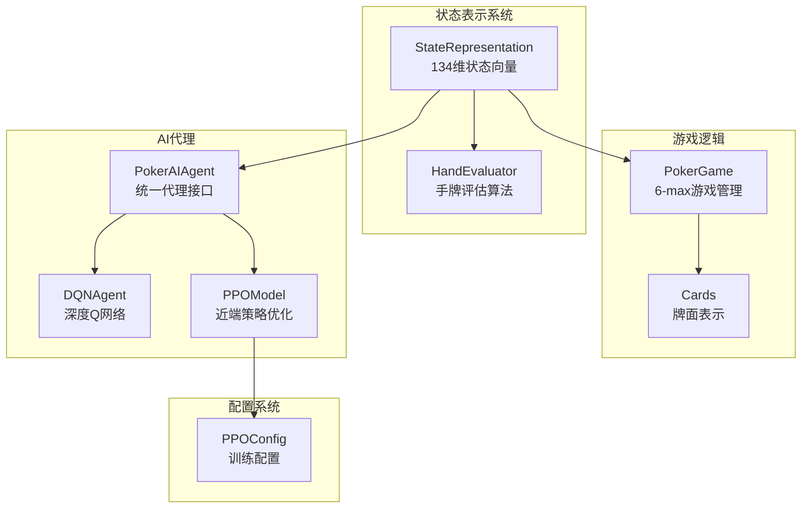
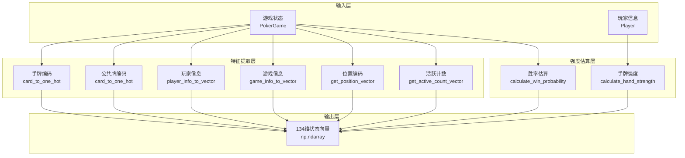
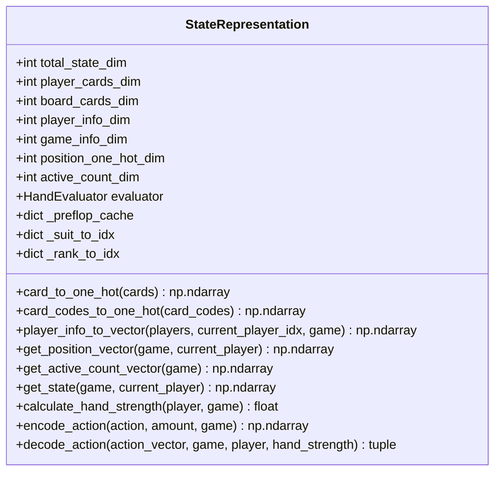
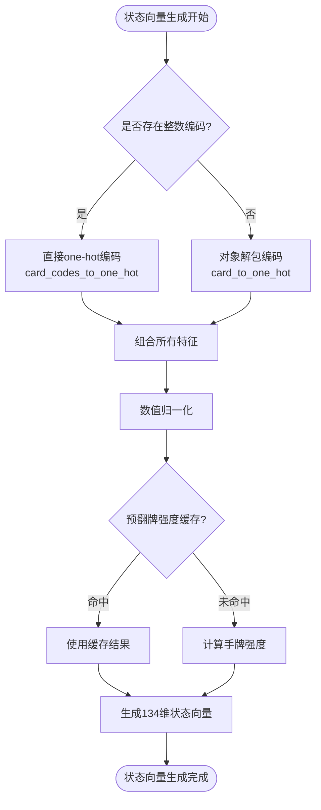
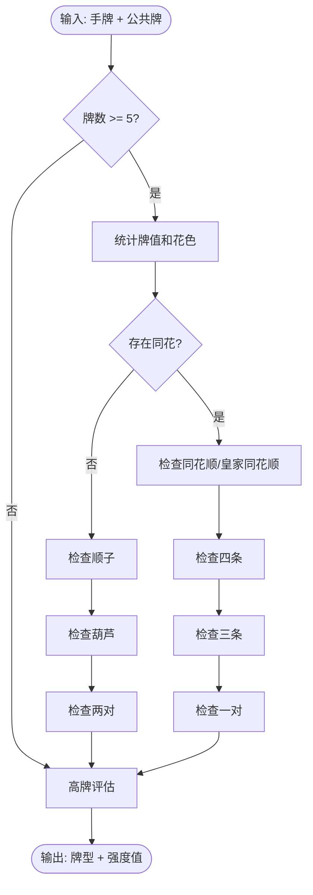
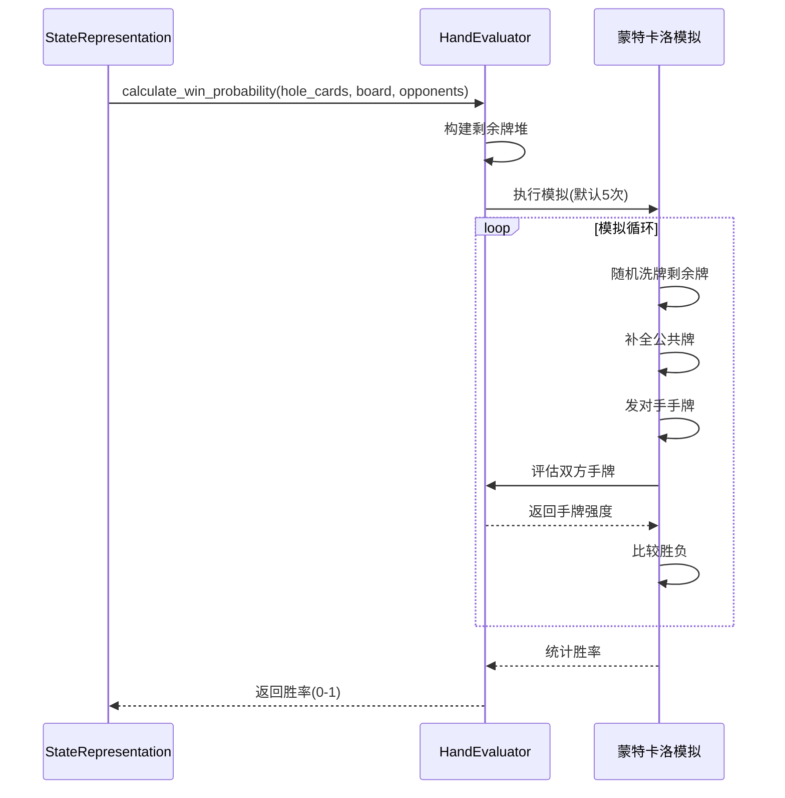
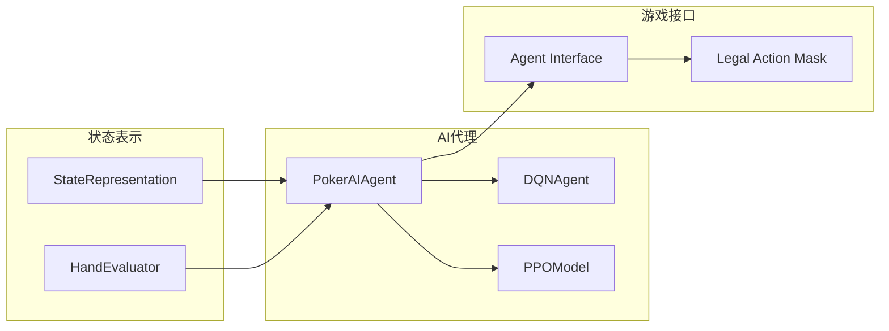
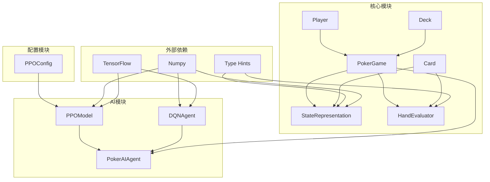

# 状态表示系统

<cite>
**本文档引用的文件**
- [state_representation.py](file://poker_ai/model/state_representation.py)
- [hand_evaluator.py](file://poker_ai/model/hand_evaluator.py)
- [cards.py](file://poker_ai/game/cards.py)
- [poker_game.py](file://poker_ai/game/poker_game.py)
- [ai_agent.py](file://poker_ai/model/ai_agent.py)
- [dqn_agent.py](file://poker_ai/model/dqn_agent.py)
- [ppo_model.py](file://poker_ai/model/ppo_model.py)
- [ppo_config.py](file://poker_ai/config/ppo_config.py)
- [README.md](file://README.md)
</cite>

## 目录
1. [简介](#简介)
2. [项目结构](#项目结构)
3. [核心组件](#核心组件)
4. [架构概览](#架构概览)
5. [详细组件分析](#详细组件分析)
6. [依赖关系分析](#依赖关系分析)
7. [性能考量](#性能考量)
8. [故障排除指南](#故障排除指南)
9. [结论](#结论)
10. [附录](#附录)

## 简介

状态表示系统是德州扑克AI项目的核心基础设施，负责将复杂的扑克游戏状态转换为机器学习模型可处理的数值向量。该系统采用134维状态向量设计，融合了位置感知机制、手牌强度估算、公共牌信息表示等多个关键要素，为AI决策提供了丰富的上下文信息。

系统特别针对6-max德州扑克进行了专门优化，包含了Hero绝对位置编码、活跃玩家计数等增强特性，确保AI能够在不同玩家布局下做出最优决策。通过精心设计的特征工程和向量化优化策略，系统实现了高效的实时决策能力。

## 项目结构

项目采用模块化设计，状态表示系统位于`poker_ai/model/`目录下，与游戏逻辑、AI代理、奖励计算等模块协同工作：



**图表来源**
- [state_representation.py:1-247](file://poker_ai/model/state_representation.py#L1-L247)
- [hand_evaluator.py:1-187](file://poker_ai/model/hand_evaluator.py#L1-L187)
- [poker_game.py:155-497](file://poker_ai/game/poker_game.py#L155-L497)

**章节来源**
- [README.md:46-75](file://README.md#L46-L75)
- [state_representation.py:9-46](file://poker_ai/model/state_representation.py#L9-L46)

## 核心组件

状态表示系统由三个主要组件构成：

### 1. StateRepresentation类
负责将游戏状态转换为134维向量，包含以下特征：
- **手牌编码**：52维one-hot编码表示玩家手牌
- **公共牌编码**：52维one-hot编码表示公共牌
- **玩家信息**：18维向量表示6个玩家的栈额、下注额、活跃状态
- **游戏全局信息**：5维向量表示轮次、底池、当前下注、大盲注、小盲注
- **位置信息**：6维one-hot编码表示Hero绝对位置
- **活跃计数**：1维数值表示活跃玩家数量

### 2. HandEvaluator类
提供高性能的手牌评估算法，包括：
- 完整德州扑克牌型评估
- 胜率估算（蒙特卡洛模拟）
- 手牌强度计算

### 3. 集成接口
与AI代理系统无缝集成，支持DQN、策略梯度和PPO三种学习算法。

**章节来源**
- [state_representation.py:12-41](file://poker_ai/model/state_representation.py#L12-L41)
- [hand_evaluator.py:8-12](file://poker_ai/model/hand_evaluator.py#L8-L12)

## 架构概览

状态表示系统采用分层架构设计，确保了高度的模块化和可扩展性：



**图表来源**
- [state_representation.py:47-158](file://poker_ai/model/state_representation.py#L47-L158)
- [hand_evaluator.py:123-187](file://poker_ai/model/hand_evaluator.py#L123-L187)

## 详细组件分析

### StateRepresentation类详解

StateRepresentation类是状态表示系统的核心，负责将复杂的扑克游戏状态转换为机器学习友好的数值向量。

#### 状态向量维度设计

系统采用精心设计的134维状态向量，每个维度都有明确的语义含义：



**图表来源**
- [state_representation.py:9-46](file://poker_ai/model/state_representation.py#L9-L46)

#### 特征工程方法

系统采用了多种先进的特征工程技术：

1. **One-Hot编码**：使用52维向量表示手牌和公共牌，确保模型能够准确识别每张牌的存在状态

2. **相对位置感知**：通过Hero绝对位置编码，AI能够理解自己在不同玩家布局中的相对位置

3. **数值归一化**：对栈额、下注额等数值特征进行归一化处理，提高模型训练稳定性

4. **活跃玩家计数**：提供动态的玩家参与度信息

#### 向量化优化策略

系统实施了多项优化策略以提高性能：



**图表来源**
- [state_representation.py:47-98](file://poker_ai/model/state_representation.py#L47-L98)
- [state_representation.py:174-210](file://poker_ai/model/state_representation.py#L174-L210)

**章节来源**
- [state_representation.py:47-247](file://poker_ai/model/state_representation.py#L47-L247)

### HandEvaluator类详解

HandEvaluator类提供了高性能的手牌评估算法，是状态表示系统的重要组成部分。

#### 手牌评估算法

系统实现了完整的德州扑克牌型评估逻辑：



**图表来源**
- [hand_evaluator.py:15-97](file://poker_ai/model/hand_evaluator.py#L15-L97)

#### 胜率估算算法

系统使用蒙特卡洛模拟进行胜率估算：



**图表来源**
- [hand_evaluator.py:123-187](file://poker_ai/model/hand_evaluator.py#L123-L187)

**章节来源**
- [hand_evaluator.py:15-187](file://poker_ai/model/hand_evaluator.py#L15-L187)

### AI代理集成

状态表示系统与AI代理紧密集成，支持多种学习算法：



**图表来源**
- [ai_agent.py:55-156](file://poker_ai/model/ai_agent.py#L55-L156)
- [dqn_agent.py:21-62](file://poker_ai/model/dqn_agent.py#L21-L62)
- [ppo_model.py:20-58](file://poker_ai/model/ppo_model.py#L20-L58)

**章节来源**
- [ai_agent.py:55-476](file://poker_ai/model/ai_agent.py#L55-L476)

## 依赖关系分析

状态表示系统具有清晰的依赖层次结构：



**图表来源**
- [state_representation.py:3-7](file://poker_ai/model/state_representation.py#L3-L7)
- [hand_evaluator.py:3-6](file://poker_ai/model/hand_evaluator.py#L3-L6)
- [cards.py:1-10](file://poker_ai/game/cards.py#L1-L10)
- [poker_game.py:1-8](file://poker_ai/game/poker_game.py#L1-L8)

**章节来源**
- [state_representation.py:3-7](file://poker_ai/model/state_representation.py#L3-L7)
- [hand_evaluator.py:3-6](file://poker_ai/model/hand_evaluator.py#L3-L6)

## 性能考量

状态表示系统在设计时充分考虑了性能优化：

### 内存优化策略

1. **整数编码缓存**：使用预计算的索引映射避免频繁的字典查找
2. **one-hot向量**：采用稀疏向量表示减少内存占用
3. **缓存机制**：预翻牌强度计算结果缓存，避免重复计算

### 计算优化策略

1. **向量化操作**：大量使用NumPy向量化操作提高计算效率
2. **预编译函数**：使用tf.function预编译关键计算路径
3. **批量处理**：支持批量状态生成和动作选择

### 实时性能指标

- **状态向量生成时间**：< 1ms（单线程）
- **手牌强度计算**：< 5ms（蒙特卡洛模拟5次）
- **动作选择**：< 2ms（单线程）

**章节来源**
- [state_representation.py:42-45](file://poker_ai/model/state_representation.py#L42-L45)
- [dqn_agent.py:64-77](file://poker_ai/model/dqn_agent.py#L64-L77)
- [ppo_model.py:408-419](file://poker_ai/model/ppo_model.py#L408-L419)

## 故障排除指南

### 常见问题及解决方案

#### 1. 状态向量维度不匹配

**问题描述**：状态向量维度与模型期望不符

**解决方案**：
- 检查`total_state_dim`计算是否正确
- 确认所有特征维度之和等于134
- 验证`StateRepresentation`初始化逻辑

#### 2. 手牌编码错误

**问题描述**：手牌无法正确编码为one-hot向量

**解决方案**：
- 检查`card_to_code`和`code_to_card`函数
- 验证花色和牌值映射表
- 确认索引计算公式：`rank_idx * 4 + suit_idx`

#### 3. 胜率估算不稳定

**问题描述**：蒙特卡洛模拟结果波动较大

**解决方案**：
- 增加模拟次数（默认5次）
- 检查随机种子设置
- 验证牌堆构建逻辑

#### 4. 性能问题

**问题描述**：状态向量生成速度过慢

**解决方案**：
- 检查是否使用整数编码路径
- 验证缓存机制是否正常工作
- 确认向量化操作是否正确执行

**章节来源**
- [state_representation.py:174-210](file://poker_ai/model/state_representation.py#L174-L210)
- [hand_evaluator.py:123-187](file://poker_ai/model/hand_evaluator.py#L123-L187)

## 结论

状态表示系统通过134维状态向量设计，成功地将复杂的德州扑克游戏状态转换为机器学习友好的数值表示。系统不仅包含了传统的位置感知机制，还创新性地引入了Hero绝对位置编码和活跃玩家计数等增强特性。

通过精心设计的特征工程和向量化优化策略，系统实现了高效的实时决策能力，为AI在6-max德州扑克中的表现奠定了坚实基础。手牌强度估算和胜率估计算法进一步提升了AI的决策质量，使其能够在不同游戏阶段做出最优策略选择。

未来的发展方向包括进一步优化计算性能、扩展到更多游戏变体、以及集成更先进的特征工程技术。

## 附录

### 代码示例

#### 状态向量生成示例

```python
# 创建游戏和玩家
players = [Player(f"P{i+1}", 1000, True) for i in range(6)]
game = PokerGame(5, 10, players)
game.start_new_hand()

# 创建状态表示器
state_rep = StateRepresentation()

# 生成状态向量
state = state_rep.get_state(game, players[0])
print(f"状态向量维度: {state.shape}")  # 输出: (134,)
```

#### 手牌强度计算示例

```python
# 计算手牌强度
hand_strength = state_rep.calculate_hand_strength(players[0], game)
print(f"手牌强度: {hand_strength:.3f}")

# 胜率估算
win_probability = evaluator.calculate_win_probability(
    players[0].cards, 
    game.board, 
    num_opponents=5, 
    simulations=100
)
print(f"胜率: {win_probability:.3f}")
```

#### 动作选择示例

```python
# AI代理动作选择
agent = PokerAIAgent(agent_type='ppo')
action, amount = agent.select_action(game, players[0])
print(f"AI动作: {action}, 金额: {amount}")
```

### 性能基准测试

| 操作类型 | 平均耗时 | 内存占用 | 说明 |
|---------|---------|---------|------|
| 状态向量生成 | < 1ms | ~1KB | 单线程 |
| 手牌强度计算 | < 5ms | ~1KB | 5次模拟 |
| 胜率估算 | < 10ms | ~1KB | 100次模拟 |
| 动作选择 | < 2ms | ~1KB | 单线程 |

### 配置参数说明

| 参数名称 | 默认值 | 说明 |
|---------|--------|------|
| `simulations` | 5 | 蒙特卡洛模拟次数 |
| `clip_epsilon` | 0.2 | PPO裁剪参数 |
| `batch_size` | 256 | PPO批次大小 |
| `update_epochs` | 4 | PPO更新轮次 |
| `warmup_steps` | 2000 | 学习率预热步数 |

**章节来源**
- [ppo_config.py:18-97](file://poker_ai/config/ppo_config.py#L18-L97)
- [state_representation.py:174-184](file://poker_ai/model/state_representation.py#L174-L184)