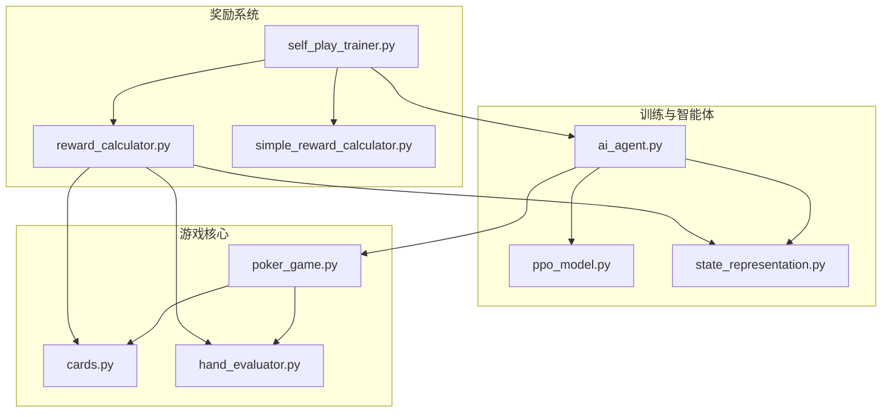
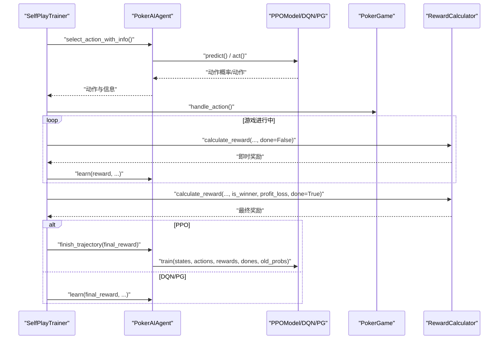
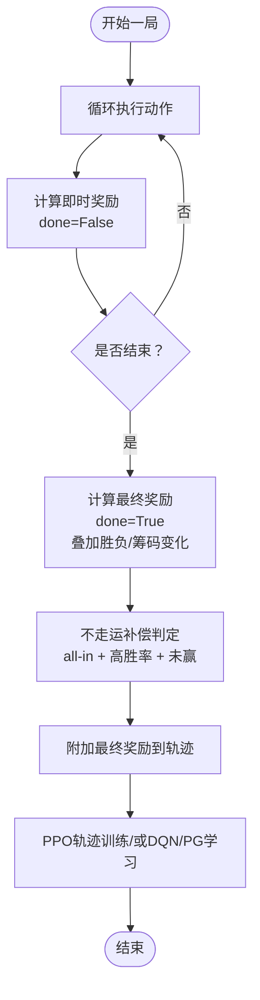
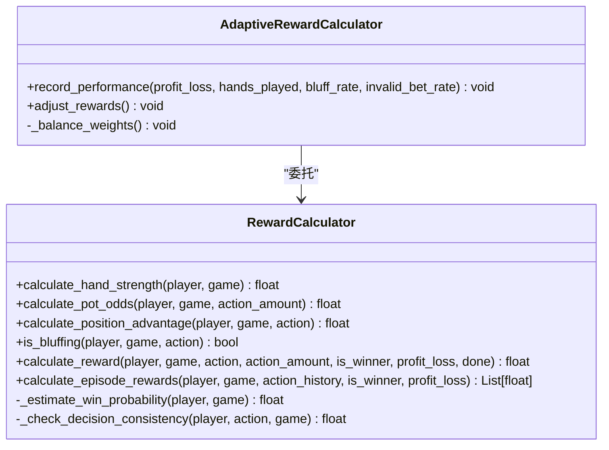
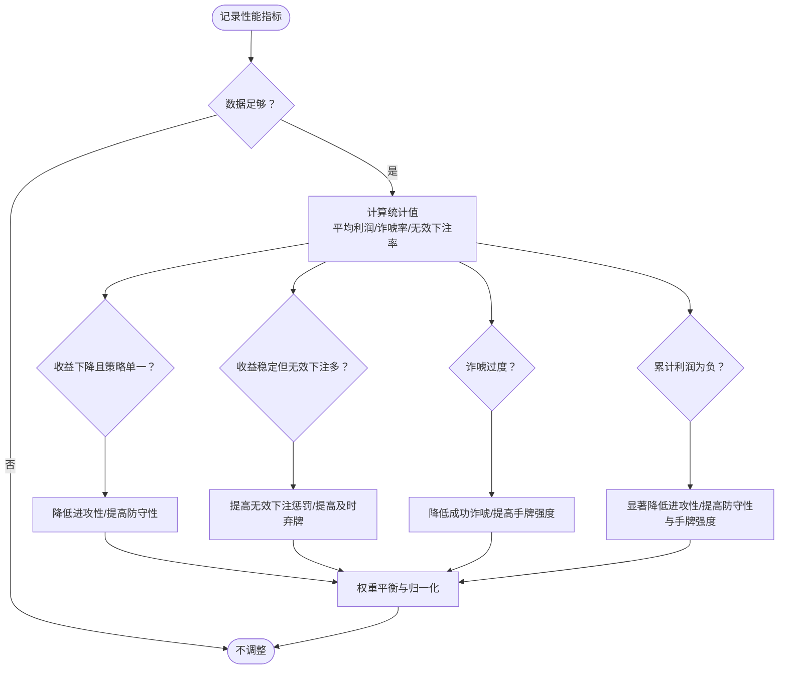
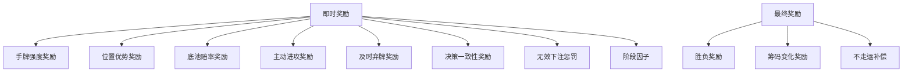
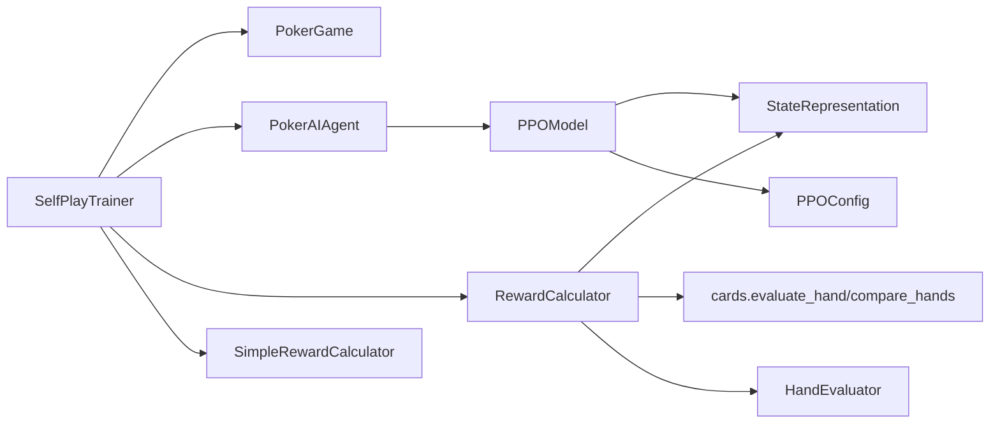

# 奖励计算系统

<cite>
**本文档引用的文件**
- [self_play_trainer.py](file://poker_ai/reward/self_play_trainer.py)
- [reward_calculator.py](file://poker_ai/reward/reward_calculator.py)
- [simple_reward_calculator.py](file://poker_ai/reward/simple_reward_calculator.py)
- [ppo_model.py](file://poker_ai/model/ppo_model.py)
- [poker_game.py](file://poker_ai/game/poker_game.py)
- [state_representation.py](file://poker_ai/model/state_representation.py)
- [ai_agent.py](file://poker_ai/model/ai_agent.py)
- [cards.py](file://poker_ai/game/cards.py)
- [ppo_config.py](file://poker_ai/config/ppo_config.py)
- [hand_evaluator.py](file://poker_ai/model/hand_evaluator.py)
- [README.md](file://README.md)
</cite>

## 目录
1. [简介](#简介)
2. [项目结构](#项目结构)
3. [核心组件](#核心组件)
4. [架构概览](#架构概览)
5. [详细组件分析](#详细组件分析)
6. [依赖分析](#依赖分析)
7. [性能考量](#性能考量)
8. [故障排查指南](#故障排查指南)
9. [结论](#结论)
10. [附录](#附录)

## 简介
本文件面向奖励计算系统，聚焦 SelfPlayTrainer 中的 RewardCalculator 与 AdaptiveRewardCalculator 设计与实现，系统阐述奖励函数的组成结构、数学模型与算法实现，包括即时奖励、最终奖励、不走运补偿等，并解释动态调整机制（自适应奖励系数、奖励衰减策略）、参数调优方法与经验指导，以及对训练稳定性与学习效果的影响与性能优化策略。

## 项目结构
奖励系统位于 poker_ai/reward 目录，核心文件如下：
- self_play_trainer.py：自我对弈训练器，负责游戏进程、奖励计算与训练闭环
- reward_calculator.py：奖励计算器（含自适应版本）
- simple_reward_calculator.py：极简奖励计算器（仅最终结果）

同时，训练器与奖励系统紧密协作的模块包括：
- model/ppo_model.py：PPO 模型与训练流程
- model/ai_agent.py：AI 代理接口与轨迹收集
- model/state_representation.py：状态表示（手牌强度估算）
- game/poker_game.py：德州扑克游戏核心逻辑
- game/cards.py：牌型评估与比较
- model/hand_evaluator.py：手牌评估器（高性能）
- config/ppo_config.py：PPO 配置
- README.md：项目总体说明

**图示来源**
- [self_play_trainer.py:1-1604](file://poker_ai/reward/self_play_trainer.py#L1-L1604)
- [reward_calculator.py:1-587](file://poker_ai/reward/reward_calculator.py#L1-L587)
- [simple_reward_calculator.py:1-72](file://poker_ai/reward/simple_reward_calculator.py#L1-L72)
- [ai_agent.py:1-703](file://poker_ai/model/ai_agent.py#L1-L703)
- [ppo_model.py:1-670](file://poker_ai/model/ppo_model.py#L1-L670)
- [state_representation.py:1-247](file://poker_ai/model/state_representation.py#L1-L247)
- [poker_game.py:1-497](file://poker_ai/game/poker_game.py#L1-L497)
- [cards.py:1-202](file://poker_ai/game/cards.py#L1-L202)
- [hand_evaluator.py:1-187](file://poker_ai/model/hand_evaluator.py#L1-L187)

**章节来源**
- [README.md:46-75](file://README.md#L46-L75)

## 核心组件
- SelfPlayTrainer：负责游戏进程推进、奖励计算与训练闭环，支持 PPO 轨迹收集与 DQN/PPO 学习
- RewardCalculator：精细化奖励计算器，包含即时奖励、最终奖励、位置优势、手牌强度、底池赔率、决策一致性、无效下注惩罚等
- AdaptiveRewardCalculator：自适应奖励计算器，基于性能历史动态调整权重
- SimpleRewardCalculator：极简奖励计算器，仅在最终结算时给出基于盈亏的奖励
- PokerAIAgent：统一代理接口，支持 DQN、Policy Gradient、PPO，负责动作选择与轨迹收集
- PPOModel：PPO Actor-Critic 模型，提供轨迹训练与优势估计
- StateRepresentation：状态表示，提供手牌强度估算
- PokerGame：6-Max 德州扑克游戏核心逻辑
- HandEvaluator：高性能手牌评估器

**章节来源**
- [self_play_trainer.py:48-166](file://poker_ai/reward/self_play_trainer.py#L48-L166)
- [reward_calculator.py:9-587](file://poker_ai/reward/reward_calculator.py#L9-L587)
- [simple_reward_calculator.py:5-72](file://poker_ai/reward/simple_reward_calculator.py#L5-L72)
- [ai_agent.py:55-116](file://poker_ai/model/ai_agent.py#L55-L116)
- [ppo_model.py:20-105](file://poker_ai/model/ppo_model.py#L20-L105)
- [state_representation.py:9-46](file://poker_ai/model/state_representation.py#L9-L46)
- [poker_game.py:155-497](file://poker_ai/game/poker_game.py#L155-L497)
- [hand_evaluator.py:8-187](file://poker_ai/model/hand_evaluator.py#L8-L187)

## 架构概览
奖励系统在 SelfPlayTrainer 中的调用链路如下：
- 训练过程中，每步动作由 PokerAIAgent 选择，随后 SelfPlayTrainer 在合法动作时记录轨迹（PPO）或经验（DQN/PG）
- 游戏结束后，SelfPlayTrainer 使用 RewardCalculator 计算即时奖励序列，并在最后一动叠加最终奖励（包含胜负、筹码变化、不走运补偿等）
- 对于 PPO，轨迹中的奖励在 finish_trajectory 时统一训练；对于 DQN/PG，learn 逐步驱动学习

**图示来源**
- [self_play_trainer.py:260-417](file://poker_ai/reward/self_play_trainer.py#L260-L417)
- [self_play_trainer.py:537-585](file://poker_ai/reward/self_play_trainer.py#L537-L585)
- [ai_agent.py:125-155](file://poker_ai/model/ai_agent.py#L125-L155)
- [ai_agent.py:388-414](file://poker_ai/model/ai_agent.py#L388-L414)
- [reward_calculator.py:303-391](file://poker_ai/reward/reward_calculator.py#L303-L391)

## 详细组件分析

### SelfPlayTrainer 中的奖励计算流程
- 游戏进行中：对每一步动作，调用 RewardCalculator.calculate_reward，其中 done=False，仅计算即时奖励（手牌强度、位置优势、底池赔率、主动进攻、及时弃牌、决策一致性、无效下注惩罚等），并乘以阶段因子
- 游戏结束：调用 RewardCalculator.calculate_reward，其中 done=True，叠加最终奖励（胜负、筹码变化），并应用不走运补偿（all-in 不走运补偿）
- PPO 轨迹：在 _play_hand_collect/_play_hands_collect_batched 中，将最终奖励附加到轨迹末尾，随后通过 finish_trajectory 或 append_trajectories_batch 批量训练

**图示来源**
- [self_play_trainer.py:260-417](file://poker_ai/reward/self_play_trainer.py#L260-L417)
- [self_play_trainer.py:537-585](file://poker_ai/reward/self_play_trainer.py#L537-L585)
- [reward_calculator.py:303-391](file://poker_ai/reward/reward_calculator.py#L303-L391)

**章节来源**
- [self_play_trainer.py:260-417](file://poker_ai/reward/self_play_trainer.py#L260-L417)
- [self_play_trainer.py:537-585](file://poker_ai/reward/self_play_trainer.py#L537-L585)

### RewardCalculator 设计理念与实现
- 奖励类型与权重：包含胜利/失败、手牌强度、底池赔率、位置优势、主动进攻、及时弃牌、成功诈唬、决策一致性、无效下注惩罚等
- 阶段因子：随游戏阶段（翻牌前/翻牌/转牌/河牌）与手牌强度动态调整，鼓励谨慎决策
- 蒙特卡洛胜率估算：通过 LRU 缓存与线程本地存储优化，避免重复计算与线程冲突
- 决策一致性：比较前后手牌强度变化，对矛盾决策施加惩罚，对一致决策施加奖励
- 位置优势与利用：基于相对庄家位置计算基础奖励，并结合动作类型（如后位主动进攻）进行加成或惩罚

**图示来源**
- [reward_calculator.py:9-587](file://poker_ai/reward/reward_calculator.py#L9-L587)

**章节来源**
- [reward_calculator.py:9-587](file://poker_ai/reward/reward_calculator.py#L9-L587)

### AdaptiveRewardCalculator 动态调整机制
- 性能记录：记录近期利润、诈唬率、无效下注率等指标
- 场景化调整：
  - 收益下降且策略单一：降低进攻性，增加防守性
  - 收益稳定但无效下注多：提高无效下注惩罚，鼓励合理决策
  - 诈唬过度：降低成功诈唬奖励，提高手牌强度权重
  - 累计利润为负：显著降低进攻性，提高防守性与手牌强度权重
- 权重平衡：确保进攻性/防守性/分析性/惩罚性权重之间的平衡，限制范围并进行归一化

**图示来源**
- [reward_calculator.py:394-536](file://poker_ai/reward/reward_calculator.py#L394-L536)

**章节来源**
- [reward_calculator.py:394-536](file://poker_ai/reward/reward_calculator.py#L394-L536)

### 奖励函数组成结构与数学模型
- 即时奖励（done=False）：
  - 手牌强度奖励：与手牌强度成正比
  - 位置优势奖励：基于相对庄家位置与动作类型
  - 底池赔率奖励：基于底池赔率阈值（>3.0、>1.5、>1.0、≤1.0）
  - 主动进攻奖励：加注动作
  - 及时弃牌奖励：弱手牌弃牌
  - 决策一致性奖励：前后手牌强度变化与动作一致性
  - 无效下注惩罚：弱手牌+差赔率+大额加注
  - 阶段因子：随阶段与手牌强度动态调整
- 最终奖励（done=True）：
  - 胜负奖励：根据是否赢家
  - 筹码变化奖励：归一化到大盲注单位
  - 不走运补偿：在翻牌前/翻牌以高胜率 all-in 且未赢时，按阈值与上限进行补偿

**图示来源**
- [reward_calculator.py:303-391](file://poker_ai/reward/reward_calculator.py#L303-L391)
- [self_play_trainer.py:360-404](file://poker_ai/reward/self_play_trainer.py#L360-L404)

**章节来源**
- [reward_calculator.py:303-391](file://poker_ai/reward/reward_calculator.py#L303-L391)
- [self_play_trainer.py:360-404](file://poker_ai/reward/self_play_trainer.py#L360-L404)

### 算法实现要点与优化
- 蒙特卡洛胜率估算：通过 LRU 缓存与线程本地存储，避免重复计算与线程冲突；在牌库不足时采用简化估算
- 翻牌前手牌强度：基于起手牌映射与同花/连张加成，快速估算
- 决策一致性：比较前后手牌强度变化，对矛盾决策施加惩罚
- 位置利用：后位主动进攻加成，前位盲目进攻惩罚
- 阶段因子：随阶段与手牌强度动态调整，鼓励谨慎决策

**章节来源**
- [reward_calculator.py:56-216](file://poker_ai/reward/reward_calculator.py#L56-L216)
- [reward_calculator.py:256-280](file://poker_ai/reward/reward_calculator.py#L256-L280)
- [reward_calculator.py:358-361](file://poker_ai/reward/reward_calculator.py#L358-L361)

### SimpleRewardCalculator（极简奖励）
- 仅在 done=True 时给出奖励，奖励值为利润/大盲注，裁剪在 [-5, 5]
- 用于日志统计的辅助方法（手牌强度、底池赔率、是否诈唬）保持兼容

**章节来源**
- [simple_reward_calculator.py:13-72](file://poker_ai/reward/simple_reward_calculator.py#L13-L72)

## 依赖分析
- SelfPlayTrainer 依赖：
  - PokerGame：游戏状态推进与结算
  - PokerAIAgent：动作选择与轨迹收集
  - RewardCalculator：即时与最终奖励计算
  - SimpleRewardCalculator：最终奖励（在某些路径）
- RewardCalculator 依赖：
  - StateRepresentation：手牌强度估算
  - cards.evaluate_hand / compare_hands：牌型评估与比较
  - HandEvaluator：高性能手牌评估
- PPOModel 依赖：
  - StateRepresentation：状态维度与动作解码
  - PPOConfig：训练超参数

**图示来源**
- [self_play_trainer.py:21-25](file://poker_ai/reward/self_play_trainer.py#L21-L25)
- [reward_calculator.py:6-7](file://poker_ai/reward/reward_calculator.py#L6-L7)
- [cards.py:92-202](file://poker_ai/game/cards.py#L92-L202)
- [hand_evaluator.py:14-187](file://poker_ai/model/hand_evaluator.py#L14-L187)
- [ai_agent.py:73-105](file://poker_ai/model/ai_agent.py#L73-L105)
- [ppo_model.py:33-57](file://poker_ai/model/ppo_model.py#L33-L57)
- [ppo_config.py:18-97](file://poker_ai/config/ppo_config.py#L18-L97)

**章节来源**
- [self_play_trainer.py:21-25](file://poker_ai/reward/self_play_trainer.py#L21-L25)
- [reward_calculator.py:6-7](file://poker_ai/reward/reward_calculator.py#L6-L7)
- [cards.py:92-202](file://poker_ai/game/cards.py#L92-L202)
- [hand_evaluator.py:14-187](file://poker_ai/model/hand_evaluator.py#L14-L187)
- [ai_agent.py:73-105](file://poker_ai/model/ai_agent.py#L73-L105)
- [ppo_model.py:33-57](file://poker_ai/model/ppo_model.py#L33-L57)
- [ppo_config.py:18-97](file://poker_ai/config/ppo_config.py#L18-L97)

## 性能考量
- 蒙特卡洛胜率估算：
  - LRU 缓存：10000 个结果，避免重复计算
  - 线程本地存储：避免多 worker 干扰
  - 牌库不足时的简化估算：减少计算开销
- 翻牌前手牌强度：基于起手牌映射与加成，避免复杂计算
- PPO 轨迹训练：
  - GAE 向量化实现：减少 Python 循环开销
  - 价值损失裁剪：基于旧价值，保守更新
  - 自适应学习率与熵系数：提升稳定性与收敛速度
  - 梯度累积与混合精度：提升 GPU 利用率
- 状态表示：one-hot 编码与预计算索引映射，降低高频路径开销

**章节来源**
- [reward_calculator.py:80-83](file://poker_ai/reward/reward_calculator.py#L80-L83)
- [reward_calculator.py:40-41](file://poker_ai/reward/reward_calculator.py#L40-L41)
- [reward_calculator.py:170-215](file://poker_ai/reward/reward_calculator.py#L170-L215)
- [ppo_model.py:276-320](file://poker_ai/model/ppo_model.py#L276-L320)
- [ppo_model.py:174-184](file://poker_ai/model/ppo_model.py#L174-L184)
- [ppo_model.py:449-470](file://poker_ai/model/ppo_model.py#L449-L470)
- [ppo_model.py:84-88](file://poker_ai/model/ppo_model.py#L84-L88)
- [state_representation.py:47-64](file://poker_ai/model/state_representation.py#L47-L64)
- [state_representation.py:174-210](file://poker_ai/model/state_representation.py#L174-L210)

## 故障排查指南
- 奖励异常（过大/过小）：
  - 检查权重范围与归一化：AdaptiveRewardCalculator 会对权重进行限制与归一化
  - 检查阶段因子与裁剪范围：RewardCalculator 对最终奖励进行了裁剪
- 训练不稳定：
  - PPO：检查 KL 散度早停、学习率调度、价值损失裁剪与梯度裁剪
  - DQN/PG：检查经验回放与学习率衰减
- 线程安全问题：
  - RewardCalculator 使用线程本地存储避免多 worker 干扰
- 性能瓶颈：
  - 检查蒙特卡洛迭代次数与 LRU 缓存命中率
  - 确认 PPO 批次大小与 GAE 向量化实现

**章节来源**
- [reward_calculator.py:465-467](file://poker_ai/reward/reward_calculator.py#L465-L467)
- [reward_calculator.py:368-369](file://poker_ai/reward/reward_calculator.py#L368-L369)
- [ppo_model.py:603-611](file://poker_ai/model/ppo_model.py#L603-L611)
- [ppo_model.py:420-447](file://poker_ai/model/ppo_model.py#L420-L447)
- [ppo_model.py:174-184](file://poker_ai/model/ppo_model.py#L174-L184)
- [reward_calculator.py:40-41](file://poker_ai/reward/reward_calculator.py#L40-L41)

## 结论
RewardCalculator 与 AdaptiveRewardCalculator 通过精细化的即时奖励与最终奖励设计，结合动态权重调整与不走运补偿机制，有效提升了训练稳定性与学习效果。配合 PPO 的轨迹训练与 GAE 优势估计，系统在 6-Max 德州扑克环境中实现了高效、稳定的自我对弈训练。通过合理的参数调优与性能优化策略，可在保证训练效率的同时提升策略质量。

## 附录
- 参数调优建议：
  - 初始权重：以 RewardCalculator 的默认权重为基准，逐步微调
  - 自适应调整：根据 AdaptiveRewardCalculator 的场景化调整策略，观察收益与策略多样性的平衡
  - PPO 超参：学习率、裁剪系数、更新轮次、批次大小等，参考 PPOConfig 的默认值进行微调
- 经验指导：
  - 避免过度进攻：通过降低进攻性权重与提高及时弃牌奖励，鼓励稳健策略
  - 控制无效下注：提高无效下注惩罚权重，减少非理性加注
  - 关注阶段因子：在弱手牌阶段提高谨慎程度，避免高风险决策

**章节来源**
- [ppo_config.py:18-97](file://poker_ai/config/ppo_config.py#L18-L97)
- [reward_calculator.py:394-536](file://poker_ai/reward/reward_calculator.py#L394-L536)