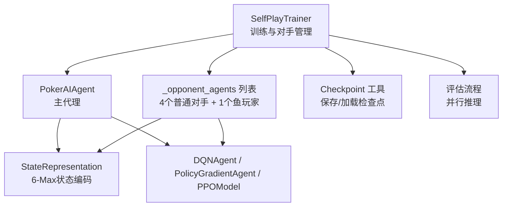
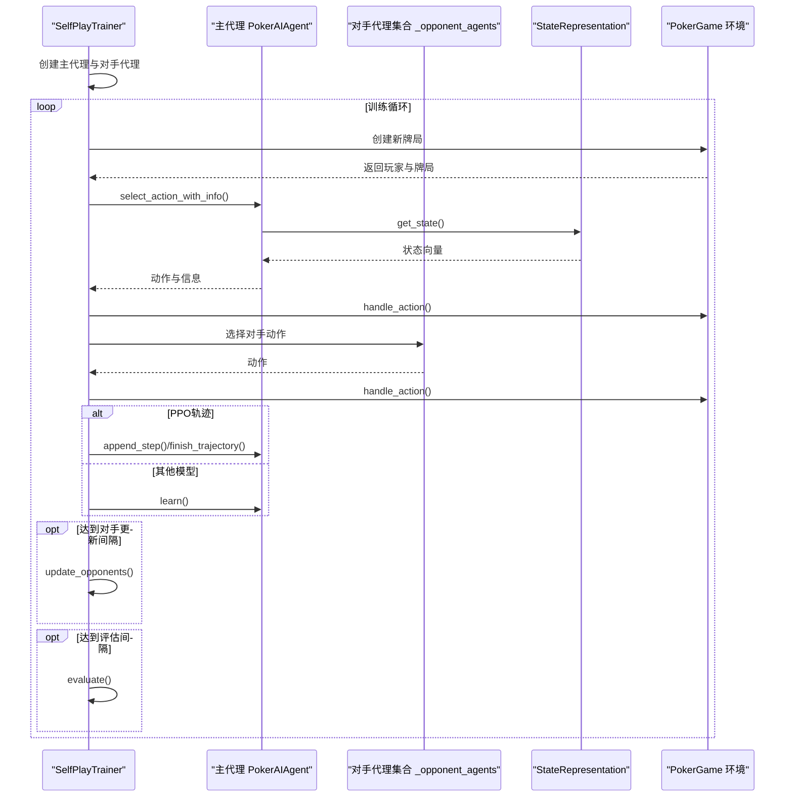
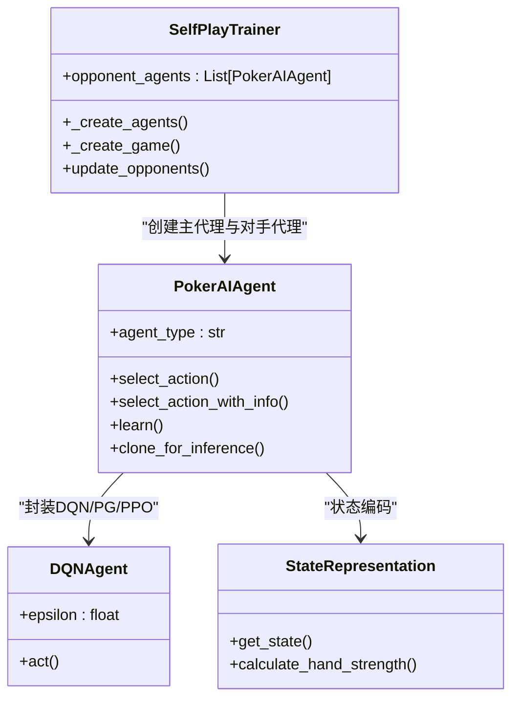
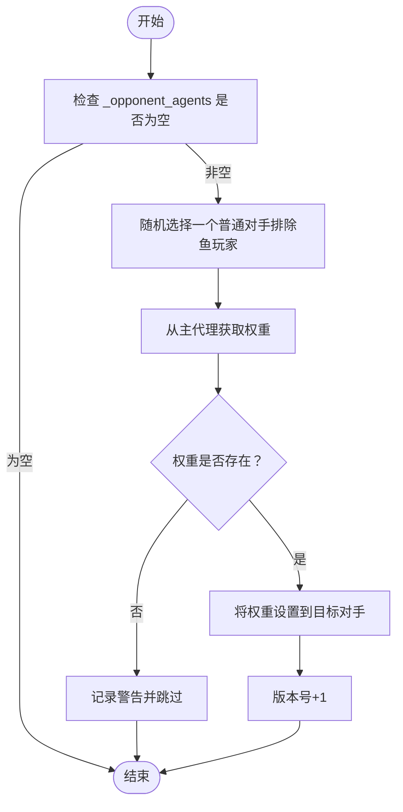
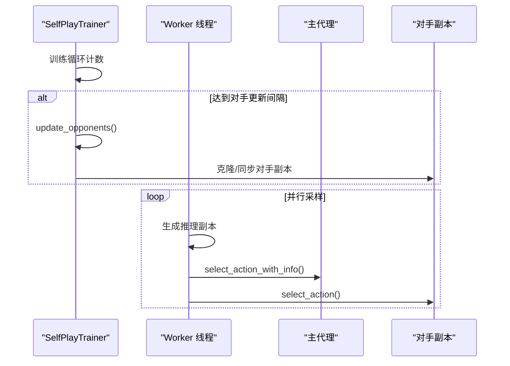
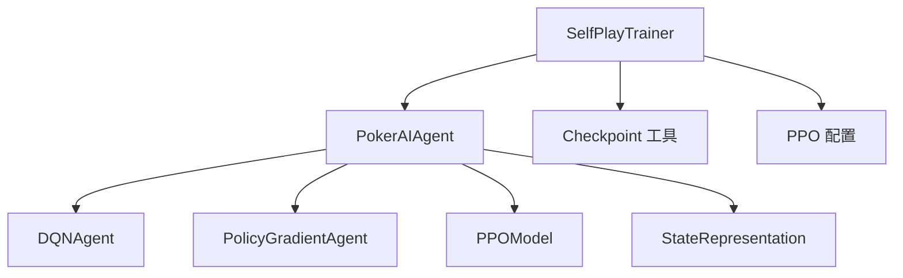

# 对手管理策略

<cite>
**本文引用的文件**
- [self_play_trainer.py](file://poker_ai/reward/self_play_trainer.py)
- [ai_agent.py](file://poker_ai/model/ai_agent.py)
- [dqn_agent.py](file://poker_ai/model/dqn_agent.py)
- [state_representation.py](file://poker_ai/model/state_representation.py)
- [checkpoint.py](file://poker_ai/utils/checkpoint.py)
- [ppo_config.py](file://poker_ai/config/ppo_config.py)
- [README.md](file://README.md)
- [train.py](file://train.py)
- [evaluate.py](file://evaluate.py)
</cite>

## 目录
1. [简介](#简介)
2. [项目结构](#项目结构)
3. [核心组件](#核心组件)
4. [架构总览](#架构总览)
5. [详细组件分析](#详细组件分析)
6. [依赖分析](#依赖分析)
7. [性能考量](#性能考量)
8. [故障排查指南](#故障排查指南)
9. [结论](#结论)
10. [附录](#附录)

## 简介
本文件围绕 SelfPlayTrainer 的对手代理管理系统展开，系统性阐述对手代理的创建策略、鱼玩家（Random Player）设计理念、对手版本管理机制、_opponent_agents 列表的组织与管理、动态对手更新机制（更新间隔、策略调整算法、性能评估）、对手管理对训练效果的影响与优化策略，以及对手多样性对AI学习的重要性与实现方法。文档同时提供配置最佳实践与调优指导，并给出可视化图示帮助读者理解。

## 项目结构
- SelfPlayTrainer 位于奖励模块，负责训练主循环、对手管理、评估与检查点保存。
- PokerAIAgent 作为统一代理接口，封装 DQN、Policy Gradient、PPO 三种模型，提供动作选择、学习与推理。
- DQNAgent 与 PolicyGradientAgent 提供探索与策略梯度能力。
- StateRepresentation 提供 6-Max 专用的状态编码，支撑对手与主代理的决策输入。
- Checkpoint 工具提供检查点保存/加载与元数据管理。
- PPO 配置集中管理 PPO 超参数，便于训练调参与复现。
- train.py/evaluate.py 提供命令行入口与参数解析，支持对手更新间隔等关键参数注入。

**图表来源**
- [self_play_trainer.py](file://poker_ai/reward/self_play_trainer.py)
- [ai_agent.py](file://poker_ai/model/ai_agent.py)
- [dqn_agent.py](file://poker_ai/model/dqn_agent.py)
- [state_representation.py](file://poker_ai/model/state_representation.py)
- [checkpoint.py](file://poker_ai/utils/checkpoint.py)

**章节来源**
- [README.md](file://README.md)
- [self_play_trainer.py](file://poker_ai/reward/self_play_trainer.py)

## 核心组件
- SelfPlayTrainer：主训练器，负责创建主代理与对手代理、动态对手更新、评估、检查点保存、训练循环与并行采样。
- PokerAIAgent：统一代理接口，封装 DQN/PPO/PG，提供动作选择、学习、批量动作、轨迹管理、推理副本克隆等。
- DQNAgent/PolicyGradientAgent：DQN 与策略梯度代理，提供探索与策略学习能力。
- StateRepresentation：6-Max 专用状态编码器，提供手牌、公共牌、玩家信息、位置、活跃人数等特征。
- Checkpoint 工具：检查点保存/加载与元数据持久化。
- PPO 配置：集中管理 PPO 超参数，便于训练调参。

**章节来源**
- [self_play_trainer.py](file://poker_ai/reward/self_play_trainer.py)
- [ai_agent.py](file://poker_ai/model/ai_agent.py)
- [dqn_agent.py](file://poker_ai/model/dqn_agent.py)
- [state_representation.py](file://poker_ai/model/state_representation.py)
- [checkpoint.py](file://poker_ai/utils/checkpoint.py)
- [ppo_config.py](file://poker_ai/config/ppo_config.py)

## 架构总览
SelfPlayTrainer 在训练过程中维护一个固定长度的对手代理集合，其中包含若干普通对手与一个“鱼玩家”。主代理与对手代理共享相同的状态表示与动作空间，但对手代理的策略随主代理的进展动态更新，以维持挑战性与多样性。训练采用并行采样与串行更新相结合的方式，评估阶段使用推理副本避免并发冲突。

**图表来源**
- [self_play_trainer.py](file://poker_ai/reward/self_play_trainer.py)
- [ai_agent.py](file://poker_ai/model/ai_agent.py)
- [state_representation.py](file://poker_ai/model/state_representation.py)

## 详细组件分析

### 对手代理创建策略与 _opponent_agents 组织
- 创建逻辑：主训练器在初始化时创建主代理，随后创建 num_players-2 个普通对手代理，最后追加一个“鱼玩家”。
- 鱼玩家设计：在 PPO 训练场景中，鱼玩家使用随机 DQN（epsilon=1.0），避免“鱼”也具备 PPO 策略体，从而提供稳定的、非策略优化的对手。
- 名称与索引映射：玩家名为 “Opponent_X”，内部通过解析 X-1 映射到 _opponent_agents 的索引，确保主代理与对手代理的匹配。
- 列表组织：_opponent_agents 长度为 num_players-1，最后一个元素为“鱼玩家”。

**图表来源**
- [self_play_trainer.py](file://poker_ai/reward/self_play_trainer.py)
- [ai_agent.py](file://poker_ai/model/ai_agent.py)
- [dqn_agent.py](file://poker_ai/model/dqn_agent.py)
- [state_representation.py](file://poker_ai/model/state_representation.py)

**章节来源**
- [self_play_trainer.py](file://poker_ai/reward/self_play_trainer.py)
- [ai_agent.py](file://poker_ai/model/ai_agent.py)
- [dqn_agent.py](file://poker_ai/model/dqn_agent.py)

### 鱼玩家（Random Player）设计理念
- 目标：提供稳定的、非策略优化的对手，避免主代理在训练早期过度拟合策略，同时保持足够的挑战性。
- 实现：在 PPO 训练场景中，鱼玩家使用 DQN 并将 epsilon 设为 1.0，且不衰减，确保完全随机策略。
- 作用：在评估与训练中，鱼玩家提供“随机基线”，便于衡量主代理的改进幅度与稳定性。

**章节来源**
- [self_play_trainer.py](file://poker_ai/reward/self_play_trainer.py)
- [dqn_agent.py](file://poker_ai/model/dqn_agent.py)

### 对手版本管理机制
- 版本号：训练器维护一个内部版本号，每次成功将主代理权重同步给随机对手后递增。
- 同步策略：update_opponents 从除“鱼玩家”外的对手中随机选择一个，将主代理的权重复制过去。
- 并行一致性：训练并行时，主线程会将对手副本重新克隆，确保 worker 线程使用的对手与主代理版本一致。

**图表来源**
- [self_play_trainer.py](file://poker_ai/reward/self_play_trainer.py)

**章节来源**
- [self_play_trainer.py](file://poker_ai/reward/self_play_trainer.py)

### _opponent_agents 列表的组织与管理
- 组织结构：长度为 num_players-1，前 num_players-2 个为普通对手，最后一个为“鱼玩家”。
- 索引映射：玩家名 “Opponent_X” -> 索引 X-1，用于在对局中定位对应对手代理。
- 管理方式：通过 _create_agents 创建；通过 update_opponents 动态同步权重；通过 _clone_opponents_for_inference 为并行评估/训练生成推理副本。

**章节来源**
- [self_play_trainer.py](file://poker_ai/reward/self_play_trainer.py)

### 动态对手更新机制
- 更新间隔：由 opponent_update_interval 控制（默认值可在训练入口参数中设置），达到间隔后触发 update_opponents。
- 触发时机：训练循环中每累计一定手牌数后检查并执行更新。
- 并行处理：在并行采样场景下，主线程会同步对手副本，确保 worker 使用的对手版本与主代理一致。
- 性能影响：动态更新可提升对手挑战性，避免主代理陷入“对手过弱”的过拟合；但过于频繁可能导致对手波动过大，影响评估稳定性。

**图表来源**
- [self_play_trainer.py](file://poker_ai/reward/self_play_trainer.py)

**章节来源**
- [self_play_trainer.py](file://poker_ai/reward/self_play_trainer.py)
- [train.py](file://train.py)

### 对手更新间隔、策略调整算法与性能评估
- 更新间隔：可通过命令行参数传入（如 --opponent-update-interval），默认值在训练入口中设定。
- 策略调整算法：权重复制（get_weights/set_weights），不涉及在线策略微调或渐进式迁移。
- 性能评估：评估阶段使用并行推理，统计平均利润、胜率、诈唬率、加注率、无效下注率等指标，作为保存最佳模型的依据。

**章节来源**
- [self_play_trainer.py](file://poker_ai/reward/self_play_trainer.py)
- [train.py](file://train.py)

### 对手管理对训练效果的影响与优化策略
- 影响：对手越强且多样化，主代理学习到的策略越稳健；鱼玩家提供稳定基线，便于识别过拟合。
- 优化策略：
  - 合理设置对手更新间隔，平衡挑战性与稳定性；
  - 在 PPO 训练中使用随机 DQN 作为鱼玩家，避免策略体污染；
  - 评估阶段使用推理副本，避免并发冲突；
  - 结合性能指标（胜率、无效下注率）选择最佳模型。

**章节来源**
- [self_play_trainer.py](file://poker_ai/reward/self_play_trainer.py)

### 对手配置的最佳实践与调优指导
- 对手数量：6-Max 固定 num_players=6，对手数量为 5（4 个普通对手 + 1 个鱼玩家）。
- 鱼玩家类型：PPO 训练中使用随机 DQN；其他模型可按需选择。
- 更新间隔：建议从较大间隔开始（如 1000~5000），观察胜率与无效下注率后逐步调整。
- 并行采样：在多核环境下开启训练并行，提高采样效率；评估阶段同样可并行。
- 检查点：定期保存检查点，便于中断恢复与版本对比。

**章节来源**
- [self_play_trainer.py](file://poker_ai/reward/self_play_trainer.py)
- [train.py](file://train.py)

### 对手多样性对AI学习的重要性与实现方法
- 重要性：多样化的对手可促使主代理学习更鲁棒的策略，避免针对单一对手过拟合；同时有助于发现并纠正无效下注等错误行为。
- 实现方法：
  - 使用随机 DQN 作为鱼玩家，提供稳定的随机基线；
  - 动态更新对手权重，引入主代理的最新策略；
  - 在评估中统计多种指标（诈唬率、加注率、无效下注率），指导策略优化。

**章节来源**
- [self_play_trainer.py](file://poker_ai/reward/self_play_trainer.py)

## 依赖分析
- SelfPlayTrainer 依赖 PokerAIAgent 与 StateRepresentation 提供统一动作选择与状态编码。
- PokerAIAgent 封装 DQN/PG/PPO，其中 DQN 提供 ε-贪婪探索，PPO 提供策略梯度与轨迹管理。
- Checkpoint 工具用于检查点保存/加载，支持 PPO 三件套与元数据持久化。
- PPO 配置集中管理超参数，便于训练调参与复现。

**图表来源**
- [self_play_trainer.py](file://poker_ai/reward/self_play_trainer.py)
- [ai_agent.py](file://poker_ai/model/ai_agent.py)
- [dqn_agent.py](file://poker_ai/model/dqn_agent.py)
- [checkpoint.py](file://poker_ai/utils/checkpoint.py)
- [ppo_config.py](file://poker_ai/config/ppo_config.py)

**章节来源**
- [self_play_trainer.py](file://poker_ai/reward/self_play_trainer.py)
- [ai_agent.py](file://poker_ai/model/ai_agent.py)
- [dqn_agent.py](file://poker_ai/model/dqn_agent.py)
- [checkpoint.py](file://poker_ai/utils/checkpoint.py)
- [ppo_config.py](file://poker_ai/config/ppo_config.py)

## 性能考量
- 并行采样与推理：训练与评估阶段均支持并行，显著提升吞吐量；推理副本避免并发冲突。
- 状态编码优化：6-Max 专用状态编码，包含手牌、公共牌、玩家信息、位置与活跃人数，确保决策信息完整。
- 检查点与元数据：支持 PPO 三件套与元数据持久化，便于中断恢复与版本对比。

**章节来源**
- [self_play_trainer.py](file://poker_ai/reward/self_play_trainer.py)
- [state_representation.py](file://poker_ai/model/state_representation.py)
- [checkpoint.py](file://poker_ai/utils/checkpoint.py)

## 故障排查指南
- 对手更新失败：检查主代理是否支持权重获取；确认 _opponent_agents 非空；查看日志警告。
- 并行评估异常：确认推理副本已正确克隆；检查线程数与 chunk 分配。
- 检查点加载失败：确认文件路径与后缀（PPO 三件套）；查看后备加载逻辑。
- 评估指标异常：关注无效下注率过高可能影响最佳模型保存；结合胜率与平均利润综合判断。

**章节来源**
- [self_play_trainer.py](file://poker_ai/reward/self_play_trainer.py)
- [checkpoint.py](file://poker_ai/utils/checkpoint.py)

## 结论
SelfPlayTrainer 的对手管理策略通过固定数量的普通对手与“鱼玩家”组合，辅以动态权重同步与并行推理，实现了对主代理的有效挑战与稳定评估。合理的对手更新间隔、多样化的对手配置与完善的性能指标监控，是获得高质量训练效果的关键。建议在实际训练中结合具体任务与资源，逐步调优对手更新间隔与评估策略，以取得最佳的学习效果。

## 附录
- 命令行参数参考（与对手管理相关）：
  - --opponent-update-interval：对手更新间隔（局数）
  - --eval-interval：评估间隔（局数）
  - --num-eval-games：评估局数
  - --checkpoint-interval：检查点保存间隔（局数）

**章节来源**
- [train.py](file://train.py)
- [README.md](file://README.md)