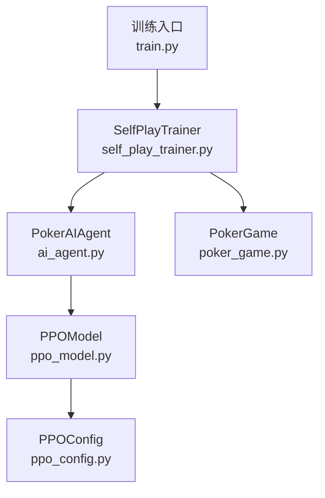
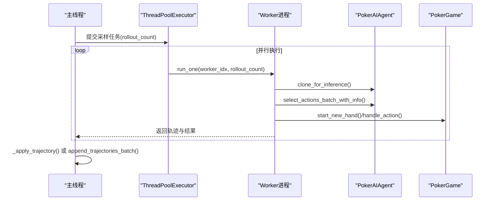
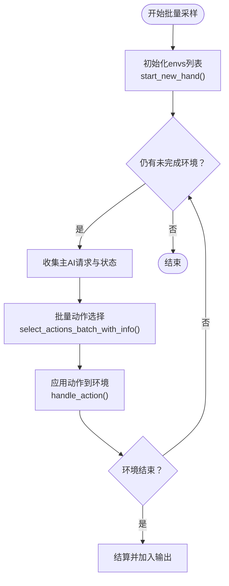
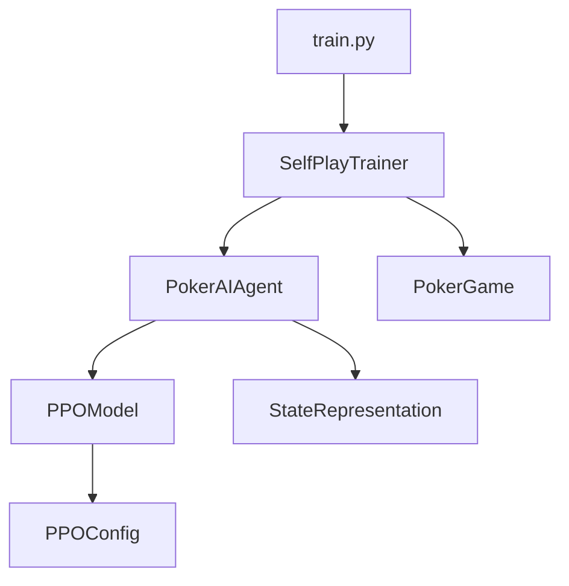

# 并行采样机制

<cite>
**本文档引用的文件**
- [self_play_trainer.py](file://poker_ai/reward/self_play_trainer.py)
- [ai_agent.py](file://poker_ai/model/ai_agent.py)
- [poker_game.py](file://poker_ai/game/poker_game.py)
- [train.py](file://train.py)
- [ppo_model.py](file://poker_ai/model/ppo_model.py)
- [ppo_config.py](file://poker_ai/config/ppo_config.py)
</cite>

## 目录
1. [简介](#简介)
2. [项目结构](#项目结构)
3. [核心组件](#核心组件)
4. [架构概览](#架构概览)
5. [详细组件分析](#详细组件分析)
6. [依赖分析](#依赖分析)
7. [性能考量](#性能考量)
8. [故障排查指南](#故障排查指南)
9. [结论](#结论)

## 简介
本文件系统性阐述SelfPlayTrainer的并行采样架构设计与实现细节，重点覆盖以下方面：
- ThreadPoolExecutor的使用策略与worker数量自动配置算法
- 任务分配机制与批处理大小调整
- `_play_hands_collect_batched`方法的实现原理（批量推理优化、状态预计算、轨迹收集）
- 并行采样的性能优化策略（批处理大小、内存管理、CPU资源分配）
- 并行采样与串行采样的差异及适用场景
- 并行度配置的最佳实践与性能调优指导
- 线程安全与数据一致性保障机制

## 项目结构
并行采样机制主要分布在以下模块：
- 训练入口与环境配置：train.py
- 自我对弈训练器：poker_ai/reward/self_play_trainer.py
- AI代理与批量推理：poker_ai/model/ai_agent.py
- 游戏环境：poker_ai/game/poker_game.py
- PPO模型与配置：poker_ai/model/ppo_model.py、poker_ai/config/ppo_config.py

图表来源
- [train.py:340-531](file://train.py#L340-L531)
- [self_play_trainer.py:48-166](file://poker_ai/reward/self_play_trainer.py#L48-L166)
- [ai_agent.py:55-116](file://poker_ai/model/ai_agent.py#L55-L116)
- [poker_game.py:155-194](file://poker_ai/game/poker_game.py#L155-L194)
- [ppo_model.py:20-105](file://poker_ai/model/ppo_model.py#L20-L105)
- [ppo_config.py:18-97](file://poker_ai/config/ppo_config.py#L18-L97)

章节来源
- [train.py:340-531](file://train.py#L340-L531)
- [self_play_trainer.py:48-166](file://poker_ai/reward/self_play_trainer.py#L48-L166)
- [ai_agent.py:55-116](file://poker_ai/model/ai_agent.py#L55-L116)
- [poker_game.py:155-194](file://poker_ai/game/poker_game.py#L155-L194)
- [ppo_model.py:20-105](file://poker_ai/model/ppo_model.py#L20-L105)
- [ppo_config.py:18-97](file://poker_ai/config/ppo_config.py#L18-L97)

## 核心组件
- SelfPlayTrainer：负责训练流程编排、并行采样、评估与检查点管理
- PokerAIAgent：封装DQN/PPO/PG等智能体，提供批量动作选择与轨迹管理
- PokerGame：德州扑克6-Max游戏环境，支持多轮推进与状态查询
- PPOModel：PPO模型实现，包含向量化更新、价值损失裁剪、自适应熵等优化
- PPOConfig：集中管理PPO超参数，支持RTX 4090D优化档位

章节来源
- [self_play_trainer.py:48-166](file://poker_ai/reward/self_play_trainer.py#L48-L166)
- [ai_agent.py:55-116](file://poker_ai/model/ai_agent.py#L55-L116)
- [poker_game.py:155-194](file://poker_ai/game/poker_game.py#L155-L194)
- [ppo_model.py:20-105](file://poker_ai/model/ppo_model.py#L20-L105)
- [ppo_config.py:18-97](file://poker_ai/config/ppo_config.py#L18-L97)

## 架构概览
SelfPlayTrainer采用“主线程串行更新 + 多worker并行采样”的双层架构：
- 主线程负责：参数同步、评估、检查点、对手更新、训练统计
- 多worker负责：并行推进多局手牌、批量动作选择、轨迹收集

图表来源
- [self_play_trainer.py:1406-1465](file://poker_ai/reward/self_play_trainer.py#L1406-L1465)
- [ai_agent.py:157-214](file://poker_ai/model/ai_agent.py#L157-L214)

章节来源
- [self_play_trainer.py:1406-1465](file://poker_ai/reward/self_play_trainer.py#L1406-L1465)
- [ai_agent.py:157-214](file://poker_ai/model/ai_agent.py#L157-L214)

## 详细组件分析

### ThreadPoolExecutor使用策略与worker数量自动配置
- 自动配置算法
  - `_resolve_workers(requested_workers, reserve_cores)`：根据CPU核数动态推断可用核心数，预留一定核心给系统/IO，避免过度占用
  - `train_workers`与`eval_workers`分别按不同保留核心数计算，评估阶段保留更少核心以兼顾系统负载
- 并行开关判定
  - `use_parallel = (train_workers > 1 and not use_ensemble and hasattr(main_agent, 'clone_for_inference'))`
  - 仅在满足条件时启用并行，避免集成模型与推理副本不可用的情况
- 任务分配
  - 将目标手数按worker数量均匀分配，多余手数分配给前若干worker，确保负载均衡
  - 定期（`train_sync_every_batches`）将主线程权重同步到各worker副本，维持策略一致性

章节来源
- [self_play_trainer.py:28-36](file://poker_ai/reward/self_play_trainer.py#L28-L36)
- [self_play_trainer.py:1406-1423](file://poker_ai/reward/self_play_trainer.py#L1406-L1423)
- [train.py:39-52](file://train.py#L39-L52)

### 任务分配机制
- 批次规划
  - `target_batch_hands = min(remaining_hands, worker_count * train_rollouts_per_worker)`
  - `base_rollouts = target_batch_hands // worker_count`，`extra_rollouts = target_batch_hands % worker_count`
  - 将多余手数分配给前extra_rollouts个worker，保证各worker任务量接近
- 同步策略
  - 每经过`train_sync_every_batches`批次，主线程调用`_sync_copies_from_main()`将权重同步至各worker副本
  - 对手副本同样同步，避免策略漂移

章节来源
- [self_play_trainer.py:1433-1447](file://poker_ai/reward/self_play_trainer.py#L1433-L1447)
- [self_play_trainer.py:1448-1455](file://poker_ai/reward/self_play_trainer.py#L1448-L1455)
- [self_play_trainer.py:1376-1392](file://poker_ai/reward/self_play_trainer.py#L1376-L1392)

### _play_hands_collect_batched方法实现原理
- 设计目标
  - 针对PPO并行采样，减少Python/TensorFlow往返开销，提升吞吐
- 关键优化
  - 批量状态预计算：收集所有主AI状态，一次性传入`select_actions_batch_with_info()`，避免重复编码
  - 批量动作选择：单次前向推理处理多局状态，返回批量动作与info
  - 轨迹收集：按PPO格式收集states/actions/old_probs，按DQN格式收集transitions，统一在主线程应用
- 状态机推进
  - 逐环境推进：维护envs列表，每轮遍历所有未结束环境，收集主AI请求与状态
  - 批量处理：对所有主AI请求执行批量动作选择，再逐一应用到对应环境
  - 结束条件：当环境手牌结束或摊牌时，结算并加入输出队列

图表来源
- [self_play_trainer.py:587-799](file://poker_ai/reward/self_play_trainer.py#L587-L799)
- [ai_agent.py:157-214](file://poker_ai/model/ai_agent.py#L157-L214)

章节来源
- [self_play_trainer.py:587-799](file://poker_ai/reward/self_play_trainer.py#L587-L799)
- [ai_agent.py:157-214](file://poker_ai/model/ai_agent.py#L157-L214)

### 批量推理与状态预计算
- 批量动作接口
  - `select_actions_batch_with_info()`：接收`(game, player)`对与预计算状态数组，返回批量动作与info
  - info包含state、action_idx、old_prob、action_probabilities、state_value等，避免重复前向推理
- 状态预计算
  - 在主AI侧对所有请求状态进行一次性编码，传入`precomputed_states`，减少重复计算
- PPO轨迹格式
  - states/actions/old_probs：用于finish_trajectory
  - transitions：DQN格式，用于learn_from_transitions

章节来源
- [ai_agent.py:157-214](file://poker_ai/model/ai_agent.py#L157-L214)
- [ai_agent.py:279-301](file://poker_ai/model/ai_agent.py#L279-L301)
- [self_play_trainer.py:1013-1028](file://poker_ai/reward/self_play_trainer.py#L1013-L1028)

### 评估并行与推理副本
- 推理副本
  - `clone_for_inference()`：创建仅用于推理的代理副本，避免训练状态干扰
  - 评估阶段预创建副本，避免在worker子线程中创建TF模型导致Variable shape冲突
- 评估任务分配
  - 与训练类似，按worker数量分配评估手数，支持批量推理
  - 串行与并行两种模式，自动选择更合适的策略

章节来源
- [ai_agent.py:489-516](file://poker_ai/model/ai_agent.py#L489-L516)
- [self_play_trainer.py:1003-1011](file://poker_ai/reward/self_play_trainer.py#L1003-L1011)
- [self_play_trainer.py:1030-1162](file://poker_ai/reward/self_play_trainer.py#L1030-L1162)

### 线程安全与数据一致性保障
- 无共享状态
  - 每个worker持有独立的PokerAIAgent副本与对手副本，避免并发写入冲突
- 周期同步
  - 通过`_sync_copies_from_main()`定期同步主线程权重，确保策略一致性
- 端到端隔离
  - `_play_hands_collect_batched`内部维护envs状态，不暴露到主线程，避免竞态

章节来源
- [self_play_trainer.py:1414-1423](file://poker_ai/reward/self_play_trainer.py#L1414-L1423)
- [self_play_trainer.py:1376-1392](file://poker_ai/reward/self_play_trainer.py#L1376-L1392)

## 依赖分析
- SelfPlayTrainer依赖PokerAIAgent进行动作选择与轨迹管理
- PokerAIAgent依赖PPOModel（PPO时）与StateRepresentation进行状态编码
- PokerGame提供完整德州扑克规则与状态推进
- train.py负责环境初始化、硬件档位与并行参数注入

图表来源
- [self_play_trainer.py:48-166](file://poker_ai/reward/self_play_trainer.py#L48-L166)
- [ai_agent.py:55-116](file://poker_ai/model/ai_agent.py#L55-L116)
- [poker_game.py:155-194](file://poker_ai/game/poker_game.py#L155-L194)
- [train.py:340-531](file://train.py#L340-L531)
- [ppo_model.py:20-105](file://poker_ai/model/ppo_model.py#L20-L105)
- [ppo_config.py:18-97](file://poker_ai/config/ppo_config.py#L18-L97)

章节来源
- [self_play_trainer.py:48-166](file://poker_ai/reward/self_play_trainer.py#L48-L166)
- [ai_agent.py:55-116](file://poker_ai/model/ai_agent.py#L55-L116)
- [poker_game.py:155-194](file://poker_ai/game/poker_game.py#L155-L194)
- [train.py:340-531](file://train.py#L340-L531)
- [ppo_model.py:20-105](file://poker_ai/model/ppo_model.py#L20-L105)
- [ppo_config.py:18-97](file://poker_ai/config/ppo_config.py#L18-L97)

## 性能考量
- 批处理大小调整
  - PPO：增大batch_size（如256/512）提升GPU利用率，配合更少更新轮次（如4）降低策略退化风险
  - 训练：`train_rollouts_per_worker`按CPU核心数与硬件档位自动调整，减少调度开销
- 内存管理
  - 批量动作接口传入预计算状态数组，避免重复编码与临时对象创建
  - PPOModel内部对不同形状输入进行填充与分块处理，减少图重建与retracing
- CPU资源分配
  - 评估阶段保留更少核心（reserve_cores=1），训练阶段保留更多核心（reserve_cores=2）
  - 硬件档位（如RTX 4090D）自动提升train_workers与eval_workers上限
- 线程池配置
  - 通过`ThreadPoolExecutor(max_workers=...)`限制并发度，避免过多上下文切换
  - 定期同步权重，平衡吞吐与一致性

章节来源
- [train.py:55-134](file://train.py#L55-L134)
- [train.py:240-335](file://train.py#L240-L335)
- [self_play_trainer.py:111-116](file://poker_ai/reward/self_play_trainer.py#L111-L116)
- [self_play_trainer.py:1433-1447](file://poker_ai/reward/self_play_trainer.py#L1433-L1447)
- [ppo_model.py:472-495](file://poker_ai/model/ppo_model.py#L472-L495)
- [ppo_config.py:64-72](file://poker_ai/config/ppo_config.py#L64-L72)

## 故障排查指南
- PPO更新失败（XLA/DNN兼容问题）
  - 现象：收尾时flush_pending_updates抛出DNN/Graph错误
  - 处理：可通过`--disable-xla`或`--disable-onednn`规避，检查GPU驱动与TensorFlow版本
- 模型加载异常
  - 现象：找不到权重文件或状态文件
  - 处理：确认文件后缀（PPO为.actor.weights.h5/.critic.weights.h5），检查_state.pkl是否存在
- 并行采样吞吐低
  - 现象：worker数量过大导致上下文切换频繁
  - 处理：适当降低train_workers，增大train_rollouts_per_worker，减少同步频率

章节来源
- [self_play_trainer.py:1559-1571](file://poker_ai/reward/self_play_trainer.py#L1559-L1571)
- [self_play_trainer.py:1268-1327](file://poker_ai/reward/self_play_trainer.py#L1268-L1327)
- [train.py:199-206](file://train.py#L199-L206)

## 结论
SelfPlayTrainer的并行采样机制通过“主线程串行更新 + 多worker并行采样”的架构，在保证数据一致性的同时显著提升了训练吞吐。其关键优势包括：
- 基于CPU核数的自动worker配置与任务均衡分配
- 针对PPO的批量动作选择与状态预计算，大幅降低Python/TensorFlow往返开销
- 定期权重同步与推理副本隔离，确保线程安全与策略一致性
- 面向RTX 4090D等高端硬件的参数优化，最大化GPU利用率

在实际部署中，建议结合硬件档位与业务需求，合理设置train_workers、train_rollouts_per_worker与train_sync_every_batches，以获得最佳吞吐与稳定性平衡。