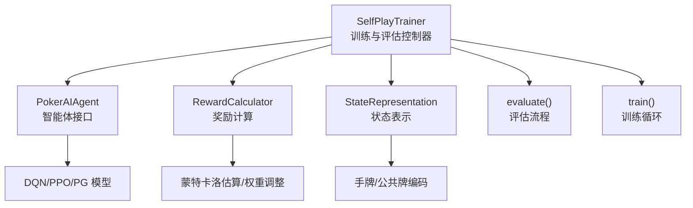
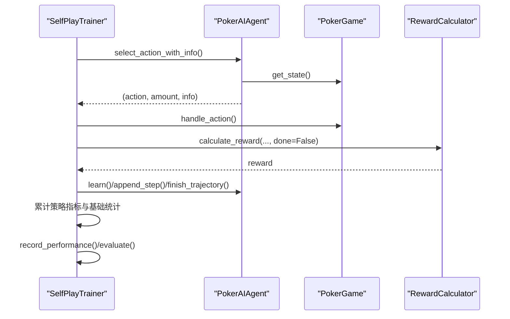
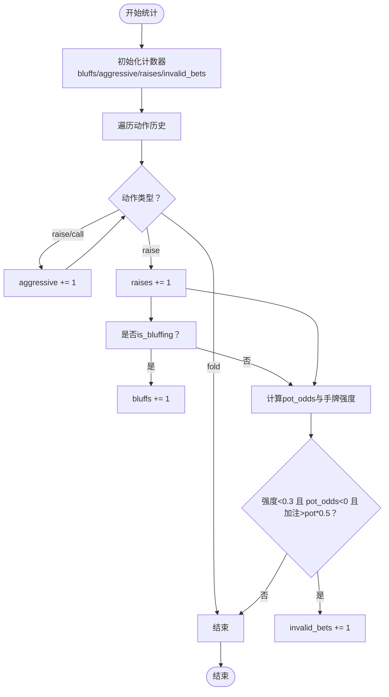
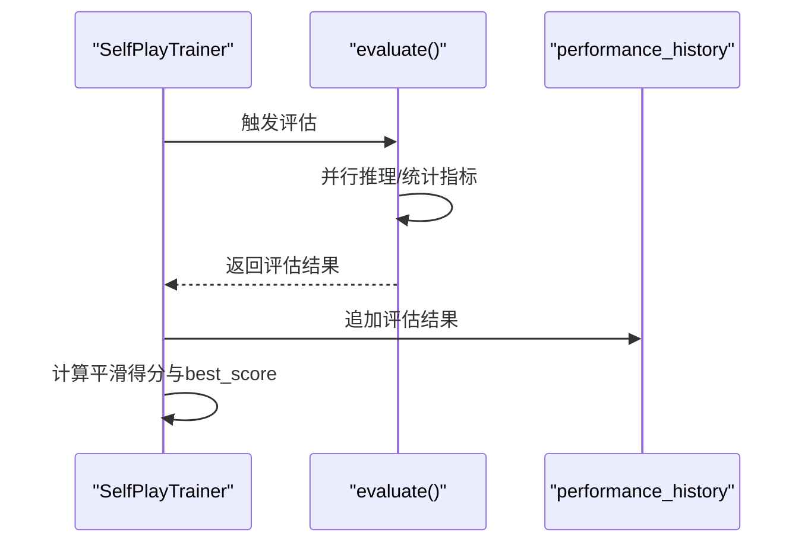
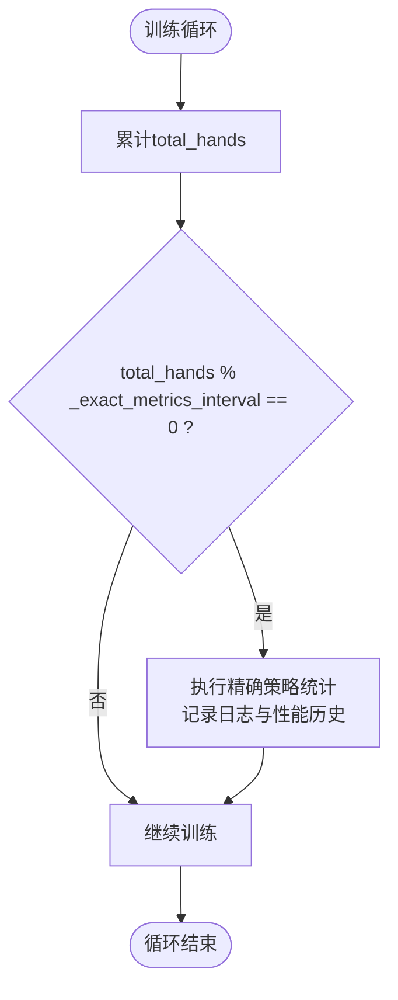
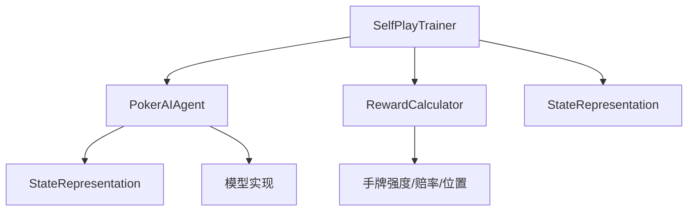

# 性能监控指标

<cite>
**本文档引用的文件**
- [self_play_trainer.py](file://poker_ai/reward/self_play_trainer.py)
- [reward_calculator.py](file://poker_ai/reward/reward_calculator.py)
- [ai_agent.py](file://poker_ai/model/ai_agent.py)
- [state_representation.py](file://poker_ai/model/state_representation.py)
- [train.py](file://train.py)
- [evaluate.py](file://evaluate.py)
</cite>

## 目录
1. [简介](#简介)
2. [项目结构](#项目结构)
3. [核心组件](#核心组件)
4. [架构概览](#架构概览)
5. [详细组件分析](#详细组件分析)
6. [依赖分析](#依赖分析)
7. [性能考量](#性能考量)
8. [故障排查指南](#故障排查指南)
9. [结论](#结论)
10. [附录](#附录)

## 简介
本文件面向SelfPlayTrainer中的性能监控指标体系，系统性阐述基础统计指标（total_hands、total_profit、best_score）、策略指标（total_aggressive_actions、total_bluff_attempts、total_raise_actions、total_invalid_bets）的计算与跟踪方式，解释性能历史记录机制与趋势分析方法，详解_exact_metrics_interval的作用与实现原理，并提供最佳实践、数据分析方法、瓶颈识别与优化建议，以及监控指标在训练调试与问题诊断中的应用。

## 项目结构
SelfPlayTrainer位于奖励与训练模块中，负责自我对弈训练、评估与检查点管理；其性能监控贯穿训练与评估两个阶段，同时与AI代理、状态表示、奖励计算紧密耦合。

**图表来源**
- [self_play_trainer.py:48-166](file://poker_ai/reward/self_play_trainer.py#L48-L166)
- [ai_agent.py:55-116](file://poker_ai/model/ai_agent.py#L55-L116)
- [reward_calculator.py:9-52](file://poker_ai/reward/reward_calculator.py#L9-L52)
- [state_representation.py:9-46](file://poker_ai/model/state_representation.py#L9-L46)

**章节来源**
- [self_play_trainer.py:48-166](file://poker_ai/reward/self_play_trainer.py#L48-L166)
- [ai_agent.py:55-116](file://poker_ai/model/ai_agent.py#L55-L116)
- [reward_calculator.py:9-52](file://poker_ai/reward/reward_calculator.py#L9-L52)
- [state_representation.py:9-46](file://poker_ai/model/state_representation.py#L9-L46)

## 核心组件
- SelfPlayTrainer：训练与评估主控制器，维护基础统计与策略指标，负责并行采样、轨迹应用、评估、检查点保存与对手更新。
- PokerAIAgent：统一的AI代理接口，封装DQN、策略梯度、PPO等模型，提供动作选择、轨迹记录与批量推理能力。
- RewardCalculator：奖励计算与自适应调整，提供手牌强度估算、底池赔率、位置优势、无效下注惩罚等，并支持自适应权重调整。
- StateRepresentation：状态向量构建，提供手牌、公共牌、玩家信息、游戏全局信息、位置与活跃人数等特征。
- evaluate()：评估流程，支持并行推理，汇总策略指标与性能指标，写入performance_history。

**章节来源**
- [self_play_trainer.py:1393-1599](file://poker_ai/reward/self_play_trainer.py#L1393-L1599)
- [ai_agent.py:55-116](file://poker_ai/model/ai_agent.py#L55-L116)
- [reward_calculator.py:9-52](file://poker_ai/reward/reward_calculator.py#L9-L52)
- [state_representation.py:137-158](file://poker_ai/model/state_representation.py#L137-L158)

## 架构概览
训练与评估的关键数据流如下：

**图表来源**
- [self_play_trainer.py:260-417](file://poker_ai/reward/self_play_trainer.py#L260-L417)
- [ai_agent.py:125-155](file://poker_ai/model/ai_agent.py#L125-L155)
- [reward_calculator.py:303-370](file://poker_ai/reward/reward_calculator.py#L303-L370)

## 详细组件分析

### 基础统计指标
- total_hands：累计训练手数，用于进度跟踪与检查点间隔判断。
- total_profit：累计利润，反映策略长期盈利能力。
- best_score：平滑后的评估得分窗口内的最佳值，用于“最佳模型”判定与保存。

这些指标在训练循环中被持续更新，并在评估阶段写入performance_history，便于趋势分析与可视化。

**章节来源**
- [self_play_trainer.py:142-146](file://poker_ai/reward/self_play_trainer.py#L142-L146)
- [self_play_trainer.py:1470-1494](file://poker_ai/reward/self_play_trainer.py#L1470-L1494)
- [self_play_trainer.py:1508-1526](file://poker_ai/reward/self_play_trainer.py#L1508-L1526)

### 策略指标计算与跟踪
- total_aggressive_actions：主动行动（raise、call）总数，用于衡量激进度与策略多样性。
- total_bluff_attempts：成功诈唬次数，通过奖励计算器的is_bluffing判定。
- total_raise_actions：加注总数，用于计算加注率与无效下注率。
- total_invalid_bets：无效下注次数，基于手牌强度、底池赔率与加注额度阈值判断。

策略指标在单局结束后通过_count_episode_metrics统计，并累加到上述字段中；训练期间定期调用record_performance计算诈唬率、无效下注率等衍生指标。

**图表来源**
- [self_play_trainer.py:226-258](file://poker_ai/reward/self_play_trainer.py#L226-L258)
- [reward_calculator.py:298-301](file://poker_ai/reward/reward_calculator.py#L298-L301)
- [reward_calculator.py:352-357](file://poker_ai/reward/reward_calculator.py#L352-L357)

**章节来源**
- [self_play_trainer.py:226-258](file://poker_ai/reward/self_play_trainer.py#L226-L258)
- [reward_calculator.py:298-301](file://poker_ai/reward/reward_calculator.py#L298-L301)
- [reward_calculator.py:352-357](file://poker_ai/reward/reward_calculator.py#L352-L357)

### 性能历史记录机制与趋势分析
- performance_history：评估阶段将avg_profit、win_rate、bluff_rate、raise_rate、invalid_bet_rate等写入列表，形成时间序列。
- 训练期间record_performance将hands、total_profit、current_profit、bluff_rate、invalid_bet_rate写入日志与内部结构，便于离线分析。
- best_score与平滑窗口(best_score_window)结合，过滤短期波动，避免过拟合评估噪声。

**图表来源**
- [self_play_trainer.py:1030-1162](file://poker_ai/reward/self_play_trainer.py#L1030-L1162)
- [self_play_trainer.py:1508-1526](file://poker_ai/reward/self_play_trainer.py#L1508-L1526)

**章节来源**
- [self_play_trainer.py:1030-1162](file://poker_ai/reward/self_play_trainer.py#L1030-L1162)
- [self_play_trainer.py:1508-1526](file://poker_ai/reward/self_play_trainer.py#L1508-L1526)

### _exact_metrics_interval的作用与实现原理
- _exact_metrics_interval：训练期每隔固定手数（默认200）进行一次精确策略统计，避免“训练全0、评估很高”的口径偏差。
- 实现：在训练循环中，当total_hands对_eval_interval取模达到阈值时，触发策略指标统计与日志记录，确保训练与评估指标的一致性与可比性。

**图表来源**
- [self_play_trainer.py:155-156](file://poker_ai/reward/self_play_trainer.py#L155-L156)
- [self_play_trainer.py:1493-1494](file://poker_ai/reward/self_play_trainer.py#L1493-L1494)

**章节来源**
- [self_play_trainer.py:155-156](file://poker_ai/reward/self_play_trainer.py#L155-L156)
- [self_play_trainer.py:1493-1494](file://poker_ai/reward/self_play_trainer.py#L1493-L1494)

### all-in 不走运补偿统计
- allin_unlucky_trigger_count：在翻牌前/翻牌阶段以高胜率(all-in_unlucky_eq_threshold)但最终失败时的补偿触发次数。
- allin_unlucky_bonus_total：补偿总额。
- allin_unlucky_equity_sum：触发时平均胜率之和，用于计算平均补偿强度。
- 作用：缓解短期方差对策略学习的干扰，鼓励长期EV正确的激进行为。

**章节来源**
- [self_play_trainer.py:162-165](file://poker_ai/reward/self_play_trainer.py#L162-L165)
- [self_play_trainer.py:385-397](file://poker_ai/reward/self_play_trainer.py#L385-L397)
- [self_play_trainer.py:549-559](file://poker_ai/reward/self_play_trainer.py#L549-L559)

### 评估与检查点保存中的监控
- evaluate()：并行推理，汇总策略与性能指标，写入performance_history。
- save_checkpoint()/load_checkpoint()：保存训练状态（total_hands、total_profit、best_score、performance_history、strategy_metrics），支持断点续训与模型对比。

**章节来源**
- [self_play_trainer.py:1030-1162](file://poker_ai/reward/self_play_trainer.py#L1030-L1162)
- [self_play_trainer.py:1186-1238](file://poker_ai/reward/self_play_trainer.py#L1186-L1238)
- [self_play_trainer.py:1268-1327](file://poker_ai/reward/self_play_trainer.py#L1268-L1327)

## 依赖分析
- SelfPlayTrainer依赖PokerAIAgent进行动作选择与轨迹记录，依赖RewardCalculator进行奖励计算与策略判定，依赖StateRepresentation进行状态编码。
- evaluate()与train()分别在评估与训练阶段调用上述组件，形成闭环的数据流。

**图表来源**
- [self_play_trainer.py:48-166](file://poker_ai/reward/self_play_trainer.py#L48-L166)
- [ai_agent.py:73-115](file://poker_ai/model/ai_agent.py#L73-L115)
- [state_representation.py:137-158](file://poker_ai/model/state_representation.py#L137-L158)
- [reward_calculator.py:56-83](file://poker_ai/reward/reward_calculator.py#L56-L83)

**章节来源**
- [self_play_trainer.py:48-166](file://poker_ai/reward/self_play_trainer.py#L48-L166)
- [ai_agent.py:73-115](file://poker_ai/model/ai_agent.py#L73-L115)
- [state_representation.py:137-158](file://poker_ai/model/state_representation.py#L137-L158)
- [reward_calculator.py:56-83](file://poker_ai/reward/reward_calculator.py#L56-L83)

## 性能考量
- 并行采样与批量推理：训练阶段通过多worker并行采样与批量动作选择，显著降低Python调度开销，提升吞吐。
- PPO轨迹聚合：训练末尾统一应用轨迹，减少函数调用与阈值检查开销。
- 环境与评估耗时统计：训练结束输出环境与评估总耗时、平均每手耗时，辅助性能回归分析。
- 自适应奖励权重：根据策略指标（诈唬率、无效下注率）动态调整奖励权重，避免策略退化与过度保守。

**章节来源**
- [self_play_trainer.py:1393-1599](file://poker_ai/reward/self_play_trainer.py#L1393-L1599)
- [ai_agent.py:157-214](file://poker_ai/model/ai_agent.py#L157-L214)
- [reward_calculator.py:419-535](file://poker_ai/reward/reward_calculator.py#L419-L535)

## 故障排查指南
- 检查点加载失败：检查权重文件与状态文件是否存在、命名是否符合约定（PPO区分.actor/.critic与_state.pkl）。
- 评估并行无效：确认eval_workers配置与实际线程数一致，避免TF变量形状冲突。
- PPO更新失败：若出现DNN/Graph/XLA相关错误，参考日志提示，尝试禁用XLA或onednn后重跑。
- 无效下注率过高：通过invalid_bet_rate阈值与自适应权重调整，引导策略收敛至更稳健的行为。

**章节来源**
- [self_play_trainer.py:1240-1266](file://poker_ai/reward/self_play_trainer.py#L1240-L1266)
- [self_play_trainer.py:1268-1327](file://poker_ai/reward/self_play_trainer.py#L1268-L1327)
- [self_play_trainer.py:1560-1571](file://poker_ai/reward/self_play_trainer.py#L1560-L1571)
- [evaluate.py:109-108](file://evaluate.py#L109-L108)

## 结论
SelfPlayTrainer通过完善的性能监控指标体系，实现了对基础统计与策略行为的双维度观测。借助并行采样、批量轨迹聚合与自适应奖励权重，系统在保证训练效率的同时提升了策略稳定性与鲁棒性。结合performance_history与策略指标，可有效评估训练效果、识别瓶颈并指导模型优化。

## 附录

### 监控指标清单与计算公式
- 基础指标
  - total_hands：累计手数
  - total_profit：累计利润
  - best_score：平滑窗口内评估得分最佳值
- 策略指标
  - total_aggressive_actions：主动行动总数
  - total_bluff_attempts：成功诈唬次数
  - total_raise_actions：加注总数
  - total_invalid_bets：无效下注次数
  - 诈唬率 = total_bluff_attempts / total_aggressive_actions
  - 无效下注率 = total_invalid_bets / total_raise_actions
- all-in不走运补偿
  - 触发次数：allin_unlucky_trigger_count
  - 补偿均值：allin_unlucky_bonus_total / allin_unlucky_trigger_count
  - 触发时平均胜率：allin_unlucky_equity_sum / allin_unlucky_trigger_count

**章节来源**
- [self_play_trainer.py:142-165](file://poker_ai/reward/self_play_trainer.py#L142-L165)
- [self_play_trainer.py:1329-1374](file://poker_ai/reward/self_play_trainer.py#L1329-L1374)
- [self_play_trainer.py:385-397](file://poker_ai/reward/self_play_trainer.py#L385-L397)

### 最佳实践与数据分析方法
- 定期评估：使用eval_interval进行周期性评估，关注avg_profit、win_rate、invalid_bet_rate。
- 策略健康度：监控诈唬率与无效下注率，避免过度激进或过度保守。
- 模型保存：以best_score与invalid_bet_rate阈值共同约束“最佳模型”保存，避免保存不稳定模型。
- 可视化：利用performance_history绘制趋势图，定位性能拐点与异常波动。

**章节来源**
- [self_play_trainer.py:1503-1531](file://poker_ai/reward/self_play_trainer.py#L1503-L1531)
- [train.py:505-527](file://train.py#L505-L527)
- [evaluate.py:523-584](file://evaluate.py#L523-L584)