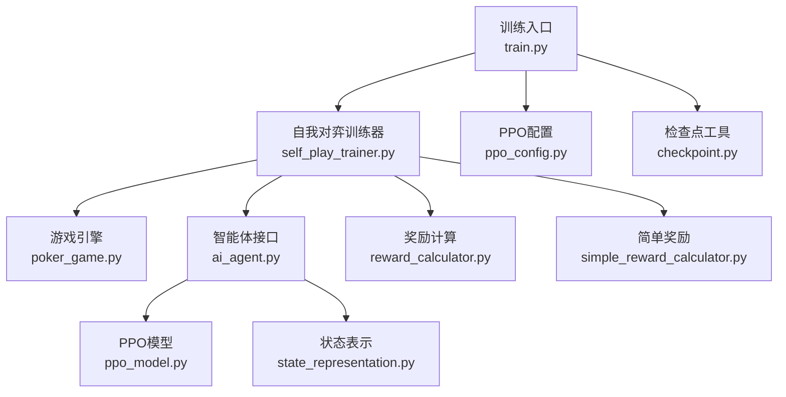
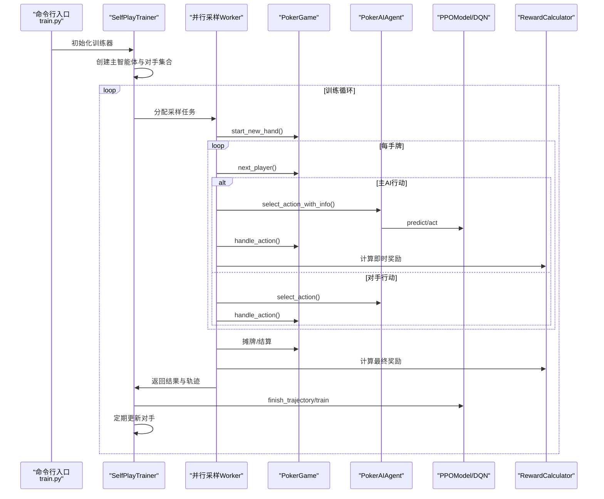
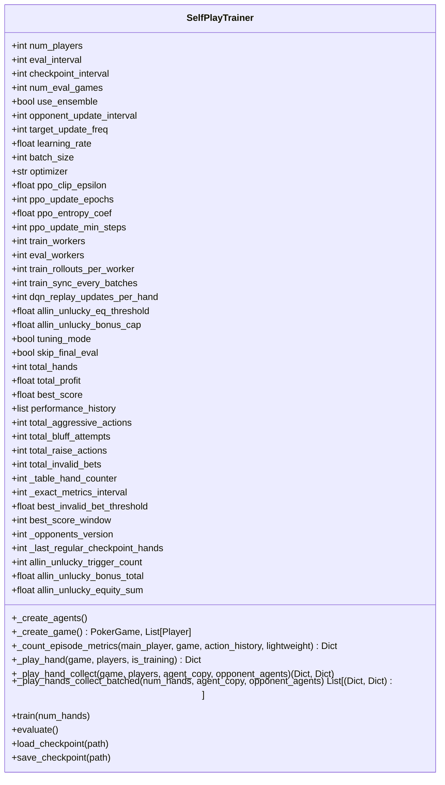
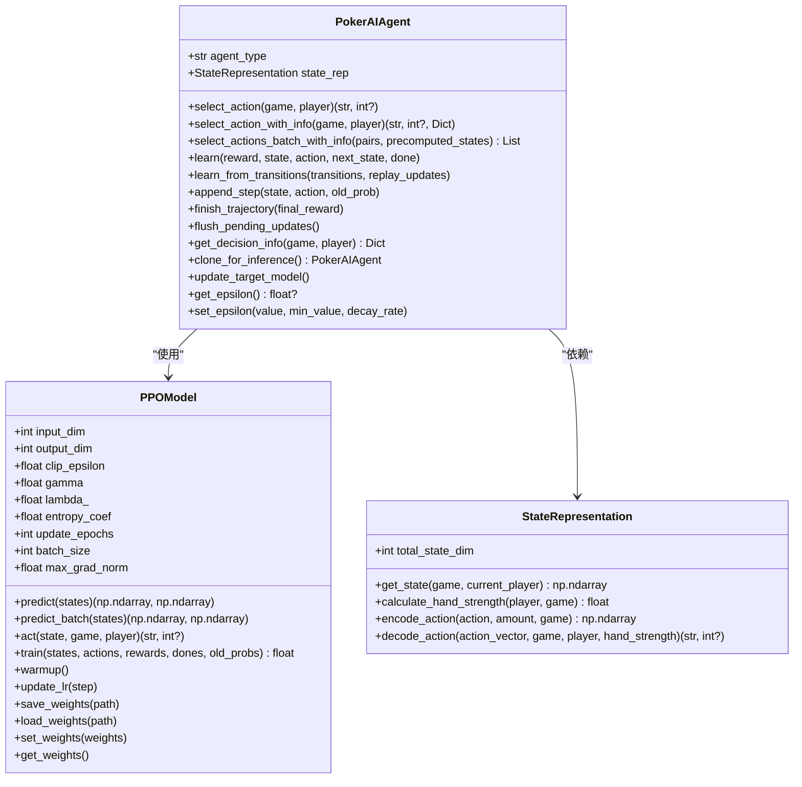
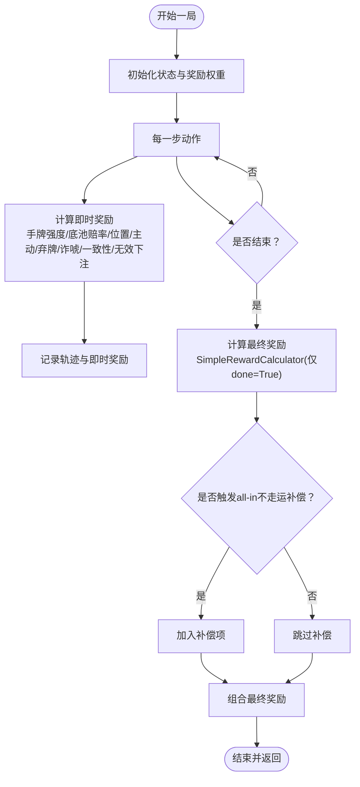
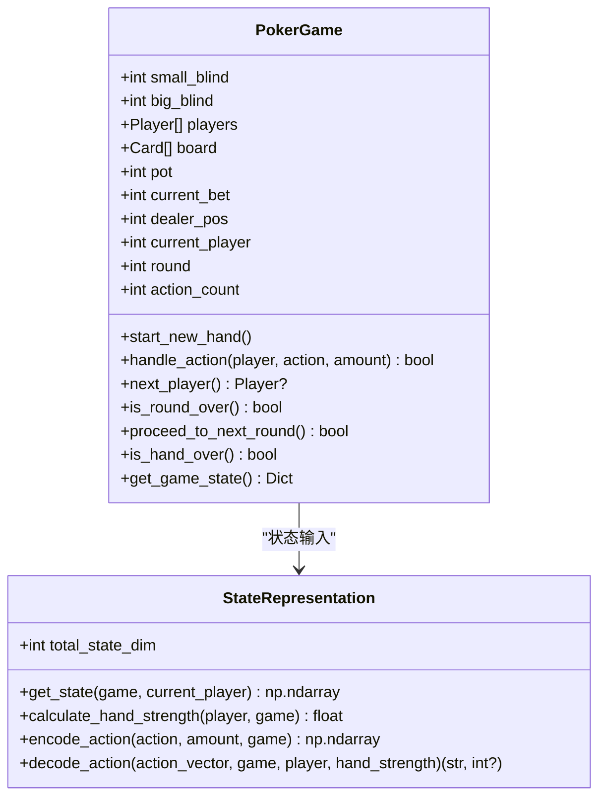
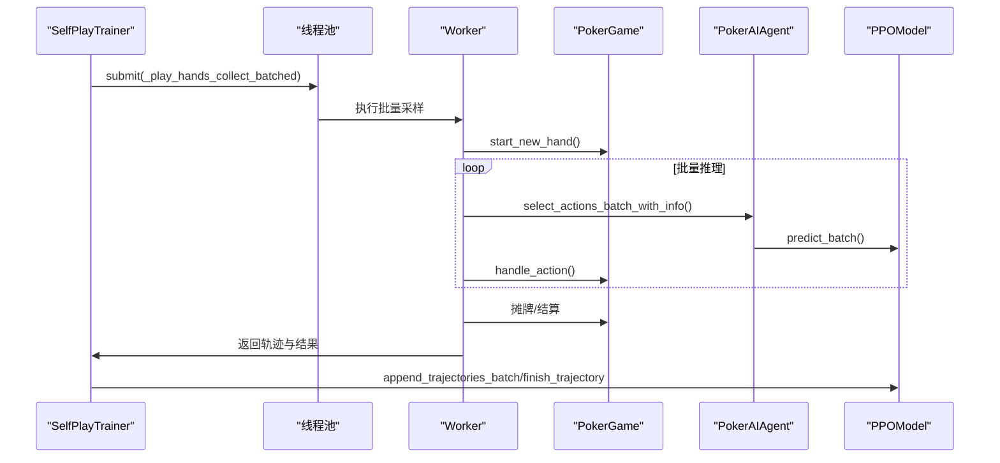
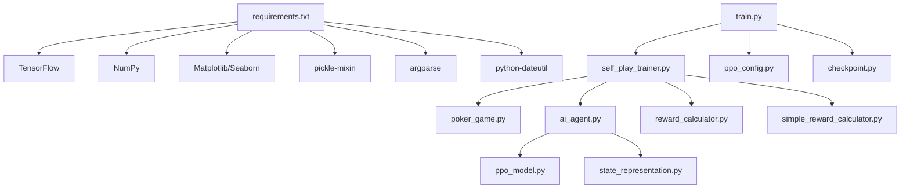

# 自我对弈训练系统

<cite>
**本文引用的文件**
- [train.py](file://train.py)
- [README.md](file://README.md)
- [TRAINING_GUIDE.md](file://TRAINING_GUIDE.md)
- [poker_ai/reward/self_play_trainer.py](file://poker_ai/reward/self_play_trainer.py)
- [poker_ai/reward/reward_calculator.py](file://poker_ai/reward/reward_calculator.py)
- [poker_ai/reward/simple_reward_calculator.py](file://poker_ai/reward/simple_reward_calculator.py)
- [poker_ai/model/ppo_model.py](file://poker_ai/model/ppo_model.py)
- [poker_ai/model/ai_agent.py](file://poker_ai/model/ai_agent.py)
- [poker_ai/model/state_representation.py](file://poker_ai/model/state_representation.py)
- [poker_ai/game/poker_game.py](file://poker_ai/game/poker_game.py)
- [poker_ai/config/ppo_config.py](file://poker_ai/config/ppo_config.py)
- [poker_ai/utils/checkpoint.py](file://poker_ai/utils/checkpoint.py)
- [requirements.txt](file://requirements.txt)
</cite>

## 目录
1. [简介](#简介)
2. [项目结构](#项目结构)
3. [核心组件](#核心组件)
4. [架构总览](#架构总览)
5. [详细组件分析](#详细组件分析)
6. [依赖关系分析](#依赖关系分析)
7. [性能考量](#性能考量)
8. [故障排查指南](#故障排查指南)
9. [结论](#结论)
10. [附录](#附录)

## 简介
本技术文档面向“自我对弈训练系统”，围绕6人桌德州扑克的强化学习训练流程展开，重点阐释SelfPlayTrainer的设计理念与实现架构，涵盖并行采样机制、动态对手更新策略、数据收集与奖励计算、模型更新与稳定性保障、训练配置与参数调优、训练效率优化、监控指标与性能评估，以及常见问题诊断与解决方案。文档力求兼顾技术深度与可读性，帮助读者快速理解并高效使用该系统。

## 项目结构
项目采用模块化组织，核心模块包括：
- 训练入口与流程控制：train.py
- 自我对弈训练器：poker_ai/reward/self_play_trainer.py
- 奖励计算：poker_ai/reward/reward_calculator.py、poker_ai/reward/simple_reward_calculator.py
- 模型与智能体：poker_ai/model/ppo_model.py、poker_ai/model/ai_agent.py、poker_ai/model/state_representation.py
- 游戏引擎：poker_ai/game/poker_game.py
- 配置与工具：poker_ai/config/ppo_config.py、poker_ai/utils/checkpoint.py
- 文档与依赖：README.md、TRAINING_GUIDE.md、requirements.txt

**图表来源**
- [train.py:1-856](file://train.py#L1-L856)
- [poker_ai/reward/self_play_trainer.py:1-1604](file://poker_ai/reward/self_play_trainer.py#L1-L1604)
- [poker_ai/model/ai_agent.py:1-703](file://poker_ai/model/ai_agent.py#L1-L703)
- [poker_ai/model/ppo_model.py:1-670](file://poker_ai/model/ppo_model.py#L1-L670)
- [poker_ai/model/state_representation.py:1-247](file://poker_ai/model/state_representation.py#L1-L247)
- [poker_ai/game/poker_game.py:1-497](file://poker_ai/game/poker_game.py#L1-L497)
- [poker_ai/reward/reward_calculator.py:1-587](file://poker_ai/reward/reward_calculator.py#L1-L587)
- [poker_ai/reward/simple_reward_calculator.py:1-72](file://poker_ai/reward/simple_reward_calculator.py#L1-L72)
- [poker_ai/config/ppo_config.py:1-97](file://poker_ai/config/ppo_config.py#L1-L97)
- [poker_ai/utils/checkpoint.py:1-139](file://poker_ai/utils/checkpoint.py#L1-L139)

**章节来源**
- [README.md:1-227](file://README.md#L1-L227)
- [TRAINING_GUIDE.md:1-181](file://TRAINING_GUIDE.md#L1-L181)

## 核心组件
- 自我对弈训练器（SelfPlayTrainer）：负责6人桌自我对弈的全流程控制，包括并行采样、对手动态更新、奖励计算与模型更新。
- 智能体接口（PokerAIAgent）：统一对接DQN、策略梯度与PPO三种模型，提供动作选择、轨迹记录与批量推理能力。
- PPO模型（PPOModel）：Actor-Critic结构，支持向量化GAE计算、价值损失裁剪、自适应熵系数、KL散度早停与混合精度。
- 奖励计算（RewardCalculator/SimpleRewardCalculator）：提供即时奖励与最终奖励的组合策略，支持自适应权重调整。
- 游戏引擎（PokerGame）：6人桌德州扑克规则实现，支持大小盲注、公共牌、摊牌结算与合法动作掩码。
- 状态表示（StateRepresentation）：6-Max专用的134维状态向量，包含手牌、公共牌、玩家信息、游戏全局信息、绝对位置与活跃人数。
- 配置与工具：PPO配置类、检查点管理工具、训练入口与评估脚本。

**章节来源**
- [poker_ai/reward/self_play_trainer.py:48-166](file://poker_ai/reward/self_play_trainer.py#L48-L166)
- [poker_ai/model/ai_agent.py:55-116](file://poker_ai/model/ai_agent.py#L55-L116)
- [poker_ai/model/ppo_model.py:20-105](file://poker_ai/model/ppo_model.py#L20-L105)
- [poker_ai/reward/reward_calculator.py:9-42](file://poker_ai/reward/reward_calculator.py#L9-L42)
- [poker_ai/game/poker_game.py:155-188](file://poker_ai/game/poker_game.py#L155-L188)
- [poker_ai/model/state_representation.py:9-46](file://poker_ai/model/state_representation.py#L9-L46)
- [poker_ai/config/ppo_config.py:18-97](file://poker_ai/config/ppo_config.py#L18-L97)
- [poker_ai/utils/checkpoint.py:17-56](file://poker_ai/utils/checkpoint.py#L17-L56)

## 架构总览
系统采用“训练器驱动+并行采样+动态对手”的架构。训练器在每轮训练中：
- 创建或加载主智能体与多个对手智能体（含一个“鱼”玩家）。
- 在多个worker中并行进行多局手牌采样，使用批量推理减少Python/TensorFlow往返开销。
- 通过奖励计算器计算即时奖励与最终奖励，结合all-in不走运补偿策略，稳定训练信号。
- 对主智能体进行模型更新（DQN经验回放或PPO轨迹训练），并在设定周期内更新对手策略。

**图表来源**
- [train.py:340-531](file://train.py#L340-L531)
- [poker_ai/reward/self_play_trainer.py:260-417](file://poker_ai/reward/self_play_trainer.py#L260-L417)
- [poker_ai/model/ai_agent.py:125-155](file://poker_ai/model/ai_agent.py#L125-L155)
- [poker_ai/reward/reward_calculator.py:303-391](file://poker_ai/reward/reward_calculator.py#L303-L391)

## 详细组件分析

### SelfPlayTrainer 设计与实现
- 6人桌专用约束：构造函数强制num_players=6，确保状态表示与游戏引擎匹配。
- 智能体创建：主智能体可为单体或集成模型；对手集合包含多个不同策略的代理，最后一个为“鱼”玩家（随机策略）。
- 并行采样：提供单手采样与批量采样两种路径，批量采样通过select_actions_batch_with_info实现向量化推理，显著降低调度开销。
- 动态对手更新：按opponent_update_interval周期更新对手策略，避免被对手策略固化。
- 奖励与轨迹：使用RewardCalculator计算即时奖励，最终奖励通过SimpleRewardCalculator或自适应奖励计算；PPO使用轨迹记录与finish_trajectory触发批量训练。
- 策略指标统计：统计弃牌率、加注率、诈唬率、无效下注率等，用于训练稳定性与策略平衡。

**图表来源**
- [poker_ai/reward/self_play_trainer.py:48-166](file://poker_ai/reward/self_play_trainer.py#L48-L166)
- [poker_ai/reward/self_play_trainer.py:167-213](file://poker_ai/reward/self_play_trainer.py#L167-L213)
- [poker_ai/reward/self_play_trainer.py:260-417](file://poker_ai/reward/self_play_trainer.py#L260-L417)
- [poker_ai/reward/self_play_trainer.py:419-585](file://poker_ai/reward/self_play_trainer.py#L419-L585)
- [poker_ai/reward/self_play_trainer.py:587-799](file://poker_ai/reward/self_play_trainer.py#L587-L799)

**章节来源**
- [poker_ai/reward/self_play_trainer.py:48-166](file://poker_ai/reward/self_play_trainer.py#L48-L166)
- [poker_ai/reward/self_play_trainer.py:167-213](file://poker_ai/reward/self_play_trainer.py#L167-L213)
- [poker_ai/reward/self_play_trainer.py:260-417](file://poker_ai/reward/self_play_trainer.py#L260-L417)
- [poker_ai/reward/self_play_trainer.py:419-585](file://poker_ai/reward/self_play_trainer.py#L419-L585)
- [poker_ai/reward/self_play_trainer.py:587-799](file://poker_ai/reward/self_play_trainer.py#L587-L799)

### 智能体接口与PPO模型
- PokerAIAgent统一接口：支持DQN、策略梯度与PPO三种模型；提供select_action/select_action_with_info、learn、append_step/finish_trajectory、批量动作选择等能力。
- PPOModel：Actor-Critic结构，支持tf.function编译、向量化GAE、价值损失裁剪、自适应熵系数、KL散度早停、混合精度与梯度累积；提供warmup、学习率调度与权重保存/加载。
- 状态表示：134维向量，包含手牌one-hot、公共牌one-hot、6名玩家状态、游戏全局信息、Hero绝对位置与活跃人数。

**图表来源**
- [poker_ai/model/ai_agent.py:55-116](file://poker_ai/model/ai_agent.py#L55-L116)
- [poker_ai/model/ai_agent.py:125-214](file://poker_ai/model/ai_agent.py#L125-L214)
- [poker_ai/model/ai_agent.py:248-420](file://poker_ai/model/ai_agent.py#L248-L420)
- [poker_ai/model/ai_agent.py:421-517](file://poker_ai/model/ai_agent.py#L421-L517)
- [poker_ai/model/ppo_model.py:20-105](file://poker_ai/model/ppo_model.py#L20-L105)
- [poker_ai/model/ppo_model.py:497-638](file://poker_ai/model/ppo_model.py#L497-L638)
- [poker_ai/model/state_representation.py:137-158](file://poker_ai/model/state_representation.py#L137-L158)
- [poker_ai/model/state_representation.py:174-211](file://poker_ai/model/state_representation.py#L174-L211)
- [poker_ai/model/state_representation.py:225-247](file://poker_ai/model/state_representation.py#L225-L247)

**章节来源**
- [poker_ai/model/ai_agent.py:55-116](file://poker_ai/model/ai_agent.py#L55-L116)
- [poker_ai/model/ai_agent.py:125-214](file://poker_ai/model/ai_agent.py#L125-L214)
- [poker_ai/model/ai_agent.py:248-420](file://poker_ai/model/ai_agent.py#L248-L420)
- [poker_ai/model/ai_agent.py:421-517](file://poker_ai/model/ai_agent.py#L421-L517)
- [poker_ai/model/ppo_model.py:20-105](file://poker_ai/model/ppo_model.py#L20-L105)
- [poker_ai/model/ppo_model.py:497-638](file://poker_ai/model/ppo_model.py#L497-L638)
- [poker_ai/model/state_representation.py:137-158](file://poker_ai/model/state_representation.py#L137-L158)
- [poker_ai/model/state_representation.py:174-211](file://poker_ai/model/state_representation.py#L174-L211)
- [poker_ai/model/state_representation.py:225-247](file://poker_ai/model/state_representation.py#L225-L247)

### 奖励计算与组合策略
- 即时奖励：基于手牌强度、底池赔率、位置优势、主动进攻、及时弃牌、成功诈唬、决策一致性与无效下注惩罚等因子，按权重组合。
- 最终奖励：SimpleRewardCalculator在done=True时仅基于盈亏归一化给出奖励，避免过程信号干扰。
- 自适应奖励：AdaptiveRewardCalculator根据近期表现（利润、诈唬率、无效下注率）动态调整权重，维持策略平衡与稳定性。
- all-in不走运补偿：对翻牌前/翻牌阶段以高胜率all-in但最终失败的情况给予少量正向补偿，缓解短期方差对策略的过度惩罚。

**图表来源**
- [poker_ai/reward/reward_calculator.py:303-391](file://poker_ai/reward/reward_calculator.py#L303-L391)
- [poker_ai/reward/reward_calculator.py:394-536](file://poker_ai/reward/reward_calculator.py#L394-L536)
- [poker_ai/reward/simple_reward_calculator.py:13-30](file://poker_ai/reward/simple_reward_calculator.py#L13-L30)
- [poker_ai/reward/self_play_trainer.py:360-404](file://poker_ai/reward/self_play_trainer.py#L360-L404)

**章节来源**
- [poker_ai/reward/reward_calculator.py:9-42](file://poker_ai/reward/reward_calculator.py#L9-L42)
- [poker_ai/reward/reward_calculator.py:303-391](file://poker_ai/reward/reward_calculator.py#L303-L391)
- [poker_ai/reward/reward_calculator.py:394-536](file://poker_ai/reward/reward_calculator.py#L394-L536)
- [poker_ai/reward/simple_reward_calculator.py:13-30](file://poker_ai/reward/simple_reward_calculator.py#L13-L30)
- [poker_ai/reward/self_play_trainer.py:360-404](file://poker_ai/reward/self_play_trainer.py#L360-L404)

### 游戏引擎与状态表示
- PokerGame：6人桌德州扑克规则实现，支持大小盲注、公共牌、摊牌结算、合法动作掩码与轮次推进。
- StateRepresentation：6-Max专用134维状态向量，包含手牌one-hot、公共牌one-hot、6名玩家状态（栈、下注、活跃）、游戏全局信息（轮次、底池、当前下注、大小盲）、Hero绝对位置one-hot与活跃人数归一化。

**图表来源**
- [poker_ai/game/poker_game.py:155-188](file://poker_ai/game/poker_game.py#L155-L188)
- [poker_ai/game/poker_game.py:227-457](file://poker_ai/game/poker_game.py#L227-L457)
- [poker_ai/model/state_representation.py:137-158](file://poker_ai/model/state_representation.py#L137-L158)
- [poker_ai/model/state_representation.py:174-211](file://poker_ai/model/state_representation.py#L174-L211)
- [poker_ai/model/state_representation.py:225-247](file://poker_ai/model/state_representation.py#L225-L247)

**章节来源**
- [poker_ai/game/poker_game.py:155-188](file://poker_ai/game/poker_game.py#L155-L188)
- [poker_ai/game/poker_game.py:227-457](file://poker_ai/game/poker_game.py#L227-L457)
- [poker_ai/model/state_representation.py:137-158](file://poker_ai/model/state_representation.py#L137-L158)
- [poker_ai/model/state_representation.py:174-211](file://poker_ai/model/state_representation.py#L174-L211)
- [poker_ai/model/state_representation.py:225-247](file://poker_ai/model/state_representation.py#L225-L247)

### 训练流程与并行采样机制
- 并行采样：通过ThreadPoolExecutor与批量推理接口，将多局手牌的前向推理合并，显著降低Python调度开销。
- 采样路径：_play_hand_collect与_play_hands_collect_batched分别处理单手与批量采样，返回结果字典与轨迹数据，供主线程统一学习。
- PPO轨迹训练：finish_trajectory将最终奖励注入轨迹末尾，flush_pending_updates确保剩余样本也被训练。

**图表来源**
- [poker_ai/reward/self_play_trainer.py:587-799](file://poker_ai/reward/self_play_trainer.py#L587-L799)
- [poker_ai/model/ai_agent.py:157-214](file://poker_ai/model/ai_agent.py#L157-L214)
- [poker_ai/model/ppo_model.py:330-338](file://poker_ai/model/ppo_model.py#L330-L338)

**章节来源**
- [poker_ai/reward/self_play_trainer.py:587-799](file://poker_ai/reward/self_play_trainer.py#L587-L799)
- [poker_ai/model/ai_agent.py:157-214](file://poker_ai/model/ai_agent.py#L157-L214)
- [poker_ai/model/ppo_model.py:330-338](file://poker_ai/model/ppo_model.py#L330-L338)

## 依赖关系分析
- 外部依赖：TensorFlow（2.x）、NumPy、Matplotlib/Seaborn（评估可视化）、pickle-mixin、argparse、python-dateutil。
- 内部模块耦合：训练器依赖智能体接口与奖励计算；智能体依赖状态表示与PPO模型；PPO模型依赖配置与状态表示；检查点工具贯穿训练与评估。

**图表来源**
- [requirements.txt:1-7](file://requirements.txt#L1-L7)
- [train.py:1-856](file://train.py#L1-L856)
- [poker_ai/reward/self_play_trainer.py:1-800](file://poker_ai/reward/self_play_trainer.py#L1-L800)
- [poker_ai/model/ai_agent.py:1-703](file://poker_ai/model/ai_agent.py#L1-L703)
- [poker_ai/model/ppo_model.py:1-670](file://poker_ai/model/ppo_model.py#L1-L670)
- [poker_ai/model/state_representation.py:1-247](file://poker_ai/model/state_representation.py#L1-L247)
- [poker_ai/reward/reward_calculator.py:1-587](file://poker_ai/reward/reward_calculator.py#L1-L587)
- [poker_ai/reward/simple_reward_calculator.py:1-72](file://poker_ai/reward/simple_reward_calculator.py#L1-L72)
- [poker_ai/config/ppo_config.py:1-97](file://poker_ai/config/ppo_config.py#L1-L97)
- [poker_ai/utils/checkpoint.py:1-139](file://poker_ai/utils/checkpoint.py#L1-L139)

**章节来源**
- [requirements.txt:1-7](file://requirements.txt#L1-L7)
- [train.py:1-856](file://train.py#L1-L856)

## 性能考量
- 并行度设置：train_workers与eval_workers按CPU核数自动推断，RTX 4090D档位下默认更高并行度以提升吞吐。
- 批处理大小：PPO默认batch_size较大（256），配合update_epochs较少（4）以减少策略退化风险。
- 批量推理：PPOModel.predict_batch与PokerAIAgent.select_actions_batch_with_info显著降低Python/TensorFlow往返开销。
- 混合精度与XLA：默认启用混合精度（float16）与XLA JIT，提升GPU利用率与推理速度。
- 学习率调度：warmup + cosine衰减，结合KL散度早停与自适应熵系数，提升训练稳定性与收敛速度。
- 数据平衡与稳定性：all-in不走运补偿、无效下注惩罚、自适应奖励权重调整，有助于缓解短期方差与策略塌缩。

**章节来源**
- [train.py:39-52](file://train.py#L39-L52)
- [train.py:64-97](file://train.py#L64-L97)
- [poker_ai/model/ppo_model.py:50-71](file://poker_ai/model/ppo_model.py#L50-L71)
- [poker_ai/model/ppo_model.py:497-638](file://poker_ai/model/ppo_model.py#L497-L638)
- [poker_ai/reward/self_play_trainer.py:383-397](file://poker_ai/reward/self_play_trainer.py#L383-L397)
- [poker_ai/reward/reward_calculator.py:420-471](file://poker_ai/reward/reward_calculator.py#L420-L471)

## 故障排查指南
- 硬件与依赖问题：未安装TensorFlow或未检测到GPU时，训练入口会记录警告并回退到CPU；请确认requirements.txt与环境配置。
- GPU内存与性能：若出现DNN/Graph错误，可尝试禁用XLA与oneDNN后重跑；或启用GPU按需分配显存。
- 训练稳定性：若评估指标异常（如avg_profit长期负、win_rate接近0），建议先缩小训练规模验证流程，再逐步扩大。
- 指标解读：优先关注评估阶段的指标（avg_profit、win_rate、bluff_rate、raise_rate、invalid_bet_rate），训练阶段轻量统计可能为0。
- 恢复训练：使用--resume或--model-path指定检查点路径，检查点文件包含权重与元数据。

**章节来源**
- [train.py:240-335](file://train.py#L240-L335)
- [train.py:528-531](file://train.py#L528-L531)
- [poker_ai/model/ai_agent.py:323-331](file://poker_ai/model/ai_agent.py#L323-L331)
- [poker_ai/utils/checkpoint.py:58-104](file://poker_ai/utils/checkpoint.py#L58-L104)
- [TRAINING_GUIDE.md:132-142](file://TRAINING_GUIDE.md#L132-L142)

## 结论
该自我对弈训练系统围绕6人桌德州扑克构建，通过SelfPlayTrainer实现高效的并行采样与动态对手更新，结合精细化奖励设计与PPO模型优化，实现了稳定的训练流程与可观的性能。系统在工程层面提供了完善的配置、检查点管理与评估工具，便于用户进行参数调优与性能监控。建议用户遵循“小样本验证—稳定性检查—规模化训练”的节奏，结合本文提供的参数调优与故障排查建议，获得高质量的训练结果。

## 附录
- 训练配置示例（以train.py参数为主）：
  - 基础：--mode train --model-type ppo --num-hands 10000
  - 恢复训练：--resume 或 --model-path ./checkpoints/agent_ppo_1000
  - 评估：--mode eval --model-type ppo --model-path ./checkpoints/agent_ppo_1000 --num-eval-games 500
- 关键参数说明（节选）：
  - --eval-interval：评估间隔（局数）
  - --num-eval-games：每次评估的游戏局数
  - --checkpoint-interval：保存检查点间隔（局数）
  - --ppo-clip/--ppo-epochs/--ppo-entropy-coef：PPO核心超参数
  - --train-workers/--eval-workers：并行采样worker数量
  - --batch-size/--ppo-update-min-steps：批处理大小与最小更新步数
  - --mixed-precision/--enable-xla：混合精度与XLA JIT开关
  - --gpu-memory-growth：GPU显存按需分配

**章节来源**
- [README.md:79-181](file://README.md#L79-L181)
- [TRAINING_GUIDE.md:11-45](file://TRAINING_GUIDE.md#L11-L45)
- [train.py:136-238](file://train.py#L136-L238)