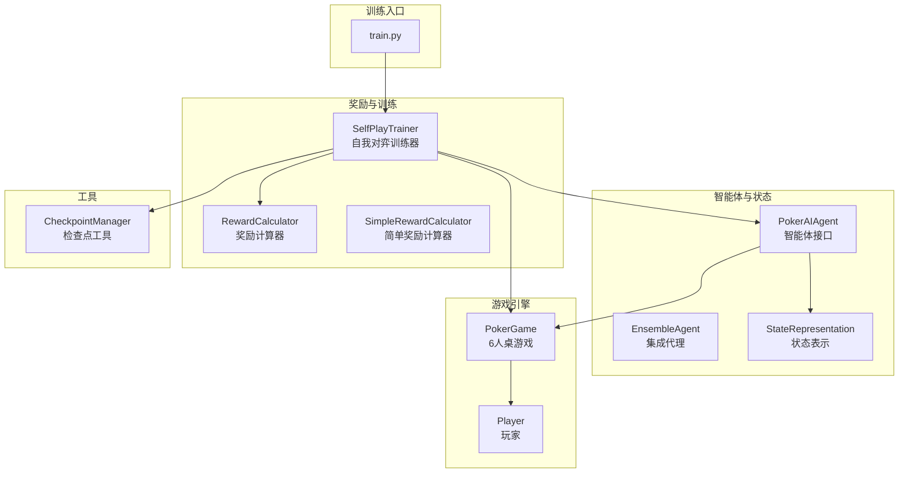
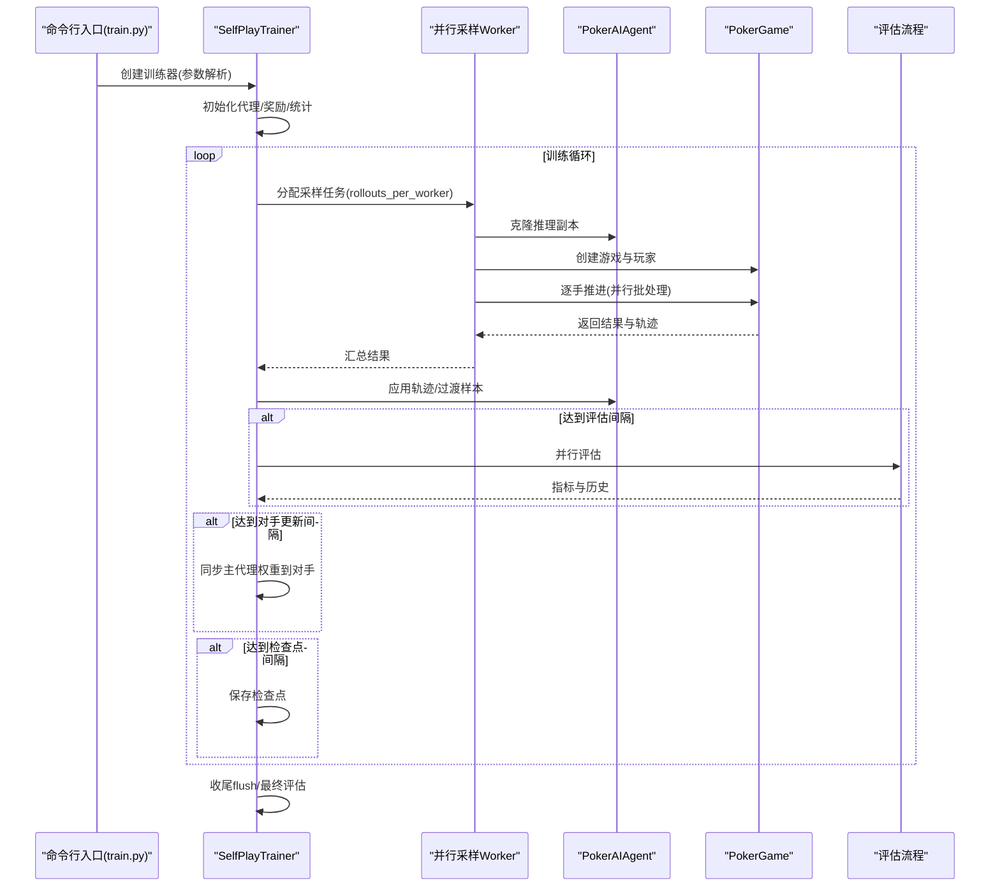
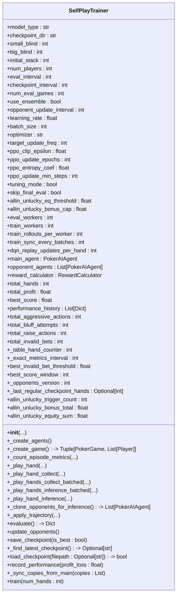
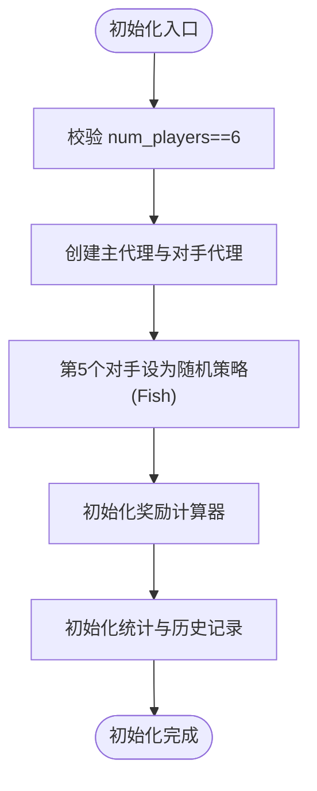
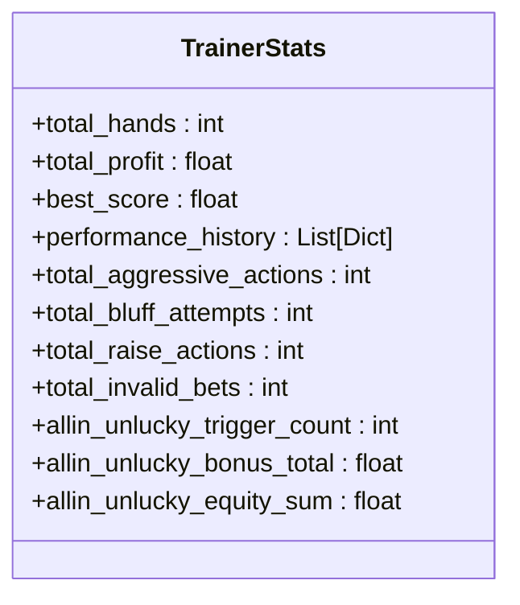
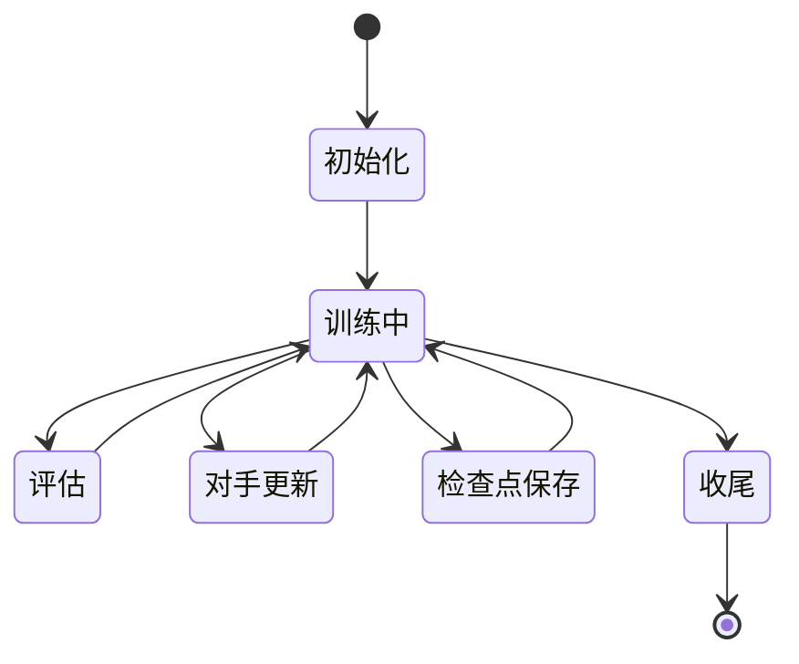
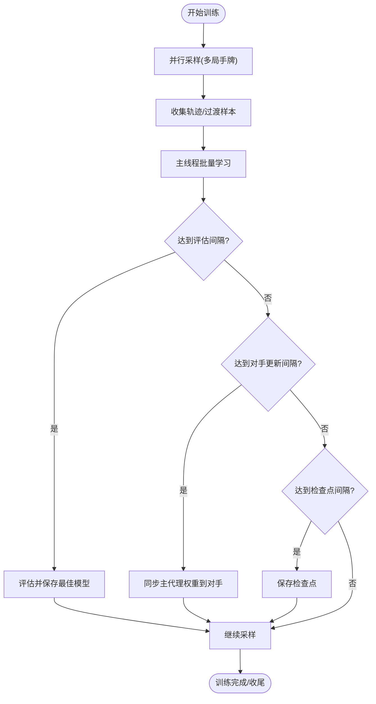
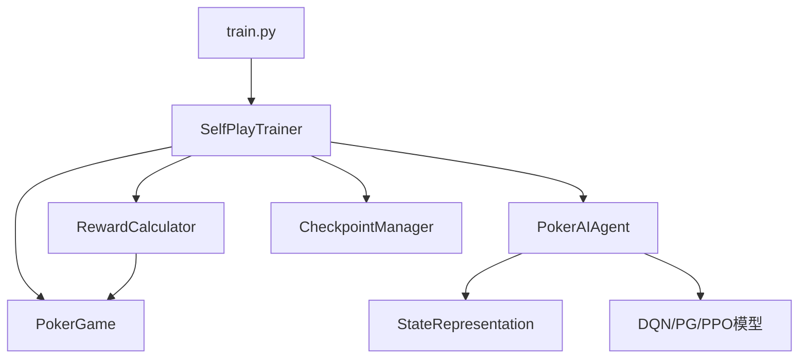

# 训练架构设计

<cite>
**本文引用的文件**
- [self_play_trainer.py](file://poker_ai/reward/self_play_trainer.py)
- [ai_agent.py](file://poker_ai/model/ai_agent.py)
- [state_representation.py](file://poker_ai/model/state_representation.py)
- [reward_calculator.py](file://poker_ai/reward/reward_calculator.py)
- [checkpoint.py](file://poker_ai/utils/checkpoint.py)
- [poker_game.py](file://poker_ai/game/poker_game.py)
- [train.py](file://train.py)
- [README.md](file://README.md)
</cite>

## 目录
1. [简介](#简介)
2. [项目结构](#项目结构)
3. [核心组件](#核心组件)
4. [架构概览](#架构概览)
5. [详细组件分析](#详细组件分析)
6. [依赖关系分析](#依赖关系分析)
7. [性能考量](#性能考量)
8. [故障排查指南](#故障排查指南)
9. [结论](#结论)
10. [附录](#附录)

## 简介
本技术文档围绕自我对弈训练架构进行系统化设计说明，重点剖析 SelfPlayTrainer 类的整体设计理念、6人桌专用训练流程、核心参数配置体系、训练阶段划分、初始化过程、核心数据结构、生命周期管理、配置示例与最佳实践，以及扩展性与可维护性设计。文档旨在帮助开发者与研究者快速理解并高效迭代该训练框架。

## 项目结构
该项目采用模块化组织，围绕“游戏引擎—智能体—奖励—训练器—工具链”的层次化结构展开。关键模块如下：
- poker_ai/game：6人桌德州扑克游戏引擎与玩家状态管理
- poker_ai/model：智能体接口与状态表示、DQN/PPO等模型封装
- poker_ai/reward：奖励计算与自我对弈训练器
- poker_ai/utils：检查点工具
- train.py：训练/评估/演示入口与参数解析
- README.md：快速开始与参数说明

**图表来源**
- [train.py:136-238](file://train.py#L136-L238)
- [self_play_trainer.py:48-166](file://poker_ai/reward/self_play_trainer.py#L48-L166)
- [ai_agent.py:55-116](file://poker_ai/model/ai_agent.py#L55-L116)
- [state_representation.py:9-46](file://poker_ai/model/state_representation.py#L9-L46)
- [poker_game.py:155-200](file://poker_ai/game/poker_game.py#L155-L200)
- [checkpoint.py:17-56](file://poker_ai/utils/checkpoint.py#L17-L56)

**章节来源**
- [README.md:46-75](file://README.md#L46-L75)
- [train.py:136-238](file://train.py#L136-L238)

## 核心组件
- SelfPlayTrainer：6人桌自我对弈训练器，负责训练循环、并行采样、评估、检查点管理、对手更新与策略指标统计。
- PokerAIAgent：统一智能体接口，封装DQN、策略梯度与PPO三种模型，提供动作选择、学习与推理克隆能力。
- StateRepresentation：6人桌专用状态表示，将手牌、公共牌、玩家信息、全局信息、位置与活跃人数等特征整合为固定维度向量。
- RewardCalculator：精细化奖励计算，包含手牌强度、底池赔率、位置优势、决策一致性、无效下注惩罚等因子，并支持自适应调整。
- PokerGame/Player：6人桌游戏引擎，管理发牌、轮次推进、行动处理、结算与胜负判定。
- CheckpointManager：检查点保存/加载工具，兼容PPO与传统模型格式。

**章节来源**
- [self_play_trainer.py:48-166](file://poker_ai/reward/self_play_trainer.py#L48-L166)
- [ai_agent.py:55-116](file://poker_ai/model/ai_agent.py#L55-L116)
- [state_representation.py:9-46](file://poker_ai/model/state_representation.py#L9-L46)
- [reward_calculator.py:9-53](file://poker_ai/reward/reward_calculator.py#L9-L53)
- [poker_game.py:155-200](file://poker_ai/game/poker_game.py#L155-L200)
- [checkpoint.py:17-56](file://poker_ai/utils/checkpoint.py#L17-L56)

## 架构概览
SelfPlayTrainer 采用“主线程串行更新 + 多线程并行采样”的混合架构：
- 初始化阶段：参数校验、代理创建、奖励计算器配置、统计与历史记录初始化。
- 训练阶段：按批次并行采样多局手牌，收集轨迹或过渡样本，主线程批量应用学习；周期性评估、对手更新、检查点保存。
- 评估阶段：使用推理克隆并行推进若干局，汇总策略指标与性能数据。
- 生命周期：训练启动、运行监控、停止条件判断（手数阈值、可选自动调参）、最终评估与收尾。

**图表来源**
- [train.py:340-531](file://train.py#L340-L531)
- [self_play_trainer.py:1393-1590](file://poker_ai/reward/self_play_trainer.py#L1393-L1590)
- [ai_agent.py:489-516](file://poker_ai/model/ai_agent.py#L489-L516)

**章节来源**
- [train.py:340-531](file://train.py#L340-L531)
- [self_play_trainer.py:1393-1590](file://poker_ai/reward/self_play_trainer.py#L1393-L1590)

## 详细组件分析

### SelfPlayTrainer 设计理念与架构模式
- 6人桌专用：严格限制 num_players=6，确保状态表示与游戏引擎的一致性。
- 模型抽象：支持DQN、策略梯度、PPO三种模型类型，通过统一接口与状态表示解耦。
- 并行采样：训练阶段使用ThreadPoolExecutor并行推进多局手牌，减少Python调度开销，提升吞吐。
- 轨迹驱动：PPO采用轨迹级学习，批量聚合后统一训练；DQN采用经验回放与批量replay。
- 自我对弈：主代理与多个对手交互，其中第5个对手为“鱼”，在PPO场景下强制随机策略，避免策略同质化。
- 自适应评估：周期性评估，综合平均利润、胜率、无效下注率等指标，动态选择最佳模型。

**图表来源**
- [self_play_trainer.py:48-166](file://poker_ai/reward/self_play_trainer.py#L48-L166)
- [self_play_trainer.py:1013-1029](file://poker_ai/reward/self_play_trainer.py#L1013-L1029)
- [self_play_trainer.py:1030-1162](file://poker_ai/reward/self_play_trainer.py#L1030-L1162)
- [self_play_trainer.py:1164-1185](file://poker_ai/reward/self_play_trainer.py#L1164-L1185)
- [self_play_trainer.py:1186-1266](file://poker_ai/reward/self_play_trainer.py#L1186-L1266)
- [self_play_trainer.py:1268-1327](file://poker_ai/reward/self_play_trainer.py#L1268-L1327)
- [self_play_trainer.py:1329-1374](file://poker_ai/reward/self_play_trainer.py#L1329-L1374)
- [self_play_trainer.py:1376-1392](file://poker_ai/reward/self_play_trainer.py#L1376-L1392)
- [self_play_trainer.py:1393-1590](file://poker_ai/reward/self_play_trainer.py#L1393-L1590)

**章节来源**
- [self_play_trainer.py:48-166](file://poker_ai/reward/self_play_trainer.py#L48-L166)

### 初始化过程与参数验证
- 参数校验：强制 num_players=6，否则抛出异常；自动推断并行worker数量，保留CPU核心以保障系统稳定性。
- 代理创建：根据 model_type 创建主代理与多个对手代理；第5个对手强制为随机策略（Fish），避免“鱼”也具备策略学习能力。
- 奖励计算器：默认使用复杂奖励计算器，提供中间步骤奖励，有助于AI学习更精细的策略。
- 统计与历史：初始化基础统计（总手牌、累计利润、最佳分数、性能历史）与策略指标（激进行动、诈唬尝试、加注、无效下注）。

**图表来源**
- [self_play_trainer.py:81-166](file://poker_ai/reward/self_play_trainer.py#L81-L166)
- [self_play_trainer.py:167-213](file://poker_ai/reward/self_play_trainer.py#L167-L213)

**章节来源**
- [self_play_trainer.py:81-166](file://poker_ai/reward/self_play_trainer.py#L81-L166)
- [self_play_trainer.py:167-213](file://poker_ai/reward/self_play_trainer.py#L167-L213)

### 核心数据结构设计
- 统计信息管理：total_hands、total_profit、best_score、performance_history，用于训练监控与最佳模型选择。
- 策略指标跟踪：total_aggressive_actions、total_bluff_attempts、total_raise_actions、total_invalid_bets，结合评估阶段的指标计算，形成闭环反馈。
- 性能历史记录：记录评估结果（平均利润、胜率、诈唬率、加注率、无效下注率），便于趋势分析与可视化。
- all-in 不走运补偿：allin_unlucky_trigger_count、allin_unlucky_bonus_total、allin_unlucky_equity_sum，用于监控补偿是否过量。

**图表来源**
- [self_play_trainer.py:142-166](file://poker_ai/reward/self_play_trainer.py#L142-L166)

**章节来源**
- [self_play_trainer.py:142-166](file://poker_ai/reward/self_play_trainer.py#L142-L166)

### 生命周期管理
- 训练启动：解析命令行参数，创建训练器，配置探索参数，加载检查点（可选）。
- 运行监控：记录训练统计、评估间隔触发、对手更新、检查点保存；支持自动调参（PPO）。
- 停止条件：达到目标手数；可选跳过最终评估；收尾时flush剩余样本并进行最终评估。
- 评估与保存：评估阶段使用推理克隆并行推进，汇总指标并保存最佳模型；常规检查点按间隔保存。

**图表来源**
- [train.py:340-531](file://train.py#L340-L531)
- [self_play_trainer.py:1393-1590](file://poker_ai/reward/self_play_trainer.py#L1393-L1590)

**章节来源**
- [train.py:340-531](file://train.py#L340-L531)
- [self_play_trainer.py:1393-1590](file://poker_ai/reward/self_play_trainer.py#L1393-L1590)

### 训练阶段划分与并行策略
- 训练阶段：主线程串行应用轨迹/过渡样本，周期性评估与保存检查点；并行采样阶段由多个worker并行推进多局手牌，减少Python调度开销。
- 评估阶段：使用推理克隆并行推进若干局，汇总策略指标与性能数据。
- 对手更新：定期将主代理权重同步到随机对手（Fish除外），维持动态对抗环境。
- 自动调参：PPO场景下短跑多组候选配置，按吞吐选择最优参数组合。

**图表来源**
- [self_play_trainer.py:1393-1590](file://poker_ai/reward/self_play_trainer.py#L1393-L1590)

**章节来源**
- [self_play_trainer.py:1393-1590](file://poker_ai/reward/self_play_trainer.py#L1393-L1590)

### 配置示例与最佳实践
- 基础配置：推荐使用PPO，设置合理的学习率、批大小、clip、更新轮次与熵正则系数。
- 并行配置：train_workers与eval_workers按CPU核数自动推断，train_rollouts_per_worker与train_sync_every_batches提升吞吐。
- 硬件优化：RTX 4090D场景下可启用GPU、XLA与混合精度，增大batch与轨迹累计以提升利用率。
- 探索参数：DQN场景下设置ε-贪婪策略的起始、终止与衰减率，避免过早收敛。
- 自动调参：PPO场景下可启用自动调参，短跑多组候选，按吞吐选择最优配置。

**章节来源**
- [train.py:55-135](file://train.py#L55-L135)
- [train.py:136-238](file://train.py#L136-L238)
- [train.py:340-531](file://train.py#L340-L531)

## 依赖关系分析
- SelfPlayTrainer 依赖 PokerGame、PokerAIAgent、RewardCalculator、CheckpointManager。
- PokerAIAgent 依赖 StateRepresentation 与具体模型实现（DQN、PolicyGradient、PPO）。
- RewardCalculator 依赖游戏引擎与牌型评估工具。
- train.py 作为入口，解析参数并创建训练器，配置环境与硬件参数。

**图表来源**
- [self_play_trainer.py:21-25](file://poker_ai/reward/self_play_trainer.py#L21-L25)
- [ai_agent.py:55-116](file://poker_ai/model/ai_agent.py#L55-L116)
- [state_representation.py:9-46](file://poker_ai/model/state_representation.py#L9-L46)
- [reward_calculator.py:9-53](file://poker_ai/reward/reward_calculator.py#L9-L53)
- [checkpoint.py:17-56](file://poker_ai/utils/checkpoint.py#L17-L56)
- [train.py:340-531](file://train.py#L340-L531)

**章节来源**
- [self_play_trainer.py:21-25](file://poker_ai/reward/self_play_trainer.py#L21-L25)
- [ai_agent.py:55-116](file://poker_ai/model/ai_agent.py#L55-L116)
- [state_representation.py:9-46](file://poker_ai/model/state_representation.py#L9-L46)
- [reward_calculator.py:9-53](file://poker_ai/reward/reward_calculator.py#L9-L53)
- [checkpoint.py:17-56](file://poker_ai/utils/checkpoint.py#L17-L56)
- [train.py:340-531](file://train.py#L340-L531)

## 性能考量
- 并行采样：通过 ThreadPoolExecutor 并行推进多局手牌，减少Python调度开销；PPO场景下批量推理进一步降低往返成本。
- 批量学习：PPO采用轨迹批量聚合后统一训练，减少函数调用与阈值检查开销；DQN采用批量replay提升样本利用效率。
- 硬件优化：启用GPU、XLA与混合精度可显著提升吞吐；合理设置线程并行度与批大小以匹配硬件资源。
- 状态表示：6人桌专用状态向量维度固定，避免动态形状带来的性能损耗；预计算索引映射与one-hot编码优化高频路径。
- 评估并行：评估阶段使用推理克隆并行推进，按CPU核数动态分配任务，缩短评估耗时。

[本节为通用性能讨论，无需特定文件引用]

## 故障排查指南
- 检查点加载失败：确认检查点路径与文件存在性，PPO需使用base路径（不含后缀），DQN/PG可使用权重或pkl文件。
- GPU兼容问题：遇到DNN/Graph错误或XLA编译失败，可尝试禁用XLA或开启oneDNN禁用选项。
- 探索参数设置：DQN场景下可通过直接访问epsilon等参数进行设置，避免训练过早收敛。
- 并行冲突：评估与训练阶段预创建推理克隆，避免在子线程中创建TF模型导致变量形状冲突。
- 硬件配置：未检测到GPU时回退到CPU；显存按需增长与混合精度可能受平台限制。

**章节来源**
- [self_play_trainer.py:1268-1327](file://poker_ai/reward/self_play_trainer.py#L1268-L1327)
- [self_play_trainer.py:1559-1571](file://poker_ai/reward/self_play_trainer.py#L1559-L1571)
- [ai_agent.py:529-553](file://poker_ai/model/ai_agent.py#L529-L553)
- [train.py:240-335](file://train.py#L240-L335)

## 结论
SelfPlayTrainer 通过模块化设计与并行采样策略，实现了高效的6人桌自我对弈训练。其核心在于：
- 严格的6人桌约束与状态表示，确保训练与评估的一致性；
- 统一智能体接口与奖励计算，支持多模型并行；
- 训练与评估的周期性监控与检查点管理，保障模型持续改进；
- 面向硬件的优化策略与自动调参能力，提升训练吞吐与稳定性。

该架构具备良好的扩展性与可维护性，适合进一步引入更复杂的对手策略、奖励机制与评估指标。

[本节为总结性内容，无需特定文件引用]

## 附录
- 快速开始命令参考与参数说明可参阅项目根目录的 README 文档。
- 训练/评估/演示入口与参数解析详见 train.py。

**章节来源**
- [README.md:12-227](file://README.md#L12-L227)
- [train.py:136-238](file://train.py#L136-L238)