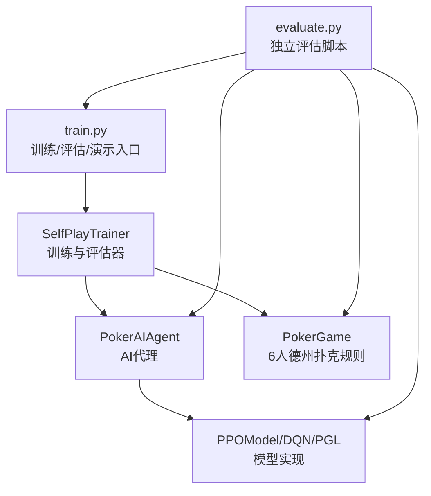
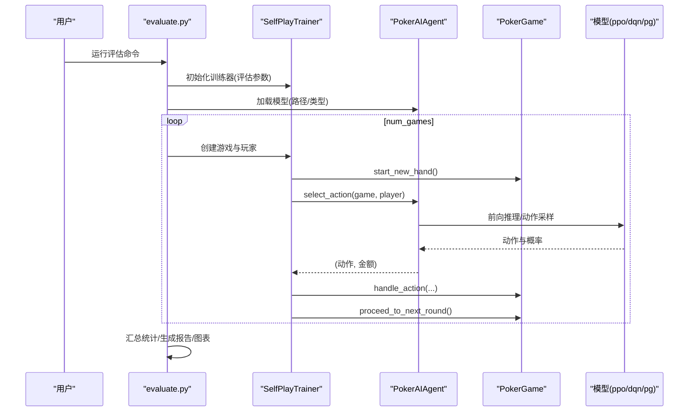
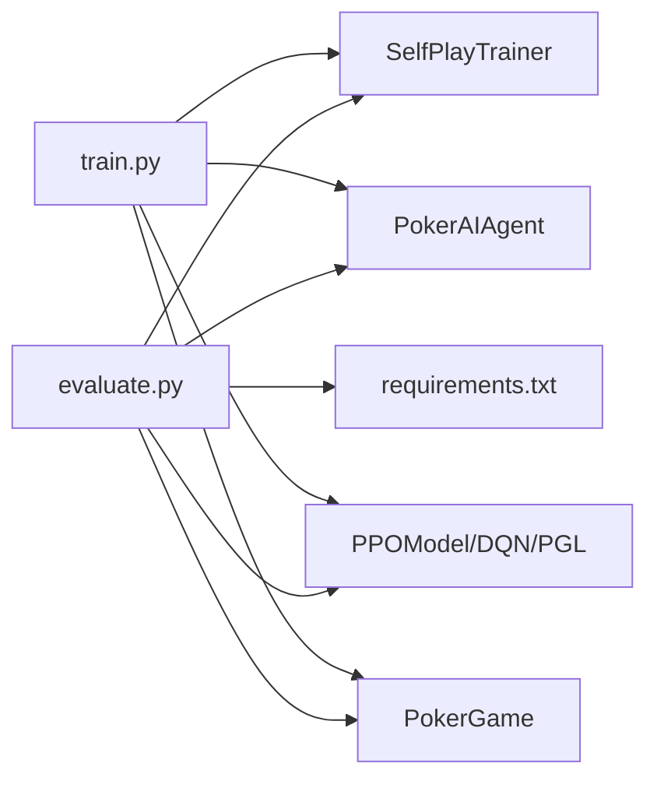

# 评估与分析系统

<cite>
**本文引用的文件**
- [evaluate.py](file://evaluate.py)
- [README.md](file://README.md)
- [docs/如何看训练结果.md](file://docs/如何看训练结果.md)
- [train.py](file://train.py)
- [poker_ai/reward/self_play_trainer.py](file://poker_ai/reward/self_play_trainer.py)
- [poker_ai/model/ai_agent.py](file://poker_ai/model/ai_agent.py)
- [poker_ai/model/ppo_model.py](file://poker_ai/model/ppo_model.py)
- [poker_ai/game/poker_game.py](file://poker_ai/game/poker_game.py)
- [requirements.txt](file://requirements.txt)
</cite>

## 目录
1. [简介](#简介)
2. [项目结构](#项目结构)
3. [核心组件](#核心组件)
4. [架构总览](#架构总览)
5. [详细组件分析](#详细组件分析)
6. [依赖关系分析](#依赖关系分析)
7. [性能考量](#性能考量)
8. [故障排查指南](#故障排查指南)
9. [结论](#结论)
10. [附录](#附录)

## 简介
本文件面向“评估与分析系统”的使用者与维护者，系统性梳理 evaluate.py 的功能、评估指标、统计分析方法、可视化报告生成、日志与结果解读、命令行参数与最佳实践，并给出扩展新指标与分析方法的建议。同时，结合训练侧的评估能力，帮助用户建立从训练到评估再到可视化的完整闭环。

## 项目结构
- 评估入口：evaluate.py 提供独立的详细评估脚本，支持生成图表与报告。
- 训练入口：train.py 提供训练、评估、演示三种模式，其中评估模式输出更丰富的策略健康度指标。
- 游戏与智能体：poker_ai/game/poker_game.py 定义6人德州扑克规则；poker_ai/model/ai_agent.py 抽象统一的AI代理接口；ppo_model.py 提供PPO模型实现。
- 自我对弈训练器：poker_ai/reward/self_play_trainer.py 实现训练与评估的核心逻辑，包含策略健康度指标的统计与输出。
- 文档与说明：README.md 与 docs/如何看训练结果.md 提供使用指南与指标解读。

图表来源
- [evaluate.py:110-142](file://evaluate.py#L110-L142)
- [train.py:136-238](file://train.py#L136-L238)
- [poker_ai/reward/self_play_trainer.py:48-166](file://poker_ai/reward/self_play_trainer.py#L48-L166)
- [poker_ai/model/ai_agent.py:55-116](file://poker_ai/model/ai_agent.py#L55-L116)
- [poker_ai/model/ppo_model.py:20-110](file://poker_ai/model/ppo_model.py#L20-L110)
- [poker_ai/game/poker_game.py:155-200](file://poker_ai/game/poker_game.py#L155-L200)

章节来源
- [README.md:46-75](file://README.md#L46-L75)
- [requirements.txt:1-7](file://requirements.txt#L1-L7)

## 核心组件
- 命令行参数解析：支持模型路径、模型类型、评估场次数、对手类型、盲注与初始筹码、输出目录、是否生成图表、是否详细日志等。
- 环境设置：创建输出目录、可选开启详细日志、GPU内存增长设置。
- 对手代理创建：支持随机、固定策略、历史版本三种对手类型。
- 评估执行：加载模型、运行基本评估与详细评估，合并元数据与结果。
- 结果保存与报告：JSON序列化、文本报告生成。
- 可视化图表：手牌强度分布、动作分布饼图、各阶段利润箱线图、按手牌强度的胜率柱状图、累计利润曲线。
- 日志与错误处理：统一日志配置、异常捕获与堆栈记录。

章节来源
- [evaluate.py:110-142](file://evaluate.py#L110-L142)
- [evaluate.py:144-158](file://evaluate.py#L144-L158)
- [evaluate.py:159-179](file://evaluate.py#L159-L179)
- [evaluate.py:181-267](file://evaluate.py#L181-L267)
- [evaluate.py:269-482](file://evaluate.py#L269-L482)
- [evaluate.py:484-522](file://evaluate.py#L484-L522)
- [evaluate.py:523-584](file://evaluate.py#L523-L584)
- [evaluate.py:586-704](file://evaluate.py#L586-L704)
- [evaluate.py:706-753](file://evaluate.py#L706-L753)

## 架构总览
evaluate.py 通过 SelfPlayTrainer 与 PokerAIAgent/模型交互，运行多局游戏收集统计信息，计算并导出评估指标与可视化图表。训练侧的评估（train.py --mode eval）提供更全面的策略健康度指标（如诈唬率、加注率、无效下注率）。

图表来源
- [evaluate.py:181-267](file://evaluate.py#L181-L267)
- [poker_ai/reward/self_play_trainer.py:1140-1172](file://poker_ai/reward/self_play_trainer.py#L1140-L1172)
- [poker_ai/model/ai_agent.py:117-155](file://poker_ai/model/ai_agent.py#L117-L155)
- [poker_ai/game/poker_game.py:155-200](file://poker_ai/game/poker_game.py#L155-L200)

## 详细组件分析

### 命令行参数与使用
- 关键参数
  - --model-path：被评估模型路径（evaluate.py 仅支持 dqn/policy_gradient；PPO 建议使用 train.py --mode eval）
  - --model-type：模型类型（dqn/policy_gradient/ppo）
  - --num-games：评估局数
  - --num-opponents：对手数量（默认5）
  - --opponent-type：对手类型（random/fixed/previous）
  - --small-blind/big-blind/initial-stack：游戏参数
  - --output-dir：输出目录（默认 ./eval_reports）
  - --generate-plots：是否生成图表
  - --verbose：详细日志
- 命令示例
  - 使用 evaluate.py 进行详细评估并生成图表
  - 使用 train.py --mode eval 进行标准评估（包含策略健康度指标）

章节来源
- [evaluate.py:110-142](file://evaluate.py#L110-L142)
- [README.md:113-121](file://README.md#L113-L121)
- [README.md:104-111](file://README.md#L104-L111)

### 环境与GPU设置
- 自动检测GPU并设置内存增长，避免一次性占用全部显存。
- 中文字体配置与降级回退，确保图表可正常保存。
- 详细日志开关，便于调试与定位问题。

章节来源
- [evaluate.py:31-51](file://evaluate.py#L31-L51)
- [evaluate.py:54-82](file://evaluate.py#L54-L82)
- [evaluate.py:144-158](file://evaluate.py#L144-L158)

### 对手代理与游戏环境
- 对手代理创建：根据对手类型创建随机、固定策略或历史版本代理。
- 游戏环境：6人德州扑克，支持翻牌前/翻牌/转牌/河牌阶段推进。
- 动作选择：PokerAIAgent 统一接口，内部委托模型进行动作采样与金额解码。

章节来源
- [evaluate.py:159-179](file://evaluate.py#L159-L179)
- [poker_ai/reward/self_play_trainer.py:48-166](file://poker_ai/reward/self_play_trainer.py#L48-L166)
- [poker_ai/model/ai_agent.py:55-116](file://poker_ai/model/ai_agent.py#L55-L116)
- [poker_ai/game/poker_game.py:155-200](file://poker_ai/game/poker_game.py#L155-L200)

### 评估执行与统计
- 基本评估：通过 SelfPlayTrainer.evaluate() 计算平均利润、胜率、总利润、获胜次数等。
- 详细评估：逐局记录动作、阶段利润、手牌强度分布、按手牌强度的胜率、按位置的胜率等。
- 统计聚合：计算各阶段平均利润、按手牌强度分类的胜率、动作分布等。

章节来源
- [evaluate.py:181-267](file://evaluate.py#L181-L267)
- [evaluate.py:269-482](file://evaluate.py#L269-L482)
- [poker_ai/reward/self_play_trainer.py:1140-1172](file://poker_ai/reward/self_play_trainer.py#L1140-L1172)

### 结果保存与报告
- JSON结果：将评估结果序列化保存，包含基本与详细统计、元数据。
- 文本报告：打印并保存评估报告，包含关键指标摘要。
- 图表生成：保存手牌强度分布、动作分布、阶段利润、按手牌强度的胜率、累计利润曲线等。

章节来源
- [evaluate.py:484-522](file://evaluate.py#L484-L522)
- [evaluate.py:523-584](file://evaluate.py#L523-L584)
- [evaluate.py:586-704](file://evaluate.py#L586-L704)

### 评估指标与计算方法
- 平均利润（avg_profit）：主玩家在评估局结束时相对初始筹码的平均盈亏。
- 胜率（win_rate）：主玩家在评估局数里“拿下该局”的比例（支持并列赢家）。
- 诈唬率（bluff_rate）：在加注/跟注中“弱牌却进攻”的比例（训练侧评估提供）。
- 加注率（raise_rate）：在非弃牌决策里加注的比例（训练侧评估提供）。
- 无效下注率（invalid_bet_rate）：加注中“明显不合理”的比例（训练侧评估提供）。
- 手牌强度分布：翻牌前手牌强度归一化到0-1范围。
- 按手牌强度的胜率：将手牌强度分为弱/中/强三档，统计各档的胜率与样本数。
- 各阶段利润：翻牌前/翻牌/转牌/河牌阶段的利润分布与均值。
- 累计利润曲线：随评估局数累积的利润走势。

章节来源
- [docs/如何看训练结果.md:34-61](file://docs/如何看训练结果.md#L34-L61)
- [evaluate.py:523-584](file://evaluate.py#L523-L584)
- [evaluate.py:586-704](file://evaluate.py#L586-L704)
- [poker_ai/reward/self_play_trainer.py:1140-1172](file://poker_ai/reward/self_play_trainer.py#L1140-L1172)

### 可视化图表与解读
- 手牌强度分布直方图：反映主玩家在翻牌前手牌强度的分布形态。
- 动作分布饼图：展示弃牌、跟注、加注的占比，辅助判断策略倾向。
- 各阶段利润箱线图：观察不同阶段的利润离散程度与异常值。
- 按手牌强度的胜率柱状图：标注样本数，判断不同强度下的胜率稳定性。
- 累计利润曲线：观察整体收益趋势与波动。

章节来源
- [evaluate.py:586-704](file://evaluate.py#L586-L704)

### 日志分析与性能趋势监控
- 控制台与日志文件：评估过程中的进度、指标与异常信息。
- 性能历史：训练侧评估会将结果追加到 performance_history，可用于绘制趋势图。
- 建议：先做小样本（500~1000）验证流程，再扩大评估规模；关注平均利润与胜率的稳定性。

章节来源
- [README.md:194-205](file://README.md#L194-L205)
- [docs/如何看训练结果.md:1-18](file://docs/如何看训练结果.md#L1-L18)
- [docs/如何看训练结果.md:94-105](file://docs/如何看训练结果.md#L94-L105)

### 模型对比评估
- 使用相同对手设置与评估局数，比较不同模型或不同训练阶段的评估结果。
- 关注：平均利润、胜率、策略健康度指标（如诈唬率、加注率、无效下注率）的差异与稳定性。

章节来源
- [docs/如何看训练结果.md:65-90](file://docs/如何看训练结果.md#L65-L90)

### 评估命令示例与参数配置
- evaluate.py 命令示例：指定模型路径、模型类型、评估局数、生成图表等。
- train.py --mode eval 命令示例：用于标准评估，包含策略健康度指标。
- 参数建议：根据硬件与资源合理设置 num-games、opponent-type、output-dir 等。

章节来源
- [README.md:113-121](file://README.md#L113-L121)
- [README.md:104-111](file://README.md#L104-L111)

### 评估系统的扩展性
- 新增评估指标：在详细评估统计部分（如 detailed_stats）新增字段，计算并纳入报告与图表。
- 新增分析方法：在 run_detailed_evaluation 中扩展采集逻辑，或在 generate_visualizations 中新增图表。
- 新增可视化：在 generate_visualizations 中添加新的绘图逻辑，并在报告中补充说明。
- 注意：扩展时需考虑数据结构的稳定性与序列化兼容性。

章节来源
- [evaluate.py:269-482](file://evaluate.py#L269-L482)
- [evaluate.py:586-704](file://evaluate.py#L586-L704)

## 依赖关系分析

图表来源
- [evaluate.py:93-98](file://evaluate.py#L93-L98)
- [requirements.txt:1-7](file://requirements.txt#L1-L7)
- [train.py:136-238](file://train.py#L136-L238)

章节来源
- [requirements.txt:1-7](file://requirements.txt#L1-L7)

## 性能考量
- GPU内存增长：避免一次性占用全部显存，提升稳定性。
- 中文字体降级：确保在不同环境下图表可正常保存。
- 评估规模：建议先小规模验证，再逐步扩大评估规模以获得更稳健的统计。
- 图表生成：仅在需要时启用 --generate-plots，避免不必要的IO开销。

章节来源
- [evaluate.py:31-51](file://evaluate.py#L31-L51)
- [evaluate.py:54-82](file://evaluate.py#L54-L82)
- [README.md:25-40](file://README.md#L25-L40)

## 故障排查指南
- 缺少依赖：确保已安装 TensorFlow、numpy、matplotlib、seaborn 等依赖。
- 模型加载失败：检查模型路径是否存在、权限是否可读、模型类型与路径是否匹配。
- GPU不可用：确认已正确设置 GPU 内存增长；若无GPU，系统将回退到CPU。
- 日志定位：查看 eval_detail_log.txt 与控制台输出，定位错误堆栈与上下文信息。
- 评估结果为空：检查 num-games 是否过大导致超时或内存不足；适当缩小规模验证。

章节来源
- [requirements.txt:1-7](file://requirements.txt#L1-L7)
- [evaluate.py:200-240](file://evaluate.py#L200-L240)
- [evaluate.py:31-51](file://evaluate.py#L31-L51)
- [evaluate.py:745-749](file://evaluate.py#L745-L749)

## 结论
evaluate.py 提供了独立、可扩展的评估与可视化能力，适合在训练之外进行快速、详细的模型评估。结合 train.py 的标准评估（包含策略健康度指标），可形成从训练到评估再到可视化的完整闭环。建议在评估前做好小规模验证，合理设置参数，并持续关注平均利润与胜率的趋势与稳定性，以指导模型迭代与超参调整。

## 附录

### 评估指标定义与意义
- 平均利润：衡量主玩家在评估期间的盈利能力。
- 胜率：衡量主玩家在评估期间的胜率水平。
- 诈唬率：衡量主玩家在弱牌时的进攻倾向，过高或过低均需警惕。
- 加注率：衡量主玩家的主动程度，需结合利润与无效下注率综合判断。
- 无效下注率：衡量主玩家决策质量，应尽量降低。

章节来源
- [docs/如何看训练结果.md:34-61](file://docs/如何看训练结果.md#L34-L61)

### 可视化图表解读要点
- 手牌强度分布：观察主玩家在翻牌前的平均手牌强度与分布集中度。
- 动作分布：判断主玩家是偏向保守还是激进。
- 各阶段利润：识别在哪些阶段存在显著盈利或亏损。
- 按手牌强度的胜率：验证不同强度下的胜率是否符合预期。
- 累计利润曲线：观察整体收益趋势与波动幅度。

章节来源
- [evaluate.py:586-704](file://evaluate.py#L586-L704)