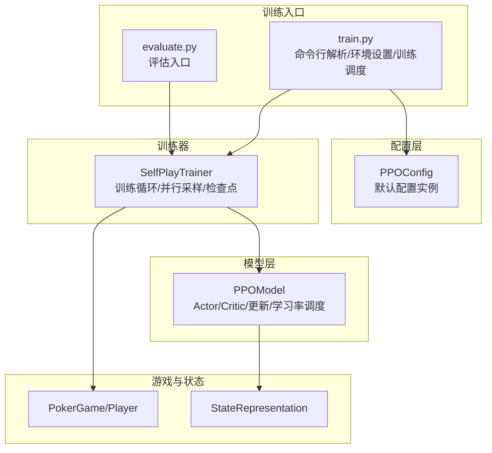
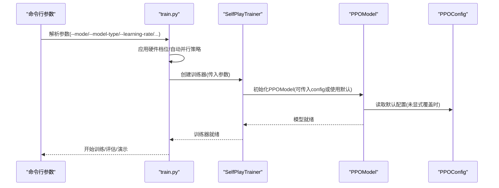
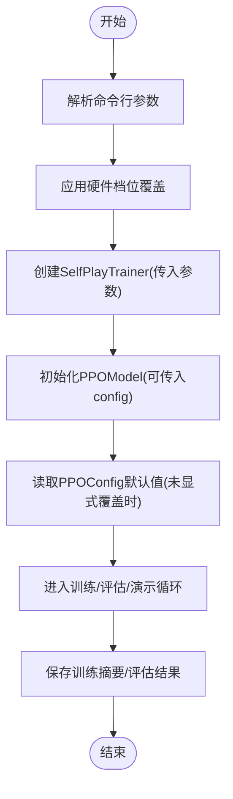
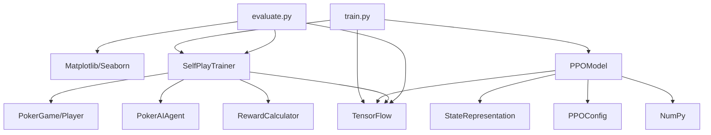

# 配置管理系统

<cite>
**本文引用的文件**
- [ppo_config.py](file://poker_ai/config/ppo_config.py)
- [train.py](file://train.py)
- [evaluate.py](file://evaluate.py)
- [self_play_trainer.py](file://poker_ai/reward/self_play_trainer.py)
- [ppo_model.py](file://poker_ai/model/ppo_model.py)
- [README.md](file://README.md)
- [PPO快速指南.md](file://PPO快速指南.md)
- [RTX4090D配置指南.md](file://RTX4090D配置指南.md)
- [requirements.txt](file://requirements.txt)
- [test_ppo.py](file://test_ppo.py)
</cite>

## 目录
1. [简介](#简介)
2. [项目结构](#项目结构)
3. [核心组件](#核心组件)
4. [架构总览](#架构总览)
5. [详细组件分析](#详细组件分析)
6. [依赖分析](#依赖分析)
7. [性能考量](#性能考量)
8. [故障排除指南](#故障排除指南)
9. [结论](#结论)
10. [附录](#附录)

## 简介
本技术文档围绕配置管理系统展开，重点解释PPO（近端策略优化）训练配置参数的设计与管理策略，涵盖超参数分类、取值范围、相互影响关系；配置文件结构与格式、参数继承与默认值、配置验证机制；命令行参数与配置文件的集成方式（优先级与覆盖策略）；配置示例与最佳实践；扩展性与版本控制兼容性；以及配置调试与故障排除方法。文档面向不同技术背景读者，既提供高层概览，也给出代码级映射与可视化图示。

## 项目结构
本项目采用“功能域+层次”相结合的组织方式：
- poker_ai/config：集中存放PPO配置数据类与默认实例
- poker_ai/model：模型实现（含PPO模型与状态表示）
- poker_ai/reward：训练器与奖励计算
- poker_ai/game：游戏规则与状态
- poker_ai/advisor：AI建议器
- poker_ai/utils：工具模块（检查点等）
- train.py/evaluate.py：训练与评估入口脚本
- 文档：PPO快速指南、RTX4090D配置指南、README等

**图表来源**
- [ppo_config.py:18-97](file://poker_ai/config/ppo_config.py#L18-L97)
- [train.py:136-238](file://train.py#L136-L238)
- [evaluate.py:110-142](file://evaluate.py#L110-L142)
- [self_play_trainer.py:48-131](file://poker_ai/reward/self_play_trainer.py#L48-L131)
- [ppo_model.py:20-105](file://poker_ai/model/ppo_model.py#L20-L105)

**章节来源**
- [README.md:46-75](file://README.md#L46-L75)
- [requirements.txt:1-7](file://requirements.txt#L1-L7)

## 核心组件
- PPOConfig：集中定义PPO超参数的数据类，提供默认值与字典导出能力，支持RTX 4090D优化特性。
- train.py：命令行参数解析、硬件档位应用、环境初始化、训练器创建与调度、自动调参、日志与结果保存。
- evaluate.py：评估入口，支持详细评估与可视化。
- SelfPlayTrainer：训练器，负责并行采样、轨迹收集、对手代理、奖励计算、检查点管理。
- PPOModel：PPO模型实现，包含Actor/Critic网络、GAE优势计算、KL早停、自适应熵、学习率调度、权重保存/加载等。

**章节来源**
- [ppo_config.py:18-97](file://poker_ai/config/ppo_config.py#L18-L97)
- [train.py:136-238](file://train.py#L136-L238)
- [evaluate.py:110-142](file://evaluate.py#L110-L142)
- [self_play_trainer.py:48-131](file://poker_ai/reward/self_play_trainer.py#L48-L131)
- [ppo_model.py:20-105](file://poker_ai/model/ppo_model.py#L20-L105)

## 架构总览
配置系统贯穿“命令行参数→训练器→模型”的链路，形成“参数注入→训练执行→结果产出”的闭环。训练器在构造时接收来自命令行的参数，并将其传递给PPO模型与代理；PPO模型在初始化时可从PPOConfig读取默认值，从而实现“命令行覆盖默认配置”的策略。

**图表来源**
- [train.py:340-531](file://train.py#L340-L531)
- [self_play_trainer.py:51-131](file://poker_ai/reward/self_play_trainer.py#L51-L131)
- [ppo_model.py:33-105](file://poker_ai/model/ppo_model.py#L33-L105)
- [ppo_config.py:95-97](file://poker_ai/config/ppo_config.py#L95-L97)

## 详细组件分析

### PPO配置参数设计与管理策略
- 设计原则
  - 数据类封装：使用dataclass集中管理超参数，便于读取、导出与扩展。
  - 默认值与RTX 4090D优化：默认配置针对大batch、较少更新轮次、KL早停、学习率warmup/cosine衰减、自适应熵、价值损失裁剪、梯度累积等进行优化。
  - 字典导出：提供to_dict便于日志与报告记录。
- 参数分类与典型取值范围
  - 网络结构：input_dim、output_dim（与状态维度与动作空间一致）
  - 学习率：lr、lr_min、lr_decay_rate；支持warmup_steps与cosine衰减(total_training_steps)
  - PPO核心：clip_epsilon、gamma、lambda_
  - 熵正则：entropy_coef、entropy_adaptive、entropy_coef_target
  - 价值损失：value_clip
  - KL早停：kl_target、kl_early_stop
  - 训练策略：update_epochs、batch_size、gradient_accumulation_steps、max_grad_norm
- 相互影响关系
  - batch_size与update_epochs：增大batch可减少更新轮次，避免策略退化。
  - entropy_coef与entropy_adaptive：自适应调节可维持探索与利用平衡。
  - value_clip与clip_epsilon：共同限制更新幅度，提升稳定性。
  - lr调度：warmup+cose衰减与total_training_steps共同决定长期学习率轨迹。
- 配置验证与默认值
  - 未显式传入时，PPOModel从PPOConfig读取默认值；训练器在创建时可覆盖部分参数。
  - 硬件档位应用：train.py根据--hardware-profile自动调整并行与batch等参数。

**章节来源**
- [ppo_config.py:18-97](file://poker_ai/config/ppo_config.py#L18-L97)
- [ppo_model.py:33-105](file://poker_ai/model/ppo_model.py#L33-L105)
- [train.py:55-97](file://train.py#L55-L97)

### 命令行参数与配置文件的集成
- 命令行参数解析
  - train.py提供丰富的参数：模式选择、模型类型、学习率、PPO专用参数、训练过程控制、游戏配置、高级选项、评估与演示参数、自我对弈参数等。
  - evaluate.py提供评估相关参数（模型路径、对手类型、输出目录、生成图表等）。
- 硬件档位与默认覆盖
  - --hardware-profile支持rtx4090d/rtx3090_112cpu/auto，自动调整并行worker、batch size、设备与混合精度等。
- 参数优先级与覆盖策略
  - 硬件档位应用在解析之后、环境设置之前，对未显式设置的参数进行默认覆盖。
  - 训练器创建时，train.py将命令行参数以关键字形式传入，覆盖默认配置与硬件档位默认值。
  - PPOModel在初始化时优先使用传入的显式参数，否则回退到PPOConfig默认值。
- 配置导出与持久化
  - 训练完成后保存训练摘要（包含参数与性能指标）。
  - 评估完成后保存评估结果与报告。

**图表来源**
- [train.py:136-238](file://train.py#L136-L238)
- [train.py:55-135](file://train.py#L55-L135)
- [train.py:340-531](file://train.py#L340-L531)
- [self_play_trainer.py:51-131](file://poker_ai/reward/self_play_trainer.py#L51-L131)
- [ppo_model.py:33-105](file://poker_ai/model/ppo_model.py#L33-L105)
- [ppo_config.py:95-97](file://poker_ai/config/ppo_config.py#L95-L97)

**章节来源**
- [train.py:136-238](file://train.py#L136-L238)
- [train.py:55-135](file://train.py#L55-L135)
- [train.py:340-531](file://train.py#L340-L531)
- [evaluate.py:110-142](file://evaluate.py#L110-L142)
- [self_play_trainer.py:51-131](file://poker_ai/reward/self_play_trainer.py#L51-L131)
- [ppo_model.py:33-105](file://poker_ai/model/ppo_model.py#L33-L105)
- [ppo_config.py:95-97](file://poker_ai/config/ppo_config.py#L95-L97)

### 训练器与模型的配置交互
- SelfPlayTrainer构造参数
  - 接收学习率、batch_size、优化器、PPO专用参数（clip、epochs、entropy_coef、update_min_steps）、并行策略、评估与检查点间隔等。
  - 对PPO场景自动设置更大的train_rollouts_per_worker与train_sync_every_batches，减少调度开销。
- PPOModel初始化
  - 从PPOConfig读取默认值，支持传入显式参数覆盖。
  - 支持warmup/cosine学习率、自适应熵、KL早停、价值损失裁剪、梯度累积、混合精度优化等。
- 轨迹与更新
  - PPOModel在训练时计算GAE、优势标准化、裁剪更新、KL早停，确保稳定收敛。

```mermaid
classDiagram
class PPOConfig {
+int input_dim
+int output_dim
+float lr
+float lr_min
+float lr_decay_rate
+bool use_lr_warmup
+int warmup_steps
+bool use_cosine_decay
+int total_training_steps
+float clip_epsilon
+float gamma
+float lambda_
+float entropy_coef
+bool entropy_adaptive
+float entropy_coef_target
+float value_clip
+float kl_target
+bool kl_early_stop
+int update_epochs
+int batch_size
+int gradient_accumulation_steps
+float max_grad_norm
+to_dict()
}
class PPOModel {
+int input_dim
+int output_dim
+float clip_epsilon
+float gamma
+float lambda_
+float entropy_coef
+int update_epochs
+int batch_size
+float lr
+float lr_min
+float lr_decay_rate
+bool use_lr_warmup
+int warmup_steps
+bool use_cosine_decay
+int total_training_steps
+float entropy_coef_target
+bool entropy_adaptive
+float value_clip
+float kl_target
+bool kl_early_stop
+int gradient_accumulation_steps
+float max_grad_norm
+train(...)
+predict(...)
+save_weights(...)
+load_weights(...)
}
class SelfPlayTrainer {
+int eval_interval
+int checkpoint_interval
+int num_eval_games
+bool use_ensemble
+int opponent_update_interval
+float learning_rate
+int batch_size
+string optimizer
+int target_update_freq
+float ppo_clip_epsilon
+int ppo_update_epochs
+float ppo_entropy_coef
+int ppo_update_min_steps
+int train_workers
+int eval_workers
+int train_rollouts_per_worker
+int train_sync_every_batches
+_create_agents()
+train(...)
+evaluate(...)
}
PPOModel --> PPOConfig : "读取默认值"
SelfPlayTrainer --> PPOModel : "初始化/传参"
```

**图表来源**
- [ppo_config.py:18-97](file://poker_ai/config/ppo_config.py#L18-L97)
- [ppo_model.py:33-105](file://poker_ai/model/ppo_model.py#L33-L105)
- [self_play_trainer.py:51-131](file://poker_ai/reward/self_play_trainer.py#L51-L131)

**章节来源**
- [self_play_trainer.py:51-131](file://poker_ai/reward/self_play_trainer.py#L51-L131)
- [ppo_model.py:33-105](file://poker_ai/model/ppo_model.py#L33-L105)
- [ppo_config.py:18-97](file://poker_ai/config/ppo_config.py#L18-L97)

### 配置示例与最佳实践
- 快速开始（500手验证）
  - 使用train.py的默认配置进行快速验证，随后评估与继续训练。
- PPO优化快速指南
  - 提供默认配置、自定义配置、小规模验证、从检查点继续训练、评估等示例。
- RTX 4090D配置指南
  - 提供标准、高性能、快速验证三种配置方案，涵盖batch size、并行worker、XLA、混合精度、显存管理等。
- 最佳实践要点
  - 首次运行先用快速验证配置；小规模训练验证流程；中等规模调参；大规模生产训练。
  - 显存不足时降低batch size或减少更新轮次；GPU利用率低时增加batch size与并行度；训练不稳定时降低学习率、增大clip或熵系数。

**章节来源**
- [README.md:25-42](file://README.md#L25-L42)
- [PPO快速指南.md:18-70](file://PPO快速指南.md#L18-L70)
- [RTX4090D配置指南.md:18-97](file://RTX4090D配置指南.md#L18-L97)
- [RTX4090D配置指南.md:175-221](file://RTX4090D配置指南.md#L175-L221)

### 扩展性与版本控制
- 扩展新配置项
  - 在PPOConfig中新增字段，提供合理默认值；在PPOModel中读取新字段；在train.py中添加命令行参数；在SelfPlayTrainer中接收并传递。
  - 保持向后兼容：新增字段应具备默认值，避免破坏既有训练流程。
- 版本控制与兼容性
  - 通过日志与训练摘要记录参数与性能指标，便于追踪配置变更对结果的影响。
  - 硬件档位与自动并行策略在train.py中集中管理，减少跨版本差异。
  - 检查点文件命名遵循约定（Actor/Critic权重与状态文件），确保模型版本一致性。

**章节来源**
- [ppo_config.py:18-97](file://poker_ai/config/ppo_config.py#L18-L97)
- [ppo_model.py:640-670](file://poker_ai/model/ppo_model.py#L640-L670)
- [train.py:136-238](file://train.py#L136-L238)
- [self_play_trainer.py:51-131](file://poker_ai/reward/self_play_trainer.py#L51-L131)

## 依赖分析
- 外部依赖
  - TensorFlow：模型训练与推理、混合精度、XLA编译等。
  - NumPy：数值计算与向量化GAE。
  - Matplotlib/Seaborn：评估脚本的可视化。
- 内部依赖
  - train.py依赖SelfPlayTrainer、PPOModel、日志与检查点工具。
  - SelfPlayTrainer依赖PokerGame、PokerAIAgent、奖励计算器与检查点工具。
  - PPOModel依赖StateRepresentation与PPOConfig。

**图表来源**
- [requirements.txt:1-7](file://requirements.txt#L1-L7)
- [train.py:1-50](file://train.py#L1-L50)
- [evaluate.py:1-50](file://evaluate.py#L1-L50)
- [self_play_trainer.py:1-30](file://poker_ai/reward/self_play_trainer.py#L1-L30)
- [ppo_model.py:1-15](file://poker_ai/model/ppo_model.py#L1-L15)
- [ppo_config.py:14-16](file://poker_ai/config/ppo_config.py#L14-L16)

**章节来源**
- [requirements.txt:1-7](file://requirements.txt#L1-L7)
- [train.py:1-50](file://train.py#L1-L50)
- [evaluate.py:1-50](file://evaluate.py#L1-L50)
- [self_play_trainer.py:1-30](file://poker_ai/reward/self_play_trainer.py#L1-L30)
- [ppo_model.py:1-15](file://poker_ai/model/ppo_model.py#L1-L15)
- [ppo_config.py:14-16](file://poker_ai/config/ppo_config.py#L14-L16)

## 性能考量
- 学习率调度：warmup线性增长与cosine衰减结合，提升早期稳定性与长期收敛。
- 批量与并行：增大batch size与并行worker可提升吞吐，但需考虑显存与CPU资源。
- 混合精度与XLA：显著提升训练速度与显存效率，建议默认启用。
- KL早停与价值损失裁剪：防止策略退化与价值函数震荡，提升稳定性。
- 自适应熵：维持探索与利用平衡，避免策略塌缩。

[本节为通用性能讨论，无需特定文件引用]

## 故障排除指南
- 训练日志定位
  - 查看logs目录中的日志文件，关注ERROR/异常、学习率变化、损失曲线、训练效率（平均每手耗时）。
- 常见问题与处理
  - 损失爆炸：降低学习率至1e-4，增大value_clip至0.3。
  - 策略塌缩：增加entropy_coef至0.05。
  - 训练停滞：检查学习率是否过小，适当增大。
  - 显存不足：降低batch size或减少更新轮次；使用--gpu-memory-growth。
  - GPU利用率低：增加batch size、并行worker与每个worker的并行局数；增大ppo-update-min-steps。
- 自动调参
  - train.py支持--auto-tune，自动测试候选配置，按手牌/秒选择最优组合，适合大规模训练场景。

**章节来源**
- [PPO快速指南.md:146-159](file://PPO快速指南.md#L146-L159)
- [RTX4090D配置指南.md:175-221](file://RTX4090D配置指南.md#L175-L221)
- [train.py:408-482](file://train.py#L408-L482)

## 结论
本配置管理系统通过“数据类默认配置 + 命令行参数覆盖 + 硬件档位自动优化”的策略，实现了PPO训练参数的集中管理与灵活扩展。配合训练器与模型的参数传递机制，形成了从命令行到训练执行的完整闭环。文档提供了丰富的配置示例、最佳实践与故障排除方法，便于在不同硬件与训练场景下快速落地与迭代。

[本节为总结性内容，无需特定文件引用]

## 附录
- 快速验证脚本
  - test_ppo.py用于验证PPO代理初始化与动作选择流程，便于快速确认配置与模型可用性。

**章节来源**
- [test_ppo.py:1-41](file://test_ppo.py#L1-L41)