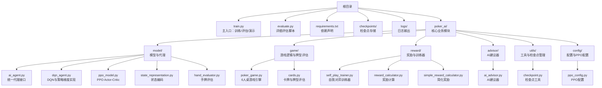
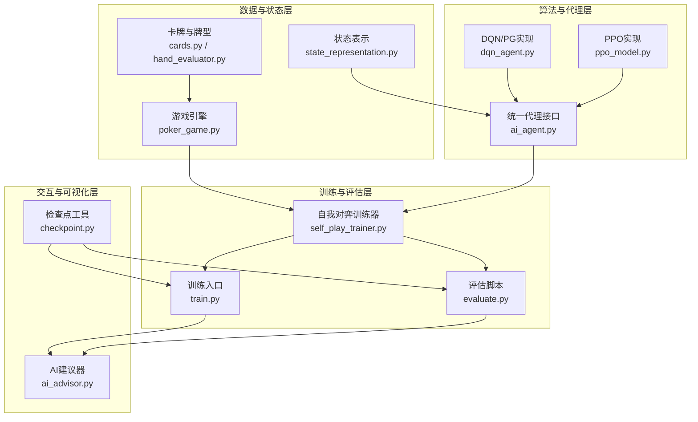
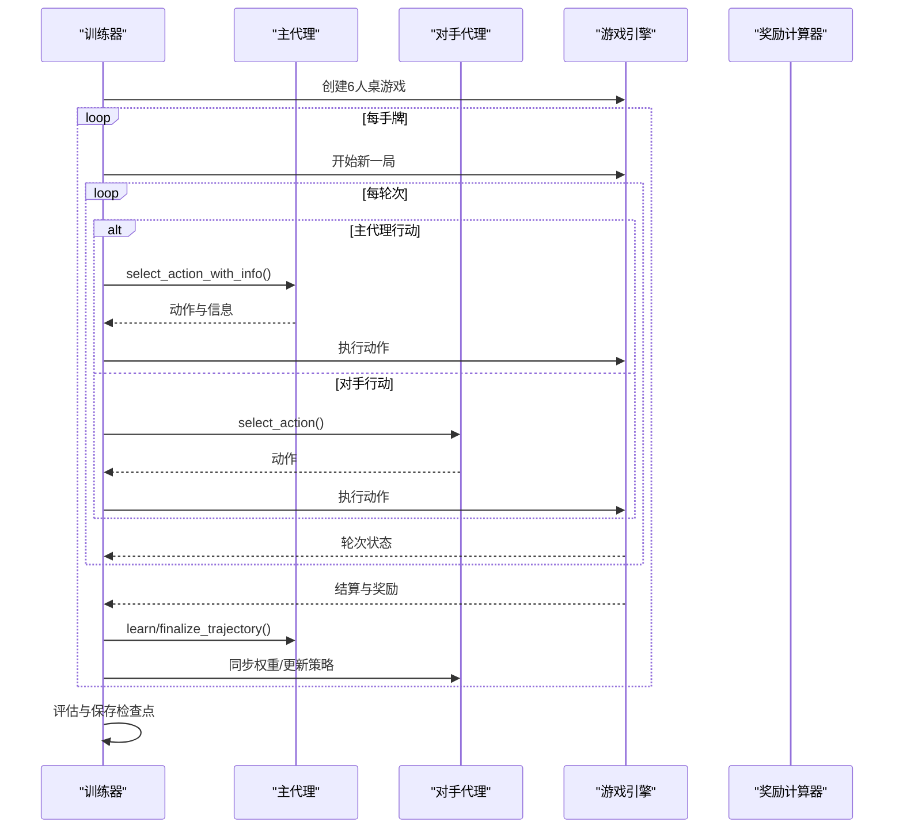
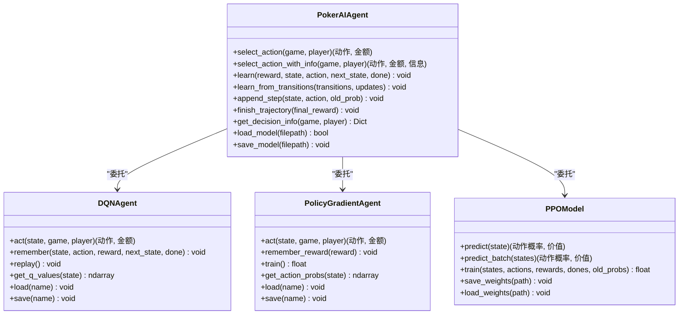
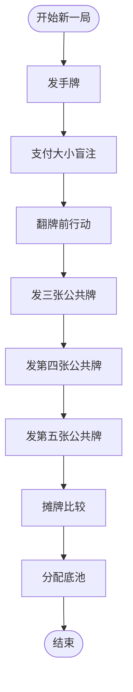
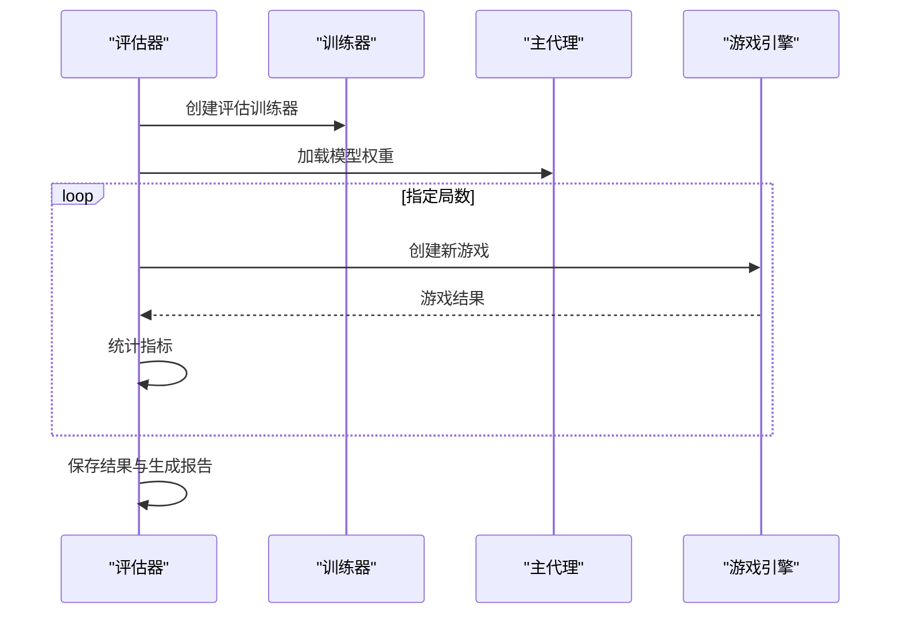
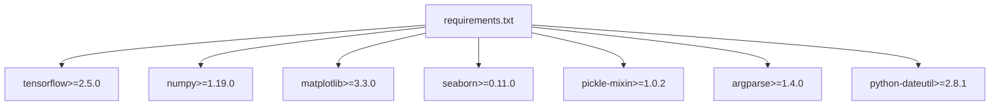

# 项目概述

<cite>
**本文档引用的文件**
- [README.md](file://README.md)
- [requirements.txt](file://requirements.txt)
- [train.py](file://train.py)
- [evaluate.py](file://evaluate.py)
- [poker_ai/model/ai_agent.py](file://poker_ai/model/ai_agent.py)
- [poker_ai/reward/self_play_trainer.py](file://poker_ai/reward/self_play_trainer.py)
- [poker_ai/game/poker_game.py](file://poker_ai/game/poker_game.py)
- [poker_ai/model/state_representation.py](file://poker_ai/model/state_representation.py)
- [poker_ai/advisor/ai_advisor.py](file://poker_ai/advisor/ai_advisor.py)
- [poker_ai/model/dqn_agent.py](file://poker_ai/model/dqn_agent.py)
- [poker_ai/model/ppo_model.py](file://poker_ai/model/ppo_model.py)
- [poker_ai/game/cards.py](file://poker_ai/game/cards.py)
- [poker_ai/model/hand_evaluator.py](file://poker_ai/model/hand_evaluator.py)
- [poker_ai/utils/checkpoint.py](file://poker_ai/utils/checkpoint.py)
</cite>

## 目录
1. [项目简介](#项目简介)
2. [项目结构](#项目结构)
3. [核心组件](#核心组件)
4. [架构概览](#架构概览)
5. [详细组件分析](#详细组件分析)
6. [依赖关系分析](#依赖关系分析)
7. [性能考量](#性能考量)
8. [故障排查指南](#故障排查指南)
9. [结论](#结论)

## 项目简介

本项目是一个基于强化学习的6人桌德州扑克AI训练系统，支持自我对弈训练与多算法并行评估。项目围绕以下核心目标展开：

- **自我对弈训练**：通过主代理与多个对手代理在6人桌环境中进行大规模自对弈，构建高质量训练数据流。
- **多算法支持**：统一接口封装DQN、策略梯度（Policy Gradient）与PPO三种算法，便于对比与迁移。
- **高性能状态表示**：设计面向6人桌的高维状态向量，融合手牌、公共牌、玩家状态、游戏全局信息及位置特征，支撑复杂决策。
- **奖励与评估体系**：提供奖励计算器与综合评估脚本，支持基础与详细评估，生成可视化图表与报告。

技术栈选择方面，项目采用TensorFlow 2.x作为深度学习框架，Python 3.8+作为运行环境，结合NumPy、Matplotlib、Seaborn等工具，形成从训练到评估的完整生态。

## 项目结构

项目采用按功能域划分的模块化组织方式，核心目录与文件如下：

**图表来源**
- [README.md:46-75](file://README.md#L46-L75)
- [train.py:1-800](file://train.py#L1-L800)
- [evaluate.py:1-753](file://evaluate.py#L1-L753)

**章节来源**
- [README.md:46-75](file://README.md#L46-L75)
- [requirements.txt:1-7](file://requirements.txt#L1-L7)

## 核心组件

- **训练入口与环境配置**：提供命令行参数解析、硬件档位优化、并行度与混合精度配置，支持自动调参与多模式运行（训练/评估/演示）。
- **自我对弈训练器**：负责6人桌自对弈的全流程，包括并行采样、轨迹收集、奖励计算、对手更新与检查点管理。
- **统一代理接口**：封装DQN、策略梯度与PPO三种算法，提供动作选择、学习与推理接口，支持批量动作与轨迹级学习。
- **状态表示与决策支持**：将6人桌状态编码为高维向量，包含手牌、公共牌、玩家状态、位置与活跃人数等特征，支持手牌强度估算与动作解码。
- **游戏引擎与牌型评估**：实现6人桌德州扑克完整规则，支持发牌、下注、轮次推进与摊牌结算；提供高效的牌型评估与胜率模拟。
- **评估与可视化**：提供基础与详细评估脚本，生成统计报告与图表，支持多维度策略分析。
- **AI建议器**：基于训练模型提供实时建议，包含手牌强度、期望价值、置信度与风险评估等。

**章节来源**
- [train.py:136-531](file://train.py#L136-L531)
- [poker_ai/reward/self_play_trainer.py:48-800](file://poker_ai/reward/self_play_trainer.py#L48-L800)
- [poker_ai/model/ai_agent.py:55-703](file://poker_ai/model/ai_agent.py#L55-L703)
- [poker_ai/model/state_representation.py:9-247](file://poker_ai/model/state_representation.py#L9-L247)
- [poker_ai/game/poker_game.py:155-497](file://poker_ai/game/poker_game.py#L155-L497)
- [evaluate.py:110-753](file://evaluate.py#L110-L753)
- [poker_ai/advisor/ai_advisor.py:21-629](file://poker_ai/advisor/ai_advisor.py#L21-L629)

## 架构概览

系统采用分层架构，自下而上分别为数据与状态层、算法与代理层、训练与评估层、交互与可视化层。

**图表来源**
- [poker_ai/model/state_representation.py:9-247](file://poker_ai/model/state_representation.py#L9-L247)
- [poker_ai/game/cards.py:1-202](file://poker_ai/game/cards.py#L1-L202)
- [poker_ai/model/hand_evaluator.py:8-187](file://poker_ai/model/hand_evaluator.py#L8-L187)
- [poker_ai/game/poker_game.py:155-497](file://poker_ai/game/poker_game.py#L155-L497)
- [poker_ai/model/ai_agent.py:55-703](file://poker_ai/model/ai_agent.py#L55-L703)
- [poker_ai/model/dqn_agent.py:21-326](file://poker_ai/model/dqn_agent.py#L21-L326)
- [poker_ai/model/ppo_model.py:20-670](file://poker_ai/model/ppo_model.py#L20-L670)
- [poker_ai/reward/self_play_trainer.py:48-800](file://poker_ai/reward/self_play_trainer.py#L48-L800)
- [train.py:136-531](file://train.py#L136-L531)
- [evaluate.py:110-753](file://evaluate.py#L110-L753)
- [poker_ai/advisor/ai_advisor.py:21-629](file://poker_ai/advisor/ai_advisor.py#L21-L629)
- [poker_ai/utils/checkpoint.py:17-139](file://poker_ai/utils/checkpoint.py#L17-L139)

## 详细组件分析

### 自我对弈训练器（SelfPlayTrainer）

SelfPlayTrainer是训练系统的核心，负责6人桌自对弈的全流程管理。其关键特性包括：

- **6人桌专用约束**：严格要求num_players=6，确保状态表示与游戏逻辑的一致性。
- **并行采样与同步**：支持训练与评估并行worker配置，通过批量轨迹收集减少Python调度开销。
- **奖励与轨迹学习**：提供奖励计算器，支持轨迹级学习（PPO）与经验回放（DQN）。
- **对手更新与集成**：定期更新对手策略，支持集成模型以提升稳定性。
- **检查点管理**：统一保存主代理与对手权重，支持从最近检查点恢复训练。

**图表来源**
- [poker_ai/reward/self_play_trainer.py:260-417](file://poker_ai/reward/self_play_trainer.py#L260-L417)
- [poker_ai/reward/self_play_trainer.py:419-800](file://poker_ai/reward/self_play_trainer.py#L419-L800)

**章节来源**
- [poker_ai/reward/self_play_trainer.py:48-800](file://poker_ai/reward/self_play_trainer.py#L48-L800)

### 统一代理接口（PokerAIAgent）

PokerAIAgent提供统一的代理接口，支持DQN、策略梯度与PPO三种算法。其核心能力包括：

- **动作选择与解码**：将神经网络输出映射为具体的德州扑克动作（弃牌、跟注、加注等），并计算金额。
- **轨迹级学习（PPO）**：支持append_step与finish_trajectory，实现轨迹级训练与批量更新。
- **批量推理与兼容性**：提供批量动作选择接口，兼容DQN/PG的单步学习。
- **决策信息提取**：输出Q值、动作概率、状态价值等，便于建议器与分析工具使用。

**图表来源**
- [poker_ai/model/ai_agent.py:55-703](file://poker_ai/model/ai_agent.py#L55-L703)
- [poker_ai/model/dqn_agent.py:21-326](file://poker_ai/model/dqn_agent.py#L21-L326)
- [poker_ai/model/ppo_model.py:20-670](file://poker_ai/model/ppo_model.py#L20-L670)

**章节来源**
- [poker_ai/model/ai_agent.py:55-703](file://poker_ai/model/ai_agent.py#L55-L703)

### 状态表示与决策支持（StateRepresentation）

状态表示模块将6人桌的复杂信息压缩为高维向量，关键维度包括：

- 玩家手牌与公共牌的one-hot编码
- 所有玩家的筹码、下注、活跃状态
- 游戏全局信息（轮次、底池、当前下注、盲注）
- 绝对位置One-Hot（相对于庄家的座位）
- 活跃玩家数量归一化

此外，提供手牌强度估算与动作解码功能，支持快速决策与奖励计算。

**章节来源**
- [poker_ai/model/state_representation.py:9-247](file://poker_ai/model/state_representation.py#L9-L247)

### 游戏引擎与牌型评估（PokerGame & HandEvaluator）

游戏引擎实现6人桌德州扑克的完整规则，包括发牌、下注、轮次推进与摊牌结算。牌型评估模块提供高效的牌型判断与胜率模拟，支持从7张牌中选择最佳5张组合。

**图表来源**
- [poker_ai/game/poker_game.py:227-457](file://poker_ai/game/poker_game.py#L227-L457)

**章节来源**
- [poker_ai/game/poker_game.py:155-497](file://poker_ai/game/poker_game.py#L155-L497)
- [poker_ai/model/hand_evaluator.py:8-187](file://poker_ai/model/hand_evaluator.py#L8-L187)

### 评估与可视化（evaluate.py）

评估脚本提供两种评估模式：

- **基础评估**：快速统计平均利润、胜率、总利润等指标。
- **详细评估**：收集动作分布、各阶段利润、按手牌强度的胜率、累计利润曲线等，生成可视化图表与报告。

**图表来源**
- [evaluate.py:181-753](file://evaluate.py#L181-L753)

**章节来源**
- [evaluate.py:110-753](file://evaluate.py#L110-L753)

### AI建议器（AIAvisor）

AIAvisor基于训练好的模型提供实时建议，包含手牌强度、期望价值、置信度与风险评估，并生成自然语言理由说明与可视化数据。

**章节来源**
- [poker_ai/advisor/ai_advisor.py:21-629](file://poker_ai/advisor/ai_advisor.py#L21-L629)

## 依赖关系分析

项目依赖关系清晰，核心依赖如下：

- **TensorFlow 2.x**：深度学习框架，提供模型构建、训练与推理能力。
- **NumPy**：数值计算基础库，支撑状态向量与奖励计算。
- **Matplotlib/Seaborn**：可视化工具，生成评估图表。
- **pickle-mixin**：序列化支持，便于模型持久化。
- **argparse/python-dateutil**：命令行解析与时间处理。

**图表来源**
- [requirements.txt:1-7](file://requirements.txt#L1-L7)

**章节来源**
- [requirements.txt:1-7](file://requirements.txt#L1-L7)

## 性能考量

- **并行与吞吐**：通过train_workers与eval_workers参数自动推断并行度，结合批量轨迹收集与向量化GAE计算，显著提升吞吐。
- **混合精度与XLA**：默认启用混合精度与XLA JIT，降低显存占用并加速训练；支持禁用以规避部分GPU初始化问题。
- **状态表示优化**：one-hot编码与预计算索引映射减少高频路径开销；位置与活跃人数特征提升决策质量。
- **PPO优化**：采用LayerNorm、残差连接、价值损失裁剪、自适应熵系数与KL早停，提升训练稳定性与收敛速度。
- **检查点与恢复**：统一检查点格式与元数据管理，支持从最近检查点恢复训练，保障长时间训练的连续性。

**章节来源**
- [train.py:55-135](file://train.py#L55-L135)
- [poker_ai/model/ppo_model.py:20-670](file://poker_ai/model/ppo_model.py#L20-L670)
- [poker_ai/model/state_representation.py:9-247](file://poker_ai/model/state_representation.py#L9-L247)
- [poker_ai/utils/checkpoint.py:17-139](file://poker_ai/utils/checkpoint.py#L17-L139)

## 故障排查指南

- **TensorFlow未安装或版本不兼容**：导入阶段会提示警告，需安装满足requirements的TensorFlow版本。
- **GPU不可用或初始化失败**：可通过--device cpu回退至CPU，或禁用oneDNN以规避初始化问题。
- **检查点加载失败**：检查文件路径与后缀是否正确，确保权重文件与元数据文件存在。
- **训练吞吐异常**：检查并行worker数量与batch size配置，必要时启用自动调参以选择最优参数组合。
- **评估结果异常**：确认评估脚本参数与模型类型匹配，PPO正式评估建议使用train.py --mode eval。

**章节来源**
- [train.py:256-335](file://train.py#L256-L335)
- [evaluate.py:31-52](file://evaluate.py#L31-L52)
- [poker_ai/utils/checkpoint.py:58-104](file://poker_ai/utils/checkpoint.py#L58-L104)

## 结论

本项目以强化学习为核心，构建了完整的6人桌德州扑克AI训练与评估体系。通过自我对弈、多算法支持与高性能状态表示，系统在训练效率与策略质量之间取得良好平衡。配套的评估与可视化工具为策略分析与迭代提供了坚实基础。建议在实际部署中结合硬件配置与任务规模，合理设置并行度与混合精度策略，以获得最佳性能表现。